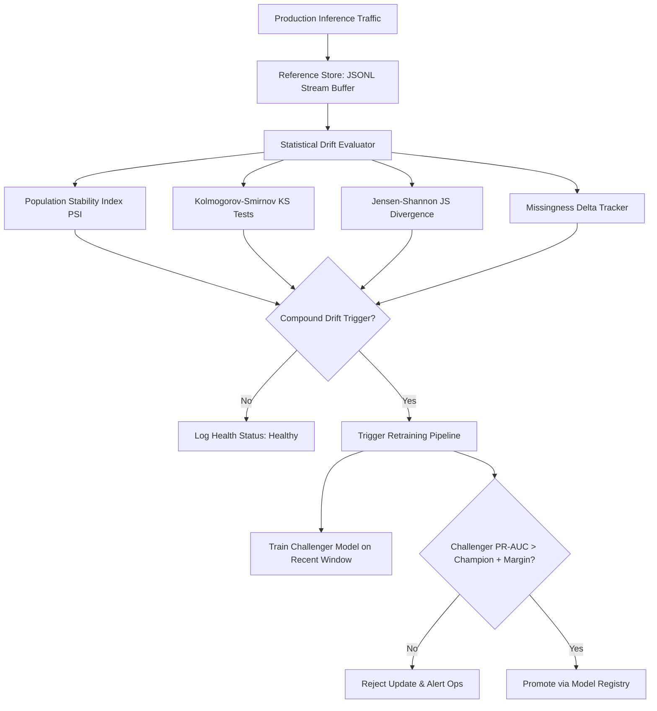

# Model Drift Detection & Controlled Continual Learning

## 1. Drift Monitoring Architecture

User habits, workday schedules, and app ecosystem dynamics evolve over time. Left unmonitored, prospective forgetting models suffer performance degradation due to covariate shift (feature distribution changes) and concept drift (changes in the relationship between behavior and task outcomes).

ContextIQ deploys a statistical surveillance engine that monitors production inference streams in rolling windows and executes controlled retraining when drift thresholds are breached.

---

## 2. Statistical Drift Detection Framework

### 2.1 Population Stability Index (PSI)
Evaluates covariate shift for continuous and binned features between reference training distribution $P$ and production serving window $Q$:
$$\text{PSI} = \sum_{k=1}^K \left( Q_k - P_k \right) \cdot \ln\left(\frac{Q_k}{P_k}\right)$$

- $\text{PSI} < 0.10$: Negligible shift (Normal operation).
- $0.10 \le \text{PSI} < 0.25$: Moderate shift (Warning threshold).
- $\text{PSI} \ge 0.25$: **Severe drift** (Triggers automated retraining alert).

### 2.2 Kolmogorov-Smirnov (KS) Non-Parametric Test
Evaluates empirical cumulative distribution function ($\text{ECDF}$) divergences:
$$D_{\text{KS}} = \sup_x |F_{\text{ref}}(x) - F_{\text{prod}}(x)|$$
Triggers drift if $p\text{-value} < 0.01$ and $D_{\text{KS}} > 0.15$.

### 2.3 Jensen-Shannon (JS) Divergence
Symmetric information-theoretic distance for discrete and categorical variables:
$$\text{JSD}(P \parallel Q) = \frac{1}{2} D_{\text{KL}}(P \parallel M) + \frac{1}{2} D_{\text{KL}}(Q \parallel M), \quad M = \frac{1}{2}(P + Q)$$
Triggers drift if $\text{JSD} > 0.15$.

### 2.4 Missingness Delta
Monitors sudden dropouts in feature telemetry:
$$\Delta M_j = |M_{j, \text{prod}} - M_{j, \text{ref}}| > 0.10$$

---

## 3. Controlled Retraining & Champion/Challenger Gate

ContextIQ strictly **prohibits uncontrolled automatic model deployment**. An automated pipeline that blindly overwrites models upon drift detection is vulnerable to feedback loops and catastrophic forgetting.

### Safe Retraining Lifecycle:
1. **Trigger Condition**: Compound trigger requiring either:
   - Severe feature drift in $\ge 3$ critical features ($\text{PSI} \ge 0.25$), OR
   - Concept drift (PR-AUC degradation $> 10\%$ on recent labeled ground truth), OR
   - Scheduled monthly freshness cadence.
2. **Challenger Training**: A new candidate model is trained on a combined dataset (historical anchor + recent sliding window).
3. **Champion/Challenger Promotion Gate**:
   - The candidate model must demonstrate:
     $$\text{PR-AUC}_{\text{challenger}} \ge \text{PR-AUC}_{\text{champion}} + \epsilon_{\text{margin}}$$
     $$\text{ECE}_{\text{challenger}} \le 0.03$$
   - Checksum and schema integrity tests must pass.
4. **Human / Admin Authorization**: Promotion requires model transition via the Model Registry REST endpoint (`/models/promote-challenger` or `/models/transition`), ensuring full operational auditability.
