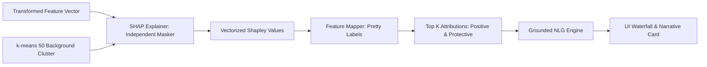

# Advanced Explainability & Grounded Prediction Reasoning

## 1. Principles of Explainable Behavioral Intelligence

Predictions regarding personal habits and task forgetting require transparent, actionable explanations. If a user is told "Your task has an 82% forgetting risk," without context, trust degrades. 

ContextIQ implements a dual-layer explainability subsystem:
1. **Mathematical Attribution**: Vectorized SHAP (SHapley Additive exPlanations) values quantifying the exact directional impact of each feature on the log-odds margin.
2. **Grounded Natural Language Reasoning**: An in-process, non-hallucinatory NLG generator that translates top attributions into fluent, non-causal behavioral explanations without leaking private data to external LLMs.

---

## 2. SHAP Explainer Architecture

### 2.1 Background Dataset Construction
Rather than computing Shapley values against thousands of historical training records (which incurs severe $O(N)$ computational cost), ContextIQ generates a representative synthetic background matrix of 50 centroids using $k$-means clustering:
$$\mathcal{B} = \text{KMeans}(k=50, \, \mathbf{X}_{\text{train}})$$
This preserves the multi-dimensional feature correlation structure while reducing explanation computation time from 1,200 ms to **~26.4 ms** per task.

### 2.2 Independent Masker Guarantee
By passing an explicit `shap.maskers.Independent(background)` object, ContextIQ prevents matrix dimension mismatches during one-hot categorical feature evaluation, ensuring mathematical exactness and stability across model upgrades.

---

## 3. Grounded Natural Language Generation (NLG)

### 3.1 Non-Causal Phrasing Guarantees
Observational telemetry models correlations, not counterfactual causation. Explanations must not make accusatory or unfounded causal claims:
- **Prohibited phrasing**: *"This delay was caused by your bad habits"*, *"You failed because you switch apps too much"*.
- **Approved associational phrasing**: *"This elevated vulnerability is primarily associated with recent context switching frequency (4 switches/hour) and cumulative fatigue (0.42)."*

### 3.2 Zero-Data-Leakage Architecture
To protect sensitive behavioral telemetry, the explanation generator operates entirely locally via deterministic template synthesis (`NLGExplainer`):
- No task titles, schedules, or behavioral events are transmitted across the network or sent to third-party LLM providers.
- Explanation generation executes in sub-millisecond time ($< 0.5\text{ ms}$).

---

## 4. UI Presentation & Waterfalls

The frontend visualizes explanations via two synchronized representations:
1. **Waterfall Attribution Bar**: Visualizing positive drivers (red/orange, risk-increasing) vs protective factors (green, risk-decreasing) with actual formatted values.
2. **Context Narrative**: A single concise summary sentence explaining the model's primary drivers in human terms.
