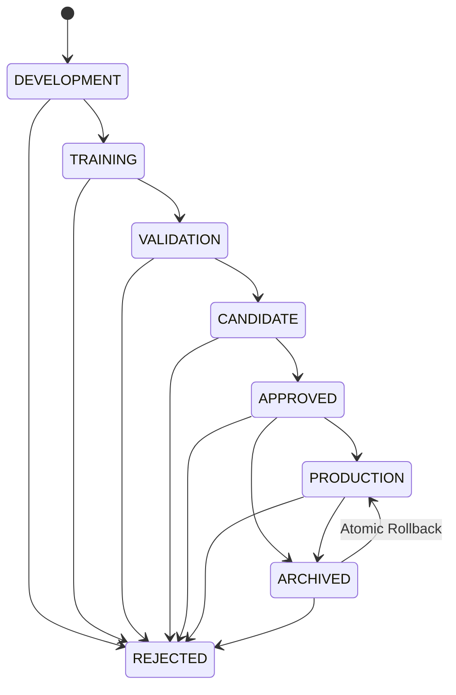

# Centralized Model Registry & Production Lifecycle Governance

## 1. Registry Architecture & Design Rationale

ContextIQ implements a centralized, versioned Model Registry designed for high reliability, zero-downtime model hot-swapping, and complete provenance tracking.

While platforms like MLflow or Weights & Biases provide external experiment tracking servers, ContextIQ implements an in-process, filesystem-backed registry with REST governance. This design delivers:
- **Zero Heavy Infrastructure**: No external Redis, Postgres, or MLflow server daemons required.
- **Atomic Operations**: File-system level atomic writes with SHA-256 checksum validation.
- **In-Memory Cache Synchronization**: Predictors automatically pick up newly promoted models without server restart.



---

## 2. Eight-Stage Lifecycle State Machine

The registry enforces an immutable finite state machine (FSM). Arbitrary state jumps (e.g. promoting directly from `DEVELOPMENT` to `PRODUCTION`) are rejected with `InvalidStateTransitionError`.

| Lifecycle State | Description | Invariant & Operational Role |
| :--- | :--- | :--- |
| **`DEVELOPMENT`** | Code prototyping & feature alignment | Artifacts may be experimental. Not valid for scoring. |
| **`TRAINING`** | Model is actively fitting on dataset | Training run metadata and hyperparameters logged. |
| **`VALIDATION`** | Model undergoing benchmark evaluation | Evaluated on validation holdout for PR-AUC and ECE. |
| **`CANDIDATE`** | Passed validation thresholds | Shadow scoring eligible. Awaiting approval. |
| **`APPROVED`** | Verified and signed off by lead engineer | Ready for immediate promotion to production. |
| **`PRODUCTION`** | Serving live user inference | **Exactly 1 champion model per task type**. |
| **`ARCHIVED`** | Replaced by a newer production champion | Kept immutable on disk for instant rollbacks. |
| **`REJECTED`** | Failed validation or security checks | Terminal state. Cannot be reactivated. |

---

## 3. Artifact Management & Cryptographic Security

### 3.1 Immutable Versioned Storage
Models are stored in version-specific directory structures:
`forgetting-ml/artifacts/models/{task_type}/{model_id}/model.joblib`

Attempting to save a model with an existing version identifier triggers `ArtifactOverwriteError`.

### 3.2 SHA-256 Checksum Verification
Every model saved calculates a SHA-256 cryptographic digest of its binary artifact:
```python
def calculate_checksum(path: Path) -> str:
    sha = hashlib.sha256()
    with open(path, "rb") as f:
        while chunk := f.read(65536):
            sha.update(chunk)
    return sha.hexdigest()
```
Before any model is loaded into serving memory, the registry recomputes the checksum. Any discrepancy raises `ChecksumMismatchError`, preventing corrupted or tampered models from executing.

---

## 4. Production Champion Invariant & Hot-Swapping

- **Single Champion Invariant**: The registry guarantees that exactly one model holds `PRODUCTION` status for `BINARY_CLASSIFICATION` and `SURVIVAL_ANALYSIS` respectively. Promoting a model automatically transitions the prior champion to `ARCHIVED`.
- **Atomic Rollback**: If operational metrics degrade in production, administrators can call `/models/rollback` to instantly demote the current model and reactivate the prior `ARCHIVED` champion within milliseconds.

---

## 5. Model Registry REST API Specification

| Endpoint | Method | Role | Description |
| :--- | :--- | :--- | :--- |
| `/models/list` | GET | Operator | Lists all registered models across lifecycle states. |
| `/models/production` | GET | System | Returns metadata of active production champion. |
| `/models/health` | GET | Monitor | Validates disk integrity and checksums of production models. |
| `/models/approve` | POST | Admin | Approves a candidate model for deployment. |
| `/models/transition` | POST | Admin | Transitions model state adhering to FSM constraints. |
| `/models/rollback` | POST | Admin | Rolls back production to previously archived model. |
