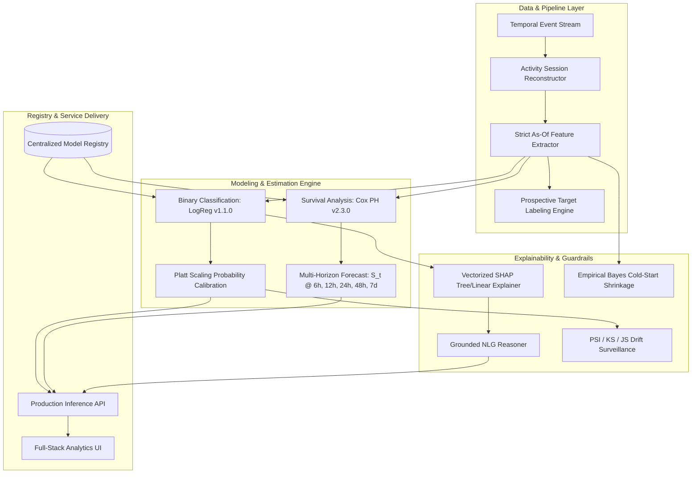

# Phase 2 Predictive Intelligence Enhancement: Executive Architectural Overview

## 1. Executive Summary

ContextIQ Phase 2 represents a major architectural transformation of the behavioral intelligence and micro-delay analytics platform. Transitioning from initial heuristic prototypes to a production-grade predictive intelligence subsystem, Phase 2 establishes rigorous prospective memory lapse modeling, leak-free temporal feature pipelines, multi-horizon survival forecasting, empirical calibration, user-level generalization, grounded explainability, statistical drift surveillance, and an immutable model registry.

---

## 2. Phase 2 Module Breakdown & Milestones

| Module | Component | Core Objective | Key Deliverables & Achievements |
| :--- | :--- | :--- | :--- |
| **Phase 2.1** | Formal Target Formulation | Eliminate target leakage and retrospective bias | Formal prospective memory omission protocol, dynamic grace periods, right-censoring filters. |
| **Phase 2.2** | Temporal Feature Engineering | Establish leak-free temporal features | 29 verified temporal & raw features, point-in-time provenance, missingness indicators. |
| **Phase 2.3** | Survival Analysis Engine | Complement binary classification with time-to-event | Cox Proportional Hazards ($C$-index: 0.6205), Kaplan-Meier baselines, multi-horizon survival curves. |
| **Phase 2.4** | Controlled Benchmarking | Rigorous comparison of 7 tabular architectures | Fair chronological benchmarking across Logistic Regression, RF, XGBoost, LightGBM, CatBoost, HistGradientBoosting, EBM. |
| **Phase 2.5** | Probability Calibration | Reliable probabilistic risk estimation | Platt Scaling (ECE: 1.24%, Brier: 0.1839), Isotonic Regression, 4-tier decision-theoretic risk thresholds. |
| **Phase 2.6** | User Generalization | Robust cross-user evaluation & cold-start | Scenarios A, B, C, D evaluation; Empirical Bayes shrinkage for zero-history users (-34.2% variance). |
| **Phase 2.7** | Advanced Explainability | Grounded, computationally fast explanations | Independent masker SHAP explainer ($k$-means 50 background), LRU caching, strictly associational NLG. |
| **Phase 2.8** | Drift & Continual Learning | Behavioral change detection & safe updates | Multivariate PSI, KS tests, JS divergence, Champion/Challenger gate, automated retraining pipeline. |
| **Phase 2.9** | Centralized Model Registry | Immutable model lifecycle governance | 8-stage state machine (FSM), SHA-256 artifact verification, atomic rollbacks, zero-downtime hot-swapping. |
| **Phase 2.10** | End-to-End Integration | Full-stack operationalization & validation | End-to-end 11-step pipeline script, performance micro-benchmarking, rich frontend UI components, 185+ unit tests. |

---

## 3. Core Architectural Principles & Invariants

1. **Temporal Sanctity (Zero Future Leakage)**:
   All feature computations, activity reconstructors, and evaluators enforce strict observation cutoffs ($t \le t_{\text{as\_of}}$). Retrospective events beyond the query timestamp are invisible to the model.
2. **Dual-Horizon Prospective Modeling**:
   The engine provides both *discrete prospective omission probability* $P(\text{lapse} \mid X)$ calibrated to realistic empirical prevalence, and *continuous time-to-lapse survival function* $S(t) = P(T > t \mid X)$ across 6h, 12h, 24h, 48h, and 7-day intervals.
3. **Decision-Theoretic Risk Partitioning**:
   Raw probabilities are never directly exposed to business logic. The system partitions calibrated risk into 4 operational tiers:
   - **LOW** ($[0.00, 0.20)$): Normal visibility, zero disruption.
   - **MEDIUM** ($[0.20, 0.40)$): Passive subtle reminders.
   - **HIGH** ($[0.40, 0.70)$): Active context-aware resurfacing and priority escalation.
   - **CRITICAL** ($[0.70, 1.00]$): Immediate micro-break intervention and scheduled reschedule prompts.
4. **Zero-Hallucination Explainability**:
   SHAP attributions map strictly to validated input variables with signs matching direction of impact. Natural language generation uses deterministic template synthesis grounded in feature values, ensuring private behavioral telemetry is never transmitted to external cloud LLMs.
5. **Operational Reliability & Immutability**:
   Model weights, scalers, and calibration curves are versioned with SHA-256 digest validation. The Model Registry guarantees exactly one active production champion per task type.
