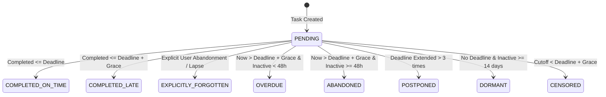

# Prospective Memory Target Formulation & Ground Truth Labeling Protocol

## 1. Mathematical Formulation of Prospective Memory Forgetting

In cognitive psychology, prospective memory refers to the cognitive mechanism enabling individuals to formulate an intention, retain it over a delay period, and successfully execute it upon the occurrence of a temporal or contextual cue. In ContextIQ, a "forgetting" event represents an execution failure where an intended task is neither completed nor acknowledged within a reasonable window around its scheduled target time.

Let task $i$ be characterized by:
- $t_{\text{create}}^{(i)}$: Task creation timestamp
- $t_{\text{dead}}^{(i)}$: Scheduled deadline timestamp (if specified)
- $t_{\text{comp}}^{(i)}$: Actual completion timestamp (if completed, else $\infty$)
- $t_{\text{obs}}$: As-of snapshot observation timestamp

---

## 2. Dynamic Grace Period Formulation

Human cognitive schedules are subject to natural operational delays. Treating a task as forgotten 1 minute after its deadline produces excessive false-positive noise. ContextIQ models prospective delay tolerance via a dynamic grace period $\Delta t_{\text{grace}}^{(i)}$:

$$\Delta t_{\text{span}}^{(i)} = \max\left(0.0, \, t_{\text{dead}}^{(i)} - t_{\text{create}}^{(i)}\right)$$

$$\Delta t_{\text{grace}}^{(i)} = \min\left( \max\left(\Delta t_{\text{min}}, \, \alpha \cdot \Delta t_{\text{span}}^{(i)}\right), \, \Delta t_{\text{max}} \right)$$

Where default production hyperparameters are configured as:
- Base minimum grace period: $\Delta t_{\text{min}} = 4.0\text{ hours}$
- Proportional ratio: $\alpha = 0.10$ ($10\%$ of task scheduled span)
- Upper bound cap: $\Delta t_{\text{max}} = 24.0\text{ hours}$

The effective deadline threshold is defined as:
$$T_{\text{thresh}}^{(i)} = t_{\text{dead}}^{(i)} + \Delta t_{\text{grace}}^{(i)}$$

---

## 3. Comprehensive Multi-State Behavioral Taxonomy

Each task lifecycle observed up to $t_{\text{obs}}$ is mapped into one of eight mutually exclusive behavioral states:

### Detailed State Specifications

| Behavioral State | Formal Condition | Binary Training Target (`will_forget`) | Training Validity |
| :--- | :--- | :--- | :--- |
| **`COMPLETED_ON_TIME`** | $t_{\text{comp}}^{(i)} \le t_{\text{dead}}^{(i)}$ | `0` (Success) | Valid |
| **`COMPLETED_LATE`** | $t_{\text{dead}}^{(i)} < t_{\text{comp}}^{(i)} \le T_{\text{thresh}}^{(i)}$ | `0` (Retained with delay) | Valid |
| **`EXPLICITLY_FORGOTTEN`** | User explicitly flags task as forgotten or unfulfilled | `1` (Lapse) | Valid |
| **`ABANDONED`** | $t_{\text{obs}} > T_{\text{thresh}}^{(i)}$ and $\Delta t_{\text{inactive}} \ge 48\text{h}$ | `1` (Lapse) | Valid |
| **`OVERDUE`** | $t_{\text{obs}} > T_{\text{thresh}}^{(i)}$ and $\Delta t_{\text{inactive}} < 48\text{h}$ | `1` (Lapse) | Valid |
| **`POSTPONED`** | Number of deadline extensions $\ge 3$ | `1` (Cognitive avoidance) | Valid |
| **`DORMANT`** | $t_{\text{dead}}^{(i)} = \text{None}$ and $\Delta t_{\text{inactive}} \ge 14\text{ days}$ | `1` (Lapse) | Valid |
| **`CENSORED`** | $t_{\text{obs}} < T_{\text{thresh}}^{(i)}$ and uncompleted | `None` (Undetermined) | **Excluded** from Binary Training |

---

## 4. Right-Censoring Mechanics & Leakage Prevention

A fundamental flaw of naive machine learning on task management systems is treating currently pending tasks as either successes or failures. 

- **Right-Censoring Rule**: If $t_{\text{obs}} < T_{\text{thresh}}^{(i)}$, the actual outcome is not yet knowable without future leakage.
- **Handling in Binary Classification**: Censored observations are strictly **excluded** from the binary training set, preventing false zero or false one labeling.
- **Handling in Survival Analysis**: Censored tasks are **included** in the survival dataset with `event_observed = 0` and `duration = t_{\text{obs}} - t_{\text{create}}^{(i)}`, allowing partial information utilization without biasing probability distributions.
