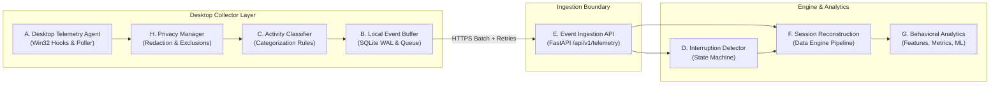
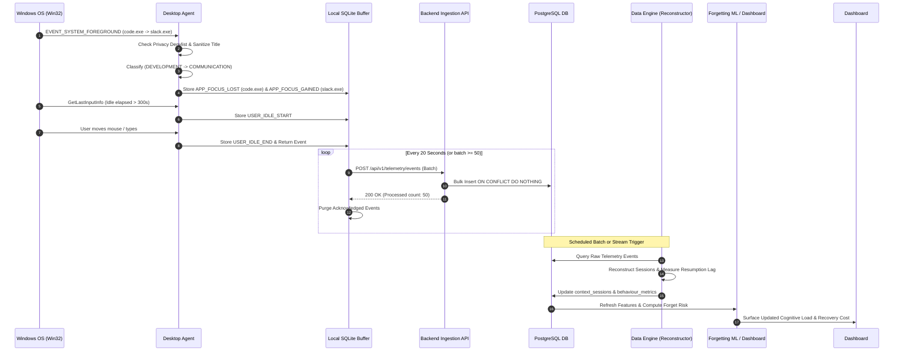

# Phase 3: Automated Behavioral Telemetry System Architecture

## 1. Executive Summary & Objective

Phase 3 introduces **Automated Behavioral Telemetry and Interruption Detection** to ContextIQ. In Phases 1 and 2, ContextIQ established core behavioral data models, multi-model predictive forgetting engines, calibration, drift detection, and interactive simulation interfaces. However, event inputs (task starts, pauses, interruptions) required explicit manual logging or simulated triggers.

Phase 3 transitions ContextIQ into an automated ambient intelligence platform on Windows desktops. It silently, efficiently, and non-invasively captures desktop application focus, window transitions, user idle states, and context switches, converting raw system telemetry into behavioral sessions, automated interruption signals, and resumption lag measurements.

```mermaid
graph TB
    subgraph Desktop Client [Windows Host Desktop Environment]
        WAPI[Win32 API: SetWinEventHook / GetLastInputInfo] --> AGENT[A. Desktop Telemetry Agent]
        AGENT --> FILTER[H. Privacy Filter & Title Redactor]
        FILTER --> CLASSIFY[C. Local Activity Classifier]
        CLASSIFY --> BUFFER[(B. Local SQLite WAL Buffer)]
        BUFFER --> SENDER[HTTP Batch Dispatcher]
    end

    subgraph Core Ingestion & Processing Layer
        SENDER -- "POST /api/v1/telemetry/events (TLS/HMAC)" --> INGEST[E. Event Ingestion API (Backend)]
        INGEST --> DB_RAW[(PostgreSQL: raw_telemetry_events)]
        INGEST --> DETECT[D. Interruption Detection Engine]
    end

    subgraph Analytical & Machine Learning Ecosystem
        DB_RAW --> SESS_RECON[F. Session Reconstruction Engine (Data Engine)]
        DETECT --> SESS_RECON
        SESS_RECON --> SESS_DB[(PostgreSQL: context_sessions)]
        SESS_DB --> FEAT_ENG[G. Behavioral Analytics Pipeline]
        FEAT_ENG --> METRICS[(behaviour_metrics)]
        FEAT_ENG --> ML[forgetting-ml: Risk Inference]
        FEAT_ENG --> CE[context-engine: Association Mining]
    end

    subgraph User Experience Layer
        METRICS --> DASHBOARD[Next.js 16 Dashboard UI]
        ML --> DASHBOARD
        CE --> DASHBOARD
        PRIVACY_UI[System Tray / Privacy Controller] -.-> AGENT
    end
```

---

## 2. Task 1: Repository Audit & Reusable Component Inventory

To prevent redundant implementations or schema fragmentation, a comprehensive audit of the existing codebase was conducted. The table below outlines how each existing component is leveraged in Phase 3.

| Component / Subsystem | Repository Location | Existing Role | Phase 3 Telemetry Reuse Strategy |
| :--- | :--- | :--- | :--- |
| **`TaskEvent` Model** | `backend/app/models/task_event.py` | Append-only event log for user task lifecycles (`CREATED`, `STARTED`, `PAUSED`, etc.) | **Reuse for explicit task links.** Serves as the ground truth for user-declared task states. Automated telemetry runs parallel in a dedicated high-throughput `raw_telemetry_events` table without polluting task lifecycle semantics. |
| **`Interruption` Model** | `backend/app/models/interruption.py` | Logged interruptions (`PHONE`, `SOCIAL_MEDIA`, `MESSAGE`, etc.) | **Dual ingestion target.** The existing `interruptions` table is retained. Automated detection will synthesize entries with an added `is_automated: bool = True` and `confidence: float` metadata attribute, harmonizing manual and automated inputs. |
| **`ContextSession` Model** | `backend/app/models/context_session.py` & `data-engine/app/models/context_session.py` | Window of activity tracking `focused_time_seconds`, `interruption_time_seconds`, `resume_delay_seconds`, `context_switch_count` | **Primary consolidation entity.** Telemetry feeds directly into the `data-engine` session builder. Reconstructed sessions unify active desktop application focus spans with task goals. |
| **`BehaviourMetric` Model** | `backend/app/models/behaviour_metric.py` | Daily rollups for user dashboard (`CONTEXT_SWITCH_COUNT`, `FOCUS_MINUTES`, etc.) | **Direct destination.** Telemetry-derived daily aggregates populate existing enum types without requiring changes to database schema or frontend consumers. |
| **Session Reconstruction** | `data-engine/app/services/session_engine.py` & `data-engine/pipeline/reconstruct.py` | Pure functional session boundary builder (`build_raw_sessions_for_task`, idle timeout 30m, gap 5m) | **Core algorithm reuse.** Reused as the session stitching backbone. Idle timeout logic is directly adapted for desktop idle detection (`USER_IDLE_START` / `USER_IDLE_END`). |
| **Context Recovery Engine** | `context-engine/ml/context/recovery_cost.py` | Computes `recovery_cost_score` from interruptions, switch count, and resume delay | **Direct integration.** Telemetry-measured resumption lag directly feeds the normalized multi-factor recovery formula (`avg_resume_delay` weight 0.25). |
| **Existing Event Schemas** | `context-engine/app/schemas/events.py` (`RawEvent`, `EventType`) | Streaming event contract (`START`, `PAUSE`, `RESUME`, `INTERRUPTION`, `TASK_SWITCH`) | **Conceptual model.** Extended into the formal Phase 3 Telemetry Contract (`docs/phase-3/telemetry-event-schema.md`). |
| **Frontend Interruption & Simulation UI** | `frontend/components/dashboard/live-simulation-panel.tsx` & `live-focus-tracker.tsx` | Chronometer measuring focus, interruption lag stopwatch, and simulation sandbox | **Visualization & Validation.** Telemetry events will feed the live chronometer via Server-Sent Events (SSE) / WebSockets, replacing manual button clicks with real desktop detection. |
| **API Endpoints** | `backend/app/api/v1/` | REST controllers for tasks, interruptions, and analytics | **Extended.** Adds `/api/v1/telemetry/events` (batch ingestion) and `/api/v1/telemetry/heartbeat` under user authentication. |
| **Deployment & Orchestration** | `docker-compose.yml`, `start_windows.ps1` | 6-service orchestration + PostgreSQL + SQLite | **Add Desktop Agent target.** Desktop agent runs natively on the Windows host and talks to `http://localhost:8000/api/v1` or configured remote gateway. |

---

## 3. Logical System Components

The Phase 3 telemetry system consists of eight decoupled logical components designed for fault tolerance, privacy, and computational efficiency.



### Component A: Desktop Telemetry Agent
- **Location**: Local Windows Background Process (Python + `pywin32` / `ctypes`).
- **Function**: Monitors the active foreground window and user idle state.
- **Mechanisms**:
  - `SetWinEventHook` listening for `EVENT_SYSTEM_FOREGROUND` (sub-millisecond notification of active window switches).
  - Background polling thread (1000ms tick) calling `GetLastInputInfo` to measure user inactivity without keyboard/mouse hooking.
  - Windows Session notifications (`WTSRegisterSessionNotification`) to detect workstation lock/unlock events.
- **Resource Budget**: CPU $< 1.0\%$, RAM $< 35\text{ MB}$, disk write I/O throttled.

### Component B: Local Event Buffer
- **Location**: Local Client Storage (`%LOCALAPPDATA%\ContextIQ\telemetry_buffer.db`).
- **Function**: Guarantees zero data loss during network outages, offline travel, or backend maintenance.
- **Storage Engine**: Embedded SQLite database operating in `PRAGMA journal_mode=WAL` with `synchronous=NORMAL`.
- **Policies**: In-memory ring buffer (fast path) + SQLite write-ahead log; max local buffer cap of 50 MB (approx. 250,000 events); FIFO eviction if exceeded.

### Component C: Activity Classification Engine
- **Location**: Client-side Pre-filter (with optional server-side fallback).
- **Function**: Normalizes raw process names (e.g., `code.exe`, `slack.exe`, `msedge.exe`) and window classes into semantic categories:
  - `DEVELOPMENT`: VS Code, Visual Studio, Windows Terminal, PyCharm.
  - `COMMUNICATION`: Slack, Microsoft Teams, Discord, Zoom.
  - `DOCUMENTATION`: Obsidian, Notion, Acrobat, Word.
  - `BROWSING`: Edge, Chrome, Firefox (sanitized domain-level only).
  - `UTILITY`: File Explorer, Task Manager, Settings.
  - `DISTRACTION`: Steam, Spotify, Netflix.

### Component D: Interruption Detection Engine
- **Location**: Dual Execution (Agent heuristic pre-tagging + Backend authoritative classification).
- **Function**: Distinguishes intentional multitasking from disruptive interruptions.
- **Rules**:
  - Evaluates transitions from primary focus applications (e.g., IDE) to external channels (e.g., Chat).
  - Classifies duration into Micro-switches ($< 30\text{s}$), Brief Interruptions ($30\text{s} - 5\text{m}$), and Macro Breaks ($> 5\text{m}$).
  - Identifies unsolicited foreground window steals (e.g., meeting popups, alarm banners).

### Component E: Event Ingestion API
- **Location**: `backend/app/api/v1/telemetry.py` (FastAPI).
- **Function**: High-throughput authenticated endpoint for batch ingestion.
- **Features**:
  - Accepts compressed JSON payloads (`Content-Encoding: gzip`).
  - Idempotent upsert based on `event_id` (UUIDv7).
  - Rate limiting (token bucket: 120 req/min per user).
  - Authenticated via standard User Bearer JWT / API Key.

### Component F: Session Reconstruction Engine
- **Location**: `data-engine/app/services/session_engine.py` (Extended).
- **Function**: Transforms the high-frequency stream of focus transitions into consolidated work sessions.
- **Enhancement**: Blends automated desktop focus spans with declared `TaskEvent` lifecycles, accurately calculating:
  - Total Session Duration ($T_{\text{session}}$).
  - Net Focused Time ($T_{\text{focus}}$).
  - Cumulative Interruption Time ($T_{\text{interrupt}}$).
  - Empirical Resumption Lag ($T_{\text{resume}}$).

### Component G: Behavioral Analytics Pipeline
- **Location**: `data-engine/pipeline/` & `forgetting-ml`.
- **Function**: Aggregates reconstructed telemetry into predictive features:
  - Daily metrics written to `behaviour_metrics` table.
  - As-of features for `will_forget` risk modeling (`recent_context_switches`, `interruptions_today`, `avg_interruption_duration`).
  - Inputs to `context-engine` for association rule mining.

### Component H: Monitoring and Privacy Manager
- **Location**: Client Tray Utility & Local Engine Hook.
- **Function**: Strict enforcement of user sovereignty and data privacy.
- **Capabilities**:
  - Global "Pause Telemetry" / "Incognito Mode" toggle.
  - Automatic denylist enforcement (password managers, banking apps, health portals).
  - Real-time window title redactor (strips file paths, URL query strings, sensitive document names).
  - Local database purge tool.

---

## 4. End-to-End Sequence & Communication Flow



---

## 5. Architectural Quality Attributes & Non-Functional Requirements

### 5.1 Performance & Resource Overhead
- **CPU Footprint**: $< 0.8\%$ average CPU utilization on modern x86_64 multi-core processors. Hook execution path is non-blocking.
- **Memory Usage**: Resident Set Size (RSS) capped at $< 35\text{ MB}$.
- **I/O Efficiency**: Local writes use SQLite WAL mode, aggregating write operations every 5 seconds to reduce SSD wear.

### 5.2 Network Efficiency
- **Payload Compression**: Event batches are Gzip-compressed over wire, reducing typical 50-event batch from $\sim 35\text{ KB}$ to $< 4\text{ KB}$.
- **Network Bandwidth**: Daily data transmission $< 2.5\text{ MB}$ per active user workday.

### 5.3 Reliability & Fault Tolerance
- **Offline Autonomy**: Desktop agent operates offline for up to 30 days without data loss or memory leaks.
- **Crash Recovery**: If the agent crashes, Windows Task Scheduler / Watchdog restarts it within 60 seconds; state resumes seamlessly from SQLite buffer.
- **Idempotency**: All ingestion requests are idempotent via deterministic UUIDv7 generation.
