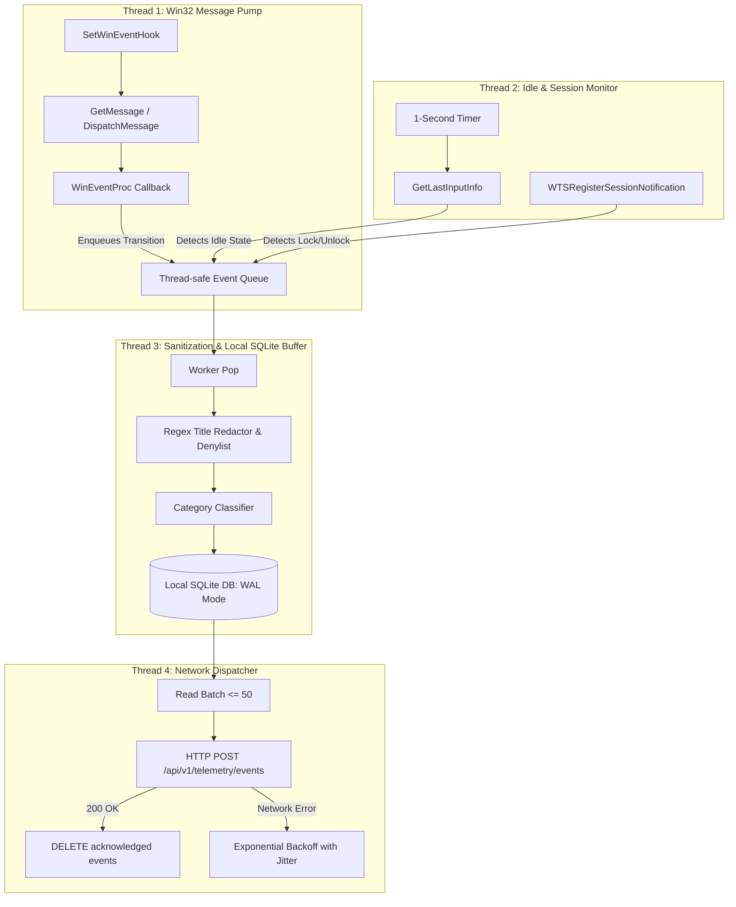

# Phase 3: Windows Desktop Telemetry Agent Design

## 1. Executive Summary & Technology Evaluation

The Desktop Telemetry Agent is a lightweight, non-invasive Windows background service that captures active application transitions, window focus duration, user idle states, and workstation lock status.

To ensure stability, minimal resource consumption, and seamless user installation without administrative privileges, the underlying Windows system APIs and architectures were evaluated.

```mermaid
graph TD
    subgraph Windows OS Kernel & Subsystems
        USER32[user32.dll: EVENT_SYSTEM_FOREGROUND]
        INPUT[user32.dll: GetLastInputInfo]
        WTS[wtsapi32.dll: WTSRegisterSessionNotification]
        PROC[kernel32.dll: QueryFullProcessImageNameW]
    end

    subgraph Agent Internal Architecture
        HOOK[Win32 Event Hook Thread]
        IDLE_THREAD[Idle Watchdog Thread (1Hz)]
        WTS_THREAD[Session State Listener]
        
        USER32 --> HOOK
        INPUT --> IDLE_THREAD
        WTS --> WTS_THREAD
        
        HOOK --> PROC_RESOLVER[Process & Class Resolver]
        PROC --> PROC_RESOLVER
        
        PROC_RESOLVER --> PRIVACY_FILTER[Privacy Redactor & Title Sanitizer]
        IDLE_THREAD --> PRIVACY_FILTER
        WTS_THREAD --> PRIVACY_FILTER
        
        PRIVACY_FILTER --> LOCAL_SQLITE[(Local SQLite Buffer: WAL)]
        LOCAL_SQLITE --> DISPATCHER[Async Batch Dispatcher]
    end

    subgraph User & Remote Layer
        DISPATCHER -- "HTTPS POST (Batched)" --> BACKEND[ContextIQ Backend :8000]
        TRAY[System Tray Controller] -.-> PRIVACY_FILTER
    end
```

---

## 2. Technology Evaluation & Selection Matrix

### 2.1 Foreground Window Capture: `SetWinEventHook` vs Polling

| Evaluation Criterion | Approach A: Event Hook (`SetWinEventHook`) | Approach B: Periodic Polling (`GetForegroundWindow`) | Selected Architecture: **Hybrid Push-Pull** |
| :--- | :--- | :--- | :--- |
| **Latency** | Sub-millisecond (instantaneous on switch) | Discrete sample delay ($500\text{ms} - 1000\text{ms}$) | **Push-first with fallback polling**: Primary capture uses `SetWinEventHook` for micro-precision. A slow 10-second polling watchdog verifies that the hook has not been silently discarded by the OS. |
| **CPU Utilization** | Near $0.0\%$ when idle; wake-on-event only | Constant periodic CPU wakeups | Hook eliminates unnecessary CPU polling cycles. |
| **Missed Transitions** | Zero missed short focus transitions ($< 500\text{ms}$) | High probability of missing brief notification glances | Hook guarantees capturing micro-disruptions. |
| **OS Threading Model** | Requires an active Windows Message Pump (`GetMessage` / `DispatchMessage`) | Simple `while True: sleep()` loop | Dedicated background thread executes standard Win32 message pump. |

### 2.2 Inactivity & Idle Detection: `GetLastInputInfo` vs Low-Level Hooks

| Evaluation Criterion | Approach A: `GetLastInputInfo` | Approach B: Global Hooks (`WH_KEYBOARD_LL`, `WH_MOUSE_LL`) | Technical & Privacy Determination |
| :--- | :--- | :--- | :--- |
| **Privacy Compliance** | **100% Privacy-Preserving**. Returns only a single timestamp (`dwTime`) of the last user interaction. Does not inspect key values, mouse coordinates, or click targets. | **Invasive & High Risk**. Captures raw keycodes and mouse events. Triggers Antivirus (AV) / EDR alerts as keylogger malware. | **`GetLastInputInfo` is MANDATED**. ContextIQ strictly prohibits low-level keyboard/mouse hooks. |
| **OS Overhead** | Single lightweight kernel query per second. | Hook function called on every single mouse move/keystroke across the entire system. | Extremely low footprint ($< 0.01\%\text{ CPU}$). |
| **Permissions** | Standard user execution. No elevation required. | Often blocked by Windows Defender / UIPI. | Clean execution in standard user context. |

### 2.3 Process Identification: Process Handle vs Process Name

To prevent permission denial errors when querying elevated or system processes (e.g., Task Manager or antivirus dialogs):
- The agent calls `GetWindowThreadProcessId(hwnd)` to obtain the `PID`.
- It opens the process using `OpenProcess(PROCESS_QUERY_LIMITED_INFORMATION, FALSE, pid)`.
- It queries the executable path via `QueryFullProcessImageNameW`.
- **Key Advantage**: `PROCESS_QUERY_LIMITED_INFORMATION` succeeds under Standard User privileges on Windows 10/11 even for processes running under different credentials or integrity levels, avoiding `ERROR_ACCESS_DENIED`.

### 2.4 Language & Runtime: Python vs Native C++ / Rust

- **Decision**: **Python 3.11+ Daemon with `ctypes` & `pywin32`**.
- **Rationale**: ContextIQ's data science and backend ecosystem is Python-native. Using `ctypes` provides direct native C invocation of `user32.dll` and `kernel32.dll` without binary compilation overhead.
- **Packaging**: For client distribution, the agent is packaged into a standalone frozen binary using PyInstaller / Nuitka, requiring zero Python installation on the user machine.

---

## 3. Windows Compatibility, Sessions & Permission Architecture

### 3.1 Windows Session 0 Isolation
- On Windows Vista and newer, Windows Services execute in **Session 0**, which is isolated from user interface rendering.
- A service running in Session 0 cannot call `GetForegroundWindow` or receive UI events from the active user desktop (Session 1+).
- **Mandate**: The Desktop Agent **must run as a per-user background application in the interactive user session (Session 1+)**, not as a generic Windows Service (`services.msc`).

### 3.2 Startup & Lifecycle Integration
Two startup mechanisms are supported:
1. **Windows Task Scheduler (`schtasks`) — Recommended**:
   - Registered under the current user's task tree: `\ContextIQ\TelemetryAgent`.
   - Trigger: `At log on of any user`.
   - Settings: "Run only when user is logged on", "Restart on failure every 1 minute up to 3 times", "Stop if running longer than: disabled".
   - Does not require Administrator elevation.
2. **Registry Run Key (`HKCU`) — Fallback**:
   - Value added to `HKEY_CURRENT_USER\Software\Microsoft\Windows\CurrentVersion\Run`.
   - Clean, lightweight, standard user writable.

### 3.3 User Interface Privilege Isolation (UIPI)
- If an elevated process (e.g. Administrator Command Prompt) is in the foreground, standard user hooks can still observe `EVENT_SYSTEM_FOREGROUND` window handles.
- However, standard user processes cannot inject input or manipulate elevated windows. Because ContextIQ is strictly read-only and passive, UIPI does not restrict the agent's telemetry monitoring.

---

## 4. Internal Threading & Subsystem Architecture

The agent is organized into four decoupled threads communicating via thread-safe queues:



### 4.1 WinEvent Hook Implementation Details
```python
# Conceptual implementation using ctypes
from ctypes import WINFUNCTYPE, windll, wintypes
import win32con

WinEventProcType = WINFUNCTYPE(
    None,
    wintypes.HANDLE,
    wintypes.DWORD,
    wintypes.HWND,
    wintypes.LONG,
    wintypes.LONG,
    wintypes.DWORD,
    wintypes.DWORD
)

def win_event_callback(hWinEventHook, event, hwnd, idObject, idChild, dwEventThread, dwmsEventTime):
    if event == win32con.EVENT_SYSTEM_FOREGROUND:
        process_name, window_title = resolve_window_metadata(hwnd)
        event_queue.put({
            "type": "APP_FOCUS_GAINED",
            "hwnd": hwnd,
            "app": process_name,
            "title": window_title,
            "timestamp": dwmsEventTime
        })
```

### 4.2 Non-Invasive Idle Tracking
```python
class LASTINPUTINFO(ctypes.Structure):
    _fields_ = [("cbSize", wintypes.UINT), ("dwTime", wintypes.DWORD)]

def get_idle_duration_seconds() -> float:
    lii = LASTINPUTINFO()
    lii.cbSize = ctypes.sizeof(LASTINPUTINFO)
    if windll.user32.GetLastInputInfo(ctypes.byref(lii)):
        millis_since_boot = windll.kernel32.GetTickCount64()
        idle_millis = millis_since_boot - lii.dwTime
        return max(0.0, idle_millis / 1000.0)
    return 0.0
```

---

## 5. Resource Consumption & Power Optimization

1. **Battery Awareness**:
   - The agent monitors system power state via `GetSystemPowerStatus`.
   - When on battery power, network flush intervals are relaxed from 20 seconds to 60 seconds to reduce radio and CPU wakeups.
2. **Zero-Busy-Wait Event Loop**:
   - All worker threads block on Python `queue.Queue.get()` or Windows `GetMessageW()`, consuming zero CPU cycles when no desktop transitions occur.
3. **Memory Footprint**:
   - Garbage collection intervals are scheduled periodically.
   - Fixed-size in-memory caches (LRU cache for process name resolution) limit memory overhead to $< 35\text{ MB}$.
