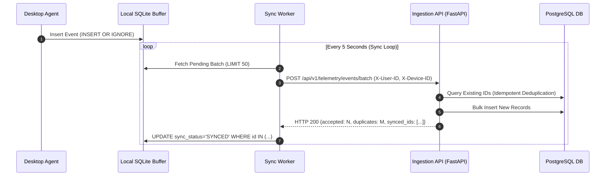

# Reliable Telemetry Event Ingestion & Synchronization (Phase 3.4)

## Architecture Overview
The event ingestion subsystem bridges the Windows desktop agent to ContextIQ core via HTTPS batch APIs. It is engineered for idempotent processing, offline buffering, graceful network recovery, and strict cryptographic user/device authentication.



## API Specifications

### 1. Ingest Events Batch
- **Route**: `POST /api/v1/telemetry/events/batch`
- **Headers**:
  - `X-User-ID`: User UUID (Required)
  - `X-Device-ID`: Windows Hardware Identifier (Optional)
- **Request Body**:
```json
{
  "events": [
    {
      "event_id": "90e1bcfe-1111-4444-8888-000000000001",
      "user_id": "aeb9dc8d-5f06-4603-acdc-387af5c98e8f",
      "device_id": "win-workstation-01",
      "event_type": "application_activated",
      "event_timestamp": "2026-11-22T08:50:00Z",
      "source": "desktop_agent_windows",
      "schema_version": "1.0.0",
      "application_identifier": "Code.exe",
      "payload": {
        "window_title": "app.py - ContextIQ"
      }
    }
  ]
}
```
- **Response**: `200 OK`
```json
{
  "received": 1,
  "accepted": 1,
  "duplicates": 0,
  "failed": 0,
  "synced_event_ids": ["90e1bcfe-1111-4444-8888-000000000001"],
  "duplicate_event_ids": [],
  "failed_event_ids": [],
  "status": "ok"
}
```

### 2. Ingest Single Event
- **Route**: `POST /api/v1/telemetry/events`
- Accepts single `TelemetryEventIn` or `TelemetryBatchIn`.

### 3. Agent Heartbeat & Status
- **Route**: `GET /api/v1/telemetry/agent/status`
- Reports active monitoring state, last event sync timestamp, local queue health, and pause state.

## Reliability Guarantees
1. **Idempotency**:
   `RawTelemetryEvent.event_id` is the primary key. If a network blip occurs after upload but before acknowledgment, the agent resends the same batch. The backend recognizes the existing event IDs, records zero new rows, and returns `duplicates: N` while acknowledging `synced_event_ids`, allowing the agent to mark them `SYNCED`.
2. **Exponential Backoff**:
   On HTTP 5xx or connection drops, the sync worker backs off ($2^r \times \text{jitter}$) up to a maximum interval of 60 seconds.
3. **Local Queue Bounds**:
   Local SQLite buffer retains pending events across machine reboots. Synced events older than 7 days are automatically purged from local disk.
