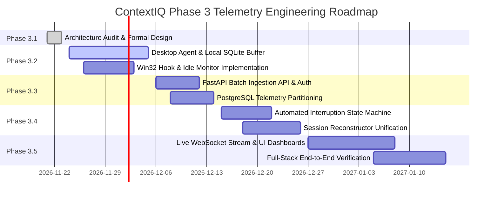
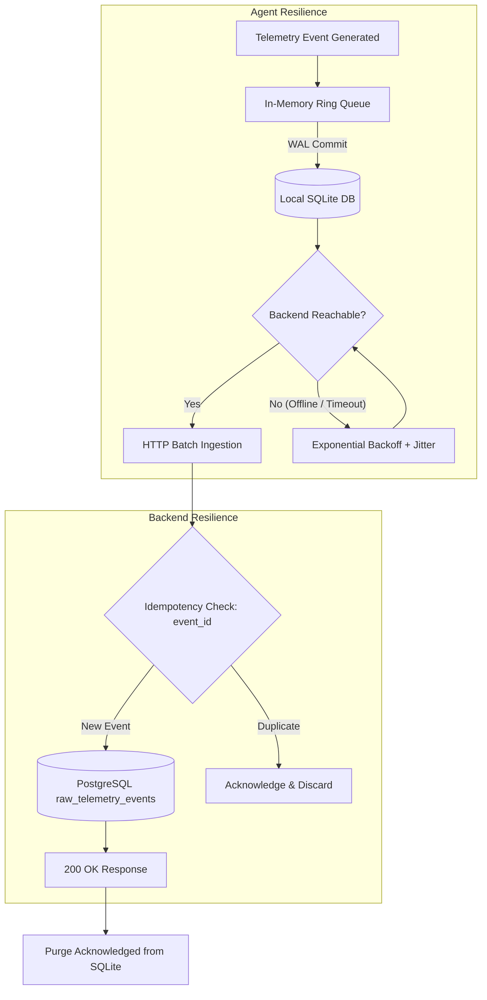

# Phase 3: Implementation Roadmap & Reliability Engineering Plan

## 1. Executive Implementation Roadmap

Phase 3 is partitioned into five distinct engineering milestones to ensure safe, iterative delivery without destabilizing existing production functionality.



---

## 2. Detailed Phase Breakdown & Milestones

### Phase 3.1: Architecture Audit & Formal Design (Current Milestone)
- **Status**: Completed.
- **Deliverables**:
  - Full inventory of reusable backend, data engine, context engine, and frontend models.
  - Standardized Telemetry Event Contract (`docs/phase-3/telemetry-event-schema.md`).
  - Windows API and runtime technology selection matrix.
  - Comprehensive anti-surveillance privacy specifications.
  - Multi-tier reliability and offline recovery blueprint.

### Phase 3.2: Desktop Collector & Local Buffer Implementation
- **Objective**: Build the standalone Windows client daemon.
- **Key Deliverables**:
  - `desktop-agent/` package structure with native `ctypes` Win32 bindings.
  - Event hook listener (`EVENT_SYSTEM_FOREGROUND`) with Windows message pump.
  - Inactivity monitor (`GetLastInputInfo`) polling at 1Hz.
  - Window title redactor and process category classifier.
  - Local SQLite buffer (`telemetry_buffer.db`) with Write-Ahead Logging (WAL).
  - Standalone Windows installer and Task Scheduler configuration scripts.

### Phase 3.3: Ingestion API & Database Telemetry Schema
- **Objective**: Establish the high-throughput server-side ingestion gateway.
- **Key Deliverables**:
  - Alembic migration creating `raw_telemetry_events` with monthly range partitioning.
  - `POST /api/v1/telemetry/events` endpoint in `backend/app/api/v1/telemetry.py`.
  - Gzip decompression and batch validation via Pydantic v2.
  - Idempotent bulk insertion (`ON CONFLICT (event_id) DO NOTHING`).
  - Agent heartbeat receiver (`POST /api/v1/telemetry/heartbeat`).

### Phase 3.4: Automated Interruption Detection & Session Reconstructor Unification
- **Objective**: Bridge raw desktop transitions into analytical sessions.
- **Key Deliverables**:
  - Interruption classification state machine detecting foreground steals and micro-switches.
  - Integration with `data-engine/app/services/session_engine.py` to seamlessly merge automated telemetry with user `TaskEvent` lifecycles.
  - Resumption lag calculation integrated into `context-engine/ml/context/recovery_cost.py`.
  - Daily rollup populator writing to `backend/app/models/behaviour_metric.py`.

### Phase 3.5: Full-Stack Integration, Live Telemetry Stream & UI Dashboards
- **Objective**: Surface live automated telemetry and cognitive recovery metrics in the frontend.
- **Key Deliverables**:
  - Real-time Server-Sent Events (SSE) / WebSocket feed from backend to frontend.
  - Automated updates for `frontend/components/dashboard/live-focus-tracker.tsx`, replacing manual chronometer buttons with real desktop state.
  - Live Cognitive Recovery Gauge and attention fragmentation analytics.
  - End-to-end multi-service test suite with simulated and live desktop traffic.

---

## 3. Reliability Engineering & Fault Tolerance Plan



### 3.1 Offline Collection & Local Durability
- **Storage Architecture**: Embedded SQLite database located in `%LOCALAPPDATA%\ContextIQ\telemetry_buffer.db`.
- **Durability Pragma**:
  ```sql
  PRAGMA journal_mode = WAL;
  PRAGMA synchronous = NORMAL;
  PRAGMA temp_store = MEMORY;
  PRAGMA busy_timeout = 5000;
  ```
- **Durability Guarantee**: Unsent events remain persisted across system reboots, unexpected shutdowns, and extended offline intervals (up to 30 days).

### 3.2 Duplicate Prevention & Idempotency
- **Event ID Generation**: Every event is minted with a client-generated UUIDv7 (timestamp-ordered UUID).
- **Server Upsert Semantics**:
  ```sql
  INSERT INTO raw_telemetry_events (event_id, user_id, ...)
  VALUES (...)
  ON CONFLICT (event_id, event_timestamp) DO NOTHING;
  ```
- Retrying an unacknowledged batch is completely idempotent.

### 3.3 Clock Synchronization & Monotonic Timestamps
- System wall-clock shifts (NTP synchronization, daylight saving adjustments, manual time changes) can corrupt duration measurements.
- **Solution**: The agent pairs wall-clock UTC timestamps with high-resolution monotonic ticks:
  ```python
  import time
  from datetime import datetime, timezone

  wall_utc = datetime.now(timezone.utc)
  monotonic_tick = time.perf_counter()
  ```
  Focus durations are calculated via monotonic deltas ($\Delta t = \text{tick}_2 - \text{tick}_1$), guaranteeing that elapsed time is never negative.

### 3.4 Process Recovery & Watchdog
- **Task Scheduler Restart**: Configured with `<RestartOnFailure><Interval>PT1M</Interval><Count>3</Count></RestartOnFailure>`.
- **Internal Watchdog**: A dedicated background thread monitors the Win32 message pump. If the pump stalls for $> 30$ seconds, the agent logs an error and gracefully re-initializes hooks.

### 3.5 Network Resilience & Backoff Policy
- When network calls fail (HTTP 5xx, timeouts, connection refused):
  1. Failed batches are retained in the local SQLite buffer.
  2. The dispatcher enters exponential backoff with full jitter:
     $$T_{\text{wait}} = \text{random}(0, \min(300, T_{\text{base}} \cdot 2^{\text{attempt}}))$$
     Where $T_{\text{base}} = 2.0\text{ seconds}$.
  3. Consecutive failures do not block local event recording.

### 3.6 Local Data Retention & Buffer Overflow Protection
- **Storage Ceiling**: The local buffer is hard-capped at 50 MB (approx. 250,000 events).
- **FIFO Eviction Policy**: If the 50 MB threshold is breached due to prolonged backend unavailability:
  ```sql
  DELETE FROM buffer_events WHERE id IN (
      SELECT id FROM buffer_events ORDER BY timestamp ASC LIMIT 5000
  );
  ```
  An `OVERFLOW_EVICTION_WARNING` event is flagged to alert the user upon reconnection.

### 3.7 Agent Health Monitoring
- The agent transmits a `HEARTBEAT` event every 60 seconds containing:
  - Agent version and uptime.
  - Unflushed buffer event count.
  - Disk storage bytes consumed.
  - Average CPU and RAM usage over the preceding minute.
- If no heartbeat is received for $> 5$ minutes during active desktop hours, the dashboard displays an "Agent Disconnected / Idle" status indicator.

---

## 4. Verification & Testing Matrix

| Test Level | Scope | Verification Strategy & Acceptance Criteria |
| :--- | :--- | :--- |
| **Unit Testing** | Win32 Title Sanitizer & Redaction | Test against 50+ sensitive path strings, emails, URL query params, and credit card patterns. Verify 100% redaction rate. |
| **Unit Testing** | Inactivity Watchdog | Mock `GetLastInputInfo` ticks. Verify exact triggering of `USER_IDLE_START` at 180s and `USER_IDLE_END` upon input. |
| **Integration Testing** | SQLite Buffer WAL Durability | Simulate sudden process termination (`SIGKILL`) during active event writes. Verify zero database corruption on reboot. |
| **Integration Testing** | Batch Ingestion API | Benchmark `POST /api/v1/telemetry/events` with 500-event payload. Verify $< 15\text{ms}$ ingestion latency and idempotency. |
| **System Testing** | End-to-End Session Reconstruction | Ingest 8 hours of simulated desktop telemetry. Verify that reconstructed sessions match expected focus/interruption breakdowns. |
| **Resource Profiling** | Performance Soak Test | Run agent continuously for 24 hours on Windows 11. Verify CPU $< 0.8\%$ and RAM $< 35\text{ MB}$. |
