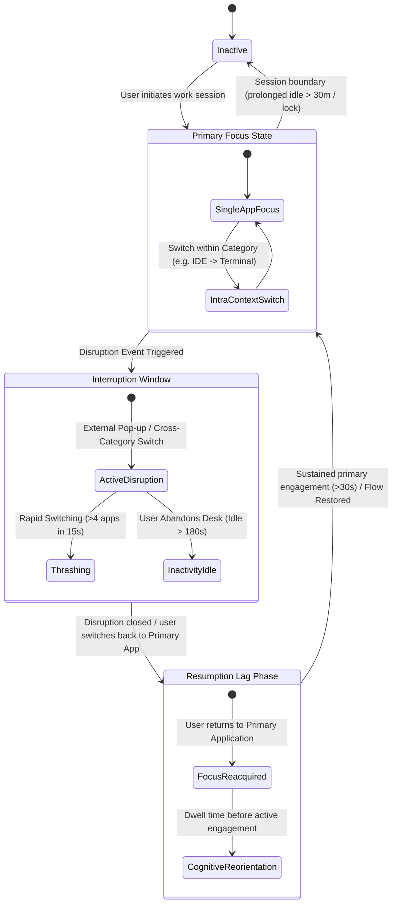
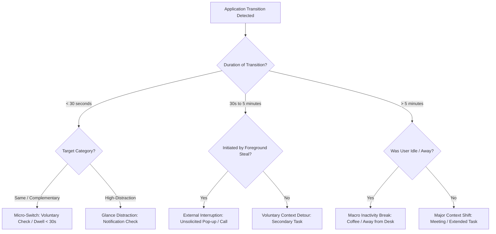
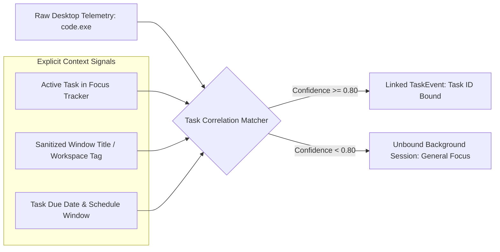

# Phase 3: Interruption Detection Engine & Resumption Lag Design

## 1. Executive Summary & Objective

In cognitive ergonomics and behavioral intelligence, interruptions are not merely binary events; they are multi-phase cognitive disruptions that fracture attention, induce prospective memory decay, and impose severe resumption overhead.

The ContextIQ Interruption Detection Engine formalizes the taxonomy of digital interruptions on desktop environments. It automatically identifies unexpected application transitions, differentiates voluntary context switches from intrusive disruptions, and quantifies **Resumption Lag**—the critical latency required for a user to re-anchor into their primary task context.



---

## 2. Detection of the 10 Core Behavioral Signals

The engine maps low-level telemetry events to 10 high-level behavioral phenomena:

| Behavioral Signal | Raw Telemetry Source | Detection Heuristic & Classification Logic |
| :--- | :--- | :--- |
| **1. Active Application Transitions** | `APP_FOCUS_GAINED` with `previous_application_identifier != current_application_identifier` | Recorded whenever the active foreground window changes process identity (e.g., `code.exe` $\to$ `slack.exe`). |
| **2. Window Focus Changes** | `APP_FOCUS_GAINED` (same process, different HWND) | Detects switching between different documents or projects within the same application (e.g., switching between two VS Code projects). |
| **3. Application Usage Duration** | `APP_FOCUS_LOST.focus_duration_seconds` | High-resolution dwell time calculation: $\Delta t = t_{\text{lost}} - t_{\text{gained}}$. Filtered for sub-second blips. |
| **4. User Inactivity Periods** | `USER_IDLE_START` | Triggered when `GetLastInputInfo` indicates zero keyboard/mouse interaction for $> \theta_{\text{idle}}$ (default 180 seconds). |
| **5. Return from Inactivity** | `USER_IDLE_END` | First user input event after an idle period. Logs total idle duration and the destination window receiving input. |
| **6. Work Session Boundaries** | Reconstructed Session Boundaries | A session begins on first activity after $> 30\text{m}$ inactivity or system unlock; closes after 30 minutes of sustained absence. |
| **7. Context Switching** | Cross-Category `APP_TRANSITION` | Transition between distinct semantic categories (e.g., `DEVELOPMENT` $\to$ `COMMUNICATION` or `BROWSING`). |
| **8. Potential Interruptions** | Evaluated Interruption State Machine | Rapid or unsolicited transition during a focused work interval (see Section 3). |
| **9. Task Resumption** | Return to Primary App after Interruption | Focus returns to the application that held primary focus prior to the disruption window. |
| **10. Unexpected Transitions** | Rapid Thrashing / Unsolicited Foreground Steals | Foreground window steals focus without preceding user input, or user thrashes through $> 4$ applications in $< 15$ seconds. |

---

## 3. Interruption Taxonomy & Classification Rules

The engine partitions interruptions into four behavioral classes:



### 3.1 External Disruptions (Foreground Steals)
- **Definition**: An application asserts foreground focus without an immediately preceding user input event (e.g., incoming Microsoft Teams call dialog, antivirus prompt, software update banner).
- **Detection Algorithm**:
  $$\Delta t_{\text{input}} = t_{\text{focus\_gain}} - t_{\text{last\_user\_input}}$$
  If $\Delta t_{\text{input}} > 1.5\text{ seconds}$ and the process was not active previously, classify as `UNSOLICITED_FOREGROUND_STEAL`.

### 3.2 Micro-Switches vs Macro-Interruptions
- **Micro-Switch ($< 30\text{ seconds}$)**:
  - Quick glance at documentation or brief Slack acknowledgment.
  - Does not sever the user's working memory buffer.
  - Counted towards `switch_count`, but exempt from heavy recovery penalties.
- **Macro-Interruption ($> 5\text{ minutes}$)**:
  - Substantial attention diversion.
  - Working memory state decays completely, triggering high prospective forgetting risk.

### 3.3 Attention Thrashing & Cognitive Fragmentation
- **Condition**: User switches active windows $\ge 5$ times in a 15-second window.
- **Cognitive Indicator**: Frustration, searching across multiple reference windows, or broken focus. Emits an `ATTENTION_THRASHING` behavioral anomaly event.

---

## 4. Formalization of Resumption Lag

### 4.1 Definition & Mathematical Formulation

**Resumption Lag** ($\tau_{\text{resume}}$) is defined as the elapsed time between the termination of an interruption and the restoration of fluid, continuous execution on the primary interrupted task.

$$\tau_{\text{resume}} = t_{\text{sustained\_re-engagement}} - t_{\text{interruption\_ended}}$$

Where:
- $t_{\text{interruption\_ended}}$: Timestamp when the disrupting application lost focus or user returned from idle.
- $t_{\text{sustained\_re-engagement}}$: Timestamp when the user executes continuous interaction ($> 30\text{s}$ uninterrupted dwell) in the primary application.

```
Primary Work (Focused)      Interruption Window              Resumption Lag          Restored Focus
[ ==== code.exe ==== ] -> [ ==== slack.exe ==== ] -> [ -- code.exe (dwell) -- ] -> [ ==== code.exe ==== ]
                      |                         |    |                         |
               Disruption Start          Disruption End   Window Regained           Full Flow Restored
                                                     <---- tau_resume ------>
```

### 4.2 Integration with Existing ContextIQ Recovery Cost Model

In `context-engine/ml/context/recovery_cost.py`, ContextIQ scores session recovery cost using a weighted combination of five behavioral metrics:

$$\text{RecoveryCostScore} = \sum_{k} w_k \cdot \text{norm}(f_k)$$

With empirical production weights:
- $w_{\text{num\_interruptions}} = 0.25$
- $w_{\text{avg\_interruption\_duration}} = 0.20$
- $w_{\text{avg\_resume\_delay}} = 0.25$
- $w_{\text{num\_context\_switches}} = 0.15$
- $w_{\text{interruption\_time\_ratio}} = 0.15$

**Telemetry Integration**: Automated telemetry provides exact, non-subjective measurements for $f_{\text{avg\_resume\_delay}}$ and $f_{\text{avg\_interruption\_duration}}$, eliminating the reliance on self-reported simulation buttons.

---

## 5. Correlating Desktop Telemetry with User Tasks

A primary engineering challenge is linking unlabelled desktop activity (e.g., `code.exe`) to explicit user tasks in the ContextIQ `tasks` table.



### 5.1 Correlation Strategy
1. **Explicit Active Task Alignment**: If the user has started a task in the ContextIQ UI or Live Focus Tracker, all telemetry collected during that interval inherits `task_id`.
2. **Project Workspace Matcher**: Sanitized window titles containing project names (e.g., `workspace-contextiq — Visual Studio Code`) are matched against task tags (`context_tag = "contextiq"`).
3. **Temporal Co-occurrence**: When a user creates or completes a task, the foreground application active within $\pm 60\text{ seconds}$ is tagged as the primary tool for that task category.
