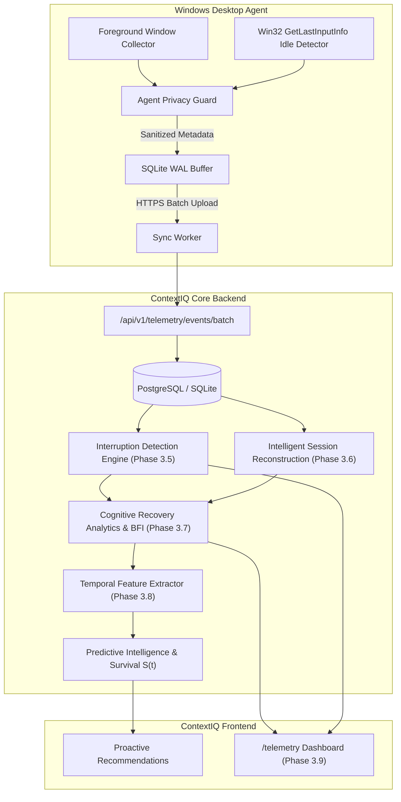

# ContextIQ Phase 3 — Automated Behavioral Telemetry System Overview

## Executive Summary
ContextIQ Phase 3 establishes a secure, privacy-preserving, and automated desktop behavioral telemetry pipeline that captures continuous interface dwell, application switching, and idle patterns on Windows workstations. This layer replaces manual logging with passive behavioral observation, feeding ContextIQ's Predictive Intelligence Layer, Forgetting-Risk ML Engine, and Survival Analysis Engine without violating user trust.

## Core Modules & Design Tenets

1. **Epistemic Humility Rule**:
   All metrics reflect observable interface focus, application dwell intervals, and resumption delays. ContextIQ never claims to read minds, measure neural exhaustion, or diagnose cognitive illness.
2. **Privacy by Default**:
   Zero keystroke collection, zero screenshot/pixel recording, zero clipboard sniffing. Excluded applications (passwords, banking) are masked at the collector before hitting disk.
3. **Resilience & Offline Autonomy**:
   Desktop agent persists events to local SQLite with Write-Ahead Logging (WAL). If the backend is unreachable, the agent continues buffering and replays upon network recovery.
4. **Idempotent Ingestion**:
   Every event carries a globally unique UUID. The backend drops duplicate event IDs idempotently without generating errors.
5. **Leakage-Safe Feature Engineering**:
   ML features are strictly computed prior to the task reference time (`event_timestamp < as_of`), preventing temporal target leakage.

## Phase 3 Documentation Index
- [Architecture & Data Flow](file:///e:/Downloads%20%F0%9F%94%83/ContextIQ-main/ContextIQ-main/docs/phase-3/architecture.md)
- [Telemetry Event Schema](file:///e:/Downloads%20%F0%9F%94%83/ContextIQ-main/ContextIQ-main/docs/phase-3/telemetry-event-schema.md)
- [Privacy & Consent Architecture](file:///e:/Downloads%20%F0%9F%94%83/ContextIQ-main/ContextIQ-main/docs/phase-3/privacy-and-consent-architecture.md)
- [Desktop Agent Design](file:///e:/Downloads%20%F0%9F%94%83/ContextIQ-main/ContextIQ-main/docs/phase-3/desktop-agent-design.md)
- [Event Ingestion & Synchronization](file:///e:/Downloads%20%F0%9F%94%83/ContextIQ-main/ContextIQ-main/docs/phase-3/event-ingestion.md)
- [Interruption Classification Engine](file:///e:/Downloads%20%F0%9F%94%83/ContextIQ-main/ContextIQ-main/docs/phase-3/interruption-classification-engine.md)
- [Session Reconstruction Engine](file:///e:/Downloads%20%F0%9F%94%83/ContextIQ-main/ContextIQ-main/docs/phase-3/session-reconstruction-engine.md)
- [Recovery & Micro-Delay Analytics](file:///e:/Downloads%20%F0%9F%94%83/ContextIQ-main/ContextIQ-main/docs/phase-3/recovery-micro-delay-analytics.md)
- [Predictive Intelligence Integration](file:///e:/Downloads%20%F0%9F%94%83/ContextIQ-main/ContextIQ-main/docs/phase-3/predictive-intelligence-telemetry-integration.md)
- [Behavioral Telemetry Dashboard](file:///e:/Downloads%20%F0%9F%94%83/ContextIQ-main/ContextIQ-main/docs/phase-3/behavioral-telemetry-dashboard.md)
- [Testing & Quality Report](file:///e:/Downloads%20%F0%9F%94%83/ContextIQ-main/ContextIQ-main/docs/phase-3/testing-report.md)
- [Performance & Benchmark Report](file:///e:/Downloads%20%F0%9F%94%83/ContextIQ-main/ContextIQ-main/docs/phase-3/performance-report.md)
- [Phase 3 Final Completion Report](file:///e:/Downloads%20%F0%9F%94%83/ContextIQ-main/ContextIQ-main/docs/phase-3/phase-3-final-report.md)
