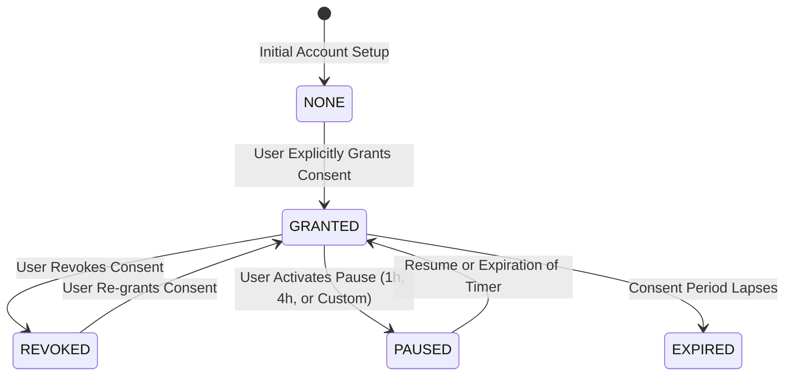

# ContextIQ Phase 3.2: Privacy, Consent, and Telemetry Control Management

## 1. Executive Summary & Philosophy

ContextIQ is an individual-centric cognitive productivity and behavioral intelligence platform. Because telemetry data reflects user work habits, context switching patterns, and cognitive workload, privacy is treated as a foundational invariant rather than an optional setting.

Phase 3.2 establishes an enterprise-grade, GDPR-compliant privacy and consent management system. Telemetry monitoring is strictly **opt-in**, completely transparent, locally enforced even offline, and fully controllable by the user.

---

## 2. Core Privacy Guarantees

1. **Zero-Surveillance Architecture**:
   - Zero keystroke logging.
   - Zero screen captures or video recording.
   - Zero clipboard inspection.
   - Zero full browser URL parameters or history scraping.
   - Zero document or message body inspection.
2. **Opt-in by Default**:
   - Telemetry collection is never automatically enabled during account creation or application install.
   - Without an active, non-expired `GRANTED` consent record, the desktop agent terminates activity collection immediately.
3. **Local-First Enforcement**:
   - Privacy checks run offline via the `AgentPrivacyGuard` before any event enters memory or disk buffers.
   - Denylisted processes (e.g. password managers) and user-excluded apps are masked or discarded immediately at the OS hook boundary.
4. **GDPR Right to Erasure (Article 17)**:
   - Users can purge all raw telemetry, session reconstructions, and window logs with a single click or API call.
   - Anonymized aggregate cognitive metrics can be retained according to user preference without linkability to raw activity.

---

## 3. Consent State Machine & Audit Model

### 3.1 State Transitions



### 3.2 Immutable Versioned Audit Trail (`TelemetryConsent`)

Consent grants and revocations do not overwrite historical records destructively. Each consent transaction is recorded immutably:

```python
class TelemetryConsent(Base):
    __tablename__ = "telemetry_consents"

    id = Column(UUID(as_uuid=True), primary_key=True, default=uuid4)
    user_id = Column(UUID(as_uuid=True), ForeignKey("users.id", ondelete="CASCADE"), nullable=False)
    consent_version = Column(String(32), nullable=False, default="1.0")
    consent_status = Column(Enum(ConsentStatus), nullable=False, default=ConsentStatus.GRANTED)
    enabled_categories = Column(JSONB, nullable=False)
    device_id = Column(String(128), nullable=True)
    device_name = Column(String(255), nullable=True)
    ip_hash = Column(String(64), nullable=True)
    granted_timestamp = Column(DateTime(timezone=True), nullable=False)
    revoked_timestamp = Column(DateTime(timezone=True), nullable=True)
    expires_at = Column(DateTime(timezone=True), nullable=True)
    created_at = Column(DateTime(timezone=True), nullable=False)
```

### 3.3 Granular Telemetry Categories

Users may selectively enable or disable individual telemetry capabilities:
- `app_transitions`: Window focus and process switching events.
- `inactivity_detection`: User idle state detection (via `GetLastInputInfo`).
- `session_reconstruction`: Reconstruction of continuous working intervals.
- `behavioral_analytics`: Cognitive load and context switching models.
- `local_storage`: Persisting events in local SQLite ring buffer.
- `server_sync`: Synchronizing encrypted sanitized aggregates to ContextIQ server.

---

## 4. Privacy Controls & Application Exclusions

### 4.1 Quick Pause & Privacy Settings (`UserPrivacySettings`)

Users can pause monitoring instantaneously for predefined intervals (e.g., 1 hour, 4 hours) or until manually resumed. During a pause:
- The local desktop agent suspends telemetry polling.
- In-memory event queues are dropped.
- Server ingest APIs reject incoming sync batches for the paused user.

### 4.2 Application Exclusions (`UserAppExclusion`)

Users can blacklist sensitive software (e.g. personal messengers, banking portals, private editors).
- Exclusions match against process names or window titles (case-insensitive substring or regex).
- When an excluded application is in focus:
  - Title and metadata are sanitized to `EXCLUDED_PRIVATE`.
  - Durations are marked as private blackout intervals or excluded from behavioral analysis.

### 4.3 Offline Agent Privacy Guard (`AgentPrivacyGuard`)

The client agent embeds an autonomous privacy guard operating before the event loop:
```python
guard = AgentPrivacyGuard(
    consent=active_consent,
    settings=user_settings,
    exclusions=user_exclusions,
)
decision = guard.evaluate_event(process_name="keepass.exe", raw_title="Master Vault")
# Returns: PrivacyDecision(allowed=False, reason="Global security denylist matched")
```

---

## 5. API Reference

| Endpoint | Method | Description |
| :--- | :--- | :--- |
| `/api/v1/privacy/consent` | `GET` | Retrieve active telemetry consent for current user. |
| `/api/v1/privacy/consent` | `POST` | Grant or update versioned telemetry consent. |
| `/api/v1/privacy/consent/revoke` | `POST` | Revoke active telemetry consent and halt collection. |
| `/api/v1/privacy/consent/history` | `GET` | Retrieve audit history of consent events. |
| `/api/v1/privacy/settings` | `GET` | Get current pause status and retention policy. |
| `/api/v1/privacy/settings` | `PUT` | Update pause timers and retention limits. |
| `/api/v1/privacy/exclusions` | `GET` | List user process and application exclusions. |
| `/api/v1/privacy/exclusions` | `POST` | Add application exclusion rule. |
| `/api/v1/privacy/exclusions/{id}` | `DELETE` | Remove application exclusion rule. |
| `/api/v1/privacy/data/purge` | `POST` | Execute GDPR Article 17 right-to-erasure purge. |
| `/api/v1/privacy/metadata` | `GET` | Summary of stored records, retention, and collection footprint. |

---

## 6. Frontend Interface (`/privacy`)

The Next.js 16 privacy cockpit provides a dedicated user control dashboard:
- **Status Indicator**: Real-time badge (`ACTIVE`, `PAUSED`, `REVOKED`, `DISABLED`).
- **Quick Controls**: Instant pause buttons (1 hour, 4 hours) and resume button.
- **Granular Toggles**: Per-category switches for telemetry capabilities.
- **Exclusion Manager**: Add/remove excluded application processes and window patterns.
- **Retention Controls**: Configurable raw event lifecycle slider (7 to 90 days).
- **GDPR Purge Modal**: Confirmation dialogue for irreversible data eradication.
- **Consent Timeline**: Complete auditable history of previous grants and revocations.
