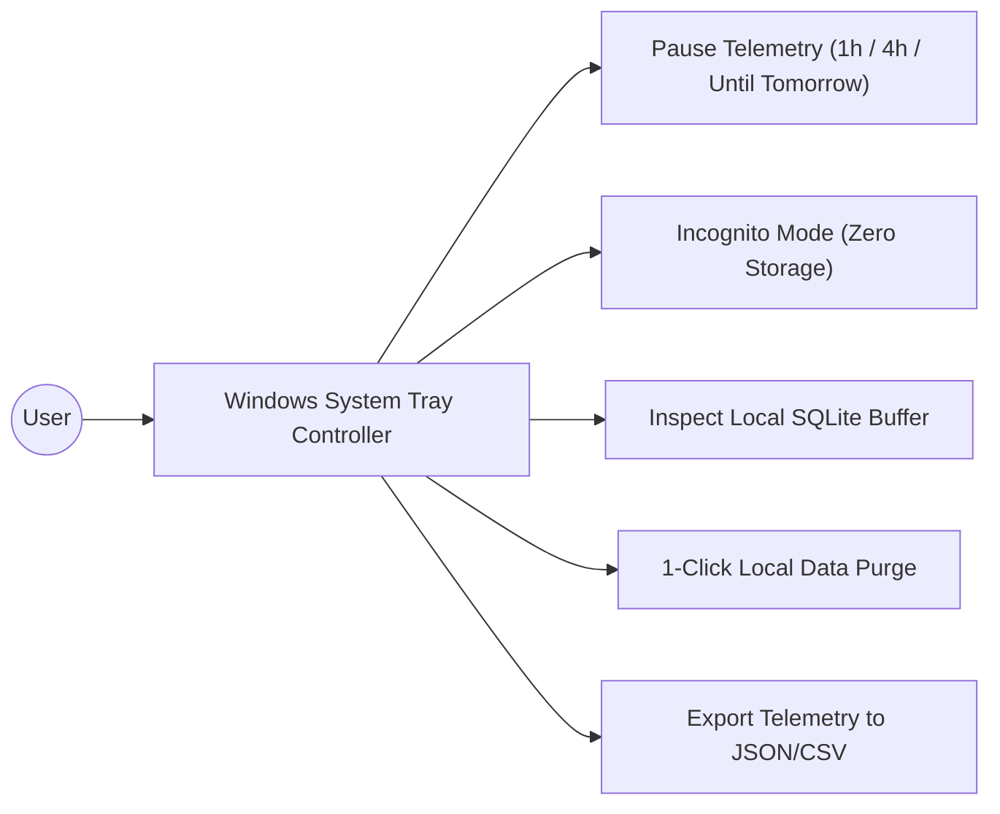

# Phase 3: Privacy Architecture & Data Protection Requirements

## 1. Executive Privacy Stance: Anti-Surveillance Manifesto

ContextIQ is an individual-centric **cognitive productivity and behavioral intelligence platform**, designed to empower individuals in mastering focus, understanding context switching, and mitigating prospective forgetting.

> [!CAUTION]
> **Strict Anti-Surveillance Mandate**:
> ContextIQ is explicitly **NOT an employee surveillance, keystroke logging, screen recording, or workplace tracking tool**.
> The platform is architected to resist weaponization as an employer monitoring system. Features that could compromise psychological safety, confidential client communications, or personal privacy are strictly forbidden by architectural design.

---

## 2. Forbidden Telemetry Matrix

The following table explicitly enumerates all forbidden telemetry categories. These constraints are enforced at the native API integration level in the client agent.

| Forbidden Telemetry Class | Architectural Enforcement Mechanism | Violation Severity |
| :--- | :--- | :--- |
| **Keystroke Logging** | Low-level keyboard hooks (`WH_KEYBOARD_LL`) are prohibited. The agent uses `GetLastInputInfo`, which inspects only the elapsed millisecond tick of user activity without intercepting key codes. | **FATAL**. No code may ever record, inspect, or buffer user keystrokes. |
| **Screenshots & Screen Recording** | GDI, DirectX, and Windows Graphics Capture APIs are completely omitted from the agent codebase. No image data is ever captured. | **FATAL**. Screen frame capture is prohibited under all circumstances. |
| **OCR / Screen Content Inspection** | The agent contains no optical character recognition (OCR) or visual element inspection routines. | **FATAL**. Document and UI text inspection is prohibited. |
| **Clipboard Scraping** | Win32 Clipboard APIs (`OpenClipboard`, `GetClipboardData`) are excluded. Clipboard buffers are never read or monitored. | **FATAL**. Copy/paste content access is prohibited. |
| **Message & Document Inspection** | The agent interacts only with top-level window handles (`HWND`) to query process names. It does not inspect window child trees, message bodies, email subjects, or document text. | **FATAL**. Message content and document bodies remain completely private. |
| **Full Browser History & URLs** | The agent does not query browser history SQLite databases, DOM trees, or address bars. Browser URLs and query parameters are never collected. | **FATAL**. Full browsing history and URL paths are prohibited. |

---

## 3. Client-Side Data Minimization & Redaction Engine

Data minimization is executed **on the local client prior to buffering or network transmission**. The server never receives raw, unredacted window titles.

```mermaid
flowchart TD
    RAW[Raw Window Title from Win32 API] --> DENY{Process Denylist Check}
    DENY -- "Match (e.g. 1Password)" --> OMIT[Completely Omit Event / Mask as 'RESTRICTED']
    DENY -- "Safe Process" --> REGEX[Regex Sanitization Pipeline]
    
    subgraph Sanitization Pipeline
        REGEX --> P1[Strip File Paths: C:\Users\...\doc.pdf -> doc.pdf]
        P1 --> P2[Strip URL Query Params: domain.com?token=123 -> domain.com]
        P2 --> P3[Strip Email & Chat Handles: user@domain.com -> [EMAIL]]
        P3 --> P4[Strip Sensitive Project Strings]
    end

    P4 --> TAX[Map to Broad Semantic Category: DEVELOPMENT / COMMUNICATION]
    TAX --> EMIT[Emit Sanitized Event to Local Buffer]
```

### 3.1 Window Title Sanitization Algorithm

```python
"""
title_sanitizer.py — Privacy Redaction Engine
"""
import re

# Regular expressions for sensitive personal information
PATH_REGEX = re.compile(r"[A-Za-z]:\\[\w\s\-\.\\]+\\([\w\s\-\.]+\.[a-zA-Z0-9]+)")
URL_PARAM_REGEX = re.compile(r"(https?://[a-zA-Z0-9\-\.]+(?::\d+)?)(/[^\s?]*)?(?:\?[^\s]*)?")
EMAIL_REGEX = re.compile(r"[\w\.-]+@[\w\.-]+\.\w+")
CREDIT_CARD_REGEX = re.compile(r"\b(?:\d{4}[-\s]?){3}\d{4}\b")
SSN_REGEX = re.compile(r"\b\d{3}-\d{2}-\d{4}\b")

# Denylisted process names that are completely masked
DENYLISTED_PROCESSES = {
    "1password.exe",
    "keepass.exe",
    "keepassxc.exe",
    "bitwarden.exe",
    "lastpass.exe",
    "dashlane.exe",
    "credentialmanager.exe",
    "taskmgr.exe",
    "regedit.exe",
    "mstsc.exe",  # Remote Desktop
}


def sanitize_window_metadata(process_name: str, raw_title: str) -> tuple[str, str]:
    """Sanitize window title on the client prior to buffering.
    
    Returns:
        tuple[process_name, sanitized_title]
    """
    proc_lower = process_name.lower().strip()
    
    # 1. Immediate denylist masking
    if proc_lower in DENYLISTED_PROCESSES:
        return proc_lower, "RESTRICTED_SECURITY_APPLICATION"
    
    if not raw_title:
        return proc_lower, ""
    
    clean_title = raw_title
    
    # 2. Redact file system paths (retain only filename or extension)
    clean_title = PATH_REGEX.sub(r"\1", clean_title)
    
    # 3. Strip URL parameters and paths (retain domain root only)
    clean_title = URL_PARAM_REGEX.sub(r"\1", clean_title)
    
    # 4. Strip emails, card patterns, SSNs
    clean_title = EMAIL_REGEX.sub("[EMAIL]", clean_title)
    clean_title = CREDIT_CARD_REGEX.sub("[REDACTED_CARD]", clean_title)
    clean_title = SSN_REGEX.sub("[REDACTED_ID]", clean_title)
    
    # 5. Length clamp
    clean_title = clean_title[:100].strip()
    
    return proc_lower, clean_title
```

---

## 4. User Autonomy & Control Architecture

To ensure total transparency and control, the agent provides the user with immediate sovereignty over their behavioral data:



### 4.1 "Do Not Disturb / Incognito" Mode
- Accessible via a single click from the Windows System Tray icon or the web dashboard.
- When toggled, the agent immediately halts event dispatch, terminates Win32 hooks, and bypasses local buffering.

### 4.2 Local Data Retention & One-Click Purge
- Users can view every record stored in their local buffer (`telemetry_buffer.db`).
- Clicking "Purge Local Telemetry" immediately issues `DROP TABLE raw_events; VACUUM;` to ensure physical eradication of cached records from local storage.

---

## 5. Regulatory Compliance & Governance

### 5.1 GDPR Compliance (Articles 5, 6, 17, 25)
- **Principle of Data Minimization (Art. 5(1)(c))**: Only binary process names and durations are collected. Free text is redacted at the source.
- **Privacy by Design & Default (Art. 25)**: Local buffer encryption and zero administrative elevation requirements.
- **Right to Erasure ('Right to be Forgotten', Art. 17)**: Deleting a ContextIQ account executes a cascading delete across both PostgreSQL `raw_telemetry_events` and derived `context_sessions`.
- **Right to Data Portability (Art. 20)**: Users can export their complete chronological behavioral telemetry stream in standard JSON format.

### 5.2 Workplace Privacy & Anti-Surveillance Design
ContextIQ is engineered with structural barriers preventing it from functioning as an employee tracking tool:
- **No Remote Desktop Inspection**: Administrators cannot view live user screens or open applications.
- **No Keystroke Counting**: Keystroke velocity or count-per-minute metrics are explicitly absent.
- **Self-Directed Insights**: Analytics are surfaced directly to the individual for self-improvement and prospective memory assistance, not exposed via employee monitoring leaderboards.
