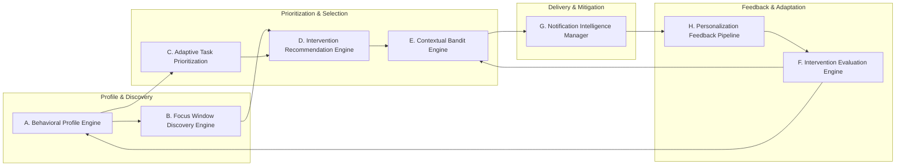
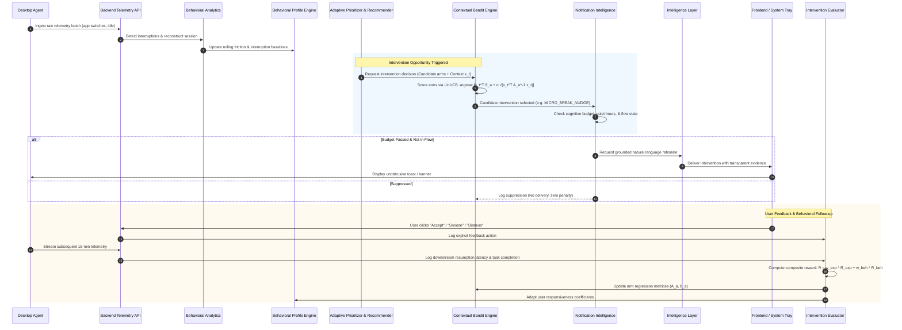

# Phase 4: Adaptive Behavioral Intelligence System Architecture

## 1. Executive Summary & Objective

ContextIQ Phase 4 introduces **Adaptive Behavioral Intelligence** — a closed-loop personalization and decision architecture that learns which interventions (reminders, focus window scheduling, task batching, micro-break nudges) are demonstrably effective for each unique individual.

In prior phases:
- **Phase 1** established the core platform: PostgreSQL schema, FastAPI backend, task lifecycles, and Next.js frontend.
- **Phase 2** introduced predictive intelligence: CatBoost/LightGBM forgetting-risk inference, Cox Time-Varying survival analysis, FP-Growth context association mining, and SHAP explainability.
- **Phase 3** automated behavioral telemetry on Windows desktops: Win32 hook event collection, privacy redactions, automated interruption detection, session reconstruction, and cognitive recovery analytics (Behavioral Friction Index, resumption lag).

**Phase 4 Objective**: Transform ContextIQ from an observational and static predictive system into an **adaptive intervention platform**. The system continuously observes telemetry, maintains an evolving personal behavioral profile, ranks tasks contextually, and uses contextual multi-armed bandits to select and deliver interventions. It monitors downstream behavioral outcomes, evaluates intervention utility, and adapts policies over time while protecting user privacy and preventing notification fatigue.

```mermaid
graph TB
    subgraph Windows Client [Windows Host Desktop Environment]
        TELEMETRY[Win32 Telemetry Agent] --> PRIVACY[Privacy & App Exclusion Filter]
        PRIVACY --> SENDER[HTTP Batch Ingestion]
    end

    subgraph Core Processing & Behavioral Analytics
        SENDER --> RAW_EVENTS[(raw_telemetry_events)]
        RAW_EVENTS --> INTERRUPT[Interruption Detection Engine]
        RAW_EVENTS --> RECONSTRUCT[Session Reconstruction Engine]
        INTERRUPT --> RECOVERY[Recovery & Micro-Delay Analytics]
        RECONSTRUCT --> SESSIONS[(context_sessions)]
        RECOVERY --> BEHAVIORAL_METRICS[(behaviour_metrics)]
    end

    subgraph Predictive Layer (Existing Phase 2)
        SESSIONS --> FORGET_ML[forgetting-ml: CatBoost / Survival]
        SESSIONS --> ASSOC_MINING[context-engine: Association Mining]
        FORGET_ML --> PREDICTIONS[(predictions)]
        ASSOC_MINING --> ASSOCIATIONS[(task_associations)]
    end

    subgraph Adaptive Intelligence Layer (Phase 4)
        BEHAVIORAL_METRICS --> PROFILE[A. Behavioral Profile Engine]
        SESSIONS --> PROFILE
        PROFILE --> FOCUS[B. Focus Window Discovery Engine]
        PROFILE --> PRIORITY[C. Adaptive Task Prioritization Engine]
        PREDICTIONS --> PRIORITY
        
        FOCUS --> INTERVENTION[D. Intervention Recommendation Engine]
        PRIORITY --> INTERVENTION
        ASSOCIATIONS --> INTERVENTION
        
        INTERVENTION --> BANDIT[E. Contextual Bandit Engine]
        BANDIT --> NOTIF_MGR[G. Notification Intelligence Manager]
    end

    subgraph Explanation & Presentation
        NOTIF_MGR --> INTELLIGENCE[Intelligence Layer: Grounded Explanations]
        INTELLIGENCE --> UI[Next.js 16 Dashboard & Desktop Nudges]
    end

    subgraph Closed-Loop Feedback & Evaluation
        UI --> FEEDBACK[User Feedback: Accept / Dismiss / Snooze]
        TELEMETRY --> DOWNSTREAM[Downstream Behavioral Metrics: Completion / Resumption]
        FEEDBACK --> PIPELINE[H. Personalization Feedback Pipeline]
        DOWNSTREAM --> PIPELINE
        PIPELINE --> EVALUATION[F. Intervention Evaluation Engine]
        EVALUATION --> BANDIT
        EVALUATION --> PROFILE
    end
```

---

## 2. Existing Repository Audit & Reusability Matrix

To avoid duplication, Phase 4 builds directly on existing data models, ML pipelines, and analytics engines.

| Existing Component | Repository Path | Existing Functionality | Phase 4 Architectural Role |
| :--- | :--- | :--- | :--- |
| **`User` Model** | `backend/app/models/user.py` | Persona, timezone, focus rhythm, friction tolerance, daily routine | **Prior Initialization**: Provides initial priors for cold-start behavioral profiles before telemetry accumulates. |
| **`Task` & `TaskEvent`** | `backend/app/models/task.py`, `task_event.py` | Status, priority, due dates, context tags, event audit log | **Ground Truth Outcomes**: Provides baseline task attributes and verifies whether tasks prompted by interventions were started or completed. |
| **`ContextSession`** | `backend/app/models/context_session.py` | Focus minutes, idle time, app breakdown, context switch frequency | **Context State Vector**: Real-time telemetry session state feeds directly into the contextual bandit context vector $x_t$. |
| **`BehaviourMetric`** | `backend/app/models/behaviour_metric.py` | Daily rollups of focus, switches, forgotten tasks | **Longitudinal Normalization**: Establishes rolling 7-day and 30-day baseline statistics to normalize personal friction scores. |
| **`Prediction`** | `backend/app/models/prediction.py` | ML model predictions (`FORGET_RISK`, confidence, model version) | **Exogenous Risk Feature**: Consumed as a read-only input by the Adaptive Task Prioritization Engine. |
| **`Recommendation` & `Feedback`** | `backend/app/models/recommendation.py`, `recommendation_feedback.py` | Recommendations, status (`PENDING`, `ACCEPTED`, `DISMISSED`), action notes | **Intervention Foundation**: Upgraded into a multi-arm intervention model supporting bandit metadata, delivery channel, and implicit outcome tracking. |
| **`TaskAssociation`** | `backend/app/models/task_association.py` | Mined rules (confidence, support, lift) | **Opportunistic Interventions**: Supplies candidate association pairs for "One More Thing" nudge arms. |
| **Telemetry & Privacy** | `backend/app/models/telemetry_consent.py`, `user_app_exclusions.py` | Category consent, app blacklist, retention policy | **Governance Barrier**: All profile extraction and bandit features strictly filter out non-consented categories and excluded applications. |
| **Interruption Detection** | `backend/app/services/interruption_detector.py` | Rule-based switch and idle interruption detection | **Interruption Sensitivity**: Quantifies user vulnerability to disruptions across times of day and active applications. |
| **Cognitive Recovery Analytics** | `backend/app/services/recovery_analytics.py`, `temporal_feature_extractor.py` | Resumption delays, Behavioral Friction Index (BFI), temporal feature extraction | **Real-Time Cognitive Load**: Supplies the immediate behavioral friction score and resumption lag to gate intervention delivery. |
| **Forgetting ML Engine** | `forgetting-ml/ml/models/`, `survival/` | CatBoost/LightGBM risk classifiers, Cox Time-Varying survival models | **Pure Predictor**: Retains exclusive responsibility for predicting forgetting probability $P(\text{forget})$ and hazard $h(t)$. |
| **Intelligence Layer** | `intelligence/app/insight_engine.py`, `ranking.py` | Rule-based grounded insight generation, deterministic text templates | **Grounded Rationale Generator**: Translates chosen intervention arms and feature attributions into natural language explanations. |
| **Frontend UI** | `frontend/components/recommendations/` | Recommendation cards, action buttons, acceptance statistics | **Intervention Client**: Expanded to support snooze options, quick execution, effectiveness indicators, and privacy profile inspection. |

---

## 3. High-Level Adaptive System Components

Phase 4 defines eight specialized engines collaborating across the lifecycle:



### Component A: Behavioral Profile Engine
- **Role**: Continuously aggregates telemetry sessions, interruptions, and task completions into an individualized behavioral signature.
- **Responsibilities**:
  - Calculates personal baseline cognitive velocity, median resumption lag, and context-switch fatigue thresholds.
  - Computes time-decayed rolling 7-day and 30-day behavioral metrics.
  - Models user interruption sensitivity as a function of time of day and application context.

### Component B: Focus Window Discovery Engine
- **Role**: Discovers recurrent circadian and weekly deep-focus opportunities.
- **Responsibilities**:
  - Employs kernel density estimation (KDE) and cluster analysis over historical focus minutes and transition rates.
  - Identifies "Prime Focus Windows" (high uninterrupted spans, low resumption delay) vs. "Fragmented Windows".
  - Publishes scheduled focus blocks to prioritize cognitively demanding tasks and guard against intrusive alerts.

### Component C: Adaptive Task Prioritization Engine
- **Role**: Dynamically re-orders pending tasks based on the user's instantaneous cognitive capacity and context.
- **Responsibilities**:
  - Evaluates multi-objective utility combining task urgency, ML forgetting risk, contextual affinity, and current cognitive friction.
  - Dynamically downranks complex tasks when the Behavioral Friction Index (BFI) is elevated, elevating low-effort quick wins.
  - Recommends task sequences that minimize context-switching penalties.

### Component D: Intervention Recommendation Engine
- **Role**: Bridges behavioral opportunities to concrete intervention strategies.
- **Responsibilities**:
  - Maps trigger conditions (e.g., disruption clusters, upcoming focus window, end of session) to candidate intervention types:
    - `MICRO_BREAK_NUDGE`: Triggered by sustained high friction or consecutive disruptions.
    - `FOCUS_WINDOW_PROTECTION`: Triggered before an identified prime focus block.
    - `TASK_BATCHING`: Triggered during high-switching, fragmented periods.
    - `PRE_DEPARTURE_CHECK`: "One More Thing" anchor nudges triggered prior to detected context departures.
    - `SCHEDULE_OPTIMIZATION`: Shifts high-risk tasks into aligned focus windows.
  - Assembles structured intervention candidates with context metadata for bandit evaluation.

### Component E: Contextual Bandit Engine
- **Role**: Optimizes intervention selection under uncertainty using exploration/exploitation trade-offs.
- **Responsibilities**:
  - Formulates decision making as a contextual multi-armed bandit (LinUCB / Linear Thompson Sampling).
  - Constructs real-time context feature vectors $x_t \in \mathbb{R}^d$ combining profile stats, current session friction, time of day, and task attributes.
  - Balances exploitation of historically successful interventions against exploration of novel timing and framing variations.

### Component F: Intervention Evaluation Engine
- **Role**: Measures the empirical effectiveness of delivered interventions.
- **Responsibilities**:
  - Calculates dual-loop rewards:
    - *Immediate Explicit Reward*: Acceptance (+1.0), Snooze (+0.2), Dismissal (-0.5), Explicit Negative (-1.0).
    - *Downstream Behavioral Reward*: Reduction in resumption lag, successful task completion within temporal window, BFI stabilization.
  - Computes counterfactual policy performance and detects intervention fatigue or policy drift.

### Component G: Notification Intelligence Manager
- **Role**: Prevents alert fatigue and preserves user flow.
- **Responsibilities**:
  - Implements a token-bucket cognitive budget per user (e.g., maximum 3 ambient interventions per 4-hour window).
  - Enforces strict quiet hours, minimum cooldown intervals between nudges, and category rate limits.
  - Detects active "Flow State" (continuous focus > 20 min without disruption) and automatically suppresses non-critical alerts.

### Component H: Personalization Feedback Pipeline
- **Role**: Closes the loop from user action to model update.
- **Responsibilities**:
  - Streams explicit feedback events (button clicks, survey dismissals) and implicit outcomes (subsequent telemetry events).
  - Triggers online bandit parameter updates ($A_a \leftarrow A_a + x_t x_t^T$, $b_a \leftarrow b_a + r_t x_t$).
  - Periodically triggers batch behavioral profile recalibrations.

---

## 4. End-to-End Data Flow

The following lifecycle traces an event from desktop capture through adaptive intervention, user feedback, and model adaptation:



---

## 5. Architectural Boundaries & Component Separation

To maintain modularity and system integrity, clear responsibilities are enforced across existing and new services:

```
┌────────────────────────────────────────────────────────────────────────┐
│                        ARCHITECTURAL BOUNDARIES                        │
├──────────────────────────────────┬─────────────────────────────────────┤
│ Service / Engine                 │ Strict Responsibilities             │
├──────────────────────────────────┼─────────────────────────────────────┤
│ 1. Forgetting ML Engine          │ - Predicts forgetting probability   │
│    (`forgetting-ml`)             │   P(forget).                        │
│                                  │ - Computes survival hazard h(t).   │
│                                  │ - Produces TreeSHAP attributions.   │
│                                  │ - NEVER selects interventions.      │
│                                  │ - NEVER tracks user feedback.       │
├──────────────────────────────────┼─────────────────────────────────────┤
│ 2. Context Association Engine    │ - Mines task co-occurrence rules.   │
│    (`context-engine`)            │ - Calculates support, confidence,   │
│                                  │   and lift.                         │
│                                  │ - NEVER schedules alerts.           │
├──────────────────────────────────┼─────────────────────────────────────┤
│ 3. Adaptive Intelligence Engine  │ - Maintains behavioral profiles.    │
│    (`backend/app/services/       │ - Ranks tasks contextually.         │
│     adaptive/`)                  │ - Selects interventions via bandit. │
│                                  │ - Enforces notification budgets.    │
│                                  │ - Updates online bandit policies.   │
├──────────────────────────────────┼─────────────────────────────────────┤
│ 4. Intelligence Layer            │ - Validates grounding of evidence.  │
│    (`intelligence/`)             │ - Synthesizes user-facing rationale │
│                                  │   using deterministic templates.    │
│                                  │ - NEVER invents telemetry metrics.  │
├──────────────────────────────────┼─────────────────────────────────────┤
│ 5. Frontend & Desktop UI         │ - Renders cards, nudges, trays.     │
│    (`frontend/`, `desktop-agent`)│ - Captures explicit feedback.       │
│                                  │ - Enforces user privacy settings.   │
│                                  │ - NEVER executes decision policies. │
└──────────────────────────────────┴─────────────────────────────────────┘
```

---

## 6. Privacy Safeguards & Ethical Constraints

1. **Telemetry Consent Gating**:
   - The adaptive engine strictly checks `TelemetryConsent.consent_status == GRANTED` and validates that `TelemetryCategory.BEHAVIORAL_ANALYTICS` is enabled.
   - If consent is revoked or paused, all bandit exploration ceases, and recommendations fall back to static rule-based defaults without telemetry inputs.
2. **App Exclusion & Blacklist Compliance**:
   - Applications registered in `user_app_exclusions` are completely excluded from context feature vectors $x_t$.
   - Any window title or process name matching an exclusion is scrubbed before feature extraction.
3. **No Sensitive Inferences**:
   - The system is architecturally constrained against inferring or storing sensitive user traits (e.g., emotional states, mental health diagnoses, political affiliations, medical conditions).
   - Only operational cognitive metrics (resumption delay, switch count, focus duration, task completion) are modeled.
4. **User Transparency & Full Control**:
   - **Profile Visibility**: Users can view their complete behavioral profile parameters, learned focus windows, and bandit arm preferences via the UI.
   - **One-Click Profile Reset**: Users can purge their bandit weight matrices ($A_a, b_a$) and learned profiles at any time, instantly resetting to cold-start population defaults.
   - **Selective Opt-Out**: Users can independently disable any intervention type or completely opt out of adaptive nudges.
   - **Right to Be Forgotten**: Full deletion cascades from `users` to all profiles, bandit states, and intervention logs.

---

## 7. Deliverable Specifications Map

The detailed technical specifications for Phase 4 are structured across the following modular documents in `docs/phase-4/`:

| Document | Purpose |
| :--- | :--- |
| **`architecture.md`** *(This Document)* | Master system architecture, component inventory, data flow, boundaries, and privacy safeguards. |
| **`behavioral-profile-design.md`** | Mathematical formulations of behavioral metrics, profile representation, baseline smoothing, and update algorithms. |
| **`focus-window-design.md`** | Algorithms for discovering personal prime focus windows using KDE and clustering over historical sessions. |
| **`task-prioritization-design.md`** | Multi-objective task ranking function balancing urgency, forgetting risk, context fit, and cognitive friction. |
| **`intervention-engine-design.md`** | Complete intervention taxonomy, trigger condition rules, candidate generation, and payload schemas. |
| **`contextual-bandit-design.md`** | Formulation of LinUCB and Thompson Sampling algorithms, context vector construction, and cold-start strategies. |
| **`effectiveness-evaluation.md`** | Dual-loop reward mathematical formulation, counterfactual evaluation, off-policy metrics, and drift monitoring. |
| **`notification-intelligence.md`** | Fatigue prevention mechanisms, cognitive budget token bucket, flow-state detection, and multi-channel routing. |
| **`implementation-roadmap.md`** | Milestone breakdown, database schema migrations, API endpoint additions, testing strategy, and risk mitigation. |
