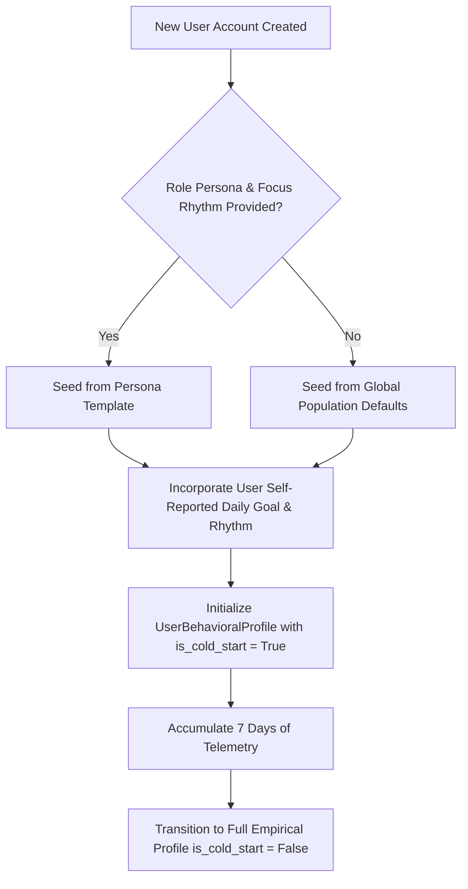

# Behavioral Profile Engine Design

## 1. Overview & Purpose

The **Behavioral Profile Engine** is responsible for learning, maintaining, and updating an individualized cognitive and behavioral representation of each user. 

Rather than treating users with static global assumptions (e.g. assuming every user loses focus after 25 minutes or experiences equal disruption from an email notification), the Behavioral Profile Engine constructs an empirical, continuously adapting signature of:
1. **Cognitive Velocity**: Typical task completion speed and daily focus capacity.
2. **Resumption Lag Distributions**: Micro-delay latency required to return to productive focus after disruptions.
3. **Interruption Sensitivity**: Vulnerability to task abandonment or prolonged disruption broken down by application category and time of day.
4. **Context Switching Tolerance**: The frequency of application transitions a user can sustain before experiencing elevated behavioral friction.
5. **Circadian Energy Baselines**: Rolling diurnal patterns of focus density and cognitive throughput.

This profile serves as the single source of truth for the **Focus Window Discovery Engine**, **Adaptive Task Prioritization Engine**, and **Contextual Bandit Engine**.

---

## 2. Mathematical Formulations & Metrics

### 2.1 Exponentially Weighted Moving Average (EWMA) Baselines
To reflect behavioral drift and changes in routine without being overly sensitive to single-day anomalies, profile metrics are tracked using dual-timescale Exponentially Weighted Moving Averages (EWMA):

$$\bar{\mu}_{t} = (1 - \lambda) \bar{\mu}_{t-1} + \lambda \cdot x_t$$

Where:
- $\lambda_{7d} = 1 - e^{-\frac{\ln(2)}{7}} \approx 0.0943$ (captures short-term weekly shifts, vacations, sprint cycles).
- $\lambda_{30d} = 1 - e^{-\frac{\ln(2)}{30}} \approx 0.0228$ (captures stable longitudinal baselines).
- $x_t$ is the daily aggregated metric extracted from `context_sessions` and `detected_interruptions`.

### 2.2 Resumption Lag Distribution & Median Latency
Resumption lag is non-normally distributed and characterized by heavy right-skew (occasional long disruptions). Therefore, the engine tracks log-transformed distributions:

$$y_i = \ln(\text{resumption\_lag\_seconds}_i + 1)$$
$$\hat{\mu}_{\ln} = \frac{1}{N}\sum_{i=1}^N y_i, \quad \hat{\sigma}_{\ln} = \sqrt{\frac{1}{N-1}\sum_{i=1}^N (y_i - \hat{\mu}_{\ln})^2}$$

The representative median resumption delay is derived as:
$$\text{MedianLag} = \exp(\hat{\mu}_{\ln}) - 1$$
$$\text{LagThreshold}_{90} = \exp(\hat{\mu}_{\ln} + 1.282 \hat{\sigma}_{\ln}) - 1$$

### 2.3 Interruption Sensitivity Index ($ISI$)
For an application category $c$ and time-of-day bucket $h \in [0, 23]$, the Interruption Sensitivity Index is defined as:

$$ISI(c, h) = w_1 \cdot \frac{\text{MedLag}(c, h)}{\text{GlobalMedLag}} + w_2 \cdot P(\text{Abandon} \mid c, h) + w_3 \cdot \Delta BFI(c, h)$$

Where:
- $w_1 = 0.40, w_2 = 0.35, w_3 = 0.25$ (weights sum to 1.0).
- $P(\text{Abandon} \mid c, h)$ is the probability that an interruption in context $(c, h)$ causes the user to abandon the active task for $> 60$ minutes.
- $\Delta BFI(c, h)$ is the normalized increase in Behavioral Friction Index in the 30-minute window post-interruption.

### 2.4 Context-Switching Tolerance Threshold ($\Theta_{CS}$)
The threshold at which context switching induces cognitive fragmentation is computed as:

$$\Theta_{CS} = \text{Percentile}_{75}(\text{transitions\_per\_hour} \mid \text{SessionQuality} == \text{HIGH})$$

When observed transitions exceed $\Theta_{CS}$, the user's cognitive state is flagged as *Fragmented*, boosting the likelihood of task-batching interventions.

---

## 3. Data Schema & Architecture

### 3.1 Database Model: `user_behavioral_profiles`

```python
"""Database model for user behavioral profile storage."""
import uuid
from datetime import datetime
from typing import Any, Dict, Optional

import sqlalchemy as sa
from sqlalchemy import Boolean, DateTime, Float, ForeignKey, Index, Integer, String
from sqlalchemy.dialects.postgresql import JSONB, UUID
from sqlalchemy.orm import Mapped, mapped_column, relationship

from app.db.session import Base
from app.models.mixins import UUIDPKMixin, utcnow


class UserBehavioralProfile(Base, UUIDPKMixin):
    """
    Learned behavioral profile representing personal focus capacity,
    interruption sensitivity, cognitive recovery baselines, and diurnal rhythms.
    """

    __tablename__ = "user_behavioral_profiles"
    __table_args__ = (
        Index("ix_behavioral_profiles_user", "user_id", unique=True),
        Index("ix_behavioral_profiles_updated", "updated_at"),
    )

    user_id: Mapped[uuid.UUID] = mapped_column(
        UUID(as_uuid=True), ForeignKey("users.id", ondelete="CASCADE"), nullable=False, unique=True
    )
    profile_version: Mapped[str] = mapped_column(String(32), nullable=False, default="1.0.0")
    is_cold_start: Mapped[bool] = mapped_column(Boolean, nullable=False, default=True)
    telemetry_days_observed: Mapped[int] = mapped_column(Integer, nullable=False, default=0)

    # Cognitive Velocity & Capacity Baselines
    daily_focus_capacity_minutes_7d: Mapped[float] = mapped_column(Float, nullable=False, default=120.0)
    daily_focus_capacity_minutes_30d: Mapped[float] = mapped_column(Float, nullable=False, default=120.0)
    avg_focus_session_length_minutes: Mapped[float] = mapped_column(Float, nullable=False, default=25.0)
    task_completion_velocity_daily: Mapped[float] = mapped_column(Float, nullable=False, default=3.0)

    # Resumption Lag & Cognitive Recovery Baselines (seconds)
    median_resumption_lag_seconds: Mapped[float] = mapped_column(Float, nullable=False, default=45.0)
    p90_resumption_lag_seconds: Mapped[float] = mapped_column(Float, nullable=False, default=180.0)
    resumption_lag_log_mu: Mapped[float] = mapped_column(Float, nullable=False, default=3.82)
    resumption_lag_log_sigma: Mapped[float] = mapped_column(Float, nullable=False, default=0.65)

    # Context Switching & Fragmentation
    context_switch_tolerance_hourly: Mapped[float] = mapped_column(Float, nullable=False, default=6.0)
    baseline_behavioral_friction_index: Mapped[float] = mapped_column(Float, nullable=False, default=35.0)

    # Multi-Dimensional Sensitivity & Rhythm Matrices
    # Schema: { "DEVELOPMENT": 0.42, "COMMUNICATION": 0.85, "BROWSING": 0.60 }
    app_category_sensitivities: Mapped[Dict[str, float]] = mapped_column(
        sa.JSON().with_variant(JSONB, "postgresql"), nullable=False, default=dict
    )
    # Schema: { "0": 0.2, "1": 0.1, ..., "9": 0.85, "10": 0.90, ..., "23": 0.3 }
    hourly_focus_propensity: Mapped[Dict[str, float]] = mapped_column(
        sa.JSON().with_variant(JSONB, "postgresql"), nullable=False, default=dict
    )
    # Schema: { "0": 0.3, "1": 0.3, ..., "9": 0.8, ..., "23": 0.2 }
    hourly_interruption_sensitivity: Mapped[Dict[str, float]] = mapped_column(
        sa.JSON().with_variant(JSONB, "postgresql"), nullable=False, default=dict
    )

    # Explicit Feedback Responsiveness Weights
    # Schema: { "BREAK_SUGGESTION": 0.65, "TASK_BATCHING": 0.40, "SCHEDULE_SHIFT": 0.80 }
    intervention_receptivity_weights: Mapped[Dict[str, float]] = mapped_column(
        sa.JSON().with_variant(JSONB, "postgresql"), nullable=False, default=dict
    )

    created_at: Mapped[datetime] = mapped_column(DateTime(timezone=True), default=utcnow, nullable=False)
    updated_at: Mapped[datetime] = mapped_column(DateTime(timezone=True), default=utcnow, onupdate=utcnow, nullable=False)

    user = relationship("User")
```

---

## 4. Cold-Start Initialization & Seeding

When a new user joins ContextIQ, no desktop telemetry exists (`telemetry_days_observed = 0`). The engine utilizes a **hierarchical prior initialization**:



### 4.1 Population Archetype Priors

| Profile Archetype | Seeding Persona | Focus Capacity | Median Lag | Switch Tolerance | Peak Propensity Window |
| :--- | :--- | :--- | :--- | :--- | :--- |
| **Deep Worker / Developer** | `developer`, `engineer` | 150 min/day | 65.0 sec | 4 switches/hr | 09:00 – 12:00 |
| **Collaborative / Manager** | `manager`, `lead` | 90 min/day | 35.0 sec | 12 switches/hr | 14:00 – 17:00 |
| **Multitasker / Student** | `student`, `researcher` | 120 min/day | 45.0 sec | 8 switches/hr | 10:00 – 13:00, 19:00 – 21:00 |
| **Default Baseline** | *fallback* | 120 min/day | 45.0 sec | 6 switches/hr | 09:00 – 11:30 |

During cold start (`telemetry_days_observed < 7`), profile parameters combine empirical observations and archetype priors using Bayesian credibility shrinkage:

$$\theta_{\text{effective}} = \frac{N_{\text{obs}}}{N_{\text{obs}} + N_0} \cdot \theta_{\text{empirical}} + \frac{N_0}{N_{\text{obs}} + N_0} \cdot \theta_{\text{prior}}$$

Where $N_0 = 7$ pseudo-days of prior strength. As $N_{\text{obs}} \to 30$, the empirical observations dominate entirely.

---

## 5. Profile Update Pipeline & Triggers

Profile updates occur via two triggers:
1. **Intra-Day Event Trigger**: Triggered at the conclusion of a `ContextSession` or logged `InterruptionFeedback` to update real-time running metrics (immediate recency).
2. **Nightly Batch Recalibration**: Runs daily at 02:00 local user time via `data-engine` pipeline. Computes rolling 7d/30d EWMA, fits log-normal resumption distributions, updates the 24-hour diurnal focus propensity array, and evaluates cold-start status.

---

## 6. Privacy, Transparency & User Controls

In compliance with Phase 4 privacy mandates:
- **Profile Transparency API**: `GET /api/v1/adaptive/profile` returns the complete profile state, allowing the user to inspect their learned focus capacity, peak hours, and category sensitivities in the dashboard.
- **Profile Reset API**: `POST /api/v1/adaptive/profile/reset` purges the empirical parameters and re-initializes from archetype priors.
- **Telemetry Consent Enforcement**: If `TelemetryConsent.consent_status` transitions to `REVOKED` or `PAUSED`, intra-day profile updates cease immediately and existing empirical metrics are frozen.
