# Contextual Bandit Engine Design

## 1. Overview & Problem Formulation

The **Contextual Bandit Engine** solves the fundamental exploration–exploitation dilemma of personalized intervention:
- *Exploitation*: Recommending interventions that have historically proven effective for this user in similar contexts.
- *Exploration*: Systematically testing alternative intervention timings, types, and framings to uncover optimal strategies and prevent premature convergence on suboptimal policies.

Standard A/B testing treats all users homogeneously and incurs high regret. Traditional reinforcement learning (e.g. Q-learning) suffers from sample inefficiency and sparse delayed rewards. 

ContextIQ formulates intervention decision making as a **Contextual Multi-Armed Bandit (MAB)** with linear payoff functions (**LinUCB** with a **Linear Thompson Sampling** alternative).

```mermaid
graph LR
    subgraph Environment [Real-Time Context Vector x_t]
        BFI[Behavioral Friction Index]
        SESS[Session Fragmentation]
        TIME[Time of Day & Focus Window]
        APP[Foreground Application Category]
        REC[Time Since Last Intervention]
    end

    subgraph Bandit_Engine [LinUCB Decision Policy]
        ARM_EVAL["Compute UCB Payoff for Each Arm a in A:<br/>p_{t, a} = x_t^T θ_a + α √(x_t^T A_a^-1 x_t)"]
        ARGMAX["Select Winning Arm:<br/>a* = argmax p_{t, a}"]
    end

    subgraph Execution_Feedback [Closed-Loop Payoff]
        EXEC[Deliver Winning Intervention a*]
        REWARD["Observe Composite Reward r_t in [-1, +1]"]
        UPDATE["Sherman-Morrison Online Update:<br/>A_{a*} += x_t x_t^T<br/>b_{a*} += r_t x_t"]
    end

    Environment --> ARM_EVAL
    ARM_EVAL --> ARGMAX
    ARGMAX --> EXEC
    EXEC --> REWARD
    REWARD --> UPDATE
    UPDATE --> Bandit_Engine
```



---

## 2. Action Space (Arm Definitions $\mathcal{A}$)

The action space consists of $K = 8$ discrete arms, including an explicit **Null / No-Op Arm**:

| Arm ID | Intervention Type | Timing / Framing Mode | Intended Cognitive Goal |
| :--- | :--- | :--- | :--- |
| **`arm_0_noop`** | *NO_INTERVENTION* | Silent Observation | Preserve current momentum; avoid unnecessary cognitive load. |
| **`arm_1_break_gentle`** | `MICRO_BREAK_NUDGE` | Gentle suggestion (toast) | Prompt a 3-minute stretch or screen break. |
| **`arm_2_break_firm`** | `MICRO_BREAK_NUDGE` | High-visibility banner | Strongly recommend break due to severe disruption cluster. |
| **`arm_3_focus_prep`** | `FOCUS_WINDOW_PROTECTION` | Advance notification (T-15m) | Prompt mute/DND before upcoming Prime Focus Window. |
| **`arm_4_task_batch`** | `TASK_BATCHING` | Contextual grouping | Bundle short pending tasks sharing active app context. |
| **`arm_5_departure_anchor`** | `PRE_DEPARTURE_CHECK` | "One More Thing" anchor | Surface associated task before departure or log-off. |
| **`arm_6_sched_shift`** | `SCHEDULE_OPTIMIZATION` | Calendar adjustment | Suggest moving high-risk task to tomorrow's focus window. |
| **`arm_7_context_restore`** | `CONTEXT_RESTORE_NUDGE` | Re-entry diff & note | Display last function diff / notes to reduce resumption lag. |

---

## 3. Context Feature Vector $x_t \in \mathbb{R}^d$

At each decision epoch $t$, a $d = 12$ dimensional normalized feature vector $x_t$ is assembled:

$$x_t = \begin{bmatrix}
x_{t, 1}: \text{Normalized BFI } (BFI_t / 100) \in [0, 1] \\
x_{t, 2}: \text{Recent Interruption Density } (\text{interruptions\_per\_hr} / 10) \in [0, 1] \\
x_{t, 3}: \text{Session Fragmentation Score } \in [0, 1] \\
x_{t, 4}: \text{Resumption Lag Ratio } (\text{CurrentLag} / \text{MedianLag}_{30d}) \in [0, 2] \\
x_{t, 5}: \text{Is Inside Prime Focus Window } \in \{0, 1\} \\
x_{t, 6}: \text{Upcoming Focus Window Proximity } (\max(0, 1 - \Delta t / 60\text{m})) \in [0, 1] \\
x_{t, 7}: \text{Active App is Deep Work (IDE/Document) } \in \{0, 1\} \\
x_{t, 8}: \text{Active App is Communication/Email } \in \{0, 1\} \\
x_{t, 9}: \text{Hours into Workday } (h_{\text{elapsed}} / 8) \in [0, 1.5] \\
x_{t, 10}: \text{Circadian Focus Propensity } (P_{\text{circadian}}(h)) \in [0, 1] \\
x_{t, 11}: \text{Cooldown Factor } (\min(1.0, \Delta t_{\text{last\_nudge}} / 120\text{m})) \in [0, 1] \\
x_{t, 12}: \text{Bias Term } \equiv 1.0
\end{bmatrix}$$

All continuous features are clipped to $[-3.0, +3.0]$ and standardized against the user's historical 30-day profile baselines.

---

## 4. Mathematical Decision & Update Formulations

### 4.1 LinUCB with Disjoint Linear Models
For each arm $a \in \mathcal{A}$, the expected reward given context $x_t$ is modeled as a linear relationship with unknown parameter vector $\theta_a \in \mathbb{R}^d$:

$$\mathbb{E}[r_{t, a} \mid x_t] = x_t^T \theta_a$$

The ridge regression estimator $\hat{\theta}_a$ and its covariance inverse $A_a^{-1}$ are maintained:

$$A_a = D_a^T D_a + I_d \in \mathbb{R}^{d \times d}, \quad b_a = D_a^T c_a \in \mathbb{R}^d$$
$$\hat{\theta}_a = A_a^{-1} b_a$$

At decision time $t$, the Upper Confidence Bound (UCB) score for each arm $a$ is calculated as:

$$p_{t, a} = x_t^T \hat{\theta}_a + \alpha \sqrt{x_t^T A_a^{-1} x_t}$$

Where:
- $\alpha > 0$ is the exploration hyperparameter (default $\alpha = 0.85$). As confidence in $\hat{\theta}_a$ increases, the variance term $x_t^T A_a^{-1} x_t \to 0$, naturally transitioning the policy from exploration to exploitation.
- The winning arm is selected as:
$$a^* = \arg\max_{a \in \mathcal{A}} p_{t, a}$$

### 4.2 Online Sherman-Morrison Updating
When the evaluation engine returns the observed reward $r_t \in [-1.0, +1.0]$, the state of winning arm $a^*$ is updated incrementally in $\mathcal{O}(d^2)$ time:

$$A_{a^*}^{-1} \leftarrow A_{a^*}^{-1} - \frac{A_{a^*}^{-1} x_t x_t^T A_{a^*}^{-1}}{1 + x_t^T A_{a^*}^{-1} x_t}$$
$$b_{a^*} \leftarrow b_{a^*} + r_t x_t$$

No matrix inversion is required during real-time online updates.

---

## 5. Cold-Start Initialization & Seeding

For a newly created user or reset profile:
1. Matrix $A_a$ is initialized to the $d \times d$ Identity Matrix $I_d$.
2. Vector $b_a$ is seeded from **Empirical Population Priors**:
   $$b_a^{(0)} = \hat{\theta}_{\text{population}, a}$$
3. During the initial 14 days, the exploration parameter $\alpha$ is elevated to $\alpha_{\text{cold}} = 1.25$ to accelerate parameter convergence, decaying linearly to $\alpha_{\text{stable}} = 0.85$.

---

## 6. Database Persistence Schema: `bandit_states`

```python
"""Database model for persisting contextual bandit state matrices."""
import uuid
from datetime import datetime
from typing import Any, Dict, List

import sqlalchemy as sa
from sqlalchemy import DateTime, Float, ForeignKey, Index, Integer, String
from sqlalchemy.dialects.postgresql import JSONB, UUID
from sqlalchemy.orm import Mapped, mapped_column, relationship

from app.db.session import Base
from app.models.mixins import UUIDPKMixin, utcnow


class BanditArmState(Base, UUIDPKMixin):
    """
    Persisted state for a specific contextual bandit arm per user.
    Maintains A^-1 covariance matrix, b bias vector, and pull statistics.
    """

    __tablename__ = "bandit_arm_states"
    __table_args__ = (
        sa.UniqueConstraint("user_id", "arm_id", name="uq_user_bandit_arm"),
        Index("ix_bandit_states_user", "user_id"),
    )

    user_id: Mapped[uuid.UUID] = mapped_column(
        UUID(as_uuid=True), ForeignKey("users.id", ondelete="CASCADE"), nullable=False, index=True
    )
    arm_id: Mapped[str] = mapped_column(String(64), nullable=False)
    algorithm: Mapped[str] = mapped_column(String(32), nullable=False, default="LIN_UCB")  # LIN_UCB, THOMPSON_SAMPLING
    model_version: Mapped[str] = mapped_column(String(32), nullable=False, default="1.0.0")

    # Bandit Parameters (d = 12)
    # Stored as serialized 12x12 matrix (list of lists of floats)
    a_inv_matrix: Mapped[List[List[float]]] = mapped_column(
        sa.JSON().with_variant(JSONB, "postgresql"), nullable=False
    )
    # Stored as serialized vector of length 12
    b_vector: Mapped[List[float]] = mapped_column(
        sa.JSON().with_variant(JSONB, "postgresql"), nullable=False
    )
    # Computed theta parameter vector
    theta_vector: Mapped[List[float]] = mapped_column(
        sa.JSON().with_variant(JSONB, "postgresql"), nullable=False
    )

    # Operational Statistics
    pull_count: Mapped[int] = mapped_column(Integer, nullable=False, default=0)
    cumulative_reward: Mapped[float] = mapped_column(Float, nullable=False, default=0.0)
    last_pulled_at: Mapped[datetime] = mapped_column(DateTime(timezone=True), nullable=True)
    updated_at: Mapped[datetime] = mapped_column(DateTime(timezone=True), default=utcnow, onupdate=utcnow, nullable=False)

    user = relationship("User")
```

---

## 7. Model Versioning & Safety Guardrails

1. **State Checkpointing**: Every 50 updates, a snapshot of all arm states is persisted to `bandit_state_checkpoints` to allow instant rollback if degenerate policies emerge.
2. **Eigenvalue Drift Guard**: If the condition number $\kappa(A_a) > 10^5$, numerical regularization is triggered ($A_a \leftarrow A_a + 0.1 I_d$).
3. **Negative Payoff Circuit Breaker**: If an arm yields 3 consecutive explicit negative feedback actions (reward $-1.0$), it is placed in a 24-hour quarantine cooldown.
