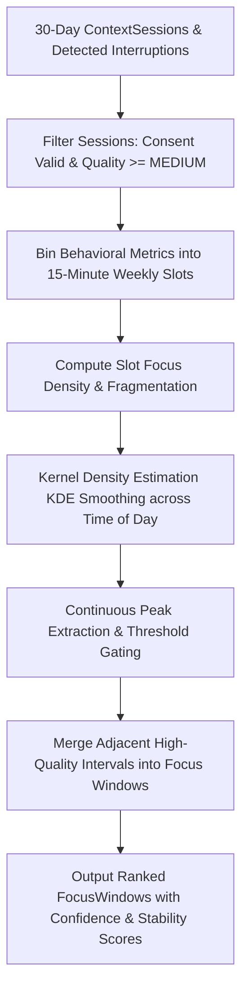

# Focus Window Discovery Engine Design

## 1. Overview & Purpose

The **Focus Window Discovery Engine** detects recurrent, highly focused temporal intervals ("Prime Focus Windows") unique to each individual. 

In traditional task systems, tasks are scheduled against rigid calendar slots or arbitrary deadlines. ContextIQ leverages continuous desktop telemetry (`context_sessions`, app switches, idle durations, and detected interruptions) to discover an individual's natural productivity cadence:
- When does the user consistently achieve extended uninterrupted focus?
- Which days and hours exhibit the lowest context-switching frequency and minimal resumption lag?
- Which time slots are recurrently fragmented by interruptions or rapid app churn?

The engine outputs explicit, high-confidence **Focus Window** objects utilized by:
1. **Adaptive Task Prioritization Engine**: To schedule high-complexity, high-forgetting-risk tasks into prime focus periods.
2. **Notification Intelligence Manager**: To suppress low-priority nudges and guard uninterrupted flow state.
3. **Intervention Recommendation Engine**: To surface proactive suggestions (e.g. "Optimal Cadence: Reserve 10:00–11:30 for deep work").

---

## 2. Mathematical Discovery Methodology

The discovery algorithm processes historical reconstructed sessions across a rolling 30-day window to extract temporal focus density and stability.



### 2.1 15-Minute Slot Binning
A weekly cycle is divided into $K = 7 \times 96 = 672$ discrete 15-minute intervals $k \in [0, 671]$, indexed by day of week $d \in [0, 6]$ and quarter-hour $q \in [0, 95]$.

For each slot $k$, historical telemetry yields:
- $F_k$: Total seconds spent in focused desktop engagement.
- $I_k$: Total count of interruptions and rapid transitions.
- $N_k$: Number of observed days for slot $k$.

The raw Focus Density $\rho_k$ and Fragmentation Index $\Phi_k$ are defined as:

$$\rho_k = \frac{F_k}{N_k \times 900 \text{ sec}} \in [0, 1]$$
$$\Phi_k = \frac{I_k}{N_k} \times \left(1 + \frac{\text{AvgResumptionLag}_k}{60}\right)$$

### 2.2 Circular Kernel Density Smoothing
Because human routines possess slight daily jitter (e.g. sitting down between 09:10 and 09:35), discrete slot density is smoothed across time using a circular Gaussian kernel:

$$\hat{\rho}(t) = \frac{1}{\sum_{k} w_k} \sum_{k=1}^K \rho_k \cdot K_h(t - t_k)$$

Where $K_h(u) = \frac{1}{\sqrt{2\pi} h} \exp\left(-\frac{u^2}{2h^2}\right)$ with bandwidth $h = 45\text{ minutes}$.

### 2.3 Window Delineation & Scoring
A continuous block of time $[t_{\text{start}}, t_{\text{end}}]$ qualifies as a **Prime Focus Window** if:
1. $\hat{\rho}(t) \ge \Theta_{\text{focus}}$ for all $t \in [t_{\text{start}}, t_{\text{end}}]$ (where default $\Theta_{\text{focus}} = 0.65$).
2. Duration $(t_{\text{end}} - t_{\text{start}}) \ge 45\text{ minutes}$.
3. Average Fragmentation $\bar{\Phi} \le \Theta_{\text{frag}}$ (where default $\Theta_{\text{frag}} = 1.20$).

Each discovered window is assigned a **Focus Quality Score** $Q \in [0, 100]$:

$$Q = 100 \times \left(0.50 \cdot \bar{\rho} + 0.30 \cdot (1 - \min(1, \bar{\Phi}/3)) + 0.20 \cdot \text{Consistency}\right)$$

Where $\text{Consistency} = \frac{\text{Weeks Observed with Focus}}{\text{Total Weeks Tracked}} \in [0, 1]$.

---

## 3. Data Contracts & Database Schema

### 3.1 Database Model: `user_focus_windows`

```python
"""Database model for discovered user focus windows."""
import uuid
from datetime import datetime, time
from typing import Any, Dict, List, Optional

import sqlalchemy as sa
from sqlalchemy import Boolean, DateTime, Float, ForeignKey, Index, Integer, String, Time
from sqlalchemy.dialects.postgresql import JSONB, UUID
from sqlalchemy.orm import Mapped, mapped_column, relationship

from app.db.session import Base
from app.models.mixins import UUIDPKMixin, utcnow


class UserFocusWindow(Base, UUIDPKMixin):
    """
    Discovered recurrent personal focus interval. Represents empirically
    validated periods of deep cognitive capacity.
    """

    __tablename__ = "user_focus_windows"
    __table_args__ = (
        Index("ix_focus_windows_user_dow", "user_id", "day_of_week"),
        Index("ix_focus_windows_user_quality", "user_id", "quality_score"),
    )

    user_id: Mapped[uuid.UUID] = mapped_column(
        UUID(as_uuid=True), ForeignKey("users.id", ondelete="CASCADE"), nullable=False, index=True
    )

    # Temporal Specification
    day_of_week: Mapped[int] = mapped_column(Integer, nullable=False)  # 0=Monday, 6=Sunday
    start_time: Mapped[time] = mapped_column(Time, nullable=False)
    end_time: Mapped[time] = mapped_column(Time, nullable=False)
    duration_minutes: Mapped[int] = mapped_column(Integer, nullable=False)

    # Quality & Empirical Metrics
    quality_score: Mapped[float] = mapped_column(Float, nullable=False)  # 0.0 - 100.0
    focus_density: Mapped[float] = mapped_column(Float, nullable=False)  # 0.0 - 1.0
    fragmentation_index: Mapped[float] = mapped_column(Float, nullable=False)
    consistency_score: Mapped[float] = mapped_column(Float, nullable=False)  # 0.0 - 1.0

    # Behavioral Affinities (e.g. apps most frequently active during this window)
    primary_categories: Mapped[List[str]] = mapped_column(
        sa.JSON().with_variant(JSONB, "postgresql"), nullable=False, default=list
    )
    is_active: Mapped[bool] = mapped_column(Boolean, nullable=False, default=True)
    user_confirmed: Mapped[bool] = mapped_column(Boolean, nullable=False, default=False)

    discovered_at: Mapped[datetime] = mapped_column(DateTime(timezone=True), default=utcnow, nullable=False)
    last_validated_at: Mapped[datetime] = mapped_column(DateTime(timezone=True), default=utcnow, nullable=False)

    user = relationship("User")
```

### 3.2 Pydantic Read Schema: `FocusWindowRead`

```python
from datetime import time
from typing import List, Optional
import uuid
from pydantic import BaseModel, ConfigDict, Field


class FocusWindowRead(BaseModel):
    model_config = ConfigDict(from_attributes=True)

    id: uuid.UUID
    user_id: uuid.UUID
    day_of_week: int = Field(ge=0, le=6, description="0=Monday, 6=Sunday")
    start_time: time
    end_time: time
    duration_minutes: int
    quality_score: float = Field(ge=0.0, le=100.0)
    focus_density: float = Field(ge=0.0, le=1.0)
    fragmentation_index: float
    consistency_score: float = Field(ge=0.0, le=1.0)
    primary_categories: List[str]
    is_active: bool
    user_confirmed: bool
```

---

## 4. Operational Integration & Downstream Consumers

### 4.1 Prioritization & Schedule Shift Integration
When the **Adaptive Task Prioritization Engine** evaluates pending tasks:
- Complex tasks ($T_{\text{est}} \ge 45\text{ min}$, High Priority, High Forgetting Risk) are assigned an affinity bonus if scheduled within an upcoming Focus Window occurring within the next 24 hours.
- If a high-priority task is currently scheduled during a known fragmented window (e.g. Friday 15:30), the **Intervention Recommendation Engine** synthesizes a `SCHEDULE_SHIFT` intervention suggesting migration into the next detected Prime Focus Window.

### 4.2 Notification Suppression & Flow Protection
During an active Focus Window:
- The **Notification Intelligence Manager** dynamically elevates the threshold for ambient notifications.
- All non-urgent reminders (`REMINDER`, `TASK_BATCHING`, `BREAK_SUGGESTION`) are suppressed or queued into a post-window digest.
- If desktop telemetry confirms active deep focus (continuous keyboard/mouse inputs and low transition rate), an automated "Flow Shield" state is engaged.

---

## 5. User Control & Calendar Verification

Users retain complete visibility and sovereignty over discovered focus windows:
- **Dashboard Visualization**: Displayed as an interactive weekly cadence heat map on the Next.js frontend (`/analytics/focus-rhythm`).
- **User Confirmation / Tuning**: Users can manually lock ("Confirm"), resize, or delete discovered windows.
- **Privacy Gating**: If a user has disabled `TelemetryCategory.SESSION_RECONSTRUCTION`, focus window discovery relies exclusively on explicit calendar events and self-reported `User.focus_rhythm` preferences.
