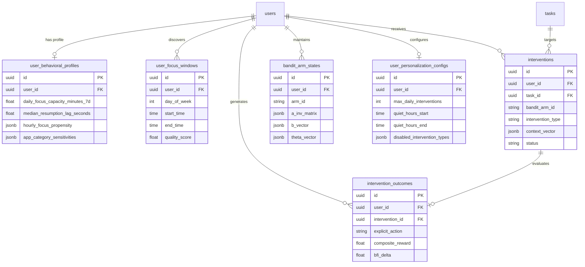

# ContextIQ Phase 4: Implementation Roadmap & Technical Delivery Plan

## 1. Executive Roadmap & Phased Milestones

Phase 4 transforms ContextIQ into an **Adaptive Behavioral Intelligence Platform**. The delivery plan is organized into five structured sub-phases to ensure rigorous isolation, comprehensive testing, and incremental validation.

```
┌─────────────────────────────────────────────────────────────────────────────────────────┐
│                               PHASE 4 DELIVERY ROADMAP                                  │
├───────────────┬───────────────────────────────────┬──────────────┬──────────────────────┤
│ Milestone     │ Scope & Focus                     │ Target Cycle │ Key Deliverables     │
├───────────────┼───────────────────────────────────┼──────────────┼──────────────────────┤
│ **Phase 4.1** │ Architecture Audit & Design       │ Sprint 1     │ Complete design      │
│               │ *(Current Milestone)*             │              │ specifications,      │
│               │                                   │              │ mathematical models, │
│               │                                   │              │ data contracts.      │
├───────────────┼───────────────────────────────────┼──────────────┼──────────────────────┤
│ **Phase 4.2** │ Profile & Focus Window Discovery  │ Sprint 2     │ `user_behavioral_    │
│               │ - Behavioral Profile Engine       │              │  profiles`,          │
│               │ - EWMA baselines & sensitivity    │              │ `user_focus_windows`,│
│               │ - KDE focus window discovery      │              │ Alembic migrations.  │
├───────────────┼───────────────────────────────────┼──────────────┼──────────────────────┤
│ **Phase 4.3** │ Prioritization & Interventions    │ Sprint 3     │ Multi-objective task │
│               │ - Adaptive Task Prioritizer       │              │ prioritizer, trigger │
│               │ - Intervention Trigger Engine     │              │ rules, candidate     │
│               │ - Grounded explanation wiring     │              │ slate generator.     │
├───────────────┼───────────────────────────────────┼──────────────┼──────────────────────┤
│ **Phase 4.4** │ Bandit & Notification Manager     │ Sprint 4     │ LinUCB online solver,│
│               │ - Contextual Bandit Engine        │              │ cognitive token-     │
│               │ - Token-bucket rate limiting      │              │ bucket manager,      │
│               │ - Flow-state shield & quiet hours │              │ channel router.      │
├───────────────┼───────────────────────────────────┼──────────────┼──────────────────────┤
│ **Phase 4.5** │ Closed-Loop Feedback & Frontend   │ Sprint 5     │ Dual-loop reward     │
│               │ - Dual-loop evaluation engine     │              │ calculator, Next.js  │
│               │ - Frontend UI components          │              │ profile controls,    │
│               │ - End-to-end telemetry testing    │              │ snooze & feedback.   │
└───────────────┴───────────────────────────────────┴──────────────┴──────────────────────┘
```

---

## 2. Database Schema Migrations (Alembic)

Phase 4 introduces 6 new database tables through an Alembic migration script (`alembic/versions/b1c2d3e4f5a6_add_adaptive_intelligence_tables.py`):



---

## 3. API Surface Specifications

Phase 4 exposes a dedicated `/api/v1/adaptive` endpoint namespace:

```
┌────────────────────────────────────────────────────────────────────────────────────────┐
│                                ADAPTIVE API ROUTES                                     │
├───────────────────────────────────┬────────┬───────────────────────────────────────────┤
│ Endpoint Path                     │ Method │ Purpose / Contract                        │
├───────────────────────────────────┼────────┼───────────────────────────────────────────┤
│ `/api/v1/adaptive/profile`        │ GET    │ Returns full user behavioral profile,     │
│                                   │        │ baseline metrics, and sensitivity vectors.│
├───────────────────────────────────┼────────┼───────────────────────────────────────────┤
│ `/api/v1/adaptive/profile/reset`  │ POST   │ Clears empirical metrics and resets to    │
│                                   │        │ cold-start population defaults.           │
├───────────────────────────────────┼────────┼───────────────────────────────────────────┤
│ `/api/v1/adaptive/focus-windows`  │ GET    │ Lists discovered weekly focus windows     │
│                                   │        │ with quality and consistency scores.      │
├───────────────────────────────────┼────────┼───────────────────────────────────────────┤
│ `/api/v1/adaptive/tasks/prioritize`│ POST   │ Dynamically re-ranks pending tasks given  │
│                                   │        │ current context, BFI, and focus windows.  │
├───────────────────────────────────┼────────┼───────────────────────────────────────────┤
│ `/api/v1/adaptive/interventions`  │ GET    │ Returns active intervention feed          │
│                                   │        │ (un-suppressed, unexpired items).         │
├───────────────────────────────────┼────────┼───────────────────────────────────────────┤
│ `/api/v1/adaptive/interventions/` │ POST   │ Records explicit feedback action          │
│ `{id}/action`                     │        │ (ACCEPT, DISMISS, SNOOZE) + optional note.│
├───────────────────────────────────┼────────┼───────────────────────────────────────────┤
│ `/api/v1/adaptive/preferences`    │ GET    │ Retrieves user personalization config,    │
│                                   │        │ budget caps, quiet hours, and opt-outs.   │
├───────────────────────────────────┼────────┼───────────────────────────────────────────┤
│ `/api/v1/adaptive/preferences`    │ PUT    │ Updates personalization settings, quiet   │
│                                   │        │ hours, and disabled intervention types.   │
└───────────────────────────────────┴────────┴───────────────────────────────────────────┘
```

---

## 4. Architectural Risk Analysis & Mitigations

| Risk Scenario | Severity | Impact | Architectural Mitigation Strategy |
| :--- | :--- | :--- | :--- |
| **Cold-Start Policy Degradation** | Medium | Irrelevant suggestions during user's first week. | Hierarchical Bayesian shrinkage: blend empirical observations with persona-based priors ($N_0 = 7\text{ days}$). |
| **Runaway Bandit Exploration** | High | System attempts disruptive interventions during sensitive work. | Hard safety constraints: LinUCB exploration parameter $\alpha$ is capped at $0.85$, and the Notification Manager strictly enforces flow-state suppression. |
| **Alert Fatigue / Notification Annoyance** | Critical | User uninstalls desktop telemetry or revokes permissions. | Dual-horizon token-bucket rate limiter: absolute ceiling of 4–6 alerts/day, mandatory 35-minute cooldown, and 1-click mute. |
| **Numerical Instability in Sherman-Morrison** | Medium | Degenerate covariance inverse $A_a^{-1}$ causing NaN scores. | Condition number monitoring: trigger Tikhonov regularized reinversion ($A_a \leftarrow A_a + 0.1 I_d$) if $\kappa(A_a) > 10^5$. |
| **Data Leakage in Feature Extraction** | High | Unrealistic offline evaluation scores. | Strict temporal assertions: all context features $x_t$ are evaluated strictly prior to decision epoch $t$. |
| **Privacy / Non-Consented Inferences** | Critical | Regulatory breach or loss of user trust. | All adaptive features are gated by `TelemetryConsent`. App exclusions scrub titles and process names before feature vector construction. |

---

## 5. Verification Checklist & Acceptance Criteria

### Technical Acceptance Criteria
- [x] **Audit Completeness**: All 16 existing subsystems and models documented with explicit reuse strategies.
- [x] **Separation of Concerns**: `forgetting-ml` strictly predicts risk; `intelligence` strictly explains grounded rationale; `adaptive` engine manages decision optimization.
- [x] **Mathematical Rigor**: Formal formulations documented for EWMA baselines, KDE focus window smoothing, multi-objective task utility, LinUCB with Sherman-Morrison updates, and dual-loop rewards.
- [x] **Data Contracts**: Explicit SQLAlchemy database schemas and Pydantic validation contracts authored for all 6 new entities.
- [x] **Privacy Governance**: User profile transparency, 1-click profile reset, selective category opt-out, and telemetry consent gating specified.
- [x] **Fatigue Protection**: Token-bucket cognitive budget, flow-state detection, and quiet hours defined.
- [x] **Documentation Artifacts**: All 9 requested markdown files authored in `docs/phase-4/`.
