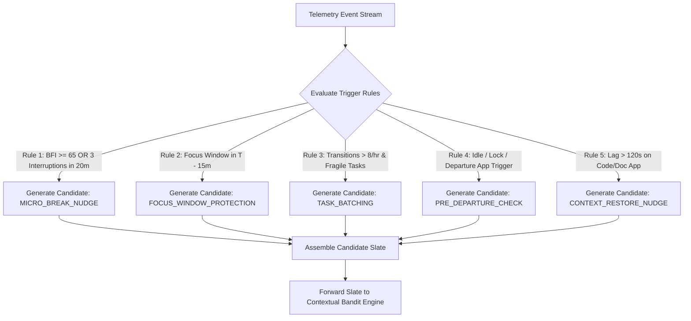

# Intervention Recommendation Engine Design

## 1. Overview & Purpose

The **Intervention Recommendation Engine** synthesizes real-time behavioral telemetry, user behavioral profiles, task prioritization states, and association rules into actionable, personalized cognitive interventions.

In static notification architectures, nudges are blasted based on elapsed timers or rigid reminders, leading to annoyance, alert fatigue, and automatic dismissals. The Intervention Recommendation Engine operates on a **pull-and-trigger model**:
1. It listens for specific **Behavioral Opportunity Triggers** (e.g. disruption clustering, departure preparation, context thrashing, onset of a focus window).
2. It generates a slate of candidate **Intervention Arms**.
3. It parameterizes each candidate with structured evidence and grounded payload parameters.
4. It forwards the candidate slate to the **Contextual Bandit Engine** for optimal arm selection and the **Notification Intelligence Manager** for fatigue gating.

---

## 2. Comprehensive Intervention Taxonomy

Phase 4 formalizes an extensible taxonomy of 6 primary intervention types, each mapped to specific cognitive friction mechanisms:

```
┌────────────────────────────────────────────────────────────────────────────────────────┐
│                              INTERVENTION TAXONOMY                                     │
├──────────────────────────┬─────────────────────────────┬───────────────────────────────┤
│ Intervention Type        │ Behavioral Target           │ Primary Delivery Goal         │
├──────────────────────────┼─────────────────────────────┼───────────────────────────────┤
│ 1. MICRO_BREAK_NUDGE     │ Elevated Behavioral         │ Prompt a 3-5 minute cognitive  │
│                          │ Friction Index (BFI > 65),  │ reset to disrupt disruption   │
│                          │ consecutive interruptions.  │ clusters and lower lag.       │
├──────────────────────────┼─────────────────────────────┼───────────────────────────────┤
│ 2. FOCUS_WINDOW_         │ Upcoming Prime Focus        │ Prompt user to mute non-vital │
│    PROTECTION            │ Window detected within      │ apps and prepare for high-    │
│                          │ 15 minutes.                 │ cognitive-demand focus block. │
├──────────────────────────┼─────────────────────────────┼───────────────────────────────┤
│ 3. TASK_BATCHING         │ High context-switching      │ Bundle short, fragmented      │
│                          │ frequency (> 8 switches/hr) │ tasks sharing the same app    │
│                          │ and low session focus depth.│ context into a single batch.  │
├──────────────────────────┼─────────────────────────────┼───────────────────────────────┤
│ 4. PRE_DEPARTURE_CHECK   │ Impending context change,   │ Prompt associated "One More   │
│    ("One More Thing")    │ system shutdown, or idle    │ Thing" anchor task before     │
│                          │ before physical departure.  │ context transition occurs.    │
├──────────────────────────┼─────────────────────────────┼───────────────────────────────┤
│ 5. SCHEDULE_OPTIMIZATION │ High-risk task scheduled    │ Suggest migrating task from a │
│                          │ during historical high-     │ high-friction slot into an    │
│                          │ disruption slot.            │ identified Focus Window.      │
├──────────────────────────┼─────────────────────────────┼───────────────────────────────┤
│ 6. CONTEXT_RESTORE_NUDGE │ Extended resumption lag     │ Surface last active artifact, │
│                          │ (> 120s) following an       │ function diff, or task note   │
│                          │ abrupt interruption.        │ to accelerate re-entry.       │
└──────────────────────────┴─────────────────────────────┴───────────────────────────────┘
```

---

## 3. Trigger Condition Evaluation & Rules

The engine continually evaluates rule conditions against the user's active session state:



### 3.1 Trigger Rule Specifications

1. **Trigger: `FrictionClusteringTrigger`**
   - Condition: `session.behavioral_friction_index >= 65.0` OR `consecutive_interruption_count >= 3` within 20 minutes.
   - Action: Synthesizes `MICRO_BREAK_NUDGE` candidate.

2. **Trigger: `UpcomingFocusWindowTrigger`**
   - Condition: Current time $t \in [t_{\text{start}} - 15\text{m}, t_{\text{start}}]$ of a verified `UserFocusWindow`.
   - Action: Synthesizes `FOCUS_WINDOW_PROTECTION` candidate with recommended top-priority task.

3. **Trigger: `ContextThrashingTrigger`**
   - Condition: `context_switch_frequency_24h >= 8.0` AND user has $\ge 2$ pending tasks with matching `context_tag`.
   - Action: Synthesizes `TASK_BATCHING` candidate grouping the matching tasks.

4. **Trigger: `DepartureProximityTrigger`**
   - Condition: Win32 workstation lock, idle returned $> 10$ minutes at end of day, or `TaskAssociation` pattern triggered.
   - Action: Synthesizes `PRE_DEPARTURE_CHECK` with highest-lift associated task.

5. **Trigger: `ResumptionStallTrigger`**
   - Condition: User returns from interruption to primary app but keyboard/mouse velocity is $< 10\%$ of baseline for $> 90$ seconds.
   - Action: Synthesizes `CONTEXT_RESTORE_NUDGE` surfacing user's pre-interruption anchor.

---

## 4. Data Contracts & Database Architecture

### 4.1 Enhanced Database Model: `interventions`

```python
"""Database model for personalized adaptive interventions."""
import uuid
from datetime import datetime
from typing import Any, Dict, List, Optional

import sqlalchemy as sa
from sqlalchemy import Boolean, DateTime, Enum, Float, ForeignKey, Index, Integer, String, Text
from sqlalchemy.dialects.postgresql import JSONB, UUID
from sqlalchemy.orm import Mapped, mapped_column, relationship

from app.db.session import Base
from app.models.enums import RecommendationStatus, RecommendationType
from app.models.mixins import TimestampMixin, UUIDPKMixin, utcnow


class Intervention(Base, UUIDPKMixin, TimestampMixin):
    """
    Personalized intervention instance selected by the Contextual Bandit
    and managed by Notification Intelligence.
    """

    __tablename__ = "interventions"
    __table_args__ = (
        Index("ix_interventions_user_status", "user_id", "status"),
        Index("ix_interventions_user_created", "user_id", "created_at"),
    )

    user_id: Mapped[uuid.UUID] = mapped_column(
        UUID(as_uuid=True), ForeignKey("users.id", ondelete="CASCADE"), nullable=False, index=True
    )
    task_id: Mapped[Optional[uuid.UUID]] = mapped_column(
        UUID(as_uuid=True), ForeignKey("tasks.id", ondelete="SET NULL"), nullable=True, index=True
    )
    bandit_arm_id: Mapped[str] = mapped_column(String(64), nullable=False, index=True)
    intervention_type: Mapped[RecommendationType] = mapped_column(
        Enum(RecommendationType, name="recommendation_type", native_enum=True), nullable=False
    )

    # Content & Framing
    title: Mapped[str] = mapped_column(String(200), nullable=False)
    message: Mapped[str] = mapped_column(Text, nullable=False)
    grounded_rationale: Mapped[str] = mapped_column(Text, nullable=False)
    evidence_payload: Mapped[List[Dict[str, Any]]] = mapped_column(
        sa.JSON().with_variant(JSONB, "postgresql"), nullable=False, default=list
    )

    # Delivery & Lifecycle
    status: Mapped[RecommendationStatus] = mapped_column(
        Enum(RecommendationStatus, name="recommendation_status", native_enum=True),
        nullable=False,
        default=RecommendationStatus.PENDING,
        index=True,
    )
    delivery_channel: Mapped[str] = mapped_column(String(32), nullable=False, default="IN_APP_BANNER")  # TOAST, BANNER, TRAY
    priority_rank: Mapped[int] = mapped_column(Integer, nullable=False, default=5)
    suppressed_by_guard: Mapped[bool] = mapped_column(Boolean, nullable=False, default=False)
    suppression_reason: Mapped[Optional[str]] = mapped_column(String(64), nullable=True)

    # Decision Context Snapshot (for Bandit Learning)
    context_vector: Mapped[Dict[str, float]] = mapped_column(
        sa.JSON().with_variant(JSONB, "postgresql"), nullable=False, default=dict
    )
    bandit_model_version: Mapped[str] = mapped_column(String(32), nullable=False, default="1.0.0")

    # Timestamps
    shown_at: Mapped[Optional[datetime]] = mapped_column(DateTime(timezone=True), nullable=True)
    responded_at: Mapped[Optional[datetime]] = mapped_column(DateTime(timezone=True), nullable=True)
    expires_at: Mapped[Optional[datetime]] = mapped_column(DateTime(timezone=True), nullable=True)

    user = relationship("User")
    task = relationship("Task")
```

### 4.2 Pydantic Schema: `InterventionRead`

```python
from datetime import datetime
from typing import Any, Dict, List, Optional
import uuid
from pydantic import BaseModel, ConfigDict, Field


class EvidenceItem(BaseModel):
    field: str
    value: str
    source: str


class InterventionRead(BaseModel):
    model_config = ConfigDict(from_attributes=True)

    id: uuid.UUID
    user_id: uuid.UUID
    task_id: Optional[uuid.UUID]
    bandit_arm_id: str
    intervention_type: str
    title: str
    message: str
    grounded_rationale: str
    evidence_payload: List[EvidenceItem]
    status: str
    delivery_channel: str
    priority_rank: int
    shown_at: Optional[datetime]
    created_at: datetime
    expires_at: Optional[datetime]
```

---

## 5. Client Integration & Presentation Affordances

When an intervention is dispatched to the frontend:
- **Card Actions**: The UI displays three explicit buttons:
  1. `Accept / Execute`: Instantly marks the intervention accepted, adds/schedules the task, or starts the break chronometer.
  2. `Snooze (15m / 1h)`: Defers delivery without registering negative feedback.
  3. `Dismiss`: Records explicit dismissal and records user rejection note.
- **Evidence Drawer**: Clicking "Why am I seeing this?" exposes the full `evidence_payload` with verified telemetry sources (e.g. "BFI 68.2 measured at 14:22", "P(forget): 74%").
