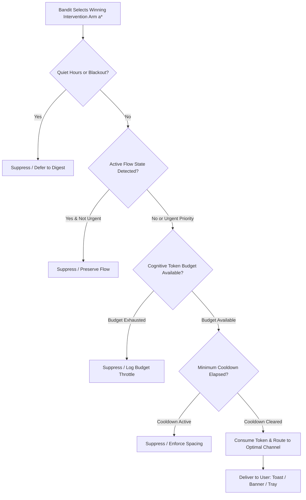

# Notification Intelligence Manager Design

## 1. Overview & Purpose

The **Notification Intelligence Manager** serves as the cognitive gatekeeper for ContextIQ. Its mission is to completely eradicate **Alert Fatigue** and protect the user's flow state.

Even the most accurate machine learning intervention becomes an annoying distraction if delivered at an inopportune moment (e.g. while a developer is typing frantically in an IDE) or at excessive frequencies. The Notification Intelligence Manager sits between the **Contextual Bandit Engine** and the **Delivery Presentation Layer**, enforcing strict cognitive budgets, rate limits, flow-state suppression, and intelligent channel routing.



---

## 2. Cognitive Quota Budget & Token-Bucket Rate Limiting

To guarantee that ContextIQ remains an ambient, respectful assistant, intervention delivery is governed by a **Dual-Horizon Leaky Token Bucket**:

### 2.1 4-Hour Rolling Cognitive Budget
- **Bucket Capacity**: $\mathcal{C}_{4h} = 3\text{ tokens}$.
- **Replenishment Rate**: $1\text{ token per } 80\text{ minutes}$ of active work.
- **Cost**:
  - `MICRO_BREAK_NUDGE`: $1.0\text{ token}$.
  - `SCHEDULE_OPTIMIZATION`: $0.5\text{ token}$ (ambient in-app badge).
  - `FOCUS_WINDOW_PROTECTION`: $1.0\text{ token}$.
  - `PRE_DEPARTURE_CHECK`: $1.0\text{ token}$.

### 2.2 Daily Maximum Ceiling
- **Hard Daily Limit**: No user receives more than $6\text{ proactive ambient notifications}$ in a single 24-hour cycle under any circumstances.
- Once the daily ceiling is reached, all further suggestions are silently written to the in-app Recommendations Feed without triggering desktop sounds or pop-up banners.

---

## 3. Flow-State Detection & Notification Suppression

Interrupting an individual during deep focus incurs an immense cognitive penalty (average resumption time 15–23 minutes in software engineering literature). The manager implements an automated **Flow Shield**:

### 3.1 Flow-State Recognition Heuristic
A user is classified in **Flow State** at time $t$ if:
1. `session.focused_time_seconds >= 1200` (at least 20 continuous minutes of active engagement).
2. `session.transition_count <= 2` during the last 20 minutes.
3. Desktop telemetry confirms recent input events (keyboard/mouse) within the last 60 seconds.
4. Active application belongs to a `DEEP_WORK` category (e.g. IDE, document editor, CAD, terminal).

### 3.2 Flow Shield Suppression Policy
When Flow State is active:
- **All non-critical interventions are strictly suppressed** (including `BREAK_SUGGESTION`, `TASK_BATCHING`, `SCHEDULE_SHIFT`).
- The bandit logs the event as `suppressed_by_guard = True` with reason `FLOW_STATE_ACTIVE`.
- No negative bandit penalty is registered; the arm is treated as a neutral suppression.

---

## 4. Cooldown Spacing & Diurnal Constraints

### 4.1 Minimum Spacing Intervals
Even if the token bucket has capacity, adjacent interventions must respect minimum temporal cooldowns:
- **Same-Type Cooldown**: Minimum $90\text{ minutes}$ between two interventions of the identical type (e.g. two break nudges).
- **Global Inter-Nudge Cooldown**: Minimum $35\text{ minutes}$ between *any* two audible or pop-up desktop interventions.

### 4.2 Quiet Hours & Calendar Blackouts
- **Default Quiet Hours**: 20:00 to 08:30 local user time (customizable in user settings).
- **Calendar Blackout**: Automatically suppresses notifications during calendar-scheduled meetings or video calls (`Zoom`, `Teams`, `Meet`).

---

## 5. Multi-Channel Routing Matrix

The manager dynamically selects the delivery channel based on the intervention's priority and the user's current desktop focus:

| Channel | Intrusiveness Level | Form Factor | Appropriate Scenarios |
| :--- | :--- | :--- | :--- |
| **System Tray Icon Glow** | Ultra-Low (Passive) | Pulsing icon dot in Windows system tray | Low-urgency suggestions (`SCHEDULE_SHIFT`, `TASK_BATCHING`). |
| **In-App Dashboard Card** | Low (Ambient) | Rendered in Next.js web application | Standard task recommendations, "One More Thing" feed. |
| **Windows Toast Notification** | Medium (Active) | Native Windows 11 Action Center banner | `FOCUS_WINDOW_PROTECTION` (T-15m), `PRE_DEPARTURE_CHECK`. |
| **Modal / Focal Banner** | High (Interruptive) | Unobtrusive top-screen banner (5-sec auto-fade) | Urgent `MICRO_BREAK_NUDGE` during critical friction cluster. |

---

## 6. Personalization Configuration Schema: `user_personalization_configs`

```python
"""Database model for user personalization and notification controls."""
import uuid
from datetime import datetime, time
from typing import Any, Dict, List, Optional

import sqlalchemy as sa
from sqlalchemy import Boolean, DateTime, Float, ForeignKey, Index, Integer, String, Time
from sqlalchemy.dialects.postgresql import JSONB, UUID
from sqlalchemy.orm import Mapped, mapped_column, relationship

from app.db.session import Base
from app.models.mixins import UUIDPKMixin, utcnow


class UserPersonalizationConfig(Base, UUIDPKMixin):
    """
    User-configurable notification thresholds, cognitive budget limits,
    quiet hours, and intervention opt-out settings.
    """

    __tablename__ = "user_personalization_configs"
    __table_args__ = (
        Index("ix_personalization_configs_user", "user_id", unique=True),
    )

    user_id: Mapped[uuid.UUID] = mapped_column(
        UUID(as_uuid=True), ForeignKey("users.id", ondelete="CASCADE"), nullable=False, unique=True
    )

    # Master Toggles
    adaptive_recommendations_enabled: Mapped[bool] = mapped_column(Boolean, nullable=False, default=True)
    ambient_desktop_toasts_enabled: Mapped[bool] = mapped_column(Boolean, nullable=False, default=True)
    sound_alerts_enabled: Mapped[bool] = mapped_column(Boolean, nullable=False, default=False)

    # Frequency & Budget Preferences
    # Options: CONSERVATIVE (max 2/day), BALANCED (max 4/day), PROACTIVE (max 6/day)
    frequency_tier: Mapped[str] = mapped_column(String(32), nullable=False, default="BALANCED")
    max_daily_interventions: Mapped[int] = mapped_column(Integer, nullable=False, default=4)
    min_cooldown_minutes: Mapped[int] = mapped_column(Integer, nullable=False, default=45)

    # Quiet Hours & Blackouts
    quiet_hours_enabled: Mapped[bool] = mapped_column(Boolean, nullable=False, default=True)
    quiet_hours_start: Mapped[time] = mapped_column(Time, nullable=False, default=time(20, 0))
    quiet_hours_end: Mapped[time] = mapped_column(Time, nullable=False, default=time(8, 30))
    suppress_during_flow: Mapped[bool] = mapped_column(Boolean, nullable=False, default=True)
    suppress_during_meetings: Mapped[bool] = mapped_column(Boolean, nullable=False, default=True)

    # Granular Category Opt-Outs (Schema: ["BREAK_SUGGESTION", "TASK_BATCHING"])
    disabled_intervention_types: Mapped[List[str]] = mapped_column(
        sa.JSON().with_variant(JSONB, "postgresql"), nullable=False, default=list
    )

    updated_at: Mapped[datetime] = mapped_column(DateTime(timezone=True), default=utcnow, onupdate=utcnow, nullable=False)
    created_at: Mapped[datetime] = mapped_column(DateTime(timezone=True), default=utcnow, nullable=False)

    user = relationship("User")
```

---

## 7. User Privacy & Opt-Out Experience

Users maintain authoritative control over their cognitive environment:
- **Instant Mute ("Do Not Disturb")**: A single click on the desktop agent system tray mutes all ContextIQ interventions for 1 hour, 4 hours, or the rest of the day.
- **Intervention Disabling**: If a user clicks "Don't suggest breaks anymore" on a break card, `disabled_intervention_types` is updated immediately via `POST /api/v1/adaptive/preferences`, permanently excluding that arm from future bandit slates.
