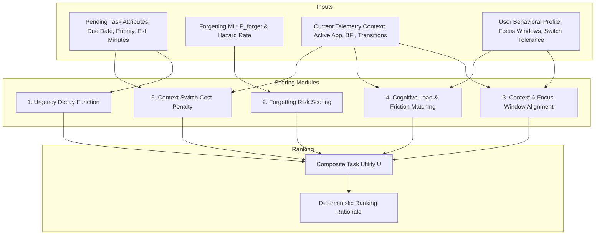

# Adaptive Task Prioritization Engine Design

## 1. Overview & Purpose

The **Adaptive Task Prioritization Engine** re-ranks a user's pending tasks dynamically based on their instantaneous cognitive capacity, current desktop context, upcoming focus windows, and machine-learned forgetting risk.

Static task lists sort by artificial due dates or fixed priority tags (`URGENT`, `HIGH`, `MEDIUM`, `LOW`). In contrast, human productivity fluctuates continuously:
- A user experiencing high behavioral friction (multiple disruptions, elevated resumption lag) cannot effectively execute a 90-minute high-focus architecture task, leading to procrastination or task abandonment.
- Conversely, during an uninterrupted prime focus window, surfacing low-cognitive-load trivial chores wastes peak mental bandwidth.
- When an individual is already working inside a specific IDE or application suite, prioritizing tasks associated with that exact context eliminates costly context-switching penalties.

The engine evaluates a continuous multi-objective utility function, producing an optimized, context-aligned task queue with transparent explanations for ranking decisions.

---

## 2. Multi-Objective Task Utility Formulation

For a user $u$ at current time $t$, given current context session $C_t$ and pending task $T_i$, the total utility score $U(T_i, C_t, t)$ is defined as:

$$U(T_i, C_t, t) = w_{\text{urg}} \cdot \mathcal{S}_{\text{urg}}(T_i, t) + w_{\text{risk}} \cdot \mathcal{S}_{\text{risk}}(T_i) + w_{\text{fit}} \cdot \mathcal{S}_{\text{fit}}(T_i, C_t) + w_{\text{cap}} \cdot \mathcal{S}_{\text{cap}}(T_i, BFI_t) - w_{\text{switch}} \cdot \mathcal{C}_{\text{switch}}(T_i, C_t)$$

Where weights satisfy $\sum w_j = 1.0$ (default configuration: $w_{\text{urg}} = 0.25, w_{\text{risk}} = 0.25, w_{\text{fit}} = 0.20, w_{\text{cap}} = 0.15, w_{\text{switch}} = 0.15$).



### 2.1 Urgency Decay Function $\mathcal{S}_{\text{urg}}(T_i, t)$
Quantifies temporal proximity to task deadline:

$$\mathcal{S}_{\text{urg}}(T_i, t) = \begin{cases}
1.0 & \text{if } t > t_{\text{due}} \text{ (Overdue)} \\
\exp\left(-\frac{\max(0, t_{\text{due}} - t)}{\tau}\right) & \text{if } t \le t_{\text{due}} \\
\text{PriorityBase}(T_i.\text{priority}) & \text{if } t_{\text{due}} \text{ is None}
\end{cases}$$

Where $\tau = 48\text{ hours}$, and $\text{PriorityBase}$ maps `URGENT` $\to 0.85$, `HIGH` $\to 0.65$, `MEDIUM` $\to 0.45$, `LOW` $\to 0.20$.

### 2.2 Forgetting Risk Scoring $\mathcal{S}_{\text{risk}}(T_i)$
Integrates directly with Phase 2's `forgetting-ml` predictions:

$$\mathcal{S}_{\text{risk}}(T_i) = P(\text{forget} \mid T_i) \times \left(1 + \text{PriorAbandonmentRate}(T_i.\text{context\_tag})\right)$$

Tasks identified with elevated forgetting hazard are surfaced proactively before memory decay occurs.

### 2.3 Context & Focus Window Alignment $\mathcal{S}_{\text{fit}}(T_i, C_t)$
Measures synergy between the task's context requirements and the current temporal window:
- If current time $t$ falls inside a verified **Prime Focus Window** and $T_i.\text{estimated\_minutes} \ge 30$: $\mathcal{S}_{\text{fit}} \leftarrow 1.0$.
- If current time $t$ is outside a focus window and $T_i$ is a quick task ($T_i \le 15\text{ min}$): $\mathcal{S}_{\text{fit}} \leftarrow 0.85$.
- If $T_i.\text{context\_tag}$ matches the currently active application category (e.g. `DEVELOPMENT` when VS Code is foregrounded): bonus $+0.30$.

### 2.4 Cognitive Load & Friction Matching $\mathcal{S}_{\text{cap}}(T_i, BFI_t)$
Dynamically throttles task difficulty based on the current Behavioral Friction Index ($BFI_t \in [0, 100]$):

$$\text{TaskComplexity}(T_i) = \frac{\min(120, T_i.\text{estimated\_minutes})}{120} \times \text{Weight}(\text{priority})$$
$$\mathcal{S}_{\text{cap}}(T_i, BFI_t) = 1.0 - \left|\frac{BFI_t}{100} - (1.0 - \text{TaskComplexity}(T_i))\right|$$

**Behavioral Effect**: When $BFI$ is elevated ($> 65$), complex tasks receive a penalty while small, frictionless tasks receive a boost. When $BFI$ is low ($< 30$), demanding tasks receive maximum affinity.

### 2.5 Context Switch Cost Penalty $\mathcal{C}_{\text{switch}}(T_i, C_t)$
Penalizes switching mental context from the active task/application:

$$\mathcal{C}_{\text{switch}}(T_i, C_t) = \begin{cases}
0.0 & \text{if } T_i.\text{context\_tag} == C_t.\text{active\_context} \\
0.5 & \text{if } T_i \text{ shares app category with } C_t \\
1.0 & \text{if } T_i \text{ requires full application & context switch}
\end{cases}$$

---

## 3. Data Contracts & API Schemas

### 3.1 Pydantic Request & Response Schemas

```python
"""Pydantic schemas for adaptive task prioritization."""
import uuid
from datetime import datetime
from typing import Any, Dict, List, Optional
from pydantic import BaseModel, ConfigDict, Field


class TaskScoreBreakdown(BaseModel):
    urgency_score: float = Field(ge=0.0, le=1.0)
    forgetting_risk_score: float = Field(ge=0.0, le=1.0)
    context_fit_score: float = Field(ge=0.0, le=1.0)
    cognitive_capacity_score: float = Field(ge=0.0, le=1.0)
    switch_cost_penalty: float = Field(ge=0.0, le=1.0)
    composite_utility: float = Field(ge=-1.0, le=1.0)


class RankedTaskItem(BaseModel):
    model_config = ConfigDict(from_attributes=True)

    task_id: uuid.UUID
    title: str
    original_priority: str
    estimated_minutes: Optional[int]
    due_at: Optional[datetime]
    rank_order: int
    utility_score: float
    scores: TaskScoreBreakdown
    ranking_rationale: str


class PrioritizedTaskListResponse(BaseModel):
    user_id: uuid.UUID
    evaluated_at: datetime
    active_context: Optional[str]
    current_bfi: float
    is_prime_focus_window: bool
    ranked_tasks: List[RankedTaskItem]
```

### 3.2 Prioritization Endpoint Contract

- **Endpoint**: `POST /api/v1/adaptive/tasks/prioritize`
- **Method**: Evaluates all `PENDING` tasks for the authenticated user, pulls current session BFI from `RecoveryAnalyticsService`, matches context tags against the latest desktop telemetry, and returns the sorted `PrioritizedTaskListResponse`.
- **Latency Guarantee**: Executed in $< 45\text{ ms}$ via vectorized numpy batch computation over the user's active task candidates.

---

## 4. Grounded Ranking Explanations

In adherence to ContextIQ's architectural standards, every rank assignment produces a transparent, deterministic explanation string:

> **Example 1 (Friction Surge)**:
> *"Ranked #1 (Quick Win): 'Review pull request comments' prioritized because high behavioral friction (BFI 72/100) was detected over the last 45 minutes. Knocking out this 10-minute task restores momentum without heavy cognitive load."*

> **Example 2 (Prime Focus Alignment)**:
> *"Ranked #1 (Deep Focus): 'Implement OAuth token refresh' prioritized because you are currently 15 minutes into your Tuesday morning Prime Focus Window with zero desktop disruptions."*

> **Example 3 (Forgetting Prevention)**:
> *"Ranked #2 (Risk Mitigation): 'Submit weekly expense report' elevated due to a 78% predicted forgetting risk for end-of-week deadlines."*
