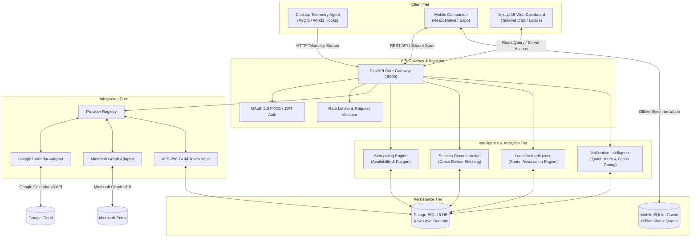
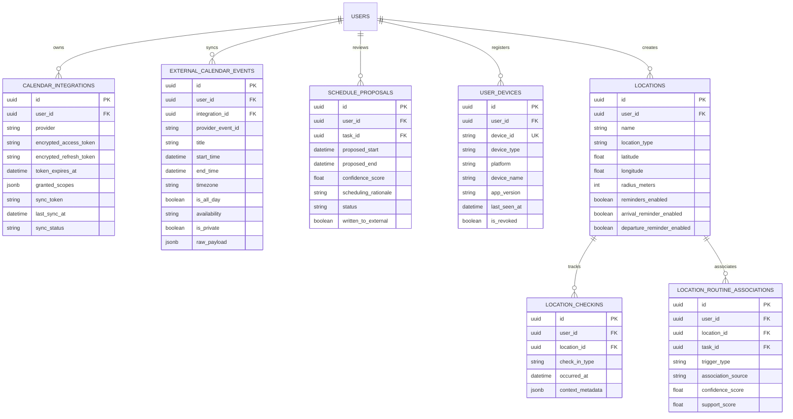

# Phase 5 System Architecture: External Ecosystem & Cross-Platform Intelligence

## 1. Architectural Overview

ContextIQ Phase 5 introduces a modular, cross-platform architecture designed to bridge desktop telemetry, mobile activity, and enterprise cloud calendar services into a unified cognitive intelligence engine.

---

## 2. Component Subsystems

### A. Core Integration Framework
- **`ProviderRegistry`**: Dynamic provider registry managing lifecycles of `GoogleCalendarProvider` and `MicrosoftCalendarProvider`. Supports runtime lookup, credential validation, and health diagnostics.
- **`TokenVault`**: Cryptographic storage leveraging PBKDF2/HKDF key derivation with AES-256-GCM authenticated encryption. Access tokens, refresh tokens, and synchronization states (`syncToken`, `deltaLink`) are sealed before persisting to PostgreSQL.

### B. Intelligent Scheduling Subsystem
- **Availability Matrix Calculation**: Integrates user working hours, external calendar events (`busy` / `tentative`), existing task commitments, and cognitive recovery buffers.
- **Micro-Delay & Fatigue Buffers**: Injects dynamic rest buffers ($\Delta t_{\text{recovery}}$) between high-cognitive-load blocks and preceding meetings.
- **Approval Gating**: Prevents automated external calendar modifications without explicit user consent.

### C. Cross-Device Synchronization Engine
- **Unified Event Schema**: Normalizes desktop active window events, mobile app actions, calendar appointments, and manual check-ins with platform metadata (`WINDOWS`, `ANDROID`, `IOS`, `WEB`, `GOOGLE_CALENDAR`, `MICROSOFT_CALENDAR`).
- **Device Registry**: Manages device lifecycle, tracking `device_id`, platform, application version, registration timestamp, last active timestamp, and revocation status.
- **Cross-Device Session Reconstruction**: Synthesizes multi-device interactions into coherent work episodes, accounting for clock skew and device transitions.

### D. Location-Aware Context Engine
- **Discrete Geofencing Pipeline**: Coarse circular geofences (minimum 100m radius) evaluated on-device. Client only transmits `GEOFENCE_ENTER`, `GEOFENCE_EXIT`, or `MANUAL` check-in events.
- **Context Association Mining**: Adapts Apriori and FP-Growth rule mining to correlate task completions with specific physical contexts, categorizing associations into `EXPLICIT`, `STATISTICALLY_OBSERVED`, and `LOW_CONFIDENCE` tiers.
- **Fatigue & Focus Protection**: Smart reminders are automatically suppressed between 22:00 and 08:00 or when an active focus session is detected.

---

## 3. Relational Schema Architecture (PostgreSQL)

Phase 5 introduced five dedicated database tables and extended two existing models via Alembic migrations:

