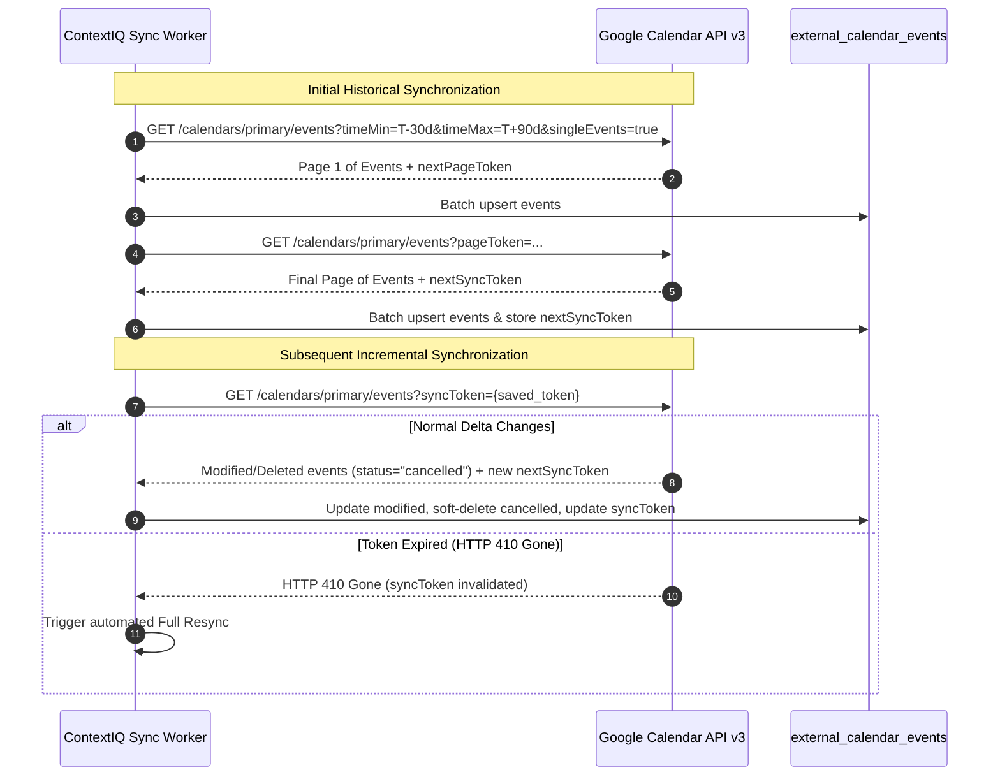
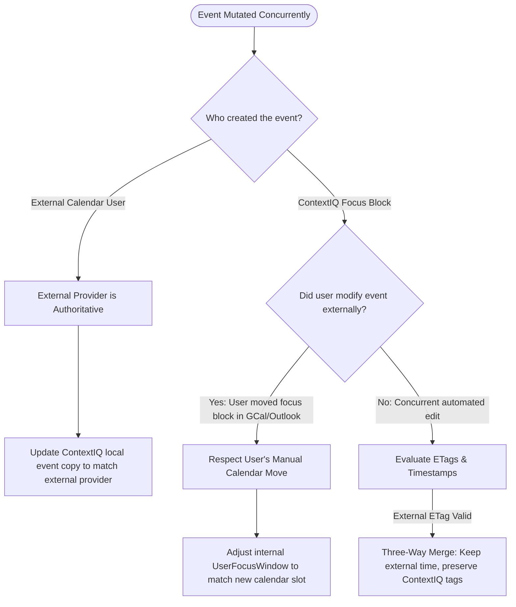

# Bi-Directional Calendar Integration: Google Calendar & Microsoft Outlook

## 1. Overview & Objectives

ContextIQ Phase 5 introduces native bi-directional calendar synchronization with **Google Calendar** and **Microsoft Outlook (Microsoft Graph)**.

The calendar integration serves two critical cognitive purposes:
1. **Cognitive Schedule Awareness**: Discover meetings, workshops, and calls to serve as **hard blackouts** for focus-window discovery and notification delivery, preventing ContextIQ from interrupting users when they are in scheduled meetings.
2. **Actionable Focus Reservation**: Enable the ContextIQ Adaptive Scheduling & Bandit Engine to propose and synchronize optimized focus blocks and task buffers directly into external calendars.

---

## 2. Google Calendar API v3 Specification

### 2.1 OAuth 2.0 Scopes & Endpoints
ContextIQ enforces the principle of least privilege, separating read-only observational synchronization from active focus block creation:

| Mode | Required Scope | Justification |
| :--- | :--- | :--- |
| **Observation & Blackouts (Default)** | `https://www.googleapis.com/auth/calendar.events.readonly` | Read meetings, times, transparency to avoid disruptions. Zero write access. |
| **Active Scheduling (Opt-in)** | `https://www.googleapis.com/auth/calendar.events` | Write and modify ContextIQ-reserved focus blocks and schedule shifts. |

- **Token Endpoint**: `https://oauth2.googleapis.com/token`
- **Calendar API Base**: `https://www.googleapis.com/calendar/v3`

### 2.2 Incremental Synchronization Mechanics (syncToken)
Google Calendar uses an opaque string called a `syncToken` to track state:



### 2.3 Push Notifications (Webhooks)
To achieve sub-minute latency without aggressive polling, ContextIQ establishes a push notification channel:
- **Registration**: `POST https://www.googleapis.com/calendar/v3/calendars/primary/events/watch`
- **Payload Headers**:
  - `X-Goog-Channel-ID`: Unique UUID representing the user integration.
  - `X-Goog-Channel-Token`: Cryptographically signed HMAC-SHA256 verification token.
  - `X-Goog-Resource-URI`: Watched calendar resource.
- **Inbound Webhook Headers**: When an event changes, Google sends a `POST` request with header `X-Goog-Resource-State: exists`. The webhook listener enqueues an incremental sync job with the stored `syncToken`.

---

## 3. Microsoft Outlook (Microsoft Graph API) Specification

### 3.1 OAuth 2.0 Scopes & Endpoints
Microsoft identity authentication routes through the Microsoft Identity Platform (v2.0):

| Mode | Required Scope | Justification |
| :--- | :--- | :--- |
| **Observation & Blackouts (Default)** | `Calendars.Read`, `offline_access` | Read user calendar events and maintain persistent sync. |
| **Active Scheduling (Opt-in)** | `Calendars.ReadWrite`, `offline_access` | Create and manage dedicated ContextIQ focus intervals. |

- **Authorize Endpoint**: `https://login.microsoftonline.com/common/oauth2/v2.0/authorize`
- **Token Endpoint**: `https://login.microsoftonline.com/common/oauth2/v2.0/token`
- **Graph API Base**: `https://graph.microsoft.com/v1.0`

### 3.2 Delta Query Mechanics (deltaLink)
Microsoft Graph provides delta queries on the `/me/calendarView/delta` resource:
1. **Initial Query**:
   ```http
   GET /v1.0/me/calendarView/delta?startDateTime=2026-11-01T00:00:00Z&endDateTime=2027-02-01T00:00:00Z
   Prefer: odata.maxpagesize=50
   ```
2. **Paging & Completion**: Graph returns pages with `@odata.nextLink` until the final page, which returns an `@odata.deltaLink` containing the delta token.
3. **Incremental Sync**: The worker queries the saved `@odata.deltaLink`. Graph returns only created, updated, or removed items (containing `@removed: {"reason": "deleted"}`).

### 3.3 Graph Change Notifications (Webhooks)
- **Subscription Creation**: `POST https://graph.microsoft.com/v1.0/subscriptions`
  ```json
  {
    "changeType": "created,updated,deleted",
    "notificationUrl": "https://api.contextiq.ai/api/v1/integrations/webhooks/microsoft",
    "resource": "/me/events",
    "expirationDateTime": "2026-11-27T18:23:45.935Z",
    "clientState": "secret_user_hmac_state"
  }
  ```
- **Handshake Validation**: Microsoft Graph sends a preliminary `POST` with query parameter `validationToken`. The endpoint must reply immediately with HTTP 200 and the plain-text `validationToken`.

---

## 4. Database Schema: External Calendar Persistence

To ensure zero pollution of ContextIQ's core `tasks` table, calendar synchronization uses two dedicated relational models:

```sql
-- 1. Persistent integration credentials and sync tokens
CREATE TABLE external_integrations (
    id UUID PRIMARY KEY DEFAULT gen_random_uuid(),
    user_id UUID NOT NULL REFERENCES users(id) ON DELETE CASCADE,
    provider_id VARCHAR(64) NOT NULL, -- 'google_calendar' | 'microsoft_outlook'
    provider_user_id VARCHAR(255),
    provider_email VARCHAR(320),
    is_active BOOLEAN NOT NULL DEFAULT TRUE,
    
    -- Encrypted OAuth Tokens (AES-256-GCM)
    encrypted_access_token BYTEA NOT NULL,
    encrypted_refresh_token BYTEA NOT NULL,
    token_expires_at TIMESTAMPTZ NOT NULL,
    granted_scopes JSONB NOT NULL DEFAULT '[]'::jsonb,
    
    -- Sync State
    sync_token TEXT,
    last_synced_at TIMESTAMPTZ,
    sync_status VARCHAR(32) NOT NULL DEFAULT 'INITIALIZING',
    error_message TEXT,
    
    -- Webhook State
    webhook_subscription_id VARCHAR(255),
    webhook_expires_at TIMESTAMPTZ,
    webhook_client_state VARCHAR(255),
    
    created_at TIMESTAMPTZ NOT NULL DEFAULT NOW(),
    updated_at TIMESTAMPTZ NOT NULL DEFAULT NOW(),
    CONSTRAINT uq_user_provider UNIQUE(user_id, provider_id)
);

CREATE INDEX ix_external_integrations_user ON external_integrations(user_id);
CREATE INDEX ix_external_integrations_active ON external_integrations(is_active);

-- 2. Normalized calendar events
CREATE TABLE external_calendar_events (
    id UUID PRIMARY KEY DEFAULT gen_random_uuid(),
    integration_id UUID NOT NULL REFERENCES external_integrations(id) ON DELETE CASCADE,
    user_id UUID NOT NULL REFERENCES users(id) ON DELETE CASCADE,
    external_event_id VARCHAR(255) NOT NULL,
    
    title VARCHAR(512) NOT NULL,
    description TEXT,
    location_name VARCHAR(255),
    start_time TIMESTAMPTZ NOT NULL,
    end_time TIMESTAMPTZ NOT NULL,
    is_all_day BOOLEAN NOT NULL DEFAULT FALSE,
    
    status VARCHAR(32) NOT NULL DEFAULT 'CONFIRMED', -- 'CONFIRMED', 'TENTATIVE', 'CANCELLED'
    transparency VARCHAR(32) NOT NULL DEFAULT 'OPAQUE', -- 'OPAQUE' (busy), 'TRANSPARENT' (free)
    is_organizer BOOLEAN NOT NULL DEFAULT TRUE,
    organizer_email VARCHAR(320),
    attendees_count INTEGER NOT NULL DEFAULT 0,
    
    etag VARCHAR(255),
    html_link TEXT,
    is_contextiq_managed BOOLEAN NOT NULL DEFAULT FALSE, -- True if created by ContextIQ focus block
    linked_task_id UUID REFERENCES tasks(id) ON DELETE SET NULL,
    
    raw_payload JSONB NOT NULL DEFAULT '{}'::jsonb,
    created_at TIMESTAMPTZ NOT NULL DEFAULT NOW(),
    updated_at TIMESTAMPTZ NOT NULL DEFAULT NOW(),
    CONSTRAINT uq_integration_external_event UNIQUE(integration_id, external_event_id)
);

CREATE INDEX ix_calendar_events_user_time ON external_calendar_events(user_id, start_time, end_time);
CREATE INDEX ix_calendar_events_transparency ON external_calendar_events(user_id, transparency);
```

---

## 5. Conflict Resolution Engine

When changes occur concurrently in ContextIQ and an external calendar, the system resolves conflicts according to the following deterministic decision matrix:



### Conflict Strategies
1. **External Precedence Invariant**: ContextIQ never overwrites user meetings created directly in Google Calendar or Outlook.
2. **Three-Way Merge**: If a ContextIQ focus block was modified in description/notes locally while being moved in time remotely, the system applies the remote time and retains local metadata.
3. **Dispute Flagging**: If a conflict cannot be safely resolved without user input, the system marks the event `CONFLICT_PENDING` and prompts the user in the Next.js UI.

---

## 6. Integration with ContextIQ Cognitive Engines

### 6.1 Focus Window Discovery Engine Integration
- **Hard Blackout Rule**: The Focus Window Discovery Engine (`UserFocusWindow`) evaluates calendar events where `transparency = 'OPAQUE'` and `status = 'CONFIRMED'`.
- Any potential focus interval overlapping an external meeting by $> 10\text{ minutes}$ is automatically disqualified from recommendation.
- **Fragmentation Metric**: The engine calculates meeting density per day to determine the user's **Calendar Fragmentation Index**:
  $$\text{CFI} = \frac{\text{Total Meeting Count}}{\max(1, \text{Continuous Free Blocks} \ge 90\text{ min})}$$

### 6.2 Notification Intelligence Manager Integration
- **Meeting Blackout Delivery Gate**: When an external calendar event is currently active, the `NotificationIntelligenceManager` activates **Meeting Blackout Mode**.
- All non-urgent notifications, micro-break nudges, and bandit interventions are suppressed until the scheduled event concludes plus a 5-minute cognitive decompression window.
