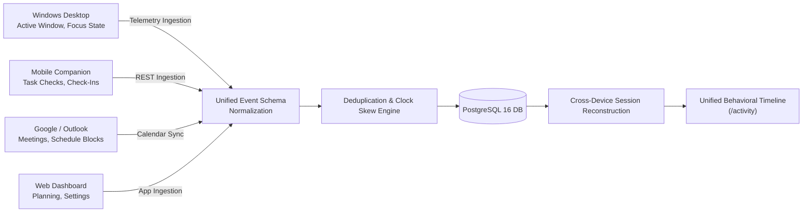

# Phase 5 Cross-Device Synchronization & Unified Behavioral Timeline

## 1. Multi-Device Behavioral Synthesis

Modern knowledge workers constantly switch between devices—reading documents on a phone, coding on a desktop workstation, attending meetings via calendar invitations, and reviewing dashboards on a web browser.

The **Cross-Device Synchronization Engine** unites these disparate event streams into a single, cohesive **Behavioral Timeline**.

---

## 2. Device Registry & Revocation Model

Every client device is registered in the `user_devices` table before emitting telemetry:

### A. Device Schema (`user_devices`)
| Column | Type | Constraints | Description |
|:---|:---|:---|:---|
| `id` | `UUID` | Primary Key | Internal device identifier |
| `user_id` | `UUID` | Foreign Key | Tenant owner reference |
| `device_id` | `VARCHAR(128)` | Unique | Hardware/OS persistent client identifier |
| `device_type` | `VARCHAR(32)` | NOT NULL | `'DESKTOP'`, `'MOBILE'`, `'WEB'` |
| `platform` | `VARCHAR(32)` | NOT NULL | `'WINDOWS'`, `'ANDROID'`, `'IOS'`, `'WEB'` |
| `device_name` | `VARCHAR(128)` | NOT NULL | User-assigned device label (e.g. "Workstation Dell XPS") |
| `app_version` | `VARCHAR(32)` | NOT NULL | Client software semantic version |
| `registration_at` | `TIMESTAMP` | NOT NULL | Initial registration timestamp |
| `last_seen_at` | `TIMESTAMP` | NOT NULL | Heartbeat or last active telemetry ingestion |
| `is_revoked` | `BOOLEAN` | Default False | Administrative revocation status |

### B. Device Revocation & Security Enforcement
- Users can revoke any device from the web dashboard (`DELETE /api/v1/devices/{device_id}`).
- The gateway immediately invalidates the device's sessions.
- Ingestion requests from revoked devices return `HTTP 403 Forbidden` (`DEVICE_REVOKED`).

---

## 3. Clock Skew Reconciliation & Deduplication

### A. Clock Differences Tolerance
Devices exhibit natural drift. To prevent causality violations in session reconstruction:
1. Every client payload includes:
   - `client_timestamp`: Local UTC timestamp when the event occurred.
   - `monotonic_seq`: Strictly incrementing sequence counter per device session.
2. The server records `server_received_at = datetime.now(timezone.utc)`.
3. If $| \text{client\_timestamp} - \text{server\_received\_at} | \le 30 \text{ seconds}$, `client_timestamp` is trusted.
4. If drift exceeds 30 seconds, the event timestamp is adjusted:
   $$t_{\text{adjusted}} = \text{server\_received\_at} - \Delta_{\text{latency}}$$

### B. Idempotency & Deduplication
To handle retry loops, network re-transmissions, and duplicate mobile batches:
- Deduplication key: $\text{MD5}(\text{user\_id} \mathbin{\Vert} \text{device\_id} \mathbin{\Vert} \text{event\_type} \mathbin{\Vert} \text{client\_timestamp} \mathbin{\Vert} \text{title\_hash})$.
- Events matching an existing hash within a 5-minute sliding window are dropped idempotently without error.

---

## 4. Cross-Device Session Reconstruction

The engine reconstructs unified work episodes by grouping events across platforms:
1. **Device Hand-Off Window**: If desktop telemetry transitions to idle and mobile activity commences within $\le 5$ minutes, the session transition is classified as a `DEVICE_SWITCH` rather than a full context break.
2. **Session Continuity Metric**:
   $$\text{ContinuityScore} = \begin{cases}
   1.0, & \text{if same category and } \Delta t \le 300\text{s} \\
   0.6, & \text{if cross-device but same active project} \\
   0.1, & \text{if unrelated category or } \Delta t > 900\text{s}
   \end{cases}$$
3. Events are visualized on `/activity` with device transition pills showing the flow of work from Desktop $\rightarrow$ Mobile $\rightarrow$ Calendar $\rightarrow$ Web.
