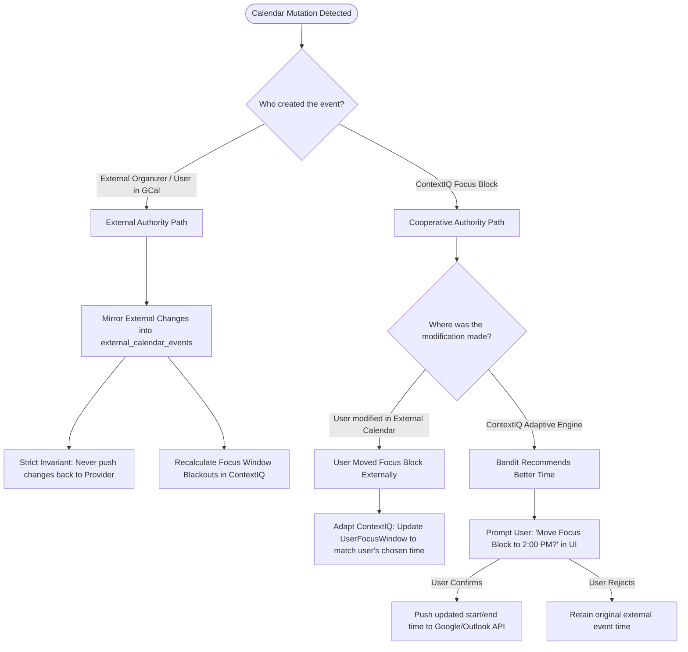

# Data Ownership, Authority Boundaries & Synchronization Governance

## 1. Executive Summary & Foundational Governance Rules (Task 6)

When integrating an internal behavioral intelligence platform with external enterprise ecosystems (Google Calendar, Microsoft 365, mobile operating systems), unambiguous data ownership rules are essential to prevent data corruption, unauthorized mutations, and user distrust.

ContextIQ establishes five inviolable data governance rules:
1. **Internal Domain Sovereignty**: ContextIQ is strictly authoritative for its internal tasks, task events, behavioral profiles, friction metrics, focus-window discoveries, and bandit recommendation states.
2. **External System Authority**: External calendars remain strictly authoritative for all events created directly within their respective ecosystems (e.g., Google Calendar meetings, Outlook invitations).
3. **Immutability of External Records**: ContextIQ **never silently overwrites, mutates, or deletes** externally created user data.
4. **Permanent Provider Provenance**: All imported calendar events retain their external identifiers (`provider_id`, `external_event_id`, `etag`, `sync_token`) to preserve an unbroken audit trail.
5. **Dynamic Reflection of External Changes**: Modifications or deletions made by the user in external calendars are mirrored faithfully in ContextIQ without human intervention.

---

## 2. Authoritative Boundaries Matrix

| Domain Entity | Primary Source of Truth | Permitted ContextIQ Operations | Permitted External Provider Operations |
| :--- | :--- | :--- | :--- |
| **ContextIQ Tasks (`tasks`)** | ContextIQ Backend | Full CRUD, prioritization, status progression, forget-risk evaluation. | Read-only (via export or optional calendar sync). Cannot mutate internal state directly. |
| **Task Events (`task_events`)** | ContextIQ Backend | Append-only immutable log. Never mutated. | None. External providers have zero access to task event telemetry. |
| **Behavioral Profiles (`user_behavioral_profiles`)** | ContextIQ Analytics | Continual computation, Bayeasian updating, snapshot versioning. | None. Internal intellectual property and private personal analytics. |
| **External Calendar Events (`external_calendar_events`)** | External Provider (Google/Outlook) | Read, cache, correlate with focus windows, mark as blackouts. **No silent mutation**. | Full authority. External creation, modification, or cancellation dictates local cache state. |
| **ContextIQ-Managed Focus Blocks** | Shared (Cooperative Authority) | Create, propose shifts, delete upon task resolution. | User can manually drag/reschedule in Google/Outlook; ContextIQ detects change and adapts. |
| **Telemetry Events (`raw_telemetry_events`)** | User Edge Devices | Collect on client, filter via privacy blacklist, append to server. | Edge clients generate; server ingests idempotently. Immutable post-ingestion. |

---

## 3. Bi-Directional Synchronization Governance



### Cooperative Authority for Focus Blocks
When ContextIQ creates a calendar event (e.g. reserving a 90-minute deep work block for a high-priority task), the event is flagged with:
```sql
is_contextiq_managed = TRUE
```
- **External User Drag & Drop**: If the user opens Google Calendar on their phone and moves the focus block from 10:00 AM to 2:00 PM, ContextIQ **respects the user's manual agency**. The webhook receives the change, detects `is_contextiq_managed == TRUE`, and immediately shifts the internal `UserFocusWindow` to match 2:00 PM.
- **ContextIQ Proactive Shift**: If the bandit engine identifies high afternoon interruption risk and suggests shifting the focus block, it **never silently moves the calendar event**. It displays a recommendation card or push notification. Only when the user taps "Accept" does ContextIQ issue a `PATCH` request to the external calendar API.

---

## 4. Provider Reference Preservation & Provenance Schema

Every imported record maintains a comprehensive external metadata envelope in `external_calendar_events`:

```json
{
  "contextiq_event_id": "c7a8b9d0-1234-4567-8901-abcdef123456",
  "provider_provenance": {
    "provider_id": "google_calendar",
    "external_event_id": "_60q30c1g60o30c1g60o30c1g60o4",
    "etag": "\"3194018240000000\"",
    "ical_uid": "meeting_abc123@google.com",
    "html_link": "https://www.google.com/calendar/event?eid=...",
    "imported_at": "2026-11-24T10:15:30.000Z",
    "last_synced_at": "2026-11-24T10:15:30.000Z",
    "sync_token_epoch": "CKCLr-6Z4c4CEAE="
  },
  "authority_state": {
    "is_contextiq_managed": false,
    "user_can_edit_externally": true,
    "last_modified_by": "EXTERNAL_PROVIDER"
  }
}
```

---

## 5. User Rights, Disconnection & Data Erasure (GDPR / CCPA)

When an integration is disconnected or an account deletion request is initiated, ContextIQ provides transparent, user-controlled data handling options:

### 5.1 Disconnection Policy
Upon disconnecting Google Calendar or Microsoft Outlook:
1. **Immediate Revocation**: OAuth refresh tokens are purged immediately from the database and revoked remotely.
2. **Webhook Unregistration**: Push subscriptions are terminated on the remote provider.
3. **Data Retention Choice**:
   - **Option A (Complete Purge - Recommended)**: All synchronized rows in `external_calendar_events` are permanently deleted (`DELETE FROM external_calendar_events WHERE integration_id = :id`).
   - **Option B (Anonymized Retrospective Analytics)**: Event titles, attendee lists, descriptions, and URLs are wiped, but aggregated focus blackout statistics (e.g., "12 hours in meetings during October") are retained to prevent distorting historical productivity baselines.

### 5.2 Right to Erasure (Article 17 GDPR)
- If a user issues a complete data deletion request, all personal records (`User`, `Task`, `TaskEvent`, `Location`, `UserBehavioralProfile`, `UserDevice`, `RawTelemetryEvent`, `ExternalIntegration`, `ExternalCalendarEvent`) are deleted via cascading database foreign keys.
- Edge devices receive a `PURGE_LOCAL_BUFFER` command on their next sync attempt, wiping all on-device SQLite databases.
