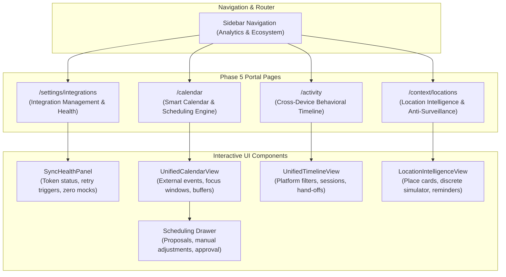

# Phase 5 Frontend Architecture & Integration Portal

## 1. Overview & Visual Identity

The ContextIQ Next.js 16 frontend brings together all external ecosystem capabilities while preserving ContextIQ's established visual identity: clean typography, dark/light theme support, accessible contrast ratios, and glassmorphism styling.

---

## 2. Page Specifications & Component Features

### A. Integration Management (`/settings/integrations`)
- **`SyncHealthPanel`**:
  - Displays real-time connectivity status for Google Calendar, Microsoft Outlook, Windows Desktop Agent, and Mobile Companion.
  - Shows last synchronization timestamp, pending operations, failed operations count, retry status, and token expiration warnings.
  - **Zero-Mock Invariant Enforced**: Unconnected providers strictly render as `Not Linked` with a connect button. Never displays mock integrations as connected accounts.
  - Manual re-sync trigger per provider with instant feedback.

### B. Smart Calendar View (`/calendar`)
- **`UnifiedCalendarView`**:
  - **Color-Coded Distinct Styling**:
    - External calendar events (Google / Outlook) styled with provider icons and border accents.
    - ContextIQ scheduled tasks rendered with priority badges and cognitive load indicators.
    - Available focus windows highlighted in indigo.
    - Recovery buffers highlighted in emerald with micro-break badges.
  - Date navigation (Day, Week, Month) and provider visibility filters.

### C. Intelligent Scheduling Drawer & Approval Workflow
- Slide-over drawer launched directly from `/calendar` via **"Generate Schedule Proposals"**.
- Displays AI-suggested task allocations within available focus windows, factoring in historical recovery times and deadlines.
- **Interactive Modifications**: Users can manually adjust proposed start times and durations, or dismiss individual proposals.
- **Strict Approval Gating**: Automatic writes to external calendars are prohibited until the user explicitly reviews and clicks **"Approve & Write to External Calendar"**.

### D. Cross-Device Activity Timeline (`/activity`)
- Full-page wrapper hosting `UnifiedTimelineView`.
- Stitches Windows desktop telemetry, mobile activity, and calendar events into unified work sessions.
- Visual device transition badges (e.g. `Desktop → Mobile` hand-offs).
- Filter controls for platforms (`Desktop`, `Mobile`, `Web`, `Calendar`), event types, and custom date ranges.

### E. Location Intelligence Portal (`/context/locations`)
- **`LocationIntelligenceView`**:
  - Manages saved places (Home, Campus, Office, Library, Laboratory) and coarse geofence radii.
  - **Anti-Surveillance Privacy Banner**: Informs users of zero GPS tracking.
  - **Discrete Check-In Simulator**: Allows testing `GEOFENCE_ENTER`, `GEOFENCE_EXIT`, and `MANUAL` check-in events directly in the browser without physical movement.
  - Contextual smart reminder cards with evidence badges (`EXPLICIT`, `STATISTICALLY_OBSERVED`).
  - Privacy toggles for enabling/disabling geofence monitoring or location reminders.

---

## 3. Accessibility & Responsive UX Invariants

1. **Accessible Color Contrast**: Complies with WCAG 2.1 AA standards. Color is never the sole indicator of state (all events and badges combine color, text labels, and semantic icons).
2. **Graceful Loading & Error States**: Every component implements dedicated skeleton loaders during asynchronous data fetching, informative empty states with call-to-action buttons, and clear error banners with retry triggers.
3. **Mobile-Responsive Breakpoints**: Layouts dynamically adapt across mobile viewports ($< 768\text{px}$), tablets, and wide desktop displays ($> 1200\text{px}$).
