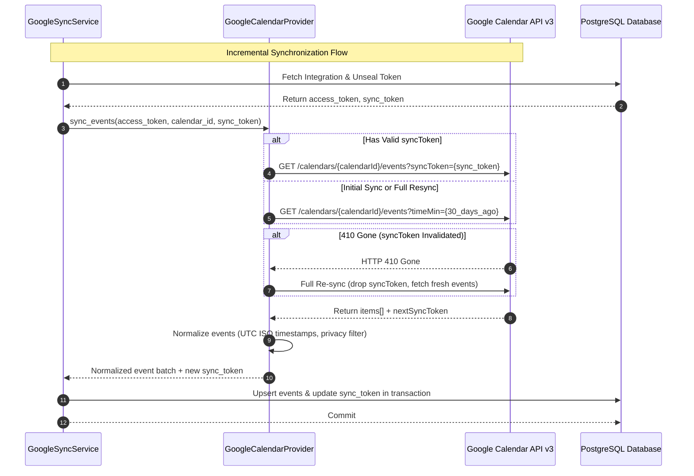

# Phase 5 Google Calendar Integration: Two-Way Synchronization Guide

## 1. Google API Architecture Overview

The Google Calendar integration establishes two-way synchronization between Google Calendar (via official Google Calendar API v3) and ContextIQ's availability and scheduling engine.

---

## 2. API Endpoints & Configuration

### A. Core Google Calendar Endpoints
- **Calendar Discovery**: `GET https://www.googleapis.com/calendar/v3/users/me/calendarList`
  - Scans for the user's primary calendar (`primary == true`).
- **Event List & Delta Ingestion**: `GET https://www.googleapis.com/calendar/v3/calendars/{calendarId}/events`
  - Parameters: `singleEvents=True`, `maxResults=2500`, `syncToken={token}`.
- **Event Creation**: `POST https://www.googleapis.com/calendar/v3/calendars/{calendarId}/events`
- **Event Modification**: `PUT https://www.googleapis.com/calendar/v3/calendars/{calendarId}/events/{eventId}`
- **Event Deletion**: `DELETE https://www.googleapis.com/calendar/v3/calendars/{calendarId}/events/{eventId}`
- **Token Revocation**: `POST https://oauth2.googleapis.com/revoke`

### B. OAuth 2.0 Scopes Required
- `openid`
- `email`
- `https://www.googleapis.com/auth/calendar.events.readonly`
- `https://www.googleapis.com/auth/calendar.events`

---

## 3. Incremental Delta Synchronization (`syncToken`)

Google Calendar API leverages an opaque `syncToken` for stateful synchronization:
1. **Initial Import**:
   - Ingests all active events spanning 30 days into the past and 90 days into the future.
   - Paginates via `nextPageToken` until all pages are retrieved.
   - The final page contains `nextSyncToken`.
2. **Delta Query**:
   - Subsequent sync calls pass `syncToken=nextSyncToken`.
   - The API returns only modified, newly created, or deleted events since the token was issued.
   - Deleted events contain `status: "cancelled"`, triggering corresponding tombstoning or deletion in `external_calendar_events`.
3. **Handling `410 Gone`**:
   - If a `syncToken` expires (typically after 7 days of inactivity or calendar ACL mutations), Google returns `HTTP 410 Gone`.
   - The sync worker automatically catches `410 Gone`, wipes the corrupted `sync_token`, and triggers a full clean resync.

---

## 4. Normalization & Privacy Invariants

### A. Privacy & Sensitivity Handling
- If an event is marked `visibility: "private"` or `visibility: "confidential"`, ContextIQ stores the title as `"Busy"` or `"Private Commitment"`.
- Detailed descriptions, video call links, and attendee rosters are discarded at ingestion time unless explicitly permitted by user settings.

### B. All-Day Event Normalization
- All-day events in Google contain date strings (e.g., `"start": {"date": "2026-11-25"}`).
- The adapter normalizes these to midnight UTC datetime ranges:
  - `start_time`: `2026-11-25T00:00:00Z`
  - `end_time`: `2026-11-26T00:00:00Z`
  - `is_all_day`: `True`

---

## 5. Two-Way Synchronization & Approval Gating

ContextIQ respects Google Calendar as the **authoritative master** for externally created meetings:
- If a meeting in Google conflicts with a ContextIQ scheduled task, the ContextIQ task yields.
- When ContextIQ's intelligent scheduling engine proposes a new task slot, it writes to Google Calendar **only after the user reviews and clicks "Approve & Write to External Calendar"**.
- Approved events written to Google Calendar include ContextIQ metadata in `extendedProperties.private.contextiq_task_id` to establish idempotent bi-directional linkage.
