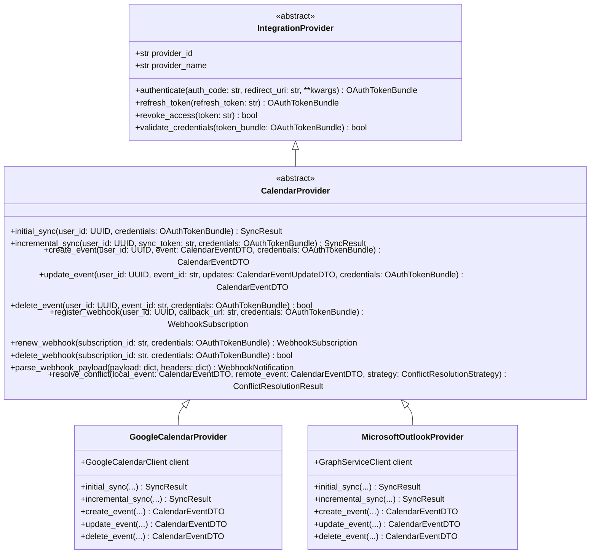
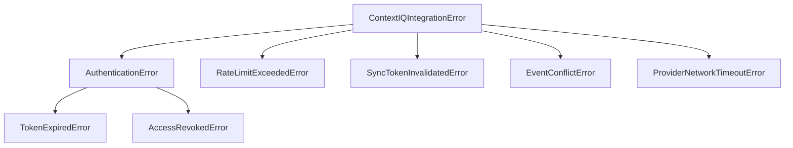

# Integration Abstraction & Provider Architecture

## 1. Executive Summary & Design Principles

To support multiple external calendar systems, third-party productivity tools, and mobile operating platforms without creating fragile, provider-specific code branches throughout the ContextIQ backend, Phase 5 establishes a **Unified Integration Abstraction Layer**.

The architecture adheres to three core design principles:
1. **Separation of Concerns**: Core domain engines (Task Management, Focus Window Discovery, Contextual Bandits) interact strictly with standardized domain models (`CalendarEventDTO`, `SyncResult`) and never interface directly with Google Calendar or Microsoft Graph APIs.
2. **Provider Pluggability**: Every external ecosystem adapter implements a well-defined Python Abstract Base Class (`IntegrationProvider` and `CalendarProvider`). New providers (e.g., Apple iCloud Calendar, CalDAV, Notion, Jira) can be added by implementing these contracts without touching existing business logic.
3. **Resilient Synchronization**: Synchronization protocols account for network partitions, rate limits, expired tokens, out-of-order webhook delivery, and 410 Gone delta token invalidations through standardized error handling and recovery state machines.

---

## 2. Core Provider Class Hierarchy



---

## 3. Abstract Interface Definitions

Below are the normative Python specifications for the ContextIQ provider interfaces and data transfer objects.

### 3.1 Standardized Data Transfer Objects (DTOs)

```python
from __future__ import annotations
from dataclasses import dataclass, field
from datetime import datetime
from enum import Enum
from typing import Any, Dict, List, Optional
from uuid import UUID


class EventStatus(str, Enum):
    CONFIRMED = "CONFIRMED"
    TENTATIVE = "TENTATIVE"
    CANCELLED = "CANCELLED"


class EventTransparency(str, Enum):
    OPAQUE = "OPAQUE"      # Busy / Blocks time (default)
    TRANSPARENT = "TRANSPARENT"  # Free / Does not block time


class ConflictResolutionStrategy(str, Enum):
    EXTERNAL_WINS = "EXTERNAL_WINS"    # External calendar is authoritative
    CONTEXTIQ_WINS = "CONTEXTIQ_WINS"  # Internal ContextIQ change takes precedence
    MANUAL_REVIEW = "MANUAL_REVIEW"    # Flag conflict for user in UI
    THREE_WAY_MERGE = "THREE_WAY_MERGE"


@dataclass(frozen=True)
class OAuthTokenBundle:
    """Secure encapsulation of OAuth credentials."""
    access_token: str
    refresh_token: Optional[str]
    token_type: str
    expires_at: datetime
    scope: List[str]
    id_token: Optional[str] = None
    provider_user_id: Optional[str] = None
    provider_email: Optional[str] = None


@dataclass
class CalendarEventDTO:
    """Normalized calendar event representation across all providers."""
    external_event_id: str
    provider_id: str
    title: str
    start_time: datetime
    end_time: datetime
    is_all_day: bool = False
    description: Optional[str] = None
    location_name: Optional[str] = None
    status: EventStatus = EventStatus.CONFIRMED
    transparency: EventTransparency = EventTransparency.OPAQUE
    organizer_email: Optional[str] = None
    attendees_count: int = 0
    is_organizer: bool = True
    html_link: Optional[str] = None
    etag: Optional[str] = None
    raw_payload: Dict[str, Any] = field(default_factory=dict)


@dataclass
class CalendarEventUpdateDTO:
    """Payload for mutating an existing calendar event."""
    title: Optional[str] = None
    start_time: Optional[datetime] = None
    end_time: Optional[datetime] = None
    description: Optional[str] = None
    location_name: Optional[str] = None
    transparency: Optional[EventTransparency] = None


@dataclass
class SyncResult:
    """Detailed outcome of an initial or incremental synchronization operation."""
    success: bool
    new_sync_token: Optional[str]
    synced_events: List[CalendarEventDTO] = field(default_factory=list)
    deleted_event_ids: List[str] = field(default_factory=list)
    full_resync_required: bool = False
    sync_duration_ms: float = 0.0
    error_message: Optional[str] = None


@dataclass
class WebhookSubscription:
    """Represents an active server-to-server push notification channel."""
    subscription_id: str
    resource_id: str
    expiration_time: datetime
    client_state: str


@dataclass
class WebhookNotification:
    """Parsed push notification payload from an external provider."""
    provider_id: str
    resource_id: str
    event_type: str
    user_id: Optional[UUID] = None
    timestamp: datetime = field(default_factory=datetime.utcnow)
```

---

### 3.2 Provider Abstract Base Classes

```python
from abc import ABC, abstractmethod


class IntegrationProvider(ABC):
    """Foundational provider contract governing authentication and identity."""

    @property
    @abstractmethod
    def provider_id(self) -> str:
        """Unique provider key (e.g. 'google_calendar', 'microsoft_outlook')."""
        pass

    @property
    @abstractmethod
    def provider_name(self) -> str:
        """Human-readable provider name."""
        pass

    @abstractmethod
    def authenticate(
        self,
        auth_code: str,
        redirect_uri: str,
        code_verifier: Optional[str] = None,
        **kwargs: Any,
    ) -> OAuthTokenBundle:
        """Exchange an authorization code for an OAuth access and refresh token bundle."""
        pass

    @abstractmethod
    def refresh_token(self, refresh_token: str) -> OAuthTokenBundle:
        """Refresh an expired access token using the stored refresh token."""
        pass

    @abstractmethod
    def revoke_access(self, token: str) -> bool:
        """Revoke user grant on the remote identity provider."""
        pass

    @abstractmethod
    def validate_credentials(self, token_bundle: OAuthTokenBundle) -> bool:
        """Ping provider API to verify credentials remain valid and active."""
        pass


class CalendarProvider(IntegrationProvider):
    """Specialized contract governing calendar synchronization and event mutation."""

    @abstractmethod
    def initial_sync(
        self,
        user_id: UUID,
        credentials: OAuthTokenBundle,
        window_days_past: int = 30,
        window_days_future: int = 90,
    ) -> SyncResult:
        """Perform first-time historical and forward synchronization of calendar events."""
        pass

    @abstractmethod
    def incremental_sync(
        self,
        user_id: UUID,
        sync_token: str,
        credentials: OAuthTokenBundle,
    ) -> SyncResult:
        """Fetch only events modified, created, or deleted since the previous syncToken."""
        pass

    @abstractmethod
    def create_event(
        self,
        user_id: UUID,
        event: CalendarEventDTO,
        credentials: OAuthTokenBundle,
    ) -> CalendarEventDTO:
        """Create a new event in the external user calendar."""
        pass

    @abstractmethod
    def update_event(
        self,
        user_id: UUID,
        external_event_id: str,
        updates: CalendarEventUpdateDTO,
        credentials: OAuthTokenBundle,
        etag: Optional[str] = None,
    ) -> CalendarEventDTO:
        """Update an existing event in the external user calendar."""
        pass

    @abstractmethod
    def delete_event(
        self,
        user_id: UUID,
        external_event_id: str,
        credentials: OAuthTokenBundle,
    ) -> bool:
        """Delete an event from the external user calendar."""
        pass

    @abstractmethod
    def register_webhook(
        self,
        user_id: UUID,
        callback_url: str,
        credentials: OAuthTokenBundle,
    ) -> WebhookSubscription:
        """Establish a server-to-server push notification subscription for calendar mutations."""
        pass

    @abstractmethod
    def renew_webhook(
        self,
        subscription_id: str,
        credentials: OAuthTokenBundle,
    ) -> WebhookSubscription:
        """Renew an expiring push notification webhook subscription."""
        pass

    @abstractmethod
    def delete_webhook(
        self,
        subscription_id: str,
        credentials: OAuthTokenBundle,
    ) -> bool:
        """Tear down a push notification webhook subscription upon provider disconnection."""
        pass

    @abstractmethod
    def parse_webhook_payload(
        self,
        payload: Dict[str, Any],
        headers: Dict[str, str],
    ) -> WebhookNotification:
        """Validate and deserialize raw provider webhook requests."""
        pass
```

---

## 4. Provider Registry & Factory Pattern

To ensure loose coupling, all provider implementations register with a central `ProviderRegistry`. The backend instantiates providers dynamically based on user configuration.

```python
class ProviderRegistry:
    """Thread-safe registry of all active ecosystem integration adapters."""

    _registry: Dict[str, type[IntegrationProvider]] = {}

    @classmethod
    def register(cls, provider_id: str):
        """Decorator to register a provider adapter class."""
        def decorator(subclass: type[IntegrationProvider]):
            cls._registry[provider_id] = subclass
            return subclass
        return decorator

    @classmethod
    def get_provider(cls, provider_id: str) -> IntegrationProvider:
        """Instantiate registered provider adapter by identifier."""
        provider_class = cls._registry.get(provider_id)
        if not provider_class:
            raise UnsupportedProviderError(f"Integration provider '{provider_id}' is not registered.")
        return provider_class()

    @classmethod
    def list_supported_providers(cls) -> List[str]:
        return list(cls._registry.keys())
```

---

## 5. Standardized Error Hierarchy & Recovery Strategies

External APIs frequently encounter operational anomalies (rate limiting, expired tokens, invalidated sync tokens). The abstraction translates low-level HTTP responses into a structured exception hierarchy.



### Recovery Matrix

| Exception | Root Cause | Automated Recovery Strategy |
| :--- | :--- | :--- |
| `TokenExpiredError` | Access token lifetime exceeded ($1\text{ hour}$). | Automatically invoke `refresh_token()`, update encrypted vault, and retry failed operation. |
| `AccessRevokedError` | User revoked app access in Google/Microsoft security settings. | Mark integration `STATUS=REVOKED`, pause syncing, and notify user via UI to re-authenticate. |
| `SyncTokenInvalidatedError` | Delta token expired (HTTP 410 Gone) or invalidated by provider reset. | Trigger immediate `initial_sync()` to rebuild local event state without duplicating records. |
| `RateLimitExceededError` | Provider quota exceeded (HTTP 429). | Parse `Retry-After` header; enqueue retry with exponential backoff and jitter. |
| `EventConflictError` | Remote event modified concurrently (ETag mismatch HTTP 412). | Execute configured `ConflictResolutionStrategy` (default: external event wins). |
