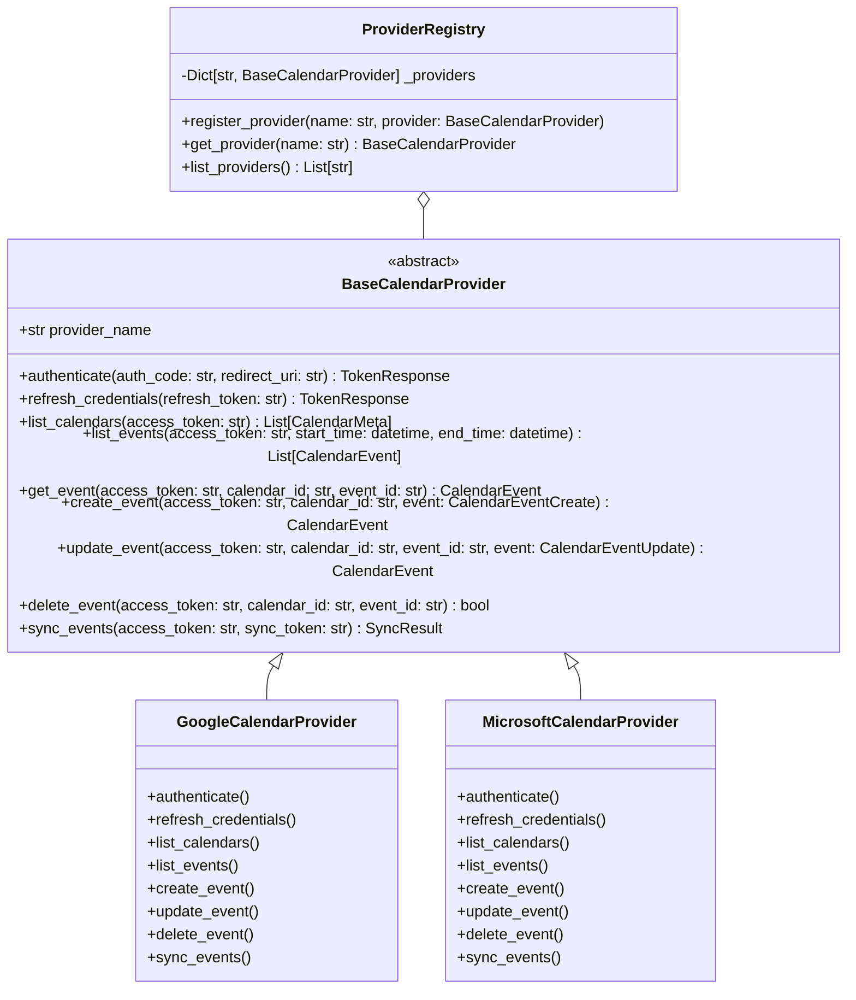

# Phase 5 Integration Framework: Provider Abstraction & Management

## 1. Abstraction Design Principles

ContextIQ interfaces with diverse calendar and productivity platforms. Rather than hardcoding provider-specific logic into scheduling or session models, all interactions flow through a unified **Provider Abstraction Layer**.

The integration framework guarantees:
1. **Identical Internal Event Schema**: Downstream models consume normalized `CalendarEvent` structures regardless of whether the source is Google Calendar or Microsoft Outlook.
2. **Pluggable Architecture**: New calendar providers (e.g., Apple iCloud, CalDAV) can be introduced by subclassing `BaseCalendarProvider` without altering core scheduling engines.
3. **Encapsulated Auth & Token Lifecycles**: Providers manage their specific token refresh and scope requirements internally while exposing consistent authentication hooks.



---

## 2. Base Calendar Provider Interface

The abstract base class defines the complete contract for calendar providers:

```python
from abc import ABC, abstractmethod
from typing import List, Optional
from datetime import datetime
from pydantic import BaseModel

class BaseCalendarProvider(ABC):
    """Abstract interface implemented by all calendar integrations."""

    @property
    @abstractmethod
    def provider_name(self) -> str:
        """Unique provider identifier (e.g. 'google', 'microsoft')."""
        pass

    @abstractmethod
    async def get_authorization_url(self, state: str, redirect_uri: str, code_challenge: Optional[str] = None) -> str:
        """Generate provider-specific OAuth authorization consent URL."""
        pass

    @abstractmethod
    async def authenticate(self, code: str, redirect_uri: str, code_verifier: Optional[str] = None) -> dict:
        """Exchange authorization code for access and refresh tokens."""
        pass

    @abstractmethod
    async def refresh_credentials(self, refresh_token: str) -> dict:
        """Obtain a new access token using the encrypted refresh token."""
        pass

    @abstractmethod
    async def list_calendars(self, access_token: str) -> List[dict]:
        """Discover user calendars and identify primary calendar."""
        pass

    @abstractmethod
    async def list_events(
        self,
        access_token: str,
        calendar_id: str,
        start_time: datetime,
        end_time: datetime
    ) -> List[dict]:
        """Fetch external calendar events within a specified temporal window."""
        pass

    @abstractmethod
    async def create_event(self, access_token: str, calendar_id: str, event_data: dict) -> dict:
        """Create a scheduled event on the external provider calendar."""
        pass

    @abstractmethod
    async def update_event(self, access_token: str, calendar_id: str, event_id: str, event_data: dict) -> dict:
        """Update an existing event on the external provider calendar."""
        pass

    @abstractmethod
    async def delete_event(self, access_token: str, calendar_id: str, event_id: str) -> bool:
        """Delete an event from the external provider calendar."""
        pass

    @abstractmethod
    async def sync_events(self, access_token: str, calendar_id: str, sync_token: Optional[str] = None) -> dict:
        """Execute incremental delta synchronization using provider sync tokens or delta links."""
        pass
```

---

## 3. Normalized Event Schema Contract

All provider responses are mapped into the canonical schema before ingestion:

| Field | Type | Description |
|:---|:---|:---|
| `provider_event_id` | `str` | Provider's persistent unique identifier |
| `calendar_id` | `str` | Identifier of the hosting calendar |
| `title` | `str` | Sanitized event title (redacted if marked private) |
| `start_time` | `datetime` | UTC ISO-8601 event start timestamp |
| `end_time` | `datetime` | UTC ISO-8601 event end timestamp |
| `timezone` | `str` | IANA timezone string (e.g. `'America/Los_Angeles'`) |
| `is_all_day` | `bool` | True if event spans full day(s) without specific clock times |
| `availability` | `str` | `'busy'`, `'free'`, `'tentative'`, or `'out_of_office'` |
| `is_private` | `bool` | True if user or tenant marked event as sensitive |
| `recurrence_rule` | `Optional[str]` | RFC-5545 RRULE string if recurring |
| `provider_updated_at` | `datetime` | Provider's last modified timestamp |

---

## 4. Provider Registry Pattern

The `ProviderRegistry` acts as a thread-safe singleton managing available integrations:

```python
class ProviderRegistry:
    _instance = None
    _providers: dict[str, BaseCalendarProvider] = {}

    @classmethod
    def register(cls, name: str, provider: BaseCalendarProvider):
        cls._providers[name.lower()] = provider

    @classmethod
    def get(cls, name: str) -> BaseCalendarProvider:
        provider = cls._providers.get(name.lower())
        if not provider:
            raise UnsupportedProviderError(f"Provider '{name}' is not registered.")
        return provider
```

---

## 5. Resilience & Rate-Limiting Strategy

1. **Exponential Backoff with Jitter**:
   - HTTP 429 (Too Many Requests) and HTTP 503 (Service Unavailable) responses trigger exponential backoff:
     $$\Delta t_{\text{backoff}} = \min(60, \text{base} \times 2^{\text{attempt}} + \text{jitter})$$
   - Providers respecting `Retry-After` headers sleep for the specified duration before retrying.
2. **Circuit Breaker**:
   - If a provider fails 5 consecutive sync requests, the integration status transitions to `DEGRADED`.
   - Further scheduled background syncs are paused for 15 minutes before executing a single probe request.
