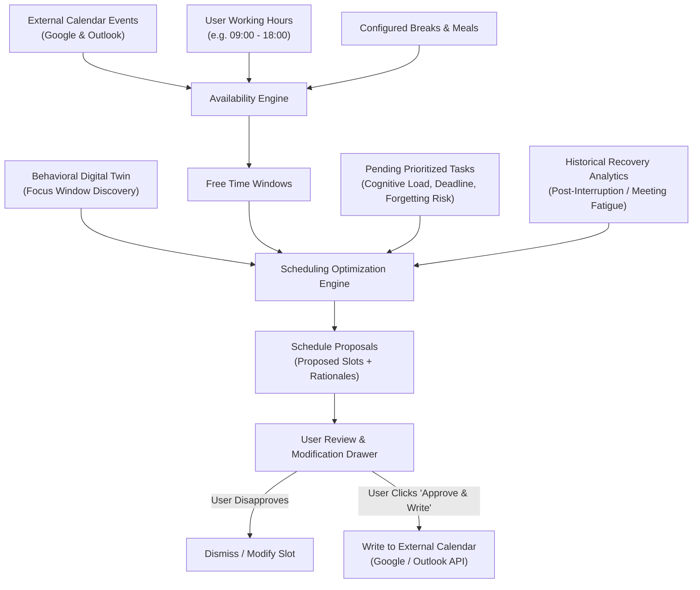
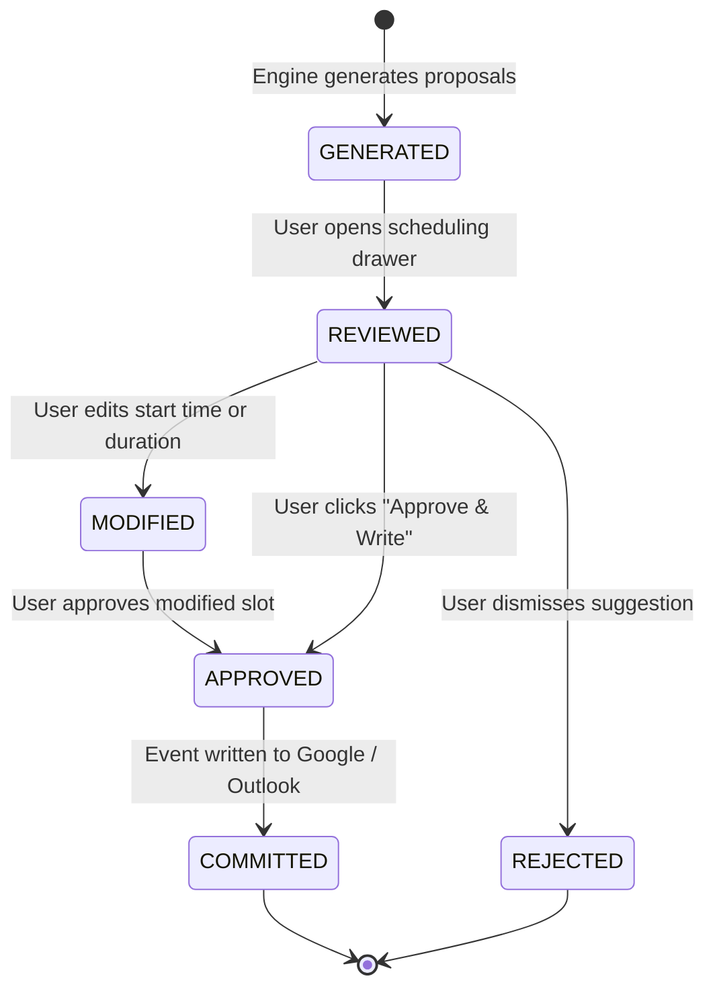

# Phase 5 Intelligent Task Scheduling Engine

## 1. Scheduling Philosophy & Objectives

In modern knowledge work, an empty calendar does not imply cognitive availability. The **Intelligent Scheduling Engine** merges external calendar commitments with ContextIQ's behavioral intelligence:
- **Availability Discovery**: Derives free scheduling windows by subtracting external calendar events (`BUSY`, `OUT_OF_OFFICE`), user working hours, and established breaks.
- **Focus Window Alignment**: Prioritizes deep-work blocks during peak cognitive focus periods identified by the user's Behavioral Digital Twin.
- **Recovery Micro-Delay Buffers**: Proactively inserts rest buffers before and after intense meetings to combat cognitive fatigue.
- **Strict Approval Gating**: Previews proposed schedules and requires user approval before writing changes to external calendars.

---

## 2. Mathematical Formulation & Availability Windows

### A. Temporal Subtraction
Given a scheduling horizon $[T_{\text{start}}, T_{\text{end}}]$ and working hours $W \subset [T_{\text{start}}, T_{\text{end}}]$, the initial availability set $A_0$ is:
$$A_0 = W \setminus \bigcup_{i} B_i$$
where $B_i$ represents external meetings marked with `availability == 'BUSY'` or `'OUT_OF_OFFICE'`.

### B. Cognitive Recovery Buffer Insertion
For every external meeting with duration $d_i$ ending at $t_{\text{end}, i}$, a fatigue buffer $\Delta t_{\text{recovery}}$ is subtracted:
$$\Delta t_{\text{recovery}} = \begin{cases} 
15 \text{ min}, & \text{if } d_i \ge 60 \text{ min} \\
10 \text{ min}, & \text{if } 30 \le d_i < 60 \text{ min} \\
5 \text{ min}, & \text{otherwise}
\end{cases}$$
The available slot start is adjusted:
$$t_{\text{available\_start}} = t_{\text{end}, i} + \Delta t_{\text{recovery}}$$

### C. Task Placement Scoring Function
For a candidate slot $S_j = [s_j, e_j]$ with duration $|S_j|$ and a prioritized task $T_k$ requiring estimated duration $D_k \le |S_j|$, the placement score $J(S_j, T_k)$ is formulated as:
$$J(S_j, T_k) = w_1 \cdot \text{Priority}(T_k) + w_2 \cdot \text{FocusMatch}(S_j, T_k) - w_3 \cdot \frac{s_j - T_{\text{start}}}{\text{Deadline}(T_k) - T_{\text{start}}} - w_4 \cdot \text{Fatigue}(s_j)$$

Where:
- $\text{FocusMatch}(S_j, T_k) \in [0, 1]$ represents the overlap between candidate slot $S_j$ and discovered focus windows.
- $w_1 = 0.35, w_2 = 0.30, w_3 = 0.20, w_4 = 0.15$ are adaptive ranking weights.

---

## 3. Proposal Lifecycle & User Approval Gating

ContextIQ enforces an invariant: **Algorithms propose, humans dispose.**

1. **`GENERATED`**: Proposal persisted in `schedule_proposals` with confidence score and human-readable explanation (e.g. *"Scheduled during discovered morning focus peak (10:00 - 11:30) following a 15-minute recovery buffer after Executive Standup"*).
2. **`MODIFIED`**: User can drag/adjust start and end times in the frontend drawer.
3. **`APPROVED`**: Explicit user action triggers `POST /api/v1/scheduling/proposals/{id}/approve?write_to_external=true`.
4. **`COMMITTED`**: Event is written to the user's primary calendar via `create_event()` and flagged with `written_to_external = true`.
