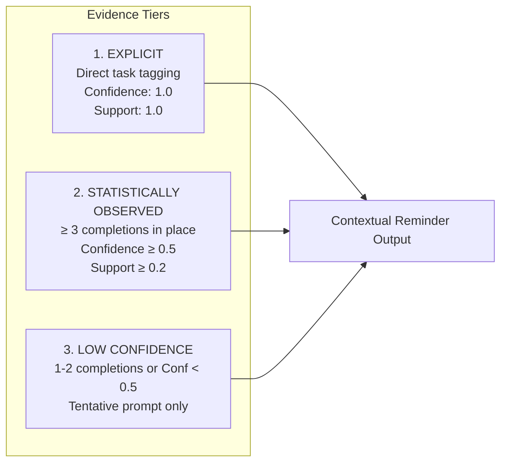

# Phase 5 Location Intelligence & Anti-Surveillance Context Architecture

## 1. Privacy-First Contextual Philosophy

Physical spaces strongly anchor human habits and task contexts:
- A researcher reads papers in the **Library**.
- A student gets thesis signatures on **Campus**.
- An engineer runs hardware benchmarks in the **Laboratory**.
- An employee addresses tickets in the **Office**.

However, continuous GPS tracking constitutes surveillance. ContextIQ solves this by enforcing an **Anti-Surveillance Privacy Boundary**:

```mermaid
flowchart TD
    subgraph Client-Side Edge Detection (Mobile Device)
        GPS["Coarse Device Location<br/>(Circular Geofence ≥ 100m)"]
        EDGE["Edge Boundary Evaluation<br/>(iOS Region Monitoring / Android Geofencing)"]
        MAN["Manual Check-In Trigger<br/>(Alternative to GPS)"]
    end

    subgraph Privacy Guardrails
        ZERO["Zero Continuous GPS Streaming<br/>Zero Location History Storage"]
        DEBOUNCE["5-Minute Jitter Debouncing Window"]
        QUIET["Quiet Hours (22:00 - 08:00)<br/>& Deep Focus Session Gating"]
    end

    subgraph Backend Intelligence Layer
        ASSOC["Task Routine Association Mining<br/>(Apriori & Observation Tiers)"]
        REM["Smart Reminders<br/>(Arrival Prompt & Departure 'One More Thing')"]
    end

    GPS --> EDGE
    EDGE -->|Discrete Transition Event Only| ZERO
    MAN --> ZERO
    ZERO --> DEBOUNCE
    DEBOUNCE --> ASSOC
    ASSOC --> QUIET
    QUIET --> REM
```

---

## 2. Location Intelligence Invariants

1. **No Raw Coordinate Streaming**: The backend **never** receives or persists continuous GPS coordinate streams or location breadcrumbs.
2. **Coarse Circular Regions Only**: Geofences enforce a minimum boundary radius of 100 meters (default 150m) to prevent fine-grained indoor tracking.
3. **Manual Check-In First**: Every location feature supports manual check-in (`check_in_type = 'MANUAL'`) without granting device location permissions.
4. **Boundary Debouncing**: Transition events occurring within 5 minutes (`300 seconds`) of a prior check-in at the same place are dropped to suppress GPS jitter oscillations.
5. **Quiet Hours & Focus Protection**: Reminders are strictly suppressed between 22:00 and 08:00 local time, or when the user is engaged in an active deep focus session.

---

## 3. Association Rule Mining & Discovery Tiers

The system connects physical places to tasks using association rule mining, separating relationships into three strict evidence tiers:



### A. Explicit Associations (`EXPLICIT`)
- User explicitly assigns a task to a location (e.g. `task.context_location_id = loc.id`).
- Assigned confidence score = 1.0, support score = 1.0.

### B. Statistically Observed Routines (`STATISTICALLY_OBSERVED`)
- Mined from historical task completions within the location context.
- Requires at least 3 co-occurrences ($N_{\text{visits}} \ge 3$).
- $\text{Confidence} = \frac{P(\text{Task} \cap \text{Location})}{P(\text{Location})} \ge 0.50$
- $\text{Support} = \frac{P(\text{Task} \cap \text{Location})}{N_{\text{total}}} \ge 0.20$

### C. Low-Confidence Associations (`LOW_CONFIDENCE`)
- Fewer than 3 observations or confidence $< 0.50$.
- Tagged with caution badges to prevent premature routine inference.

---

## 4. Smart Reminder Generation Triggers

### A. Arrival Focus Prompts (`ARRIVAL`)
- Triggered on `GEOFENCE_ENTER` or `MANUAL` check-in.
- Identifies pending tasks that match the entered location context.
- Prepares the user's focus window for productive work relevant to that environment.

### B. Departure "One More Thing" Prompts (`DEPARTURE`)
- Triggered on `GEOFENCE_EXIT`.
- Detects uncompleted tasks associated with the departing location (e.g., *"Before leaving Stanford Quad: 'Advisor Thesis Signoff' is still pending"*).
- Prevents forgotten errands and saves unnecessary round-trip travel.
