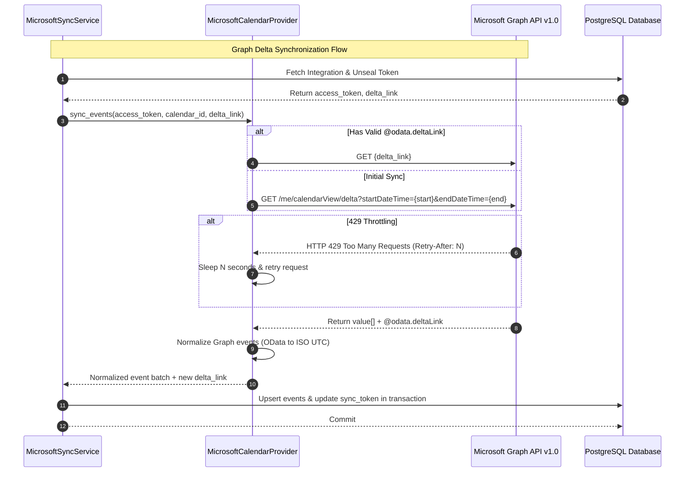

# Phase 5 Microsoft Outlook & Graph API Integration Guide

## 1. Microsoft Graph Architecture Overview

The Microsoft Outlook Calendar integration utilizes the **Microsoft Graph API (v1.0)** to synchronize Outlook calendar commitments, corporate meetings, and availability data into ContextIQ's normalized schema.



---

## 2. Authentication & Microsoft Entra Configuration

### A. OAuth 2.0 & Entra Application Registration
- **Identity Provider**: Microsoft Entra ID (formerly Azure Active Directory).
- **Supported Account Types**: Accounts in any organizational directory (Multi-tenant) and personal Microsoft accounts (e.g. Outlook.com, Hotmail, Live).
- **Flow**: Authorization Code Flow with PKCE (RFC 7636).
- **Token Endpoint**: `https://login.microsoftonline.com/common/oauth2/v2.0/token`
- **Authorize Endpoint**: `https://login.microsoftonline.com/common/oauth2/v2.0/authorize`

### B. Minimal Delegated Permissions
- `offline_access`: Enables persistent synchronization via refresh tokens.
- `User.Read`: Retrieves the signed-in user's profile and principal name.
- `Calendars.Read`: Reads user calendar events to discover free/busy availability.
- `Calendars.ReadWrite`: Writes confirmed ContextIQ task blocks to the user's Outlook calendar.

---

## 3. Microsoft Graph Calendar Operations

### A. Primary Calendar Discovery
```http
GET https://graph.microsoft.com/v1.0/me/calendars
Authorization: Bearer {access_token}
```
The provider filters for `isDefaultCalendar == true` to designate the authoritative target for event synchronization.

### B. Delta Query Synchronization (`/calendarView/delta`)
Microsoft Graph provides stateful incremental change tracking through delta queries:
1. **Initial Call**:
   ```http
   GET https://graph.microsoft.com/v1.0/me/calendarView/delta?startDateTime=2026-10-25T00:00:00Z&endDateTime=2027-02-25T00:00:00Z
   Prefer: odata.maxpagesize=250
   ```
2. **Pagination**:
   Follows `@odata.nextLink` until the response contains `@odata.deltaLink`.
3. **Subsequent Calls**:
   Subsequent synchronization calls issue a GET directly to `@odata.deltaLink`, returning only additions, modifications, and deletions (`@removed: {"reason": "deleted"}`).

---

## 4. Recurrence & Availability Mapping

### A. Recurrence Expansion
- Graph's `calendarView` automatically expands recurring event series into individual occurrences within the requested time window.
- Series masters (`type: "seriesMaster"`) and exceptions (`type: "exception"`) are mapped cleanly without requiring manual recurrence engine computation.

### B. Availability Normalization
Microsoft Graph availability statuses are normalized to ContextIQ canonical enums:
- `free` $\rightarrow$ `FREE`
- `tentative` $\rightarrow$ `TENTATIVE`
- `busy` $\rightarrow$ `BUSY`
- `oof` (Out of Office) $\rightarrow$ `OUT_OF_OFFICE`
- `workingElsewhere` $\rightarrow$ `BUSY`

### C. Sensitivity Mapping
- Graph events with `sensitivity: "private"` or `"confidential"` have their subject replaced with `"Busy"` and body content redacted before database persistence.

---

## 5. Throttling Recovery (HTTP 429)

Microsoft Graph enforces strict per-app and per-mailbox rate limits. The provider implements robust throttling mitigation:
1. When encountering `HTTP 429 Too Many Requests` or `HTTP 503 Service Unavailable`:
2. Extracts the `Retry-After` header value (duration in seconds).
3. If `Retry-After` is missing, applies exponential backoff:
   $$\Delta t = 2^{\text{attempt}} \pm \text{jitter}$$
4. Re-executes the request upon timeout expiry (up to a maximum of 3 retries).
