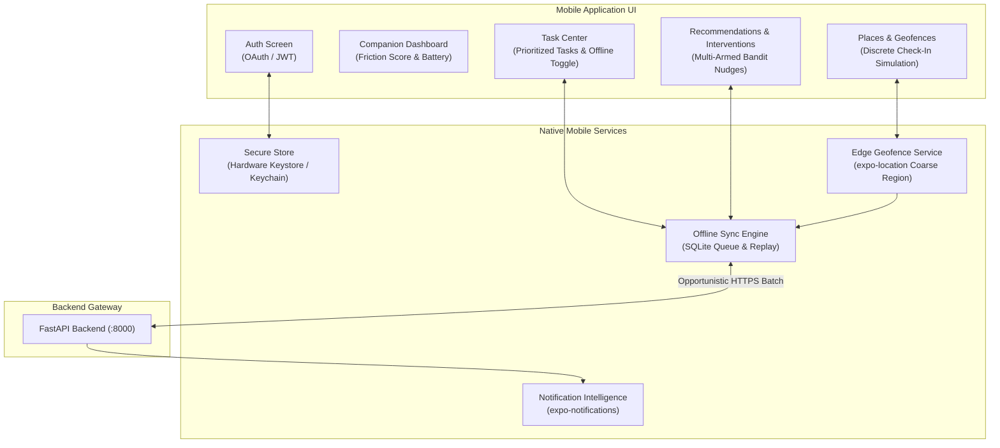
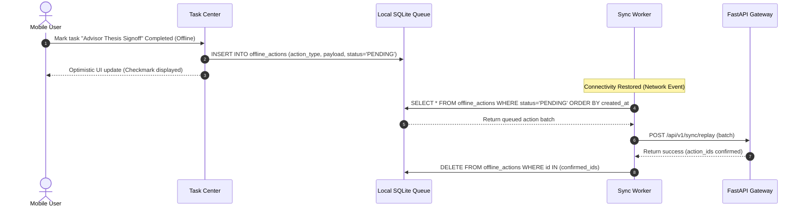

# Phase 5 Mobile Companion Application Architecture

## 1. Overview & Mobile Principles

The ContextIQ Mobile Companion extends the platform to iOS and Android devices using **React Native with Expo**.

Mobile design principles:
1. **Lightweight & Battery-Conscious**: Opportunistic background execution. Zero continuous GPS tracking or wake-locks.
2. **Offline-First Synchronization**: All task completions, check-ins, and user actions are recorded locally in a SQLite mutex queue and synchronized to the backend when connectivity is restored.
3. **Hardware Keystore Security**: Authentication tokens and device keys are stored in encrypted hardware-backed storage (`expo-secure-store`).
4. **Context-Aware Micro-Interventions**: Delivers actionable nudges and arrival/departure reminders respecting system focus modes and user quiet hours.



---

## 2. Project Directory Structure

```
mobile/
├── app/                  # Expo file-based router pages
├── components/           # Reusable UI widgets (cards, badges, buttons)
├── features/             # Domain modules
│   ├── authentication/   # Auth forms, token management
│   ├── dashboard/        # Friction scores, daily metrics
│   ├── tasks/            # Task list, completion toggle, filter
│   ├── calendar/         # Mobile calendar view
│   ├── recommendations/  # Contextual recommendations list
│   ├── interventions/    # Micro-break & fatigue nudges
│   ├── notifications/    # Push notifications & quiet hours
│   ├── profile/          # Digital twin & behavioral settings
│   └── settings/         # Device registration & integration status
├── services/             # API client & device services
│   ├── apiClient.ts      # Axios/fetch client with interceptors
│   ├── authService.ts    # Secure token storage & session refresh
│   ├── taskService.ts    # Task CRUD & offline sync
│   ├── locationService.ts# Discrete check-ins & geofencing
│   └── notificationService.ts # Local/push notification routing
├── hooks/                # Custom React hooks (useAuth, useOfflineSync)
├── storage/              # SQLite database adapter & schema
└── tests/                # Vitest unit & integration test suites
```

---

## 3. Secure Storage & Authentication

- **Token Storage**:
  - `auth_token` and `refresh_token` are stored via `expo-secure-store`, backed by **Android KeyStore** (with AES encryption) and **iOS Keychain**.
- **Session Refresh**:
  - Axios response interceptor intercepts `401 Unauthorized`.
  - Automatically executes refresh token rotation against `POST /api/v1/auth/refresh`.
  - Enqueues concurrent requests during token renewal to prevent race conditions.

---

## 4. Offline Synchronization Pipeline



---

## 5. Background Execution Invariants & Realities

Mobile operating systems enforce strict background execution limits:
- **Android**: Background execution relies on `WorkManager` with battery optimization and Doze mode constraints. Periodic sync intervals are non-deterministic (minimum 15-minute interval governed by JobScheduler).
- **iOS**: Background execution is governed by `BGTaskScheduler` (`BGAppRefreshTask` / `BGProcessingTask`). Execution occurs opportunistically when the device is connected to power or during frequent app usage patterns.
- **Invariant**: The application **does not claim continuous 24/7 background telemetry streaming**. All telemetry and check-ins are debounced, queued locally, and transmitted opportunistically when active or during scheduled system refresh windows.
