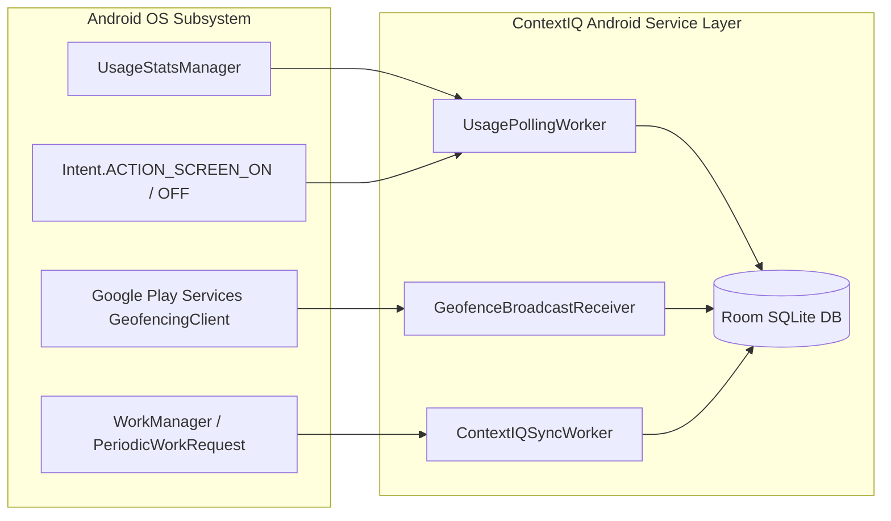
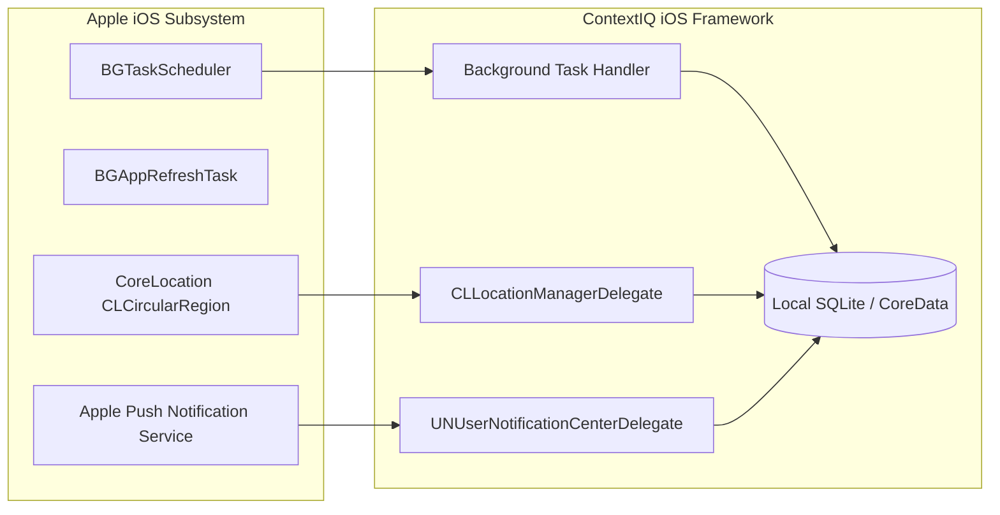
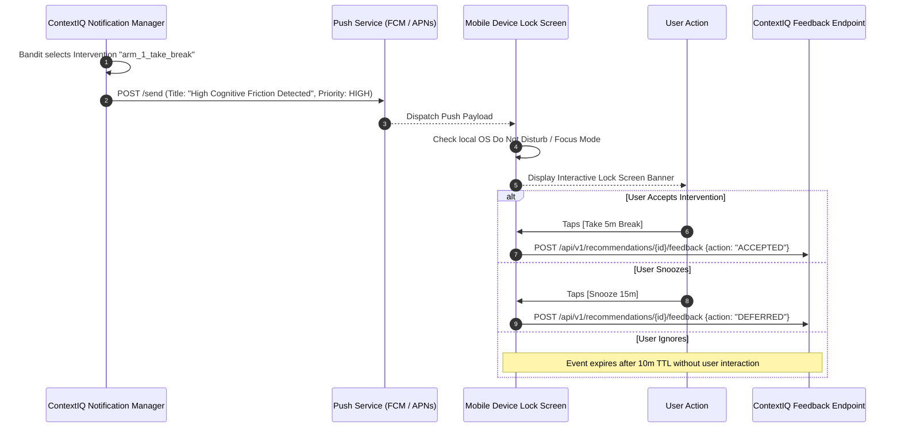

# Mobile Architecture: Android & iOS Cross-Platform Clients

## 1. Overview & Mobile Architectural Principles

Modern knowledge workers constantly transition between workstations and mobile devices. Context switches, micro-delays, and sudden interruptions frequently originate on smartphones during or between deep focus sessions. 

The **ContextIQ Mobile Architecture** extends behavioral intelligence to Android and iOS ecosystems under five strict architectural principles:
1. **Zero High-Frequency Polling**: Mobile clients must never drain battery through continuous active polling or persistent wake locks. Activity is captured through OS-level event listeners and scheduled background workers.
2. **Local Privacy Enforcement**: Exclusion rules (`UserAppExclusion`), title scrubbing, and privacy pausing are executed on-device prior to local storage or transmission.
3. **Offline-First Persistence**: All mobile events are committed to a local SQLite database before network dispatch.
4. **Resilient Synchronization**: Background sync is batched, compressed, and scheduled when the device is idle or connected to unmetered Wi-Fi.
5. **Actionable Contextual Interventions**: Support native high-priority push notifications with interactive action buttons (Start, Snooze, Complete).

---

## 2. High-Level Mobile Application Topology

```mermaid
graph TB
    subgraph Mobile_Application_Host [ContextIQ Mobile Client (Android / iOS)]
        subgraph UI_Layer [User Interface Layer]
            DASH[Mobile Dashboard & Focus View]
            SETTINGS[Privacy & Device Controls]
            INTERVENTIONS_UI[Actionable Notification Center]
        end

        subgraph Background_Engines [Low-Power Background Engine]
            APP_COLLECTOR[App Transition Monitor]
            SCREEN_COLLECTOR[Screen State & Inactivity Monitor]
            GEO_COLLECTOR[OS Geofence Transition Receiver]
        end

        subgraph Local_Storage_Layer [Offline Storage & Privacy Boundary]
            PRIVACY_FILTER[On-Device Privacy & App Filter]
            SQLITE_DB[(Local SQLite / Room Buffer)]
            SYNC_ENGINE[Batch Sync Worker]
        end

        subgraph OS_Subsystems [Native OS Platform Services]
            NOTIF_SERVICE[Push Notification Receiver (FCM / APNs)]
            OS_GEOFENCE[OS Location & Geofencing System]
            OS_SCHEDULER[OS Background Task Scheduler]
        end
    end

    subgraph Cloud_Infrastructure [ContextIQ Cloud Backend]
        API_GATEWAY[API Gateway / Telemetry Ingestion]
        PUSH_GATEWAY[Notification Dispatcher (FCM / APNs)]
    end

    %% Wiring
    APP_COLLECTOR --> PRIVACY_FILTER
    SCREEN_COLLECTOR --> PRIVACY_FILTER
    GEO_COLLECTOR --> PRIVACY_FILTER
    PRIVACY_FILTER --> SQLITE_DB
    SQLITE_DB --> SYNC_ENGINE
    OS_SCHEDULER --> SYNC_ENGINE

    SYNC_ENGINE -->|HTTPS Batch Ingest| API_GATEWAY
    PUSH_GATEWAY --> NOTIF_SERVICE
    NOTIF_SERVICE --> INTERVENTIONS_UI
    OS_GEOFENCE --> GEO_COLLECTOR
```

---

## 3. Platform-Specific Background Collection Mechanisms

### 3.1 Android Architecture

Android provides fine-grained background processing APIs, governed by strict battery optimization policies (Doze Mode and App Standby Buckets).



1. **Application Usage Monitoring**:
   - Utilizes `UsageStatsManager` with user-granted `PACKAGE_USAGE_STATS` special access permission.
   - Polling occurs via an adaptive `WorkManager` job running only when the screen is active, sampling foreground transitions every 10–30 seconds.
   - Screen on/off transitions are captured via a lightweight `BroadcastReceiver` (`ACTION_SCREEN_ON`, `ACTION_SCREEN_OFF`, `ACTION_USER_PRESENT`).
2. **Battery & Doze Mode Management**:
   - Synchronizations are marked with `setRequiresBatteryNotLow(true)` and `setRequiresCharging(false)`.
   - Batch upload intervals expand dynamically from 5 minutes (while user is active) to 60 minutes (when device is idle/dozing).
3. **Geofencing**:
   - Registers static circular geofences with Google Play Services `GeofencingClient`. The OS handles radio duty-cycling via Wi-Fi and cell tower signatures with negligible battery impact.

---

### 3.2 iOS Architecture

iOS imposes rigorous sandbox and background execution constraints, managed by the `BackgroundTasks` framework and privacy entitlements.



1. **Background Task Scheduling**:
   - `BGAppRefreshTask` (`com.contextiq.app.refresh`): Scheduled periodically to perform batch uploads and token health checks.
   - `BGProcessingTask` (`com.contextiq.app.dbcleanup`): Executed during overnight charging to purge local synchronized records and aggregate metrics.
2. **Location & Geofencing**:
   - Utilizes `CLLocationManager` with `startMonitoring(for: region)`. Regions are registered with `CLCircularRegion` (radius $\ge 100\text{ meters}$).
   - Boundary transitions (`didEnterRegion`, `didExitRegion`) awaken the app in the background for up to 30 seconds to record the event into SQLite.
3. **Push Interventions (APNs)**:
   - Delivers low-latency proactive nudges via APNs with actionable notification categories (`ACCEPT_ACTION`, `SNOOZE_ACTION`, `DISMISS_ACTION`).

---

## 4. Local Offline Persistence & Synchronization Engine

The mobile SQLite database architecture mirrors the desktop agent's schema, ensuring seamless multi-platform consistency:

```sql
-- Mobile Local Event Storage (Room / SQLite)
CREATE TABLE mobile_event_queue (
    event_id TEXT PRIMARY KEY,
    event_type TEXT NOT NULL,
    event_timestamp INTEGER NOT NULL, -- Unix epoch milliseconds
    source_application TEXT,
    payload TEXT NOT NULL, -- JSON formatted string
    sync_status TEXT NOT NULL DEFAULT 'PENDING', -- 'PENDING', 'SYNCED', 'FAILED'
    retry_count INTEGER NOT NULL DEFAULT 0,
    created_at INTEGER NOT NULL
);

CREATE INDEX ix_mobile_event_sync ON mobile_event_queue(sync_status, event_timestamp);
```

### 4.1 Sync Protocol & Network Guardrails
- **Batching**: Up to 50 events are dispatched in a single compressed `POST /api/v1/telemetry/events/batch` payload.
- **Compression**: Payloads are compressed using gzip or zstd over HTTPS if batch size $> 1\text{ KB}$.
- **Metered Network Throttling**: On metered cellular connections, routine heartbeat and background telemetry uploads are deferred until unmetered Wi-Fi is detected, unless an urgent intervention feedback action occurs.

---

## 5. Push Notification Subsystem & Interactive Nudges

To minimize cognitive intrusion while ensuring timely interventions, mobile push notifications are governed by the `NotificationIntelligenceManager`:



### Notification Payload Schema
```json
{
  "to": "user_device_fcm_token",
  "priority": "high",
  "data": {
    "type": "CONTEXTIQ_INTERVENTION",
    "recommendation_id": "rec_uuid_v4",
    "arm_id": "arm_1_take_break",
    "title": "Cognitive Reset Suggested",
    "body": "Continuous focus friction detected over the last 45 minutes. A 5-minute break will restore resumption speed.",
    "actions": [
      {"id": "ACCEPT", "title": "Take Break"},
      {"id": "SNOOZE", "title": "Snooze (15m)"},
      {"id": "DISMISS", "title": "Dismiss"}
    ],
    "expires_at": 1732454400
  }
}
```
