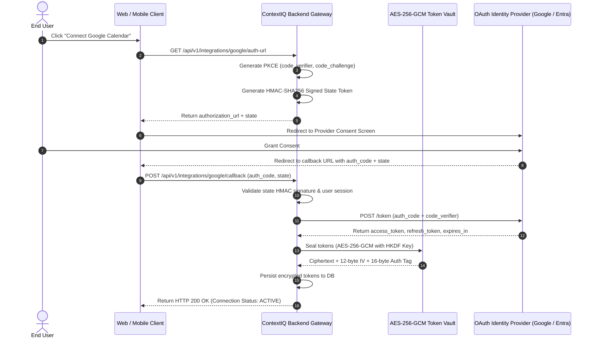

# Phase 5 Security & OAuth Architecture: Cryptographic Vault and Privacy

## 1. Threat Model & Security Objectives

Integrating with third-party ecosystems introduces critical security boundaries. ContextIQ enforces a zero-trust model around external credentials, focusing on:
1. **Confidentiality of OAuth Credentials**: Third-party access and refresh tokens are treated as high-value secrets. Tokens are never stored in plaintext and never leaked into logs or client-facing responses.
2. **Mitigation of OAuth CSRF & Interception**: Implementation of Proof Key for Code Exchange (PKCE, RFC 7636) and cryptographically signed state parameters.
3. **Scope Minimization (Least Privilege)**: Requesting only the minimal delegated scopes necessary to discover calendar events and write confirmed schedules.
4. **Instant Revocation & Clean Disconnect**: Secure disposal of tokens from the database and dispatching revocation webhooks to the provider identity endpoints.



---

## 2. Cryptographic Token Vault (AES-256-GCM)

All third-party tokens are encrypted using **AES-256-GCM (Galois/Counter Mode)**, providing both confidentiality and cryptographic integrity verification.

### Encryption Specifications:
- **Cipher**: AES-256 in GCM mode.
- **Key Derivation**: HKDF-SHA256 utilizing a master secret (`SECRET_KEY`) and a per-record salt.
- **Initialization Vector (IV)**: 12-byte cryptographically secure pseudo-random bytes generated using `secrets.token_bytes(12)` per encryption operation. Nonces are never reused.
- **Authentication Tag**: 16-byte GCM authentication tag appended to the ciphertext to verify payload authenticity. Any tampering immediately raises `DecryptionError`.

```python
from cryptography.hazmat.primitives.ciphers.aead import AESGCM
import base64
import os

class TokenVault:
    def __init__(self, master_key_bytes: bytes):
        self.aesgcm = AESGCM(master_key_bytes)

    def seal_token(self, plaintext_token: str) -> str:
        """Encrypts token and returns base64-encoded bundle: [12-byte IV] + [Ciphertext + 16-byte Tag]"""
        iv = os.urandom(12)
        ciphertext = self.aesgcm.encrypt(iv, plaintext_token.encode("utf-8"), None)
        return base64.b64encode(iv + ciphertext).decode("utf-8")

    def unseal_token(self, encrypted_bundle_b64: str) -> str:
        """Decrypts token bundle and verifies GCM authentication tag."""
        raw = base64.b64decode(encrypted_bundle_b64.encode("utf-8"))
        iv, ciphertext = raw[:12], raw[12:]
        decrypted_bytes = self.aesgcm.decrypt(iv, ciphertext, None)
        return decrypted_bytes.decode("utf-8")
```

---

## 3. OAuth 2.0 PKCE & CSRF Defense

### A. PKCE Implementation (RFC 7636)
To protect authorization codes from being intercepted in mobile deep links or client redirects:
1. Client generates high-entropy cryptographic `code_verifier`:
   $$\text{code\_verifier} \in [43, 128] \text{ chars from } [A-Z, a-z, 0-9, -, ., _, \sim]$$
2. Computes the SHA-256 challenge:
   $$\text{code\_challenge} = \text{BASE64URL-ENCODE}(\text{SHA256}(\text{code\_verifier}))$$
3. Passes `code_challenge` and `code_challenge_method=S256` to the identity provider.
4. During token redemption, provides the raw `code_verifier` for server-side verification.

### B. HMAC-SHA256 State Signing
The `state` parameter prevents Cross-Site Request Forgery (CSRF). It encodes user identity, timestamp, and an HMAC-SHA256 signature:
$$\text{state} = \text{base64url}(\text{user\_id} \mathbin{\Vert} \text{timestamp} \mathbin{\Vert} \text{nonce} \mathbin{\Vert} \text{HMAC}(\text{user\_id} \mathbin{\Vert} \text{timestamp} \mathbin{\Vert} \text{nonce}, K_{\text{master}}))$$

Callbacks verify:
- Signature authenticity using constant-time comparison (`hmac.compare_digest`).
- Timestamp freshness (rejected if older than 10 minutes).
- Binding to the currently authenticated session user.

---

## 4. Scope Minimization Matrix

ContextIQ enforces the principle of least privilege:

| Provider | Scope | Justification |
|:---|:---|:---|
| **Google** | `openid`, `email` | User identity verification & account linking |
| **Google** | `https://www.googleapis.com/auth/calendar.events.readonly` | Read meetings to determine free/busy availability |
| **Google** | `https://www.googleapis.com/auth/calendar.events` | Write user-approved scheduling blocks |
| **Microsoft** | `offline_access` | Maintain background synchronization via refresh tokens |
| **Microsoft** | `User.Read` | Confirm account principal identity |
| **Microsoft** | `Calendars.Read` | Read Outlook meetings for availability calculations |
| **Microsoft** | `Calendars.ReadWrite` | Create user-approved task events on Outlook |

*Notice: Full mailbox access, contacts, or unconstrained administrative scopes are strictly prohibited.*

---

## 5. Token Revocation & Disconnect Lifecycle

When a user initiates a disconnect action:
1. **Provider Revocation**: An HTTP POST request is dispatched to the provider's token revocation endpoint:
   - Google: `https://oauth2.googleapis.com/revoke?token={access_or_refresh_token}`
   - Microsoft: Revocation handled via tenant token endpoint.
2. **Cryptographic Deletion**: Encrypted tokens, sync tokens, and provider calendar mappings are purged from `calendar_integrations`.
3. **Event Sanitization**: Associated records in `external_calendar_events` are soft-deleted or purged in accordance with user retention preferences.
4. **Audit Logging**: A structured audit entry is recorded with user ID and timestamp (with all credential payloads omitted).
