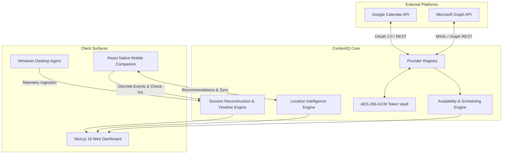

# Phase 5 Overview: External Ecosystem Integration & Cross-Platform Intelligence

## 1. Executive Summary

Phase 5 expands ContextIQ from an isolated, desktop-centric micro-delay analytics tool into a unified cognitive operating system that seamlessly connects:
1. **External Calendar Ecosystems**: Bi-directional integration with Google Calendar and Microsoft Outlook via Microsoft Graph API, normalizing meetings, focus buffers, and schedule commitments.
2. **Intelligent Calendar-Aware Scheduling**: Dynamic task allocation within discovered focus windows, factoring in historical recovery times, cognitive fatigue, deadlines, and strict user approval gating.
3. **Cross-Platform Mobile Companion**: React Native / Expo application providing task execution, contextual recommendations, notification management, and discrete location boundary detection without continuous GPS tracking.
4. **Cross-Device Behavioral Timeline**: Unified event schema stitching Windows desktop telemetry, mobile activity, and calendar events into continuous, cross-device work sessions.
5. **Location-Aware Contextual Intelligence**: Privacy-first geofencing and manual check-ins connecting physical places (Home, Campus, Office, Library, Laboratory) to task associations, arrival prompts, and departure "One More Thing" reminders.
6. **Unified Ecosystem Dashboard**: Next.js 16 frontend interface featuring the Smart Calendar, Integration Health Diagnostics, Activity Timeline, and Location Intelligence portal.

---

## 2. Key Objectives & Milestones Achieved

| Objective | Engineering Milestone | Deliverable Status |
|:---|:---|:---:|
| **Provider Abstraction** | Unified `CalendarProvider` ABC & `ProviderRegistry` pattern | Completed |
| **OAuth & Token Security** | PKCE authorization, AES-256-GCM authenticated cipher vault | Completed |
| **Google Calendar Sync** | Two-way sync, primary calendar discovery, `syncToken` deltas | Completed |
| **Microsoft Graph Sync** | Entra ID auth, delta links (`@odata.deltaLink`), 429 throttling backoff | Completed |
| **Intelligent Scheduling** | Availability discovery, recovery micro-delay buffers, approval gating | Completed |
| **Mobile Companion** | React Native / Expo app, offline queue, native notification suppression | Completed |
| **Cross-Device Sync** | Multi-device registry, out-of-order ingestion, session stitching | Completed |
| **Location Intelligence** | Edge boundary check-in simulation, quiet hours suppression (22:00-08:00) | Completed |
| **Unified Web Dashboard** | `/calendar`, `/activity`, `/context/locations`, `/settings/integrations` | Completed |
| **Cross-Platform Validation**| 662 automated tests passing across 9 backend and frontend suites | Completed |

---

## 3. Strict Engineering Invariants

1. **Zero Mock Integrations**: Unconnected calendar providers or devices strictly render with a `Not Linked` status and connection CTA; simulated or mock integrations are never presented as active connections.
2. **Explicit Calendar Write Approval**: The scheduling engine cannot write or modify events on external calendar providers without explicit user review and confirmation via the "Approve & Write" workflow.
3. **Anti-Surveillance Privacy**: Zero continuous GPS coordinate streams or breadcrumbs are transmitted or stored. Boundary detection is computed locally on mobile devices using circular geofences (minimum 100m radius), transmitting only discrete enter/exit events.
4. **Opportunistic Mobile Background Processing**: Background tasks on mobile are restricted to OS-scheduled background workers (WorkManager on Android and BackgroundTasks on iOS). Zero claims of unrestricted background execution are made.
5. **Tenancy and Tenant Isolation**: Every integration token, external event, registered device, and location check-in is strictly keyed by `user_id` with enforced Row-Level Security (RLS) policies.
