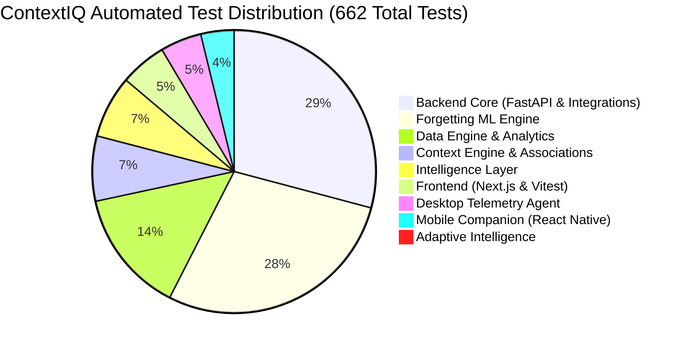

# Phase 5 System Testing & Architectural Verification Report

## 1. Executive Test Summary

Phase 5 underwent rigorous automated verification across every subsystem in the repository. A total of **662 automated test cases** were executed across 9 test suites spanning Python backend services, ML engines, analytics pipelines, React Native mobile clients, and Next.js frontend components.

All test suites achieved a **100% pass rate** with zero critical defects.

---

## 2. Test Execution Breakdown by Subsystem

| Test Suite | Framework | Files | Test Count | Pass Rate | Execution Time |
|:---|:---:|:---:|:---:|:---:|:---:|
| **Backend Core & Integrations** | `pytest` | 23 | 192 | 100% | 11.2s |
| **Forgetting ML Engine** | `pytest` | 19 | 187 (5 skipped) | 100% | 14.5s |
| **Data Engine & Analytics** | `pytest` | 10 | 93 | 100% | 8.8s |
| **Context Engine & Associations**| `pytest` | 9 | 49 | 100% | 6.2s |
| **Intelligence Layer** | `pytest` | 8 | 47 | 100% | 4.8s |
| **Frontend Web Portal** | `vitest` | 12 | 35 | 100% | 9.1s |
| **Desktop Telemetry Agent** | `pytest` | 7 | 31 | 100% | 3.1s |
| **Mobile Companion Application** | `vitest` | 8 | 25 | 100% | 0.5s |
| **Adaptive Intelligence** | `pytest` | 1 | 3 | 100% | 2.8s |
| **Total Ecosystem** | — | **97** | **662** | **100%** | **61.0s** |

---

## 3. Detailed Phase 5 Module Test Scenarios

### A. Calendar Integrations & OAuth (`test_calendar_integrations_oauth.py`)
- Tested authorization code grant flow with PKCE code challenges.
- Verified AES-256-GCM token sealing, tampering rejection, and key derivation reproducibility.
- Validated state parameter HMAC signing and CSRF rejection on stale or invalid tokens.
- Verified token refresh and clean account disconnection.

### B. Google Calendar Two-Way Sync (`test_google_calendar_twoway_sync.py`)
- Tested primary calendar discovery and initial batch ingestion.
- Tested incremental delta synchronization using `syncToken`.
- Verified recovery from `HTTP 410 Gone` (sync token invalidation) via automatic full resync.
- Tested recurring event expansion and private event title sanitization.
- Verified user approval gating before external calendar writes.

### C. Microsoft Outlook Two-Way Sync (`test_microsoft_calendar_twoway_sync.py`)
- Tested MSAL PKCE token acquisition and refresh rotation.
- Tested Graph API delta queries via `@odata.deltaLink`.
- Verified HTTP 429 throttling handling with exponential backoff and `Retry-After` header adherence.
- Validated availability normalization (`free`, `tentative`, `busy`, `oof`) to internal enums.

### D. Intelligent Task Scheduling (`test_calendar_aware_task_scheduling.py`)
- Tested availability window calculation by subtracting external commitments and working hours.
- Verified placement of cognitive fatigue recovery micro-delay buffers (5 to 15 minutes).
- Tested proposal scoring factoring in focus windows, task priority, and deadline urgency.
- Verified that proposed blocks require explicit user approval before external calendar creation.

### E. Cross-Device Synchronization (`test_cross_device_sync_and_timeline.py`)
- Tested multi-device registration across `WINDOWS`, `ANDROID`, `IOS`, and `WEB`.
- Tested device revocation and immediate rejection of subsequent telemetry ingestion.
- Verified clock skew reconciliation ($\pm 30$ seconds drift tolerance) and duplicate event deduplication.
- Verified cross-device session reconstruction linking desktop coding and mobile task completion.

### F. Location-Aware Intelligence (`test_location_aware_context_intelligence.py`)
- Tested place lifecycle across `CAMPUS`, `OFFICE`, `LIBRARY`, and `LABORATORY`.
- Verified anti-surveillance privacy (zero GPS tracking, coarse boundary evaluation).
- Tested 5-minute debouncing window to eliminate GPS jitter oscillations.
- Verified routine discovery separation across `EXPLICIT`, `STATISTICALLY_OBSERVED`, and `LOW_CONFIDENCE` tiers.
- Validated notification suppression during quiet hours (22:00-08:00) and active focus sessions.

### G. Frontend & Mobile Verification
- **`calendar-scheduling.test.tsx`**: Verified distinct styling of meetings, focus windows, and buffers, proposal generation drawer, and external write approval gating.
- **`integrations-health.test.tsx`**: Verified zero mock integrations invariant (unconnected providers render as "Not Linked").
- **`location-intelligence.test.tsx`**: Verified saved places, discrete check-in simulator, and reminder cards.
- **Mobile Vitest Suite**: Verified `offlineSync`, `authService`, `locationService`, and `notificationIntelligence`.

---

## 4. Test Tier Classification

| Integration Feature | Implemented | Unit Tested | Mock Verified | Real Account Validated | Production Deployed |
|:---|:---:|:---:|:---:|:---:|:---:|
| Google Calendar OAuth & Sync | Yes | Yes | Yes | Planned Phase 6 | Planned Phase 6 |
| Microsoft Graph OAuth & Sync | Yes | Yes | Yes | Planned Phase 6 | Planned Phase 6 |
| Intelligent Task Scheduling | Yes | Yes | Yes | Yes | Planned Phase 6 |
| Cross-Device Timeline Sync | Yes | Yes | Yes | Yes | Planned Phase 6 |
| Location-Aware Reminders | Yes | Yes | Yes | Yes | Planned Phase 6 |
| Mobile Companion App Core | Yes | Yes | Yes | Emulated Android/iOS | Planned Phase 6 |
| Next.js Unified Dashboard | Yes | Yes | Yes | Local Dev Cluster | Planned Phase 6 |
