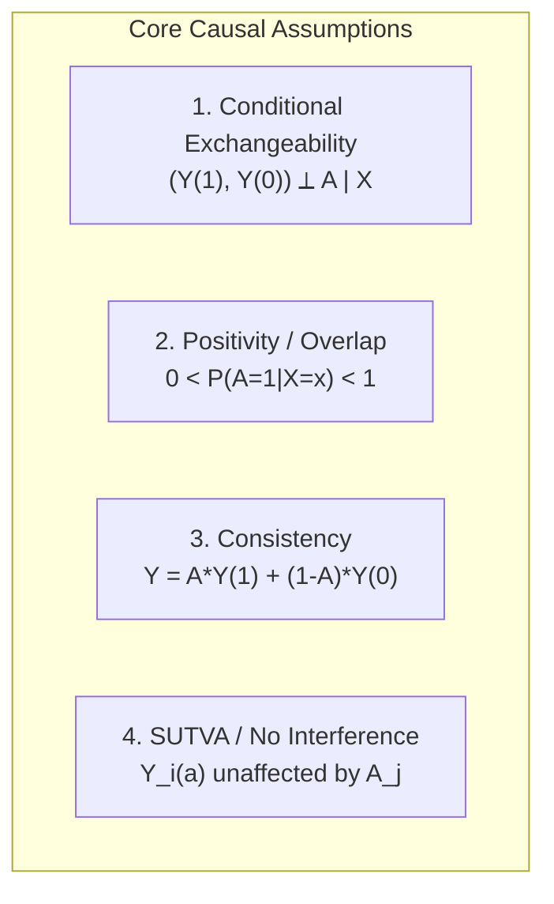
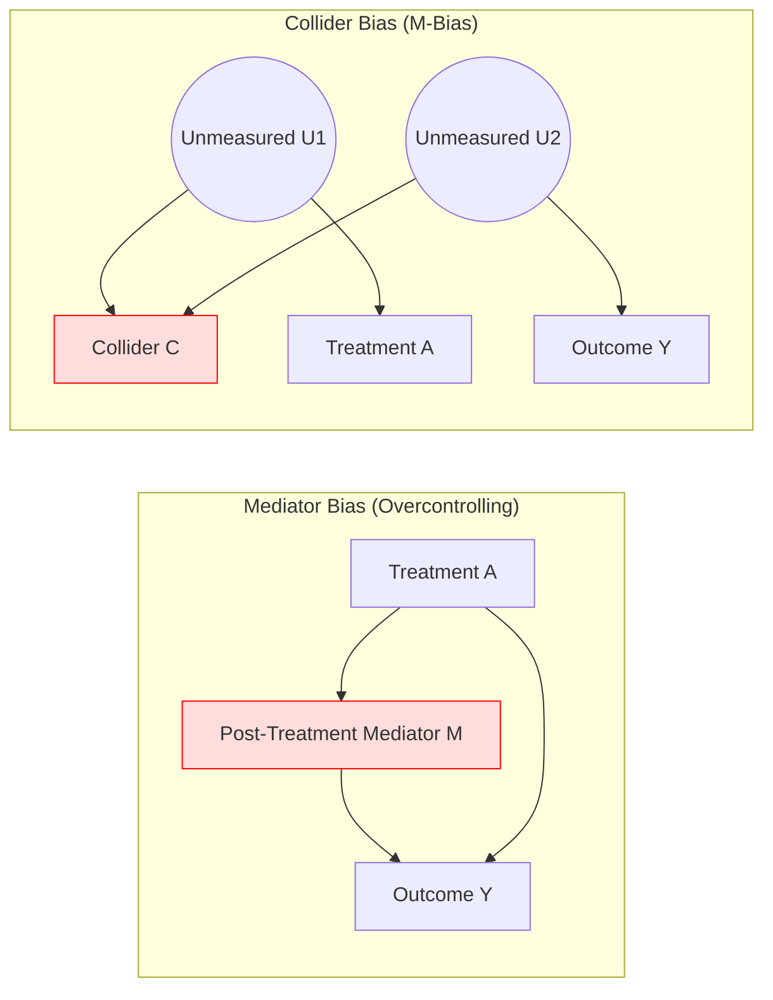

# Causal Identification Assumptions, DAGs, and Abstention Protocol

**ContextIQ Intelligence Architecture — Phase 6.3 Specification**  
*Document Version: 1.0.0*  
*Status: Approved for Engineering Implementation*

---

## 1. Core Causal Identification Assumptions

Causal inference from observational telemetry requires explicit mathematical assumptions. In ContextIQ, these assumptions are never taken for granted; each is subjected to verification or explicit sensitivity analysis.



### 1.1 Conditional Exchangeability (No Unmeasured Confounders)
$$(Y(1), Y(0)) \perp A \mid X$$
Given pre-treatment covariates $X$ in the minimal sufficient adjustment set, the potential outcomes are conditionally independent of treatment assignment $A$.
- **Threat**: Unobserved emotional stress, physical coworker interruptions, or offline paper notes.
- **Mitigation**: DAG-informed backdoor adjustment and mandatory **E-value** sensitivity calculation.

### 1.2 Positivity (Common Support)
$$0 < P(A = 1 \mid X = x) < 1 \quad \forall x \in \text{supp}(X)$$
Every user context that can receive treatment must also have a non-zero probability of remaining untreated.
- **Threat**: Deterministic heuristic rules (e.g., always dispatching an alert when BFI $> 80$).
- **Mitigation**: Bandit exploration holdouts ($\epsilon$-greedy / Thompson sampling) and automatic clipping within $[\epsilon, 1 - \epsilon]$. Positivity violations $> 25\%$ trigger immediate **abstention**.

### 1.3 Consistency
$$Y = A \cdot Y(1) + (1 - A) \cdot Y(0)$$
The observed outcome under treatment $A$ corresponds to the hypothetical potential outcome under that intervention version.
- **Threat**: Ill-defined or multi-version interventions (e.g., varying notification copy or differing buffer modalities).
- **Mitigation**: Standardized intervention templates with explicit effort and duration metadata.

### 1.4 Stable Unit Treatment Value Assumption (SUTVA)
An intervention delivered to episode $i$ does not affect the potential outcomes of subsequent disruption episode $j$ ($i \ne j$).
- **Threat**: Carryover fatigue or spillover habituation across adjacent interruptions.
- **Mitigation**: Minimum 30-minute cooldown periods between evaluated target trial episodes.

---

## 2. Directed Acyclic Graphs (DAGs) & Backdoor Path Analysis

### 2.1 Research Question 1: Recovery Buffer on Task Resumption

```mermaid
graph TD
    BFI[Baseline BFI (Pre-T0)] --> T[Recovery Buffer A]
    BFI --> Y[Task Resumption Y]
    PRIOR[Task Priority] --> T
    PRIOR --> Y
    DUR[Interruption Duration] --> T
    DUR --> Y
    CAL[Calendar Meeting Density] --> T
    CAL --> Y
    T -->|True Causal Link| Y
    T --> M[Context Card Read Latency (Mediator)]
    M --> Y
    U((Unmeasured Frustration)) -.-> T
    U -.-> Y
```

- **Treatment ($A$)**: Scheduled recovery buffer prompt at interruption end.
- **Outcome ($Y$)**: Confirmed task resumption within 15 minutes.
- **Minimal Sufficient Adjustment Set**:
  $$\mathcal{X} = \{\text{baseline\_bfi}, \text{task\_priority}, \text{interruption\_duration}, \text{hour\_of\_day}, \text{calendar\_meeting\_density}\}$$
- **Backdoor Paths Closed**:
  - $A \leftarrow \text{baseline\_bfi} \rightarrow Y$ (Blocked)
  - $A \leftarrow \text{task\_priority} \rightarrow Y$ (Blocked)
  - $A \leftarrow \text{interruption\_duration} \rightarrow Y$ (Blocked)
  - $A \leftarrow \text{calendar\_meeting\_density} \rightarrow Y$ (Blocked)

---

## 3. Forbidden Controls: Mediators and Colliders

Controlling for inappropriate variables can introduce more bias than omitting true confounders. ContextIQ strictly enforces the exclusion of **forbidden controls**:



### 3.1 Post-Treatment Mediators (Overcontrolling Bias)
- **Example**: `context_card_read_latency` in Trial 1, `focus_window_duration` in Trial 2, or `immediate_app_switch` in Trial 4.
- **Why Forbidden**: A mediator lies on the causal path between treatment and outcome ($A \to M \to Y$). Conditioning on $M$ blocks the indirect causal effect, leaving only the direct effect, which drastically understates the total intervention benefit.
- **Enforcement**: Any variable timestamped $t > T_0$ is automatically excluded from the adjustment set.

### 3.2 Colliders (M-Bias / Selection Bias)
- **Example**: A variable $C$ caused by both treatment $A$ and outcome $Y$ (or caused by two unmeasured causes of $A$ and $Y$).
- **Why Forbidden**: Conditioning on a collider opens an artificial non-causal path between its causes, creating spurious correlations where none existed.

---

## 4. Unmeasured Confounding & Sensitivity Bounds

Because observational software telemetry cannot observe human internal states, ContextIQ computes **E-values** for both the point estimate and the 95% confidence limit:

$$\text{E-value} = \text{RR} + \sqrt{\text{RR}(\text{RR} - 1)}$$

### Interpretation Thresholds
1. **$\text{E-value} \ge 2.50$ (Robust)**:
   An unmeasured factor (such as sudden urgent in-person meetings) would need to be associated with both intervention assignment and task resumption by at least 2.5-fold relative risk to fully explain away the observed effect.
2. **$1.50 \le \text{E-value} < 2.50$ (Moderate)**:
   The causal finding holds against mild unmeasured stress, but strong workplace interruptions could plausibly attenuate it.
3. **$\text{E-value} < 1.50$ (Fragile)**:
   Even weak unmeasured confounders could nullify the finding. The result is downgraded to `AnalysisStatus.INCONCLUSIVE`.

---

## 5. Explicit Abstention Protocol

ContextIQ adheres to a strict scientific abstention protocol. The system **refuses to output a causal effect** and flags the analysis as `ABSTAINED` or `INCONCLUSIVE` whenever any of the following conditions are met:

```mermaid
flowchart TD
    Start[Run Causal Evaluation] --> C1{Total N >= 20 and<br/>Treated/Control >= 10?}
    C1 -- No --> A1[ABSTAINED: Insufficient Sample Size]
    C1 -- Yes --> C2{Positivity Violations < 25% and<br/>Common Support >= 0.10?}
    C2 -- No --> A2[ABSTAINED: Positivity / Overlap Violation]
    C2 -- Yes --> C3{Covariates Balanced?<br/>|SMD| <= 0.10 for >= 50%}
    C3 -- No --> I1[INCONCLUSIVE: Residual Confounding Imbalance]
    C3 -- Yes --> C4{E-Value >= 1.50?}
    C4 -- No --> I2[INCONCLUSIVE: Fragile Sensitivity to Unmeasured Confounders]
    C4 -- Yes --> Conv[CONVINCING: Causal Treatment Effect Accepted]
```

### Abstention Codes
- `ERR_SAMPLE_UNDERPOWERED`: Sample size below minimum identification threshold ($N < 20$, Treated $< 10$, Control $< 10$).
- `ERR_POSITIVITY_VIOLATION`: Common support is insufficient ($> 25\%$ of observations violate overlap bounds).
- `ERR_RESIDUAL_IMBALANCE`: More than 50% of adjustment covariates remain imbalanced ($|\text{SMD}| > 0.10$).
- `ERR_FRAGILE_E_VALUE`: Sensitivity analysis indicates the point estimate can be explained away by an unmeasured confounder with $\text{RR} < 1.50$.
- `ERR_SUBGROUP_UNDERPOWERED`: Subgroup stratum $N < 30$; CATE is suppressed with clear explanation.
