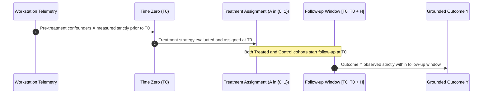

# Causal Behavioral Modeling and Confounding Analysis Framework

**ContextIQ Intelligence Architecture — Phase 6.3 Specification**  
*Document Version: 1.0.0*  
*Status: Approved for Engineering Implementation*

---

## Executive Summary

ContextIQ is designed to optimize cognitive recovery, protect deep focus, and minimize behavioral friction. However, standard predictive modeling, SHAP values, and supervised feature importance **cannot determine whether an intervention causes an improvement or merely correlates with favorable user contexts**. For instance:
- Users who receive a "recovery buffer" after an interruption may resume tasks faster simply because they were working on high-priority tasks that triggered the recommendation rule.
- Users who self-schedule focus blocks may have inherently higher conscientiousness or lighter meeting loads than those who do not.

Phase 6.3 establishes a formal, mathematically rigorous **Causal Inference and Confounding Analysis Framework**. It separates predictive risk forecasting from counterfactual intervention estimation, defines formal **Target Trials** to eliminate immortal-time bias, constructs **Directed Acyclic Graphs (DAGs)** to identify minimal sufficient adjustment sets, and implements **Doubly Robust Augmented Inverse Probability Weighting (AIPW)** alongside E-value sensitivity analysis.

> [!IMPORTANT]
> **The ContextIQ Causal Invariant**: Correlation is never presented as causation. In the absence of random assignment or defensible observational identification, the system explicitly abstains from claiming causal effectiveness rather than fabricating certainty.

---

## 1. Primary Causal Research Questions

ContextIQ structures its causal evaluation around four foundational research questions:

| Question ID | Research Question | Target Estimand | Default Method |
| :--- | :--- | :--- | :--- |
| `RECOVERY_BUFFER_ON_RESUMPTION` | Does a scheduled cognitive recovery buffer improve grounded task resumption? | $\tau_{\text{ATT}} = \mathbb{E}[Y(1) - Y(0) \mid A=1]$ | Doubly Robust AIPW |
| `ADAPTIVE_SCHEDULING_ON_COMPLETION` | Does calendar-aware focus window scheduling improve task completion? | $\tau_{\text{ATE}} = \mathbb{E}[Y(1) - Y(0)]$ | Propensity Score Matching & AIPW |
| `PERSONALIZED_REMINDER_ON_ABANDONMENT` | Does an adaptive prospective memory nudge reduce task abandonment? | $\tau_{\text{ATE}} = \mathbb{E}[Y(1) - Y(0)]$ | Inverse Probability Weighting (IPW) |
| `NOTIFICATION_TIMING_ON_FRICTION` | Does dispatching alerts at cognitive slack boundaries reduce subsequent friction? | $\tau_{\text{ATE}} = \mathbb{E}[Y(1) - Y(0)]$ | G-computation Regression Adjustment & AIPW |

---

## 2. Target Trial Protocols (Preventing Immortal-Time Bias)

Observational comparisons frequently suffer from **immortal-time bias** when the treatment definition requires a user to remain active or survive until an intervention is delivered, while the unexposed group begins follow-up immediately. ContextIQ prevents this by explicitly emulating a hypothetical target trial:

### Protocol Specifications

#### 1. Recovery Buffer Trial (`RECOVERY_BUFFER_ON_RESUMPTION`)
- **Eligibility**: User experienced a detected cognitive interruption exceeding 60 seconds during an active task; deadline is $> 2$ hours away.
- **Treatment Strategy**: Dispatch of an automated cognitive recovery buffer (3-5 minutes) with a context re-anchoring card immediately at interruption end.
- **Control Strategy**: Standard unassisted resumption (no recovery buffer prompt).
- **Time Zero ($T_0$)**: The exact microsecond of cognitive interruption termination ($t_{\text{int\_end}}$).
- **Follow-up Window**: $[T_0, T_0 + 15\text{ min}]$.
- **Outcome**: Confirmed grounded task resumption ($Y \in \{0, 1\}$) requiring active keystroke/IDE interaction on the original task.
- **Immortal-Time Guard**: Eligibility and assignment occur at $T_0$. Follow-up is never defined retroactively upon user returning to workstation.

#### 2. Adaptive Scheduling Trial (`ADAPTIVE_SCHEDULING_ON_COMPLETION`)
- **Eligibility**: Task created with explicit deadline between 4 hours and 7 days; calendar integration authorized.
- **Treatment Strategy**: Proactively allocate calendar focus window aligned with predicted circadian focus peaks.
- **Control Strategy**: Retain task in backlog without calendar modification (user self-scheduling).
- **Time Zero ($T_0$)**: Task creation timestamp.
- **Follow-up Window**: From $T_0$ until scheduled deadline.
- **Outcome**: Verified task completion ($Y \in \{0, 1\}$) on or before deadline.
- **Immortal-Time Guard**: Focus windows are booked at $T_0$; tasks deleted within 5 minutes are symmetrically excluded from both arms.

---

## 3. Causal Estimation Methods

ContextIQ implements four complementary causal estimators, benchmarked against each question's data distribution:

### 3.1 Doubly Robust AIPW (Champion Method)
The Augmented Inverse Probability Weighting (AIPW) estimator combines a propensity score model $e(X) = P(A=1 \mid X)$ with outcome regression models $\mu_1(X) = \mathbb{E}[Y \mid A=1, X]$ and $\mu_0(X) = \mathbb{E}[Y \mid A=0, X]$:

$$\hat{\tau}_{\text{AIPW}} = \frac{1}{N} \sum_{i=1}^N \left( \hat{\mu}_1(X_i) - \hat{\mu}_0(X_i) + \frac{A_i (Y_i - \hat{\mu}_1(X_i))}{\hat{e}(X_i)} - \frac{(1 - A_i)(Y_i - \hat{\mu}_0(X_i))}{1 - \hat{e}(X_i)} \right)$$

**Double Robustness Guarantee**: $\hat{\tau}_{\text{AIPW}}$ is asymptotically unbiased and semiparametrically efficient if **either** the propensity model $\hat{e}(X)$ **or** the outcome regression model $\hat{\mu}(X)$ is correctly specified.

### 3.2 Hajek-Stabilized Inverse Probability Weighting (IPW)
When propensity scores are bounded within $[\epsilon, 1-\epsilon]$, IPW reweights the observational sample to emulate a pseudo-population where treatment is independent of confounders:

$$\hat{\tau}_{\text{IPW}} = \frac{\sum_{i: A_i=1} \tilde{w}_i Y_i}{\sum_{i: A_i=1} \tilde{w}_i} - \frac{\sum_{i: A_i=0} \tilde{w}_i Y_i}{\sum_{i: A_i=0} \tilde{w}_i}, \quad \text{where } \tilde{w}_i = \min\left( w_i, Q_{0.95}(w) \right)$$

Weights are trimmed at the 95th percentile to prevent extreme weights from inflating estimator variance.

### 3.3 Propensity Score Matching (PSM)
1:1 Nearest-Neighbor matching without replacement on the logit propensity scale:

$$d(i, j) = \left| \text{logit}(\hat{e}(X_i)) - \text{logit}(\hat{e}(X_j)) \right| \le 0.20 \times \sigma_{\text{logit}(\hat{e})}$$

Treated units lacking a control unit within the caliper distance are excluded from the ATT estimation, preserving high internal validity on the common support.

### 3.4 G-Computation Regression Adjustment
Parametric modeling of potential outcomes directly conditioned on the minimal adjustment set $X$:

$$\hat{\tau}_{\text{RA}} = \frac{1}{N} \sum_{i=1}^N \left( \hat{\mu}_1(X_i) - \hat{\mu}_0(X_i) \right)$$

---

## 4. Diagnostics & Reporting Standards

Every causal evaluation produced by ContextIQ must satisfy three diagnostic gates before an effect is accepted:

### 4.1 Positivity & Common Support Diagnostics
- Evaluates the overlap of propensity distributions: $\mathcal{S} = [\max(\min(e_1), \min(e_0)), \min(\max(e_1), \max(e_0))]$.
- **Positivity Guardrail**: If more than 25% of observations have propensity scores $\hat{e}(X) < 0.05$ or $\hat{e}(X) > 0.95$, or if the common support width is $< 0.10$, the engine **abstains** and reports `AnalysisStatus.ABSTAINED`.

### 4.2 Covariate Balance Diagnostics (SMD)
- Computes Standardized Mean Differences before and after adjustment:
  $$\text{SMD}_j = \frac{\bar{X}_{1, j} - \bar{X}_{0, j}}{\sqrt{\frac{s_{1, j}^2 + s_{0, j}^2}{2}}}$$
- **Balance Threshold**: A covariate is considered balanced if $|\text{SMD}_{\text{adjusted}}| \le 0.10$.
- If $> 50\%$ of covariates remain imbalanced after weighting/matching, the engine marks the result as `AnalysisStatus.INCONCLUSIVE`.

### 4.3 Sensitivity Analysis for Unmeasured Confounding (E-Value)
To quantify vulnerability to unobserved variables (e.g., emotional frustration, off-screen conversations), ContextIQ computes the **E-value**:

$$\text{E-value} = \text{RR} + \sqrt{\text{RR}(\text{RR} - 1)}$$

- **Robustness Classification**:
  - $\text{E-value} \ge 2.50$: **ROBUST** against plausible unmeasured behavioral confounding.
  - $1.50 \le \text{E-value} < 2.50$: **MODERATE** robustness; minor unmeasured stress could attenuate effect.
  - $\text{E-value} < 1.50$: **FRAGILE**; result is marked `INCONCLUSIVE`.

---

## 5. Effect Heterogeneity & Subgroup Guardrails

ContextIQ estimates Conditional Average Treatment Effects (CATE) across five key operational dimensions:
1. **Task Category**: Coding, DeepWork, Administrative, Communication.
2. **Task Urgency**: HIGH vs LOW.
3. **Time of Day**: Morning circadian peak vs afternoon trough.
4. **User Experience Level**: Novice, Intermediate, Expert.
5. **Context-Switching Frequency**: High frequency vs focused.

### Statistical Power Guardrail
- Any subgroup stratum with total sample size $N_{\text{subgroup}} < 30$ or fewer than 5 treated/control events has its CATE **suppressed**.
- The engine reports `is_statistically_sound = False` and outputs an explicit abstention reason rather than presenting high-variance estimates as reliable findings.
