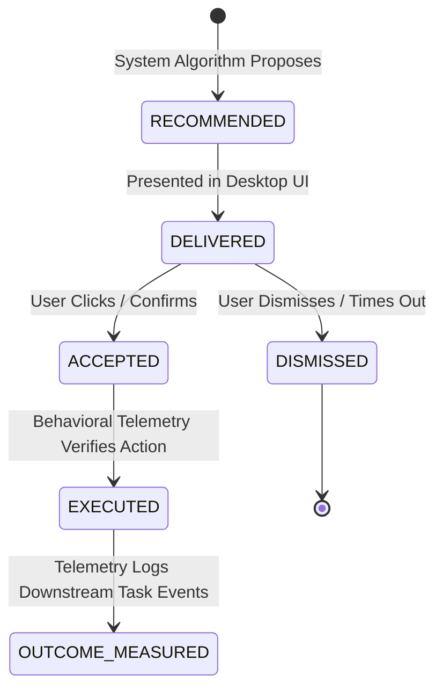
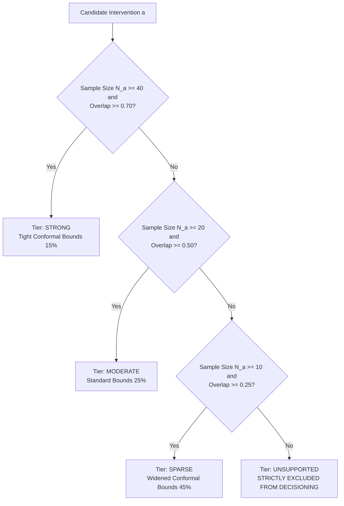

# Counterfactual Recommendation and Intervention Analysis Framework

**ContextIQ Intelligence Architecture — Phase 6.4 Specification**  
*Document Version: 1.0.0*  
*Status: Approved for Engineering Implementation*

---

## Executive Summary

Standard recommender systems select interventions based on association: which actions correlate with higher user acceptance or historical completion. In ContextIQ, this approach is fundamentally flawed because high-friction, complex tasks systematically trigger different interventions than low-friction tasks. Selecting an intervention based on raw historical conversion conflates selection bias with causal efficacy.

Phase 6.4 introduces a **Counterfactual Intervention Comparison Engine** that models hypothetical potential outcomes:
$$\{Y_i(a) \mid a \in \mathcal{A}\}$$
For any given working context (such as an impending deadline or a severe cognitive interruption), the system simulates the prospective behavioral outcomes across all supported alternatives—including the passive baseline of **No Intervention** ($a_0$).

> [!IMPORTANT]
> **The Counterfactual Invariant**: Counterfactual potential outcomes $Y(a)$ represent modeled conditional expectations under unverifiable exchangeability and positivity assumptions. They must **never** be presented to users as observed historical facts. Unsupported candidate interventions with insufficient data coverage are strictly excluded from recommendation consideration.

---

## 1. Candidate Intervention Space & Potential Outcomes

ContextIQ evaluates a standardized action space $\mathcal{A}$ containing seven distinct alternatives:

| Candidate ID | Human Title | Category | Operational Definition |
| :--- | :--- | :--- | :--- |
| `no_intervention` | No Intervention (Baseline) | BASELINE | Unassisted passive holdout; standard user self-direction. |
| `immediate_reminder` | Immediate Contextual Reminder | TASK | Immediate alert at interruption or task omission. |
| `delayed_reminder` | Cognitive Slack Boundary Reminder | TASK | Notification held until detected typing pause or window switch. |
| `calendar_rescheduling` | Calendar-Aware Focus Rescheduling | FOCUS | Automatic proposal to block focus time during circadian peak. |
| `short_recovery_buffer` | Cognitive Recovery Buffer (3-5 min) | RECOVERY | Post-interruption re-anchoring card and cognitive breather. |
| `focus_session_recommendation`| Protected Deep Focus Session (45m)| FOCUS | Full desktop notification suppression and deep work timer. |
| `break_large_task` | Task Decomposition Nudge | TASK | Prompt to split a multi-hour task into 15-minute sub-steps. |

### Multi-Dimensional Potential Outcomes Vector $Y(a)$
For each candidate $a \in \mathcal{A}$, the engine predicts five distinct outcome dimensions across explicit time horizons:

1. **Task Resumption Probability ($P_{\text{resume}} \in [0, 1]$)**:
   Probability of verified deliberate keystroke or IDE interaction within **15 minutes** of decision timestamp $T_0$.
2. **Task Completion Probability ($P_{\text{complete}} \in [0, 1]$)**:
   Probability of on-time task completion prior to the scheduled deadline.
3. **Expected Recovery Duration ($\bar{T}_{\text{rec}} \in [20, 900]$ seconds)**:
   Continuous expected seconds required to resume cognitive flow in the subsequent **30 minutes**.
4. **Prospective Behavioral Friction ($\text{BFI} \in [0, 100]$)**:
   Behavioral Friction Index forecast over the upcoming **30-minute** working window.
5. **Expected Notification Burden ($\mathcal{B}_{\text{notif}} \in [0, 1]$)**:
   Psychological disruption penalty, measured as prompt dismissal rate or immediate tab-switching away within **5 minutes**.

---

## 2. Multi-Lifecycle Intervention Dataset Construction

ContextIQ strictly distinguishes between the five lifecycle stages of an intervention:

### Critical Invariants
- **Recommendation $\ne$ Delivery**: An intervention generated by the background scheduler is not delivered if suppressed by the privacy guard or focus mode.
- **Delivery $\ne$ Acceptance**: Delivering a notification does not mean the user engaged with it.
- **Acceptance $\ne$ Execution**: A user clicking "Yes, schedule buffer" may immediately switch to social media; actual behavioral execution requires ground-truth telemetry verification.
- **Leak-Free Confounding Adjustment**: Covariates $X$ are measured strictly prior to delivery ($t < t_{\text{delivery}}$).

---

## 3. Counterfactual Meta-Learners

ContextIQ implements four specialized meta-learner architectures:

### 3.1 Doubly Robust Learner (Champion Architecture)
Combines propensity modeling with cross-fitted outcome regression:
$$\hat{\tau}_{\text{DR}}(X) = \hat{\mu}_a(X) - \hat{\mu}_0(X) + \frac{\mathbb{I}(A=a)(Y - \hat{\mu}_a(X))}{\hat{e}_a(X)} - \frac{\mathbb{I}(A=a_0)(Y - \hat{\mu}_0(X))}{\hat{e}_0(X)}$$
Guarantees unbiased estimation if either the propensity score model or the outcome response surfaces are correctly specified.

### 3.2 T-Learner (Two-Model Architecture)
Fits separate response models for each treatment arm $a$:
$$\mu_a(X) = \mathbb{E}[Y \mid A=a, X], \quad \hat{\tau}_{\text{T}}(X) = \hat{\mu}_a(X) - \hat{\mu}_0(X)$$
Effective when treatment arms have distinct response functions and sufficient sample size ($N_a \ge 40$).

### 3.3 S-Learner (Single-Model Architecture)
Fits a pooled model where the intervention arm is encoded as an input feature:
$$\mu(X, A) = \mathbb{E}[Y \mid X, A], \quad \hat{\tau}_{\text{S}}(X) = \hat{\mu}(X, a) - \hat{\mu}(X, a_0)$$
Protects against overfitting when individual treatment arms have sparse observations.

### 3.4 X-Learner (Imbalanced Two-Stage Learner)
Designed for imbalanced sample sizes (e.g., when control holdouts heavily outnumber active interventions):
1. Fit base models $\hat{\mu}_0(X)$ and $\hat{\mu}_a(X)$.
2. Impute counterfactuals: $D_a = Y_a - \hat{\mu}_0(X_a)$ and $D_0 = \hat{\mu}_a(X_0) - Y_0$.
3. Train second-stage models $\hat{\tau}_a(X)$ and $\hat{\tau}_0(X)$.
4. Combine via propensity weighting: $\hat{\tau}_{\text{X}}(X) = \hat{e}(X) \hat{\tau}_0(X) + (1 - \hat{e}(X)) \hat{\tau}_a(X)$.

---

## 4. Multi-Objective Composite Uplift Utility

To rank competing interventions with trade-offs (e.g., a reminder increases completion by 15% but increases burden by 25%), ContextIQ computes a standardized **Composite Uplift Score**:

$$\mathcal{U}(a) = 0.30 \cdot \Delta P_{\text{resume}} + 0.35 \cdot \Delta P_{\text{comp}} + 0.15 \cdot \frac{\min(30, \Delta T_{\text{rec}})}{5} + 0.15 \cdot \Delta \text{BFI}_{\text{red}} - 25.0 \cdot \mathcal{B}_{\text{notif}}$$

Where all deltas $\Delta$ are relative to `no_intervention`.

---

## 5. Data Coverage Tiers & Abstention Guardrails

To prevent premature algorithmic certainty, every candidate intervention is classified into a **Data Coverage Tier**:

### Decisioning & Deterministic Fallback Rules
The recommendation engine only selects a counterfactual-optimized candidate when:
1. The champion candidate is supported (`is_supported = True`, tier $\in \{\text{STRONG}, \text{MODERATE}\}$).
2. The uncertainty interval width on primary outcome is $\le \delta_{\max}$ (default 0.35).
3. The composite uplift score is positive ($\mathcal{U}(a) > 0$).

If any of these conditions are violated, ContextIQ **falls back to deterministic heuristic rules** with an explicit reason logged in the response (`recommendation_source = "deterministic_fallback"`).
