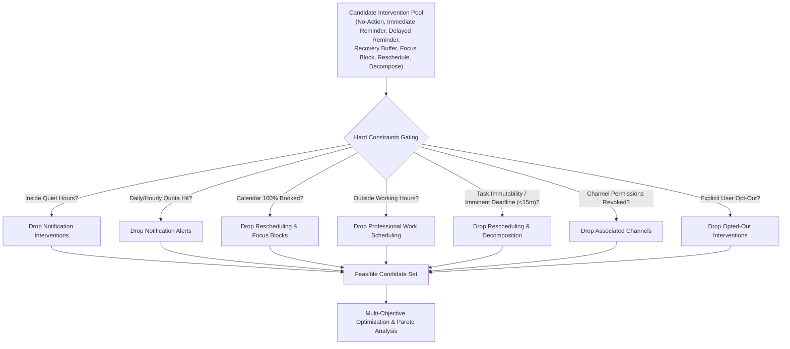
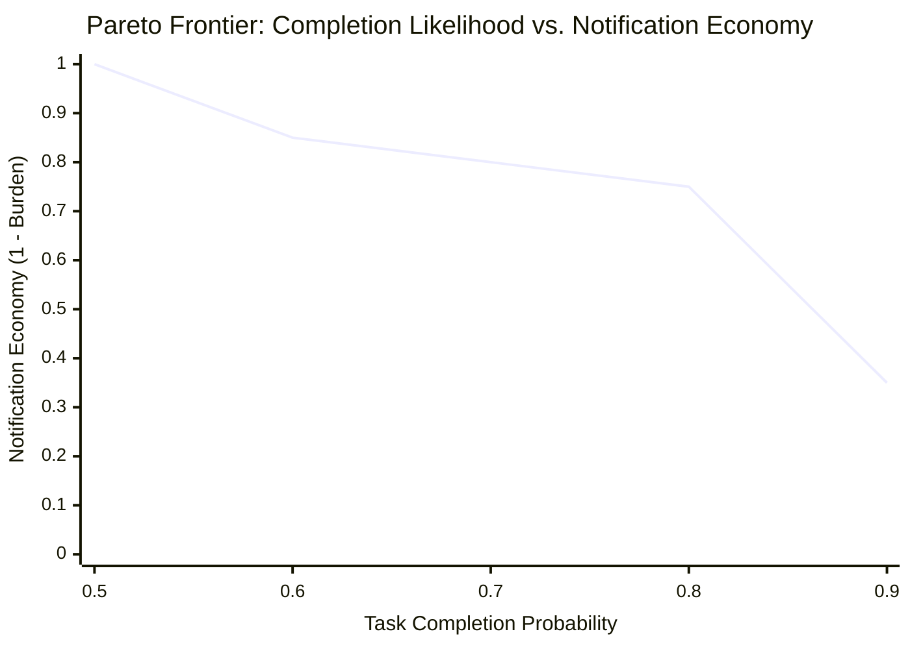

# Multi-Objective Intervention Optimization

**ContextIQ Intelligence Architecture — Phase 6.7 Specification**  
*Document Version: 1.0.0*  
*Status: Approved for Engineering Implementation*

---

## Executive Summary

Behavioral intelligence systems often fall into the trap of single-metric optimization—e.g., maximizing immediate task completion rate or response frequency. In real-world knowledge work, single-metric optimization leads to user burnout, notification fatigue, and cognitive resistance. 

Phase 6.7 establishes a principled **Multi-Objective Intervention Optimization Engine** for ContextIQ. The engine balances productivity, cognitive recovery, psychological burden, schedule feasibility, and explicit user preferences.

> [!IMPORTANT]
> **Ethical & Ergonomic Invariant**: ContextIQ must never optimize task completion at the expense of user well-being or excessive notification disruption. Active interventions are strictly gated behind non-bypassable constraints, and the system actively prefers **No-Action** whenever incremental utility is negligible, burden is excessive, or uncertainty is high.

---

## 1. Quantitative Optimization Objectives

Candidate interventions are evaluated across eight normalized, mathematically explicit objectives where **higher is strictly better** ($o_i \in [0.0, 1.0]$):

| Objective Identifier | Dimension | Range | Direction | Behavioral Significance |
| :--- | :--- | :--- | :--- | :--- |
| **`task_completion`** | Productivity | $[0, 1]$ | Maximize | Prospective probability of task completion on or before scheduled deadline. |
| **`task_resumption`** | Continuity | $[0, 1]$ | Maximize | Probability of verified deliberate resumption within 15 minutes of disruption. |
| **`recovery_duration`** | Well-Being | $[0, 1]$ | Maximize | Speed of cognitive recovery and restoration of working memory throughput. |
| **`behavioral_friction`** | Cognitive Health | $[0, 1]$ | Maximize | Reduction of micro-delay cognitive friction (scaled as $1.0 - \text{BFI} / 100$). |
| **`notification_economy`**| Attention Defense | $[0, 1]$ | Maximize | Minimization of notification disruption and psychological burden ($1.0 - \text{Burden}$). |
| **`interruption_comfort`**| Focus Comfort | $[0, 1]$ | Maximize | Preservation of sustained cognitive flow; avoidance of intrusive interruptions. |
| **`user_preferences`** | Alignment | $[0, 1]$ | Maximize | Alignment with user's explicitly configured weights, affinities, and feedback. |
| **`schedule_feasibility`**| Temporal Fit | $[0, 1]$ | Maximize | Calendar slack, buffer availability, and lack of meeting/workload conflicts. |

---

## 2. Non-Bypassable Hard Constraints

Unlike soft penalties in standard loss functions, constraints represent **hard feasibility boundaries**. Any candidate intervention violating any hard constraint is immediately excluded from the decision set with an explicit violation reason recorded:

> [!NOTE]
> **No-Action Invariant**: The `NO_INTERVENTION` candidate produces zero notifications, zero calendar modifications, and zero cognitive load. It can **never** violate any hard constraint and is guaranteed to remain in the feasible set under all conditions.

---

## 3. Multi-Objective Formulation

ContextIQ combines multi-attribute utility scalarization with Pareto-frontier analysis.

### 3.1 Scalarized Multi-Attribute Utility
For candidate $a \in \mathcal{A}_{\text{feasible}}$:
$$U(a) = \sum_{i=1}^8 w_i \cdot o_i(a) \quad \text{where } \sum_{i=1}^8 w_i = 1.0, \quad w_i \ge 0$$

Net incremental utility lift over passive holdout:
$$\Delta U(a) = U(a) - U(\text{No-Intervention})$$

### 3.2 Context-Dependent Dynamic Weight Adaptation
The optimizer dynamically adjusts base weights according to real-time cognitive and temporal contexts:

1. **Elevated Cognitive Fatigue ($\text{BFI} > 65$)**:
   - Shifts weights toward Recovery Duration ($+10\%$) and Friction Reduction ($+10\%$).
   - Reduces Task Completion pressure ($-12\%$) to prevent cognitive overload.
2. **Imminent Task Deadline ($t_{\text{due}} < 2\text{h}$)**:
   - Shifts weights toward Task Completion ($+15\%$) and Task Resumption ($+8\%$).
   - Temporarily relaxes Interruption Comfort ($-10\%$).
3. **Notification Clustering / High Disruption ($N_{\text{recent}} \ge 3$)**:
   - Elevates Notification Economy ($+12\%$) and Interruption Comfort ($+8\%$) to guard attention.

Weights are re-normalized to sum to $1.0$ after adaptation, and all applied adaptations are returned in the response audit log.

---

## 4. Pareto-Frontier Analysis

A candidate $a$ **Pareto-dominates** candidate $b$ ($a \succ b$) if and only if:
$$\forall i \in \{1, \dots, 8\}: o_i(a) \ge o_i(b) \quad \land \quad \exists j \in \{1, \dots, 8\}: o_j(a) > o_j(b)$$

Candidates that are non-dominated by any other feasible candidate form the **Pareto Frontier** (`pareto_rank = 1`, `is_pareto_optimal = True`). The system presents the Pareto frontier alongside the champion recommendation to reveal the complete trade-off surface.

---

## 5. First-Class No-Action Option & Fallback Rules

Rather than forcing an active intervention, ContextIQ treats `NO_INTERVENTION` as an equal candidate with high notification economy ($1.0$), zero disruption ($1.0$), and low uncertainty.

The optimizer strictly selects `NO_INTERVENTION` when:
1. **Negligible Utility Lift**: Top active candidate provides $\Delta U < \epsilon_{\min}$ (default $\epsilon_{\min} = 0.04$). Small gains do not justify user interruption.
2. **Excessive Prediction Uncertainty**: Conformal uncertainty width exceeds tolerance ($\text{width} > 0.35$). When observational data or propensity overlap is insufficient, the system safely withholds action.
3. **High Fatigue Notification Defense**: When $\text{BFI} > 75$, intrusive prompts (immediate/delayed reminders) are suppressed in favor of recovery or complete passivity.
4. **Constraint Infeasibility**: All active candidates violate quiet hours, notification caps, or calendar availability.

---

## 6. Safety, Explainability, and Authorization Boundaries

1. **No Silent Execution**: The optimizer produces **recommendations and proposals only** (`requires_authorization = True`).
2. **Authorization Boundary**: Modifying an external Google/Microsoft calendar, dispatching a push notification, or rescheduling tasks requires existing authorization tokens and explicit user interaction.
3. **Visible Trade-Offs**: The system never hides multi-objective trade-offs behind a single unexplained score. Every response explicitly reports:
   - `improved_objectives`: Quantified dimensions improved over No-Action (e.g., *Task Resumption Likelihood (+37.0%)*).
   - `worsened_objectives`: Quantified penalties incurred (e.g., *Notification Economy (-65.0%)*).
   - `applied_constraints`: Audit log of all constraint checks.
   - `selection_rationale`: Human-readable justification of the decision.
