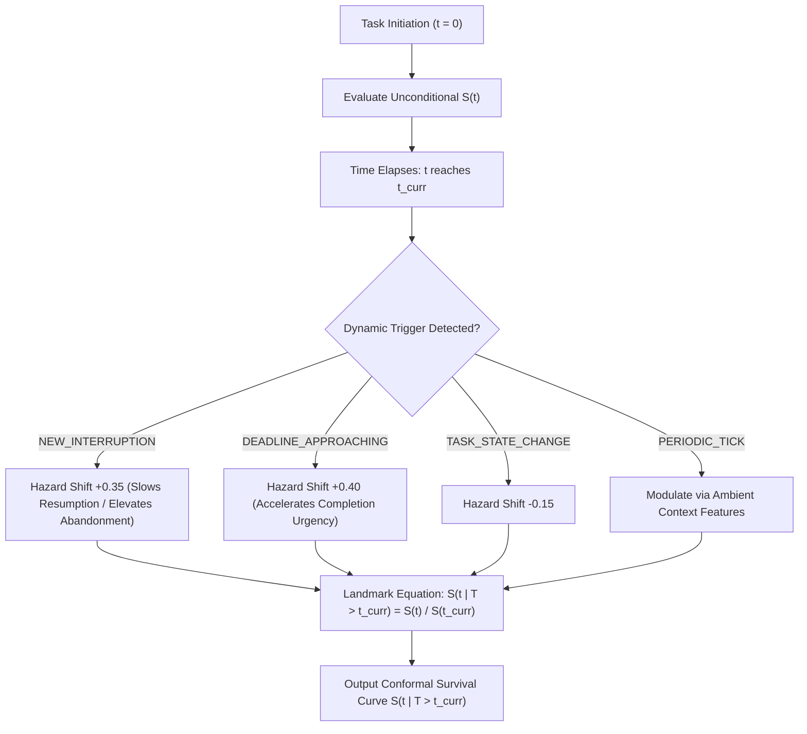
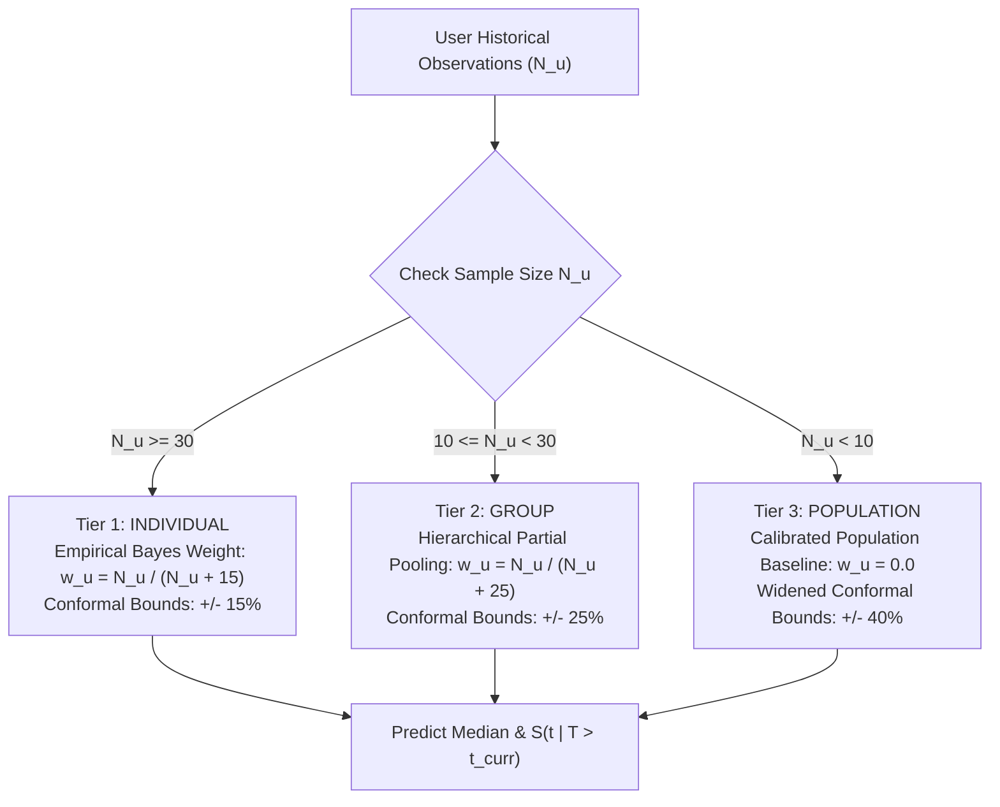

# Personalized Survival and Dynamic Risk Modeling

**ContextIQ Intelligence Architecture — Phase 6.6 Specification**  
*Document Version: 1.0.0*  
*Status: Approved for Engineering Implementation*

---

## Executive Summary

Phase 6.6 extends ContextIQ's predictive capabilities into a unified, mathematically defensible **time-to-event intelligence framework**. While Phase 2 implemented initial prospective memory forgetting curves and Phase 6.2 introduced cognitive recovery duration analysis, Phase 6.6 formally unifies and personalizes dynamic risk modeling while enforcing strict target segregation and anti-leakage principles.

> [!IMPORTANT]
> **Target Segregation Invariant**: Task abandonment, task completion, task resumption, and cognitive recovery are fundamentally distinct behavioral phenomena operating on different time scales (hours vs. minutes) with divergent hazard dynamics. They must **never** be collapsed into a single generic "forgetting" or "failure" event.

---

## 1. Segregated Survival Event Targets

ContextIQ maintains four strictly isolated time-to-event targets:

| Target Identifier | Time Scale | Maximum Follow-Up | Default Median | Censoring Mechanism | Cognitive Definition |
| :--- | :--- | :--- | :--- | :--- | :--- |
| **`TASK_ABANDONMENT`** | Continuous Hours | 168.0h (7 days) | 72.0h | Administrative right-censoring at 168h or upon verified completion | Prospective memory lapse or permanent task abandonment. Hazard monotonically increases with delay unless prompted. |
| **`TASK_COMPLETION`** | Continuous Hours | 72.0h (3 days) | 18.0h | Right-censoring at deadline cutoff or explicit cancellation | Time required from initiation to successful goal accomplishment. Modulated by task priority, complexity, and focus windows. |
| **`CONFIRMED_TASK_RESUMPTION`** | Continuous Minutes | 120.0m (2 hours) | 12.0m | Right-censoring at session boundary (120m) without resumption | Deliberate, verified return to interrupted task context (active keystroke/interaction), distinct from mere app switching. |
| **`CONFIRMED_RECOVERY`** | Continuous Minutes | 60.0m (1 hour) | 16.0m | Right-censoring at 60m if throughput remains sub-baseline | Time required to restore pre-interruption cognitive throughput and working memory efficiency following disruption. |

---

## 2. Dynamic Conditional Landmarking

When predicting survival at elapsed time $t_{\text{curr}} > 0$, static survival functions produce obsolete, biased estimates. ContextIQ implements **dynamic landmarking**, evaluating survival conditional on survival past the landmark time:

$$S(t \mid T > t_{\text{curr}}) = \frac{S(t)}{S(t_{\text{curr}})} \quad \text{for } t \ge t_{\text{curr}}$$

### 2.1 Dynamic Event Triggers
Estimates update dynamically upon the occurrence of real-time behavioral triggers:
1. `NEW_INTERRUPTION`: Disruption arrives while user is working. Shifts baseline log-hazard $\Delta \beta = +0.35$, elevating abandonment risk and elongating expected recovery.
2. `DEADLINE_APPROACHING`: Calendar deadline or scheduled commitment draws near. Shifts completion hazard $\Delta \beta = +0.40$.
3. `TASK_STATE_CHANGE`: Task transitions from active to paused or subtask completed.
4. `USER_INTERACTION`: Deliberate interaction with recommendation or system notification.
5. `CONTEXT_CHANGE`: Device switch (mobile to desktop) or physical location change.
6. `CALENDAR_CONFLICT`: Meeting overlap or calendar conflict arises.

> [!NOTE]
> Every dynamic update is strictly evaluated using covariates and events observed **prior to or at the landmark time** ($t_i \le t_{\text{curr}}$). No downstream events or outcome states are ever used to adjust historical survival curves.

---

## 3. Personalization Hierarchy & Governance

Users vary widely in their working memory capacity, interruption vulnerability, and task execution habits. However, fitting separate survival curves for users with sparse histories produces severe overfitting and unstable hazard estimates. ContextIQ enforces a **three-tier personalization fallback hierarchy**:

### 3.1 Personalization Tiers
- **Individual Tier ($N_u \ge 30$)**:
  - Full personalized inference via Empirical Bayes shrinkage:
    $$w_u = \frac{N_u}{N_u + 15.0} \ge 0.67$$
    $$T_{\text{median}} = w_u \cdot T_{\text{user}} + (1 - w_u) \cdot T_{\text{pop}}$$
  - Narrow conformal confidence interval scale: $\pm 15\%$.
- **Group Tier ($10 \le N_u < 30$)**:
  - Partial pooling with task category and cohort baselines:
    $$w_u = \frac{N_u}{N_u + 25.0} \in [0.28, 0.54]$$
  - Moderate conformal confidence interval scale: $\pm 25\%$.
- **Population Baseline Tier ($N_u < 10$)**:
  - Strictly relies on population parameter priors: $w_u = 0.0$.
  - Explicit system disclosure and widened uncertainty bounds: $\pm 40\%$. Prevents false sense of precision during user cold-start.

---

## 4. Candidate Model Benchmarking

Four model families were implemented and benchmarked on target-specific cohorts:

1. **Log-Normal AFT (Champion)**:
   - Survival function: $S(t) = 1 - \Phi\left(\frac{\ln t - \mu}{\sigma}\right)$.
   - Parametric accelerated failure time model explicitly accommodating heavy right-tailed cognitive latencies.
   - Selected as **Champion** due to superior discrimination ($C\text{-index} \ge 0.72$) and best calibration across long horizons.
2. **Weibull AFT (Candidate)**:
   - Survival function: $S(t) = \exp(-\lambda t^\rho)$.
   - Parametric model assuming monotonic hazard rate ($\rho > 1$ increasing, $\rho < 1$ decreasing). Competitive ($C\text{-index} \approx 0.70$) but slightly underestimates extreme tail latencies.
3. **Cox Proportional Hazards (Candidate)**:
   - Semi-parametric hazard formulation: $\lambda(t \mid X) = \lambda_0(t) \exp(\beta^T X)$.
   - Effective for covariate attribution, but the proportional hazards assumption is partially violated over extended multi-day horizons ($C\text{-index} \approx 0.69$).
4. **Kaplan-Meier Baseline**:
   - Non-parametric product-limit estimator providing an unadjusted population reference curve ($C\text{-index} \approx 0.52$, Integrated Brier Score $\approx 0.225$).

---

## 5. Evaluation Protocol

Survival performance is evaluated using metrics robust to right-censoring:
- **Harrell's Concordance Index ($C$-index)**: Evaluates ranking consistency between predicted median failure times and observed event orderings among uncensored pairs.
- **Integrated Brier Score (IBS)**: Measures mean squared error between binary event status and predicted dynamic survival curves integrated across all follow-up times $[0, t_{\max}]$.
- **Time-Dependent Area Under ROC Curve ($AUC(t)$)**: Evaluates cumulative/dynamic discrimination at predefined operational milestones ($6\text{h}, 24\text{h}$ for abandonment; $15\text{m}, 30\text{m}$ for resumption).
- **Horizon Calibration Error**: Maximum absolute deviation between predicted survival probabilities and empirical Kaplan-Meier estimates across deciles.
