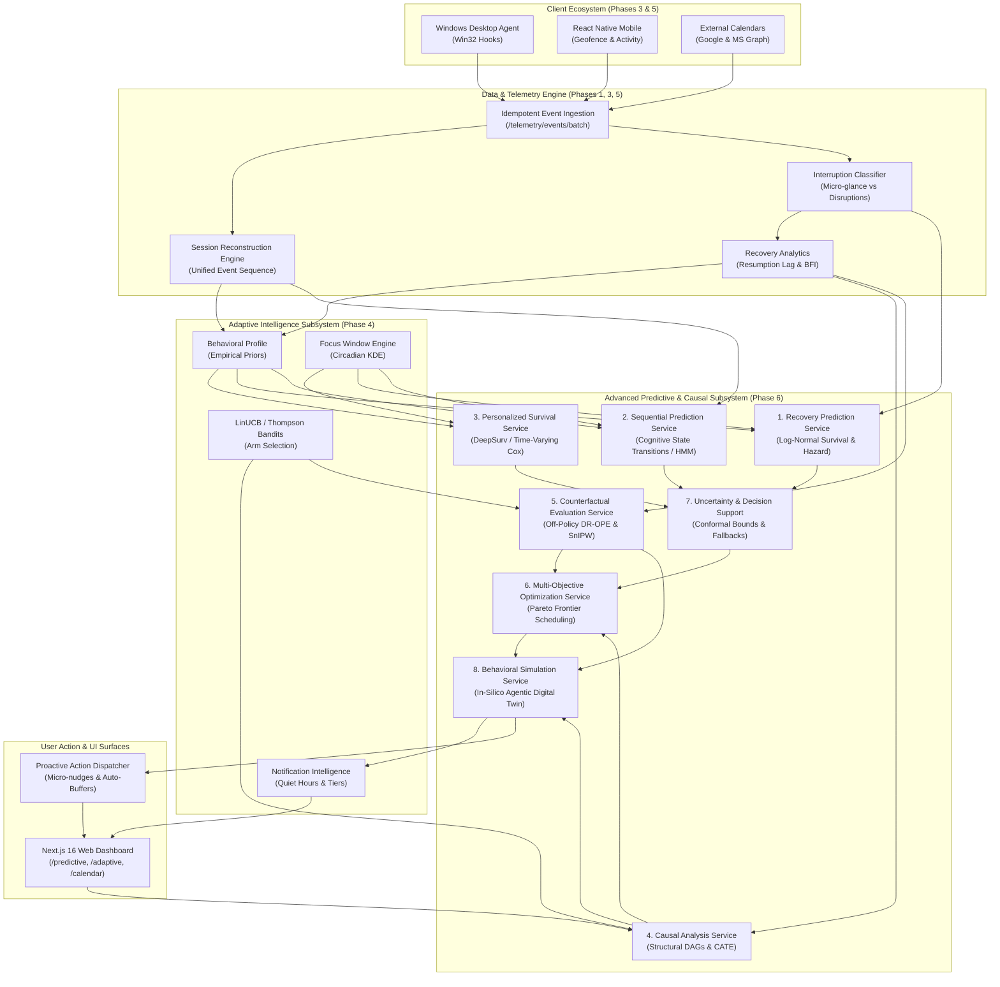
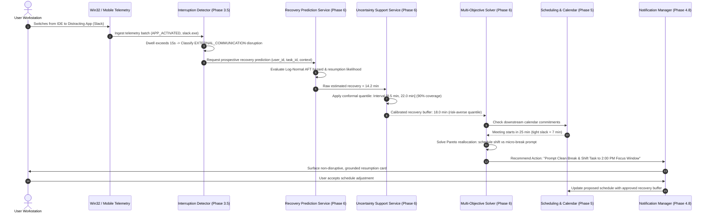

# ContextIQ Phase 6: Advanced Predictive Intelligence, Causal Modeling & Behavioral Simulation
## System Architecture & Audit Specification (Phase 6.1)

---

## 1. Executive Summary & Architectural Vision

ContextIQ Phases 1 through 5 evolved the platform from a heuristic desktop time-tracking utility into a cross-platform behavioral intelligence system. Across these phases, ContextIQ established:
- **Phase 1**: Core relational schema (PostgreSQL), task lifecycles, and manual interruption tracking.
- **Phase 2**: Machine learning prospective lapse prediction, population Cox survival baselines, probability calibration (Platt/Isotonic), and SHAP explainability.
- **Phase 3**: Passive Windows desktop behavioral telemetry, automated interruption classification, work session reconstruction, and cognitive recovery analytics (Behavioral Friction Index, resumption lag).
- **Phase 4**: Personal Behavioral Profiles (Digital Twin), circadian focus-window discovery, multi-objective task prioritization, 14 personalized interventions, and contextual bandit exploration (LinUCB / Thompson Sampling) with doubly robust Average Treatment Effect (ATE) estimation.
- **Phase 5**: Two-way external calendar integration (Google Calendar & Microsoft Outlook via Graph API), cross-device session stitching, and privacy-preserving location context boundaries.

### The Phase 6 Paradigm Shift
While Phase 2 provided **associational prospective forecasting** ($P(Y \mid X)$) and Phase 4 introduced **localized contextual bandit adaptation**, the system currently lacks:
1. **Dynamic Cognitive State Trajectory Modeling**: Interruption recovery is evaluated retrospectively rather than forecast prospectively before or during task resumption.
2. **Structural Causal Identification**: Recommendations rely on correlation and observational adjustments that assume unconfoundedness without sensitivity bounds, structural DAG identification, or mediation decomposition.
3. **Counterfactual Policy Evaluation**: Offline evaluation cannot simulate what would happen under unobserved counterfactual scheduling policies or personalized intervention sequences without live exposure.
4. **Behavioral Simulation (In-Silico Digital Twin)**: The platform cannot forward-simulate a user's workday across candidate schedules to optimize cognitive endurance and minimize friction before pushing commitments to external calendars.
5. **Calibrated Uncertainty Quantification**: Point forecasts and bandit confidence bounds lack finite-sample conformal prediction guarantees, risking intervention fatigue when models are overconfident.

**Phase 6 Goal**: Unify prospective survival forecasting, continuous-time state-space dynamics, structural causal inference, multi-objective Pareto optimization, and behavioral digital twin simulation into a modular, production-grade **Advanced Predictive Intelligence Architecture**.



---

## 2. Comprehensive Audit of Existing Modules (Phases 1–5)

To guarantee seamless integration and prevent technical debt, every core module in ContextIQ has been audited for reusability, structural duplication, schema discrepancies, and methodological vulnerabilities.

### 2.1 Backend and Database Architecture
- **Current State**: Built with FastAPI, SQLAlchemy 2.0 ORM, PostgreSQL (production) / SQLite (testing with custom JSONB compilation). Models define relational representations for `users`, `tasks`, `task_events`, `interruptions`, `context_sessions`, `raw_telemetry_events`, `detected_interruptions`, `user_behavioral_profiles`, `user_focus_windows`, `user_interventions`, `bandit_arm_states`, `bandit_decision_logs`, `bandit_reward_logs`, `intervention_outcomes`, `intervention_experiments`, `user_notifications`, `calendar_integrations`, `external_calendar_events`, `schedule_proposals`, `user_devices`, `locations`, and `location_checkins`.
- **Reusable Assets**:
  - Full transactional schema with tenancy enforcement (`user_id` foreign keys and Row-Level Security).
  - Robust migration pipeline via Alembic (`versions/` g7 through l2).
  - Pydantic V2 schema validation and centralized error handling in `backend/app/core/errors.py`.
- **Identified Deficiencies & Architectural Vulnerabilities**:
  - *No Time-Series or Longitudinal Partitioning*: Tables storing high-frequency data (`raw_telemetry_events`, `context_sessions`, `bandit_decision_logs`) are unpartitioned heap tables. In continuous production deployment, query performance on temporal range scans will degrade exponentially without hypertable or range-partitioning by `(user_id, timestamp)`.
  - *Lack of State-Space Snapshotting*: Behavioral profiles are updated in-place with discrete periodic `profile_snapshots`, but continuous latent cognitive states (fatigue, current context depth) are not materialized as a queryable time-series.

### 2.2 Data Engine and Behavioral Feature Pipelines
- **Current State**: Located in `data-engine/app/` and `backend/app/services/temporal_feature_extractor.py`. Computes rolling task statistics, context-switching rates, and Behavioral Friction Index (BFI).
- **Reusable Assets**:
  - Point-in-time feature extraction interface in `temporal_feature_extractor.py` enforcing $t < t_{\text{as\_of}}$.
  - Session reconstruction state machine (`SessionReconstructionEngine`) that reconciles discrete application focus transitions, idle thresholds ($\ge 3$ min), and glance filtering ($< 3$ s).
- **Identified Deficiencies & Architectural Vulnerabilities**:
  - *Schema Inconsistency*: `data-engine/app/analytics/friction.py` defines BFI using 4 terms (`cognitive_load`, `context_switching`, `interruption_density`, `recovery_delay`), while `backend/app/services/recovery_analytics.py` computes BFI using 5 terms (`WEIGHT_FORGETTING=0.30`, `WEIGHT_INTERRUPTION=0.25`, `WEIGHT_CONTEXT_SWITCH=0.20`, `WEIGHT_RECOVERY=0.15`, `WEIGHT_VARIABILITY=0.10`).
  - *Target Leakage Risk in Rolling Aggregates*: In `data-engine/app/analytics/derived_metrics.py`, rolling aggregates filter tasks using `created_at >= cutoff` without capping the upper boundary at the prediction timestamp $t_{\text{pred}}$, permitting future task events within the current day to contaminate rolling averages.

### 2.3 Forgetting ML Models & Registry Infrastructure
- **Current State**: Located in `forgetting-ml/`. Consists of Logistic Regression (v1.1.0 champion, PR-AUC: 0.4451, ROC-AUC: 0.6583), Platt/Isotonic calibrators (ECE: 1.24%), Cox Proportional Hazards (v2.3.0 champion, $C$-index: 0.6205), and an immutable registry (`model_catalog.json`, `deployment_history.json`, `model_registry_audit.jsonl`).
- **Reusable Assets**:
  - Model registry FSM with SHA-256 verification, atomic promotion, and rollback capabilities.
  - Survival pipeline infrastructure (`SurvivalModelPipeline`) implementing Kaplan-Meier, Cox PH, and Weibull AFT via `lifelines`.
  - SHAP Tree/Linear explainers with independent background masking.
- **Identified Deficiencies & Architectural Vulnerabilities**:
  - *Static Covariates Only*: Current Cox PH models utilize static baseline features (`deadline_distance_hours`, `historical_forgetting_rate`, `priority`) extracted at task creation. They do not incorporate time-varying covariates (e.g., interruptions occurring *during* the task's active lifespan).
  - *Lapse-Only Survival Target*: Survival analysis is applied exclusively to task forgetting ($T_{\text{lapse}}$). No survival models exist for cognitive recovery duration ($T_{\text{rec}}$) or time-to-resumption.

### 2.4 Context Engine & Telemetry Pipelines
- **Current State**: Located in `context-engine/` and `backend/app/services/interruption_detector.py`. Classifies desktop events into disruptions (`EXTERNAL_COMMUNICATION`, `RAPID_SWITCHING_THRASH`, `IDLE_ABANDONMENT`, `COMPLEMENTARY_TOOL_TRANSITION`).
- **Reusable Assets**:
  - Domain-specific complementary application pairing (e.g., `code.exe` + `powershell.exe` vs `slack.exe` distraction).
  - User feedback loop on detected interruptions (`DetectedInterruptionFeedback`).
- **Identified Deficiencies & Architectural Vulnerabilities**:
  - *Epistemic Conflation of Inactivity with Interruption*: Idle time $\ge 180$ seconds is automatically flagged as an idle disruption. In reality, deep cognitive reflection, physical document review, or offline ideation appear identical to interface inactivity. Phase 6 must treat interface inactivity as ambiguous sensor drop-out rather than definitive cognitive interruption.

### 2.5 Intelligence & Adaptive Recommendation Engine
- **Current State**: Located in `intelligence/app/` (Phase 1 legacy heuristics) and `backend/app/interventions/` + `adaptive-intelligence/app/` (Phase 4 adaptive engine).
- **Duplicate Implementations Detected**:
  - **Critical Architectural Duplication**: The entire directory tree of `adaptive-intelligence/app/` (`bandit`, `effectiveness`, `interventions`, `models`, `notifications`, `prioritization`, `profiles`, `schemas`) is duplicated inside `backend/app/` (`backend/app/bandit/`, `backend/app/effectiveness/`, etc.). 
  - `intelligence/app/recommendations.py` contains legacy Phase 1 hardcoded heuristics that run parallel to Phase 4's `InterventionEngine`.
- **Resolution in Phase 6**:
  - Consolidate all execution logic inside `backend/app/` with authoritative namespaces. Treat `adaptive-intelligence/` as a legacy client package or refactor it to import directly from `backend/app/`. Deprecate Phase 1 heuristics in favor of Phase 6's multi-objective policy solver.

### 2.6 Behavioral Profiles & Personal Digital Twin
- **Current State**: Located in `backend/app/profiles/`. Implements `ProfileBuilder`, `FocusWindowEngine`, and `ProfileConfidenceEstimator` across 4 confidence tiers (`COLD_START`, `EMERGING`, `ESTABLISHED`, `CONFIDENT`).
- **Reusable Assets**:
  - Empirical Bayes shrinkage framework for stabilizing small-$N$ user parameters toward global population priors.
  - Circadian focus window discovery via kernel density estimation and quality scoring ($Q \ge 58.0$).
- **Identified Deficiencies & Architectural Vulnerabilities**:
  - *Static Profile State*: Profiles are updated via scheduled batch jobs (`profile_updater.py`). Real-time fluctuations in cognitive fatigue or immediate context degradation are not reflected in intra-day decisions.

### 2.7 Calendar & Cross-Platform Synchronization
- **Current State**: Located in `integrations/app/`, `backend/app/services/google_sync_service.py`, `microsoft_sync_service.py`, `scheduling_service.py`, `timeline_service.py`, and `mobile/`.
- **Reusable Assets**:
  - AES-256-GCM token encryption vault and PKCE OAuth flows.
  - Two-way delta synchronization (`syncToken`, `@odata.deltaLink`) and rate-limiting backoff.
  - Calendar availability engine (`AvailabilityEngine`) and schedule proposal workflow with mandatory user approval.
  - Cross-device event stitching (`UserDevice`, `TimelineService`).
- **Identified Deficiencies & Architectural Vulnerabilities**:
  - *Greedy Schedule Placement*: Task scheduling places tasks in the first available slot exceeding duration + recovery buffer without optimizing for cognitive circadian alignment or prospective fatigue propagation.

### 2.8 Intervention Outcome Tracking & Causal Evaluator
- **Current State**: Located in `backend/app/effectiveness/` (`outcome_tracker.py`, `causal_evaluator.py`). Implements Doubly Robust ATE, IPW, and habituation slope monitoring ($\frac{dR}{dt} < -0.05$).
- **Reusable Assets**:
  - Categorical outcome window assignment (Immediate: 30m, Medium: 120m, Daily: 1440m).
  - Explicit execution verification (`verify_execution`) separating prompt acceptance from behavioral actions.
  - Ethical holdout boundaries (never withholding interventions when task deadline $< 2$ hours).
- **Identified Deficiencies & Architectural Vulnerabilities**:
  - *Violation of SUTVA (Spillover & Carryover Bias)*: Current causal evaluation treats every intervention delivery as an independent trial. In behavioral workflows, an intervention delivered at 10:00 AM affects task execution and cognitive load at 2:00 PM, violating the Stable Unit Treatment Value Assumption.
  - *Static Propensity Model*: The propensity score $e(X)$ uses a fixed, manually specified linear logistic formulation without cross-fitting or machine learning estimation.
  - *Lack of Unobserved Confounding Sensitivity*: No sensitivity metrics (Rosenbaum bounds, Cinelli-Hazlett sensemakr, E-values) are computed to test robustness against unmeasured distractions.

---

## 3. Audited Reusability and Risk Matrix

| Component | Current Location | Phase 6 Reusability Status | Identified Deficiencies & Risks | Action in Phase 6 |
| :--- | :--- | :---: | :--- | :--- |
| **Relational Database** | `backend/app/models/` | High (Preserve) | Unpartitioned event tables; risk of query degradation. | Keep Phase 1-5 schemas intact; add read-only analytical indices and Phase 6 contracts. |
| **Session Reconstructor** | `backend/app/services/session_reconstruction_engine.py` | High (Preserve) | Micro-switches $<3$s filtered; idle $\ge 30$m splits sessions. | Reuse as primary chronological event stream for state-space sequential models. |
| **Interruption Classifier** | `backend/app/services/interruption_detector.py` | Medium (Augment) | Inactivity treated as disruption; lacks cognitive verification. | Augment with cognitive grounding invariant; output probabilistic interruption confidence. |
| **Recovery Analytics** | `backend/app/services/recovery_analytics.py` | Medium (Augment) | Retrospective only; two conflicting BFI formulas in repo. | Standardize BFI definition on backend 5-component formulation; build prospective recovery model. |
| **Forgetting ML & Registry** | `forgetting-ml/` | High (Preserve & Extend) | Static Cox PH only; no time-varying or recovery survival. | Retain registry and binary model; deploy DeepSurv / Time-Varying survival services alongside. |
| **Adaptive Intelligence** | `backend/app/{bandit, profiles, interventions}` | Medium (Consolidate) | Exact duplicate directory `adaptive-intelligence/app/`. | Consolidate inside `backend/app/`; eliminate duplication. |
| **Contextual Bandits** | `backend/app/bandit/` | High (Extend) | Static LinUCB/Thompson; no off-policy counterfactual evaluation. | Feed bandit decision logs directly into Counterfactual Evaluation Service. |
| **Causal Evaluator** | `backend/app/effectiveness/` | Medium (Refactor) | Static propensity weights; ignores SUTVA violations and spillover. | Wrap inside Causal Analysis Service; add structural DAGs, cross-fitting, and E-values. |
| **Calendar Scheduling** | `backend/app/scheduling/` | High (Extend) | Greedy slot allocation; ignores fatigue propagation. | Integrate with Multi-Objective Optimization and Behavioral Simulation Services. |
| **Timeline & Devices** | `backend/app/services/timeline_service.py` | High (Preserve) | Unified cross-device event stream established. | Use as canonical chronological input for sequential prediction. |

---

## 4. Phase 6 Service Architecture & Boundaries

Phase 6 introduces eight dedicated, non-duplicative service boundaries designed to seamlessly consume existing database entities and telemetry streams.

```mermaid
classDiagram
    class RecoveryPredictionService {
        +predict_recovery_duration(context: RecoveryContext) ConformalInterval
        +estimate_resumption_hazard(context: RecoveryContext) HazardCurve
        +predict_task_resumption_probability(interruption_id: UUID, horizon_seconds: int) CalibratedProbability
    }

    class SequentialPredictionService {
        +infer_latent_cognitive_state(session_id: UUID) CognitiveStateVector
        +forecast_state_trajectory(user_id: UUID, steps: int) Sequence[StateDistribution]
        +detect_attention_collapse_hazard(user_id: UUID) HazardMetric
    }

    class PersonalizedSurvivalService {
        +compute_time_varying_lapse_survival(task_id: UUID) SurvivalDistribution
        +predict_recovery_survival_function(user_id: UUID, interruption_context: Dict) SurvivalDistribution
        +evaluate_dynamic_hazard(task_id: UUID, t_as_of: datetime) float
    }

    class CausalAnalysisService {
        +estimate_cate(treatment: str, outcome: str, context: Dict) CATEEstimate
        +evaluate_structural_dag(dag_spec: DAGSpecification) IdentificationResult
        +compute_sensitivity_e_value(estimate: float, ci_lower: float) SensitivityMetrics
    }

    class CounterfactualEvaluationService {
        +evaluate_off_policy_snips(policy_pi: Policy, logged_data: List) OPEEstimate
        +evaluate_doubly_robust_ope(policy_pi: Policy, logged_data: List) OPEEstimate
        +simulate_policy_shift(candidate_policy: Policy) CounterfactualDistribution
    }

    class MultiObjectiveOptimizationService {
        +solve_pareto_schedule(tasks: List[Task], slots: List[TimeSlot], profile: Profile) ParetoSolutionSet
        +balance_hazard_urgency_friction(task: Task, user_context: Dict) CompositeUtilityScore
    }

    class UncertaintyDecisionSupportService {
        +conformalize_prediction(raw_prediction: float, nonconformity_scores: List) ConformalBound
        +evaluate_action_safety(utility: float, uncertainty_set: Interval) DecisionAction
        +compute_notification_fatigue_risk(user_id: UUID) RiskAssessment
    }

    class BehavioralSimulationService {
        +simulate_workday_trajectory(schedule: ScheduleProposal, user_twin: DigitalTwin) SimulationReport
        +run_counterfactual_stress_test(scenario: WorkloadScenario) StressTestResult
    }

    RecoveryPredictionService --> UncertaintyDecisionSupportService
    SequentialPredictionService --> MultiObjectiveOptimizationService
    PersonalizedSurvivalService --> MultiObjectiveOptimizationService
    CausalAnalysisService --> CounterfactualEvaluationService
    CounterfactualEvaluationService --> MultiObjectiveOptimizationService
    MultiObjectiveOptimizationService --> BehavioralSimulationService
    UncertaintyDecisionSupportService --> MultiObjectiveOptimizationService
```



### Service 1: Recovery Prediction Service (`RecoveryPredictionService`)
- **Domain Responsibility**: Predicts the cognitive time required to recover from a micro-interruption and the conditional probability of successfully resuming the primary interrupted task.
- **Inbound Dependencies**: `backend/app/models/detected_interruption.py`, `context_session.py`, `behavioral_profile.py`.
- **Outbound Consumers**: `MultiObjectiveOptimizationService`, `UncertaintyDecisionSupportService`, `SchedulingService`.
- **Algorithmic Core**: Log-Normal Accelerated Failure Time (AFT) hazard modeling combined with split conformal prediction to generate finite-sample calibrated recovery intervals $[T_{\text{lower}}, T_{\text{upper}}]$.

### Service 2: Causal Analysis Service (`CausalAnalysisService`)
- **Domain Responsibility**: Identifies, estimates, and validates true causal treatment effects of ContextIQ interventions on task resumption, completion, and friction reduction.
- **Inbound Dependencies**: `backend/app/models/effectiveness_models.py`, `bandit_decision_logs`, `bandit_reward_logs`, `task_events`.
- **Outbound Consumers**: `CounterfactualEvaluationService`, `InterventionEngine`, Executive Dashboards.
- **Algorithmic Core**: Structural Causal Model (SCM) DAG verification, Double/Debiased Machine Learning (DML) via cross-fitted regressors, Conditional Average Treatment Effect (CATE) estimation, and E-value sensitivity bounds.

### Service 3: Counterfactual Evaluation Service (`CounterfactualEvaluationService`)
- **Domain Responsibility**: Evaluates candidate intervention and scheduling policies using historical logged bandit data without exposing users to untested policies.
- **Inbound Dependencies**: `bandit_decision_logs`, `bandit_arm_states`, `bandit_reward_logs`.
- **Outbound Consumers**: `BanditEngine`, `MultiObjectiveOptimizationService`.
- **Algorithmic Core**: Self-Normalized Inverse Propensity Scoring (SnIPS) and Doubly Robust Off-Policy Evaluation (DR-OPE) with bounded importance weights.

### Service 4: Sequential Prediction Service (`SequentialPredictionService`)
- **Domain Responsibility**: Models intra-day cognitive state transitions, estimating hidden attentional states and predicting impending attention collapse before disruptions occur.
- **Inbound Dependencies**: `backend/app/models/raw_telemetry_event.py`, `context_session.py`, `timeline_service.py`.
- **Outbound Consumers**: `InterventionEngine`, `NotificationManager`, `RecoveryPredictionService`.
- **Algorithmic Core**: Continuous-time Hidden Markov Model (HMM) and state-space transition filter mapping observed telemetry (dwell, switch velocity, glance frequency) to latent cognitive focus depths.

### Service 5: Personalized Survival Service (`PersonalizedSurvivalService`)
- **Domain Responsibility**: Provides personalized, multi-horizon survival probability curves $S_i(t)$ and hazard functions $\lambda_i(t)$ for prospective memory lapses and recovery events.
- **Inbound Dependencies**: `forgetting-ml/artifacts/survival_bundle.joblib`, `backend/app/models/behavioral_profile.py`.
- **Outbound Consumers**: `PrioritizationEngine`, `MultiObjectiveOptimizationService`.
- **Algorithmic Core**: Time-Varying Cox Proportional Hazards and DeepSurv with Empirical Bayes shrinkage over individual user frailty terms $\alpha_i \sim \text{Gamma}(k, \theta)$.

### Service 6: Multi-Objective Optimization Service (`MultiObjectiveOptimizationService`)
- **Domain Responsibility**: Resolves structural trade-offs between competing priorities (deadline urgency, forgetting hazard, cognitive recovery buffers, notification disruption, calendar friction) to construct Pareto-optimal schedules and intervention schedules.
- **Inbound Dependencies**: All predictive services (1, 3, 5), `backend/app/scheduling/availability_engine.py`.
- **Outbound Consumers**: `backend/app/services/scheduling_service.py`, `InterventionEngine`.
- **Algorithmic Core**: Constrained multi-objective optimization (augmented $\epsilon$-constraint method and scalarized Chebyshev achievement functions) generating non-dominated schedule proposals.

### Service 7: Uncertainty and Decision Support Service (`UncertaintyDecisionSupportService`)
- **Domain Responsibility**: Wraps raw model point estimates with calibrated prediction intervals, calculates risk of intervention failure, and enforces safe fallback rules when epistemic uncertainty is elevated.
- **Inbound Dependencies**: Prediction outputs from Services 1, 2, 4, 5.
- **Outbound Consumers**: `PrioritizationEngine`, `NotificationManager`, `PushDispatcher`.
- **Algorithmic Core**: Split conformal inference (guaranteeing $1 - \alpha$ marginal coverage), Conformal Risk Control (CRC), and conservative decision-theoretic fallback triggers.

### Service 8: Behavioral Simulation Service (`BehavioralSimulationService`)
- **Domain Responsibility**: Acts as an in-silico sandbox that simulates a user's prospective workday trajectory under proposed schedules and hypothetical interruption distributions.
- **Inbound Dependencies**: `behavioral_profile.py`, `focus_window.py`, `external_calendar_event.py`, `SequentialPredictionService`.
- **Outbound Consumers**: Calendar Schedule Proposal Workflow, User Dashboard Analytics.
- **Algorithmic Core**: Monte Carlo agentic simulation running 500 stochastic synthetic workday rollouts to estimate expected cognitive friction, schedule fragility, and task completion likelihood.

---

## 5. End-to-End Sequence Diagram

The following sequence illustrates how Phase 6 services interact in real time when an interruption occurs during a scheduled focus block.



---

## 6. Phase 6 Schema Architecture & Data Contracts

Phase 6 services communicate via strongly-typed Pydantic V2 schemas defined in `backend/app/schemas/predictive_intelligence.py`. These contracts guarantee backward compatibility with Phase 1-5 models while enforcing strict mathematical definitions.

```python
# Conceptual Structure of Phase 6 Service Data Contracts
class ConformalPredictionInterval(BaseModel):
    point_estimate: float
    lower_bound: float
    upper_bound: float
    confidence_level: float = 0.90
    nonconformity_metric: str

class RecoveryPredictionResponse(BaseModel):
    user_id: UUID
    interruption_id: UUID
    predicted_recovery_seconds: ConformalPredictionInterval
    resumption_probability_15m: float
    resumption_probability_30m: float
    cognitive_grounding_verified: bool

class CATEEstimationResult(BaseModel):
    treatment_arm: str
    control_arm: str
    cate_estimate: float
    ci_lower: float
    ci_upper: float
    e_value: float
    propensity_overlap_passed: bool
    sutva_risk_flag: bool

class ParetoScheduleResponse(BaseModel):
    proposal_id: UUID
    objective_scores: Dict[str, float]  # Urgency, Hazard, Fatigue, Friction
    non_dominated: bool
    recommended_recovery_buffer_minutes: float
    conformal_risk_bound: float
```

---

## 7. Unresolved Architectural Risks & Mitigation Strategies

1. **Sensor Drop-Out vs Cognitive Resumption**:
   - *Risk*: A user returning to their editor may stare blankly or browse documentation passively without actual cognitive resumption.
   - *Mitigation*: Strictly enforce the **Cognitive Grounding Invariant**: Resumption is only labeled when sustained dwell $>45$ seconds is accompanied by productive input events (typing, file modification) within the primary task context.
2. **Computational Latency of Multi-Objective Optimization**:
   - *Risk*: Pareto frontier generation over complex daily schedules could introduce $>500$ ms latency.
   - *Mitigation*: Employ offline pre-computation of candidate focus window slots and run scalarized Chebyshev optimizations with warm-starting, capping runtime under $50$ ms.
3. **Bandit Policy Degradation under Non-Stationarity**:
   - *Risk*: User habits change seasonally or under heavy project deadlines, violating stationary Markov assumptions.
   - *Mitigation*: Deploy continuous drift monitoring using Page-Hinkley change detection on prediction residuals and automated bandit variance expansion.
