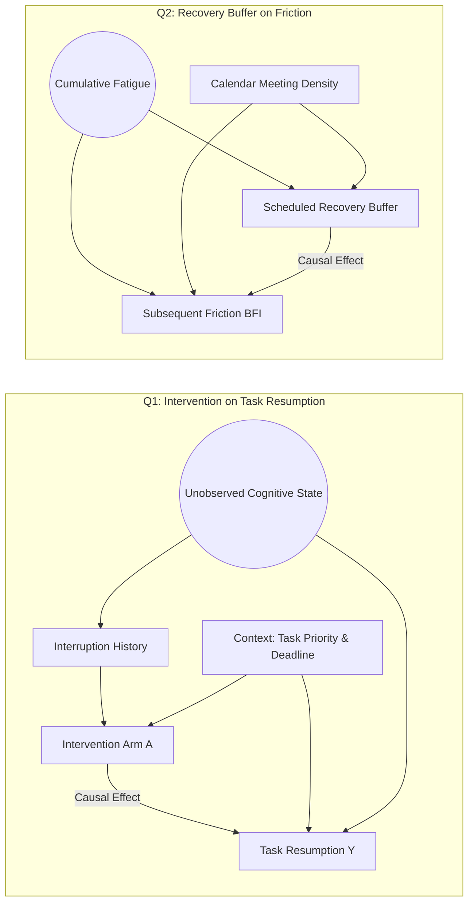

# ContextIQ Phase 6: Research Design & Target Formulation Specification
## Predictive Targets, Causal Identification & Methodological Foundations (Phase 6.1)

---

## 1. Epistemic Foundations: Demarcating Predictive vs. Causal Questions

A central methodological failure in computational behavioral science is the conflation of predictive association with causal intervention. Observing that users who receive task reminders complete more tasks does not prove the reminder *caused* the completion; users working during active daytime focus hours are both more likely to trigger reminders and independently more likely to finish work.

ContextIQ Phase 6 enforces a rigorous mathematical and structural boundary between **Predictive Estimands** and **Causal Estimands**.

| Dimension | Predictive Intelligence ($P(Y \mid X)$) | Causal Intelligence ($P(Y \mid \text{do}(A = a), X)$) |
| :--- | :--- | :--- |
| **Fundamental Question** | *"Given the observed behavioral features $X$, what is the expected outcome $Y$?"* | *"If we actively intervene and set treatment $A = a$ versus $A = a'$, what will be the change in outcome $Y$?"* |
| **Mathematical Estimand** | Conditional Expectation: $\mathbb{E}[Y \mid X = x]$ or Conditional Distribution $P(Y \le y \mid X = x)$ | Average Treatment Effect: $\tau(x) = \mathbb{E}[Y(a) - Y(a') \mid X = x]$ (CATE) |
| **Confounder Sensitivity** | Immune to confounding: correlation and predictive proxies are valid features. | Highly vulnerable: spurious backdoor paths induce biased, non-identifiable policy estimates. |
| **Optimization Target** | Empirical Risk Minimization (log-loss, Brier score, MSE, C-index). | Counterfactual Risk Minimization (IPW, Doubly Robust ATE, Regret Bounds). |
| **Operational Role in ContextIQ** | Risk triage, prospective lapse alerting, latent state inference, forecasting baseline fatigue. | Selecting active interventions, evaluating calendar buffer efficacy, tuning bandit policies. |

---

## 2. Formal Specification of the 7 Phase 6 Prediction Targets

ContextIQ establishes strict prospective mathematical formulations for seven prediction targets. Every target defines its unit of analysis, observation/outcome windows, formal label construction, censoring mechanics, exclusion criteria, and biases.

### Invariant: The Cognitive Grounding Axiom
> **Core Requirement**: Inactivity, application switching, or device return must **NEVER** be treated as definitive evidence of cognitive interruption or task resumption.
> - *False Interruption*: A user reading code or thinking quietly generates zero keystrokes and no app switches. Treating 3 minutes of zero input as an interruption produces gross false positives.
> - *False Resumption*: An interrupted user who re-opens their IDE but immediately stares blankly, checks a notification preview, or closes it within 10 seconds has experienced an interface glance, not cognitive task resumption.
> 
> Therefore, cognitive interruption and resumption require **multivariate behavioral grounding** (sustained primary dwell $\ge 45$ s, productive task mutation, or verified user interaction).

---

### Target 1: Cognitive Recovery Duration ($T_{\text{rec}}$)
- **Conceptual Definition**: The elapsed duration in minutes from the termination of an external disruption until the user re-establishes grounded, sustained cognitive immersion on their primary active task.
- **Unit of Analysis**: Interruption Episode $i = (u, \tau_{\text{disrupt\_end}}, \text{task\_id})$.
- **Prediction Timestamp ($t_{\text{pred}}$)**: Exactly at $\tau_{\text{disrupt\_end}}$ (the timestamp when the disrupting application loses focus or idle period ends).
- **Observation Window ($W_{\text{obs}}$)**: $[t_{\text{pred}} - 120\text{ min}, t_{\text{pred}}]$. Telemetry history prior to disruption onset (pre-interruption dwell, context-switch velocity, baseline BFI).
- **Outcome Window ($W_{\text{out}}$)**: $[t_{\text{pred}}, t_{\text{pred}} + 60\text{ min}]$.
- **Formal Label Construction**:
  $$T_{\text{rec}} = \inf \left\{ t \ge 0 \;\middle|\; \text{App}(t_{\text{pred}} + t) = \text{PrimaryApp}(\text{task\_id}) \;\land\; \text{Dwell}(t_{\text{pred}} + t) \ge 45\text{s} \;\land\; \text{HasProductiveAction}(t_{\text{pred}} + t) \right\}$$
- **Censoring Conditions**:
  - *Right-Censored at Window End*: If the user fails to achieve grounded resumption within 60 minutes ($E_{\text{rec}} = 0, T_{\text{rec}} = 60$).
  - *Competing Risk Censoring*: If the user switches tasks intentionally or logs out ($E_{\text{rec}} = 2$).
- **Exclusion Criteria**:
  - Disruption episodes lasting $< 15$ seconds (filtered as micro-glances).
  - Episodes where no primary task was active prior to the disruption.
- **Known Sources of Bias**:
  - *Survivorship Bias*: Highly focused users experience fewer interruptions, skewing observed recovery times toward easily disrupted sessions.
  - *Instrumentation Bias*: Keystroke-free reading can inflate apparent recovery time if reading occurs before physical input.

---

### Target 2: Probability of Successful Task Resumption ($P_{\text{resume}}$)
- **Conceptual Definition**: The calibrated probability that an interrupted user will successfully re-engage with and resume their primary task within a defined prospective horizon $H \in \{15\text{ min}, 30\text{ min}\}$.
- **Unit of Analysis**: Interruption Episode $i = (u, \tau_{\text{disrupt\_start}}, \text{task\_id})$.
- **Prediction Timestamp ($t_{\text{pred}}$)**: At interruption onset $\tau_{\text{disrupt\_start}}$ or disruption midpoint.
- **Observation Window ($W_{\text{obs}}$)**: $[t_{\text{pred}} - 60\text{ min}, t_{\text{pred}}]$.
- **Outcome Window ($W_{\text{out}}$)**: $[t_{\text{pred}}, t_{\text{pred}} + H]$.
- **Formal Label Construction**:
  $$Y_{\text{resume}}^{(H)} = \mathbb{I}\left( T_{\text{rec}} \le H \;\land\; \text{Status}(\text{task\_id}, t_{\text{pred}} + H) \in \{\text{IN\_PROGRESS}, \text{COMPLETED}\} \right)$$
- **Censoring Conditions**:
  - Right-censored if the workday terminates (user logs off or enters quiet hours) prior to $t_{\text{pred}} + H$.
- **Exclusion Criteria**:
  - Tasks marked completed prior to $t_{\text{pred}}$.
- **Known Sources of Bias**:
  - *Procrastination & Self-Selection Bias*: Users often avoid resuming difficult or ambiguous tasks, conflating task difficulty with recovery failure.

---

### Target 3: Probability of Task Completion ($P_{\text{complete}}$)
- **Conceptual Definition**: The conditional probability that a scheduled or active task will reach `COMPLETED` status within a forecast horizon $H$ (or before its scheduled deadline).
- **Unit of Analysis**: Task Instance $j = (u, \text{task\_id}, t_{\text{pred}})$.
- **Prediction Timestamp ($t_{\text{pred}}$)**: Focus window start, schedule generation time, or daily morning sync (08:00 UTC).
- **Observation Window ($W_{\text{obs}}$)**: Task creation time $t_{\text{create}}$ up to $t_{\text{pred}}$.
- **Outcome Window ($W_{\text{out}}$)**: $[t_{\text{pred}}, \min(\text{Deadline}_j, t_{\text{pred}} + 24\text{h})]$.
- **Formal Label Construction**:
  $$Y_{\text{complete}} = \mathbb{I}\left( \exists t \in W_{\text{out}} : \text{Event}(j, t) = \text{TASK\_COMPLETED} \right)$$
- **Censoring Conditions**:
  - Right-censored if the task is explicitly postponed or rescheduled to a subsequent calendar day ($Y = 0$, tagged `CENSORED_POSTPONED`).
- **Exclusion Criteria**:
  - Tasks deleted, cancelled, or archived due to invalid input.
- **Known Sources of Bias**:
  - *Outcome Reporting Bias*: Users frequently batch-complete tasks hours after actual completion; timestamps reflect reporting time rather than execution time unless verified by telemetry.

---

### Target 4: Time-to-Forgetting ($T_{\text{lapse}}$)
- **Conceptual Definition**: Continuous survival duration from task creation until prospective memory omission occurs (lapse, abandonment, or passing deadline without execution).
- **Unit of Analysis**: Task Lifecycle $j = (u, \text{task\_id})$.
- **Prediction Timestamp ($t_{\text{pred}}$)**: Task creation timestamp $t_{\text{create}}$.
- **Observation Window ($W_{\text{obs}}$)**: Strictly historical features prior to $t_{\text{create}}$ ($t < t_{\text{create}}$).
- **Outcome Window ($W_{\text{out}}$)**: $[t_{\text{create}}, t_{\text{create}} + 168\text{h}]$ (7-day prospective window).
- **Formal Label Construction**:
  $$T_{\text{lapse}} = \inf \left\{ t \ge 0 \;\middle|\; \text{Outcome}(j, t_{\text{create}} + t) \in \{\text{EXPLICITLY\_FORGOTTEN}, \text{ABANDONED}\} \right\}$$
  $$\delta_{\text{lapse}} = \begin{cases} 1 & \text{if lapse observed at } T_{\text{lapse}} \le 168\text{h} \\ 0 & \text{if completed, postponed, or active at 168h (right-censored)} \end{cases}$$
- **Censoring Conditions**:
  - *Administrative Right-Censoring*: Study cutoff at 168 hours.
  - *Competing Risk*: Task completion on time ($T = T_{\text{comp}}, \delta = 0$).
- **Exclusion Criteria**:
  - Tasks with duration $< 36$ seconds ($< 0.01$ hours) to avoid division by zero in log-hazard models.
- **Known Sources of Bias**:
  - *Inactivity Conflation*: Assuming a dormant task is forgotten when the user is simply waiting on an external dependency.

---

### Target 5: Expected Intervention Effectiveness ($\Delta_{\text{treatment}}$)
- **Conceptual Definition**: The personalized conditional treatment effect (CATE) of delivering intervention $a \in \mathcal{A}$ versus control holdout $a_0$ on subsequent task resumption speed and friction reduction.
- **Unit of Analysis**: Intervention Opportunity $k = (u, t_k, \text{context}_k)$.
- **Prediction Timestamp ($t_{\text{pred}}$)**: Immediately prior to intervention dispatch.
- **Observation Window ($W_{\text{obs}}$)**: $[t_k - 30\text{ min}, t_k]$.
- **Outcome Window ($W_{\text{out}}$)**: $[t_k, t_k + 30\text{ min}]$.
- **Formal Label Construction**:
  $$Y_k = 0.35 \cdot \Delta_{\text{Lag}} + 0.30 \cdot \Delta_{\text{BFI}} + 0.25 \cdot \mathbb{I}(\text{Resumed}) - 0.10 \cdot \text{DisruptionPenalty}$$
  $$\tau(x) = \mathbb{E}[Y_k(a) - Y_k(a_0) \mid X_k = x]$$
- **Censoring Conditions**:
  - Censored if user closes the workstation application or powers down machine within 30 minutes.
- **Exclusion Criteria**:
  - Urgent safety holdouts (tasks with deadline $< 2$ hours are exempt from randomized control holdout).
- **Known Sources of Bias**:
  - *Hawthorne / Novelty Effect*: Users interact with new intervention modalities enthusiastically during the first week before habituation sets in.

---

### Target 6: Expected Behavioral Friction ($\text{BFI}_{\text{forecast}}$)
- **Conceptual Definition**: The prospective multi-component Behavioral Friction Index ($0-100$) expected over the next active work session.
- **Unit of Analysis**: Work Session $s = (u, t_{\text{session\_start}})$.
- **Prediction Timestamp ($t_{\text{pred}}$)**: At session initialization.
- **Observation Window ($W_{\text{obs}}$)**: Trailing 24 hours of session and interruption telemetry.
- **Outcome Window ($W_{\text{out}}$)**: The duration of the upcoming session (up to 4 hours).
- **Formal Label Construction**:
  $$\text{BFI} = 100 \cdot \left( 0.30 \cdot \hat{P}_{\text{lapse}} + 0.25 \cdot \frac{\min(\lambda_{\text{int}}, 6)}{6} + 0.20 \cdot \frac{\min(\nu_{\text{switch}}, 3)}{3} + 0.15 \cdot \frac{\min(\bar{T}_{\text{rec}}, 30)}{30} + 0.10 \cdot \frac{\min(\sigma_{\text{rec}}, 15)}{15} \right)$$
- **Censoring Conditions**:
  - Sessions terminated prematurely ($< 5$ minutes).
- **Exclusion Criteria**:
  - Non-work weekend sessions where user has disabled tracking.
- **Known Sources of Bias**:
  - *Tool-Switching Inflation*: Development workflows inherently involve rapid switches (IDE $\leftrightarrow$ terminal), artificially inflating friction if complementary pairings are unmapped.

---

### Target 7: Expected Notification Burden ($\mathcal{B}_{\text{notif}}$)
- **Conceptual Definition**: The expected psychological cost and distraction penalty induced by delivering a system notification, quantified as the probability of prompt dismissal/annoyance and disruption to ongoing focus.
- **Unit of Analysis**: Notification Dispatch Event $m = (u, t_m, \text{channel})$.
- **Prediction Timestamp ($t_{\text{pred}}$)**: Microseconds before notification enqueue.
- **Observation Window ($W_{\text{obs}}$)**: Session state at $t_m$ (active focus depth, recent notification count today).
- **Outcome Window ($W_{\text{out}}$)**: $[t_m, t_m + 5\text{ min}]$.
- **Formal Label Construction**:
  $$\mathcal{B}_{\text{notif}} = \mathbb{I}(\text{Action} \in \{\text{DISMISSED}, \text{EXPLICIT\_NEGATIVE}\}) + 0.5 \cdot \mathbb{I}(\text{ImmediateAppSwitchAway})$$
- **Censoring Conditions**:
  - System-level notification suppression by OS focus assist.
- **Exclusion Criteria**:
  - Silent/batched background notifications.
- **Known Sources of Bias**:
  - *Attention Blindness*: Fatigued users may ignore notifications entirely rather than dismissing them, masking true burden.

---

## 3. Causal Research Specification & Identification Strategies

Phase 6 formulates four fundamental causal research questions critical to ContextIQ's core intelligence.

### Research Question 1: Does an automated recovery intervention improve grounded task resumption?
- **Predictive Estimand**: $\mathbb{E}[Y_{\text{resume}} \mid A = \text{RECOVERY\_NUDGE}, X] - \mathbb{E}[Y_{\text{resume}} \mid A = \text{NONE}, X]$
- **Causal Estimand**: Average Treatment Effect on the Treated (ATT):
  $$\tau_{\text{ATT}} = \mathbb{E}[Y(1) - Y(0) \mid A = 1]$$
- **Causal DAG Structure**:
  - *Treatment ($A$)*: Dispatch of context-aware resumption card vs passive holdout.
  - *Outcome ($Y$)*: Grounded task resumption within 15 minutes ($Y_{\text{resume}} \in \{0, 1\}$).
  - *Observed Confounders ($X$)*: Trailing 60m BFI, primary task priority, deadline proximity, duration of disruption, hour of day.
  - *Unobserved Confounders ($U$)*: True emotional frustration, external in-person workplace distractions.
  - *Mediator ($M$)*: User interface interaction latency (reaction time).
- **Identification Assumptions**:
  1. *Consistency*: $Y = A Y(1) + (1-A) Y(0)$.
  2. *Conditional Exchangeability*: $(Y(1), Y(0)) \perp A \mid X$. (No unmeasured confounding within the observed behavioral state space).
  3. *Positivity / Overlap*: $0 < P(A = 1 \mid X = x) < 1$ for all $x \in \text{supp}(X)$. Enforced by bandit clipping $\epsilon \le e(x) \le 1 - \epsilon$.
  4. *SUTVA*: No interference across distinct interruption episodes.
- **Sensitivity Analysis**:
  - Calculate **E-values** for point estimate and confidence lower bound:
    $$\text{E-value} = \text{RR} + \sqrt{\text{RR}(\text{RR} - 1)}$$
    Quantifies the minimum relative risk an unmeasured confounder must have with both treatment and outcome to explain away the observed effect.

---

### Research Question 2: Does an explicit recovery buffer reduce subsequent behavioral friction?
- **Causal Estimand**: Continuous treatment effect of buffer duration $b \in [0, 30]$ minutes on subsequent session BFI:
  $$\tau(b) = \frac{\partial}{\partial b} \mathbb{E}[\text{BFI}_{\text{next}}(b) \mid X]$$
- **DAG & Backdoor Path**: Calendar density and historical task duration confound both the allocation of buffers and subsequent friction. Conditioning on the adjustment set $X = \{\text{MeetingCount}, \text{SlackTime}, \text{CircadianPeak}\}$ blocks all non-causal backdoor paths.
- **Identification Strategy**: Instrumental Variable (IV) approach utilizing calendar provider synchronization latency as an exogenous instrument influencing buffer placement without directly impacting individual focus ability.

---

### Research Question 3: Does calendar-aware scheduling improve task completion over user self-scheduling?
- **Causal Estimand**: Population Average Treatment Effect (PATE):
  $$\tau = \mathbb{E}[Y_{\text{complete}}(\text{AutoSchedule}) - Y_{\text{complete}}(\text{SelfSchedule})]$$
- **Identification Strategy**: Difference-in-Differences (DiD) and Staggered Adoption Synthetic Control across user onboarding cohorts, comparing pre-integration weeks against post-integration calendar automation.

---

### Research Question 4: Do personalized contextual notifications outperform fixed heuristic rules?
- **Causal Estimand**: Policy Value Difference:
  $$\Delta V = V(\pi_{\text{LinUCB}}) - V(\pi_{\text{Static}})$$
- **Identification Strategy**: Off-Policy Evaluation (OPE) on randomized exploration logs using Doubly Robust estimators with 95% bootstrap confidence intervals.

---

## 4. Counterfactual Evaluation & Off-Policy Learning Design

To evaluate candidate algorithms without risky production deployments, ContextIQ adopts **Doubly Robust Off-Policy Evaluation (DR-OPE)**.

Given logged interaction tuples $\mathcal{D} = \{(x_i, a_i, r_i, p_i)\}_{i=1}^N$ where $a_i \sim \pi_0(\cdot \mid x_i)$ with propensity $p_i = \pi_0(a_i \mid x_i)$:
1. **Self-Normalized Importance Sampling (SnIPS)**:
   $$\hat{V}_{\text{SnIPS}}(\pi) = \frac{\sum_{i=1}^N \frac{\pi(a_i \mid x_i)}{p_i} r_i}{\sum_{i=1}^N \frac{\pi(a_i \mid x_i)}{p_i}}$$
2. **Doubly Robust Estimator (DR)**:
   $$\hat{V}_{\text{DR}}(\pi) = \frac{1}{N} \sum_{i=1}^N \left( \hat{Q}(x_i, \pi(x_i)) + \frac{\pi(a_i \mid x_i)}{p_i} \left( r_i - \hat{Q}(x_i, a_i) \right) \right)$$
   Where $\hat{Q}(x, a)$ is an independently trained baseline reward model (cross-fitted). DR guarantees unbiased value estimation if *either* the propensity model $p_i$ *or* the reward model $\hat{Q}$ is correctly specified.

---

## 5. Calibrated Uncertainty Quantification: Conformal Prediction

To prevent alert fatigue caused by overconfident predictions, ContextIQ embeds **Split Conformal Prediction**:
1. Partition calibration dataset $\mathcal{D}_{\text{cal}} = \{(x_j, y_j)\}_{j=1}^M$.
2. Compute nonconformity scores for recovery duration:
   $$s_j = \left| y_j - \hat{f}(x_j) \right| \quad \text{or} \quad s_j = \frac{\left| y_j - \hat{f}(x_j) \right|}{\hat{\sigma}(x_j)}$$
3. Compute empirical quantile at desired confidence $1 - \alpha = 0.90$:
   $$\hat{q} = \text{Quantile}\left( s_1, \dots, s_M ; \frac{\lceil (M+1)(1-\alpha) \rceil}{M} \right)$$
4. Construct rigorous prediction interval for new point $x_{N+1}$:
   $$C(x_{N+1}) = \left[ \hat{f}(x_{N+1}) - \hat{q} \cdot \hat{\sigma}(x_{N+1}), \; \hat{f}(x_{N+1}) + \hat{q} \cdot \hat{\sigma}(x_{N+1}) \right]$$

**Finite-Sample Coverage Guarantee**: Under the sole assumption of exchangeability,
$$P\left( Y_{N+1} \in C(X_{N+1}) \right) \ge 1 - \alpha$$
This distribution-free guarantee ensures that scheduled recovery buffers cover true cognitive resumption delays 90% of the time, eliminating brittle point-estimate heuristics.
