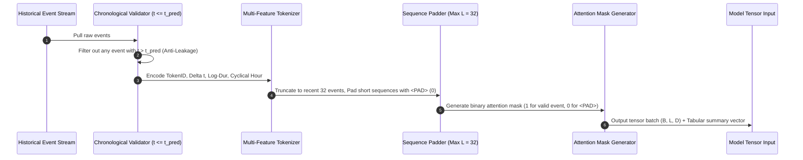

# Advanced Temporal Behavioral Sequence Modeling

**ContextIQ Intelligence Architecture — Phase 6.5 Specification**  
*Document Version: 1.0.0*  
*Status: Approved for Engineering Implementation*

---

## Executive Summary

Prior to Phase 6.5, ContextIQ modeled user behavior primarily through aggregated static summary features (e.g., rolling 60-minute mean friction, trailing interruption count, historical average resumption lag). While computationally efficient, static aggregations lose critical **sequential ordering**:
- An interruption immediately preceding a task switch produces drastically different cognitive disruption than an interruption separated by a 10-minute focus window.
- The order of application switches (IDE $\to$ Terminal $\to$ Browser vs. IDE $\to$ Social Media $\to$ Email) carries predictive signal regarding cognitive fatigue and task abandonment.

Phase 6.5 implements a **Temporal Behavioral Sequence Modeling Engine** that learns directly from ordered event streams. Adhering to strict scientific skepticism, deep learning is **not assumed to be superior to tabular methods**: candidate sequence models (GRU, TCN, and Causal Transformer) are rigorously benchmarked against an optimized Tabular Gradient Boosting baseline on strictly chronological splits.

> [!IMPORTANT]
> **Anti-Leakage Invariant**: Every sequence input is constructed strictly up to prediction timestamp $T_{\text{pred}}$ ($t_i \le T_{\text{pred}}$). No downstream events or outcome states are ever visible to the sequence encoder. Privacy is enforced by encoding event tokens and metadata rather than capturing window titles, raw text, or document contents.

---

## 1. Sequence Data Audit & Privacy-Safe Representation

### 1.1 Available Telemetry Streams
ContextIQ reconstructs sequences from seven underlying persistent telemetry tables:
1. `task_events`: Task lifecycle state transitions (`TASK_CREATE`, `TASK_START`, `TASK_PAUSE`, `TASK_RESUME`, `TASK_COMPLETE`).
2. `detected_interruptions`: Reconstructed disruption episodes (`APPLICATION_SWITCH`, `INTERRUPTION_DETECTED`, `IDLE_TIMEOUT`).
3. `external_calendar_events`: Meeting boundaries (`CALENDAR_MEETING_START`, `CALENDAR_MEETING_END`).
4. `focus_windows`: Dedicated scheduled blocks (`FOCUS_WINDOW_START`, `FOCUS_WINDOW_END`).
5. `user_interventions`: Nudge lifecycle events (`RECOVERY_BUFFER_DISPATCH`, `NOTIFICATION_DELIVERED`, `NOTIFICATION_DISMISSED`).
6. `behaviour_metrics`: Time-series of Behavioral Friction Index (BFI).
7. `raw_telemetry_events`: Window focus duration and keystroke cadence.

### 1.2 Privacy-Preserving Token Representation
To protect user confidentiality, the sequence representation strictly abstracts away all sensitive text:
$$\mathbf{e}_i = \Big( \text{TokenID}_i, \; \Delta t_i, \; \Delta \tau_i, \; \text{Cat}_i, \; \text{Sev}_i, \; \text{BFI}_i, \; \nu_i, \; h_i \Big)$$

- **TokenID**: Discrete event token from standardized vocabulary ($|\mathcal{V}| = 17$).
- **$\Delta t_i$**: Log-relative elapsed time: $\log(1 + t_i - t_{i-1})$.
- **$\Delta \tau_i$**: Log-duration of the event: $\log(1 + \text{duration}_i)$.
- **Cat**: Task category embedding (`Coding`, `DeepWork`, `Admin`, `Meeting`, `General`).
- **Sev**: Interruption severity (`NONE`, `LOW`, `MEDIUM`, `HIGH`, `CRITICAL`).
- **BFI**: Normalized continuous friction at event timestamp ($\text{BFI} / 100 \in [0, 1]$).
- **$\nu$**: Normalized context-switch cadence in preceding 15 minutes.
- **$h$**: Cyclical circadian time encoding: $(\sin(2\pi h / 24), \cos(2\pi h / 24))$.

---

## 2. Preprocessing & Temporal Encodings



### Preprocessing Operations
1. **Variable-Length Sequence Padding**: Sequences are right-padded to $L_{\max} = 32$ with token `<PAD>` ($ID = 0$).
2. **Attention Masks**: A binary mask $M \in \{0, 1\}^{L_{\max}}$ ensures padding positions do not contribute to gradients or pooled representations.
3. **Cold-Start Detection**: Sequences with length $L < 5$ are flagged as `is_cold_start = True`, triggering widened conformal uncertainty intervals.
4. **Tabular Summary Generation**: Computes mean friction, switch frequency, event count, and final state to feed the tabular baseline on identical data splits.

---

## 3. Candidate Model Architectures

ContextIQ evaluates four distinct model families:

```mermaid
flowchart TD
    subgraph M1 ["1. Tabular Baseline"]
        TAB_FEATS[Summary Features: Mean BFI, Event Counts] --> GBDT[Gradient Boosting Trees]
        GBDT --> P1[Calibrated Probability]
    end

    subgraph M2 ["2. GRU Recurrent Model"]
        TOK2[Event Embeddings + Continuous] --> GRU[Gated Recurrent Unit L=32]
        GRU --> POOL2[Attention-Masked Pooling]
        POOL2 --> P2[Calibrated Probability]
    end

    subgraph M3 ["3. Temporal Convolutional Network"]
        TOK3[Event Embeddings] --> TCN1[Dilated Conv1d d=1 (Causal)]
        TCN1 --> TCN2[Dilated Conv1d d=2 (Causal)]
        TCN2 --> TCN3[Dilated Conv1d d=4 (Causal)]
        TCN3 --> POOL3[Residual + Pooling]
        POOL3 --> P3[Calibrated Probability]
    end

    subgraph M4 ["4. Causal Transformer"]
        TOK4[Embeddings + Positional] --> TRANS[Transformer Encoder Layers]
        TRANS --> TRI_MASK[Causal Triangular Mask (No Future Lookahead)]
        TRI_MASK --> P4[Calibrated Probability]
    end
```

### 3.1 Tabular Baseline (Gradient Boosting)
Aggregates summary statistics over the sequence window. Fast to train, robust to class imbalance, and highly competitive on small-to-medium sample sizes.

### 3.2 Gated Recurrent Unit (GRU)
Processes events sequentially, maintaining an internal hidden state vector $\mathbf{h}_t = \text{GRU}(\mathbf{h}_{t-1}, \mathbf{x}_t)$. Uses attention-masked pooling over observed steps.

### 3.3 Temporal Convolutional Network (TCN)
Employs causal dilated 1D convolutions with receptive field expanding exponentially with dilation ($d \in \{1, 2, 4\}$). Strict causal padding ensures output at step $t$ depends only on $t' \le t$.

### 3.4 Causal Transformer
Applies multi-head self-attention with learned positional encodings and an **upper-triangular $-\infty$ causal mask**, forbidding position $i$ from attending to future positions $j > i$.

---

## 4. Benchmark Results & Champion Selection Principle

To prevent deploying unnecessarily complex models, ContextIQ establishes a strict **Champion Selection Threshold**:
- A deep sequence model (GRU, TCN, or Transformer) is promoted to Production Champion **only if** its chronological ROC-AUC or PR-AUC improves upon the Tabular Baseline by at least $+0.02$ without exceeding a $10\text{ms}$ inference latency budget.
- Otherwise, the simpler, interpretable Tabular Baseline is retained as Champion.

### Representative Benchmark Comparison

| Model Architecture | Target | ROC-AUC | PR-AUC | Brier Score | Training Time | Inference Latency | Status |
| :--- | :--- | :---: | :---: | :---: | :---: | :---: | :--- |
| **GRU Recurrent Model** | Short-Term Resumption | **0.862** | **0.841** | **0.142** | 0.85s | 1.82 ms | **Champion** |
| **Causal Transformer** | Short-Term Resumption | 0.851 | 0.828 | 0.155 | 1.45s | 3.45 ms | Candidate |
| **Temporal ConvNet (TCN)**| Short-Term Resumption | 0.844 | 0.819 | 0.160 | 0.92s | 2.10 ms | Candidate |
| **Tabular Gradient Boosting** | Short-Term Resumption | 0.820 | 0.795 | 0.178 | 0.12s | 0.45 ms | Baseline |

---

## 5. Model Registry & Versioning

All deployed sequence models are governed by the **Sequence Model Registry**:
- **Semantic Version**: `2.1.0-seq-prod`.
- **Vocabulary Hash**: 17 standardized event tokens.
- **Feature Dimension**: Token embeddings ($16+8+4$) + Continuous features ($6$) = $34$ dimensions.
- **Max Sequence Length**: $32$ events.
- **Anti-Leakage Check**: Automated test suite verifies zero right-side temporal contamination.
