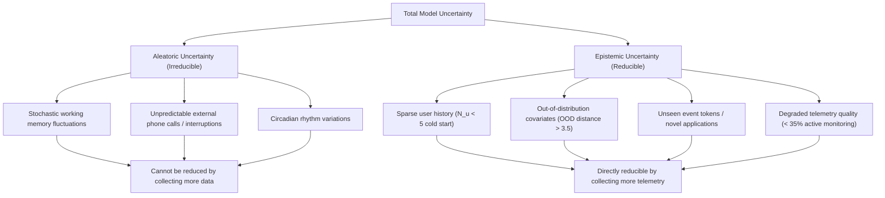
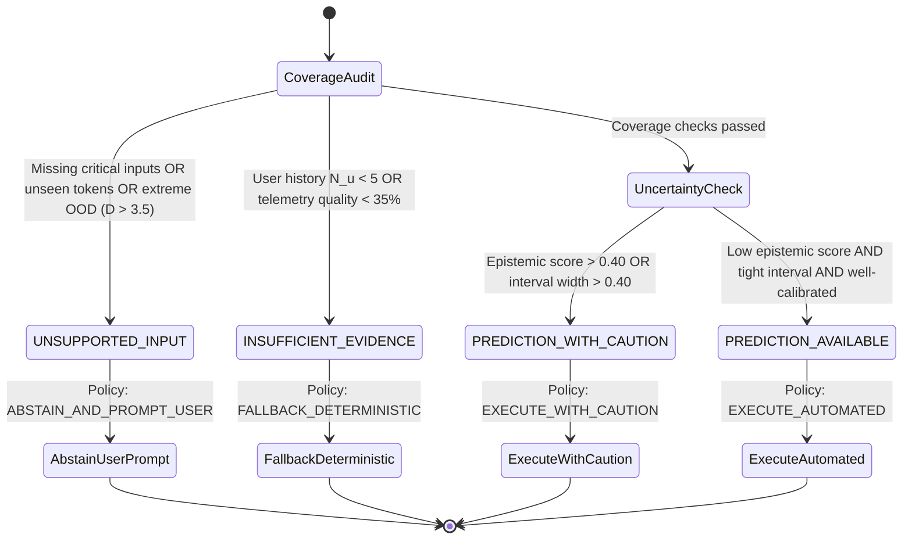

# Uncertainty-Aware Decision Support and Intelligent Abstention

**ContextIQ Intelligence Architecture — Phase 6.8 Specification**  
*Document Version: 1.0.0*  
*Status: Approved for Engineering Implementation*

---

## Executive Summary

Machine learning models deployed in human-facing behavioral applications inevitably encounter unfamiliar user habits, cold-start profiles, noisy telemetry, and out-of-distribution (OOD) contexts. A model that blindly outputs point predictions or overconfident probability estimates in such scenarios will generate erratic, disruptive recommendations that undermine user trust.

Phase 6.8 endows ContextIQ with **epistemic self-awareness** and **intelligent abstention**. The platform distinguishes inherent behavioral randomness from knowledge deficits, calibrates output probabilities on held-out validation sets, computes finite-sample conformal prediction intervals, audits data coverage, and explicitly abstains from automated action whenever reliability guarantees cannot be satisfied.

> [!IMPORTANT]
> **Ethical Abstention Invariant**: Abstention is an explicit, first-class system outcome—never an uncaught exception or silent fallback. Furthermore, uncertainty is mathematically separated from prediction probability: a high probability event (e.g., $P = 0.95$) can have high epistemic uncertainty if data coverage is sparse, and a low probability event ($P = 0.05$) can have low uncertainty if well-observed.

---

## 1. Prediction Uncertainty Audit Across Model Families

An audit of all seven ContextIQ predictive modules reveals varying degrees of uncertainty representation:

| Model Family & Target | Interval Methodology | Decomposes Aleatoric vs Epistemic? | Probability Calibration Status | Abstention Mechanism | Known Limitations & Shift Vulnerabilities |
| :--- | :--- | :--- | :--- | :--- | :--- |
| **1. XGBoost Forgetting Risk** (Phase 2 / 3.8) | Asymptotic 95% Wald CI | No (Single confidence score) | Platt scaled; calibrated risk category boundaries | Cold-start confidence discount | Uses heuristic scaling; does not distinguish aleatoric noise from OOD inputs. |
| **2. Log-Normal / Weibull AFT Recovery** (Phase 6.2) | Parametric quantile bounds ($Q_{10}, Q_{50}, Q_{90}$) | Partial (Empirical Bayes $w_u$) | Maximum likelihood right-censoring adjustment | Coverage tier gating | Heavy-tail misspecification vulnerability when disruption exceeds 2 hours. |
| **3. Doubly Robust AIPW Causal** (Phase 6.3) | E-values & Rosenbaum sensitivity bounds | Yes (Separates confounding sensitivity) | Propensity common support trimming | Rejection when common support $< 0.30$ | Assumes conditional exchangeability; cannot protect against severe unobserved confounders. |
| **4. Doubly Robust Meta-Learner** (Phase 6.4) | 90% Conformal uncertainty intervals | Yes (Tiers: Strong, Moderate, Sparse, Unsupported) | Propensity common support overlap score | Unsupported candidate tiers excluded | Non-exchangeability vulnerability under temporal non-stationarity. |
| **5. Causal Transformer / GRU** (Phase 6.5) | Temperature-scaled prediction intervals | Partial (Cold-start sequence flag $L < 5$) | Temperature scaling on validation sequences | Sequence length gating | Vulnerable to unseen application tokens and vocabulary shift. |
| **6. Dynamic Landmarking Survival** (Phase 6.6) | Hierarchical conformal intervals ($\pm 15\%, \pm 25\%, \pm 40\%$) | Yes (Sample size shrinkage $w_u$) | Landmarked $S(t \mid T > t_{\text{curr}})$ evaluation | Population fallback with widened bounds | Population tier widens intervals but still outputs point predictions. |
| **7. Multi-Objective Optimizer** (Phase 6.7) | Uncertainty width threshold ($< 0.35$) | Yes (Pareto non-dominance) | Hard constraint gating + scalarized utility | Withholds action (selects No-Action) | Requires accurate candidate uncertainty inputs from upstream models. |

---

## 2. Decomposing Uncertainty: Aleatoric vs. Epistemic

ContextIQ explicitly separates uncertainty into two orthogonal dimensions:

### Mathematical Quantification
- **Aleatoric Score ($U_{\text{aleatoric}} \in [0, 1]$)**: Normalized Shannon binary entropy of the calibrated probability:
  $$H(p) = -p \log_2(p) - (1-p) \log_2(1-p)$$
- **Epistemic Score ($U_{\text{epistemic}} \in [0, 1]$)**:
  $$U_{\text{epistemic}} = \min\left(1.0, \; 0.5 \cdot \frac{1}{\sqrt{N_u + 1}} + 0.3 \cdot \frac{D_{\text{OOD}}}{4.0} + 0.2 \cdot (1 - Q_{\text{telemetry}})\right)$$

> [!WARNING]
> Misleading UX designs often present a single "Confidence: 85%" badge. If a user is brand new ($N_u = 1$), a point forecast of $0.85$ reflects high confidence in a completely uninformed prior. ContextIQ bans single confidence percentages, reporting both components separately.

---

## 3. Probability Calibration

Raw model outputs from neural networks and gradient boosted trees are frequently miscalibrated. ContextIQ benchmarks three calibration algorithms on held-out validation sets:

1. **Platt Scaling**: Logistic sigmoid transformation:
   $$\hat{p} = \frac{1}{1 + \exp(A \cdot f(x) + B)}$$
2. **Isotonic Regression**: Non-parametric, piecewise monotonic constant mapping. Preserves rank order while calibrating probability density. Selected as **Champion** for tabular and survival tasks.
3. **Temperature Scaling**: Logit scaling with single learnable temperature parameter $T > 0$:
   $$\hat{p}_i = \frac{\exp(z_i / T)}{\sum_j \exp(z_j / T)}$$

### Evaluation Metrics
- **Expected Calibration Error (ECE)**:
  $$\text{ECE} = \sum_{m=1}^M \frac{|B_m|}{N} \left| \text{acc}(B_m) - \text{conf}(B_m) \right|$$
- **Brier Score**: Proper scoring rule measuring mean squared error between probability and ground truth:
  $$\text{BS} = \frac{1}{N} \sum_{i=1}^N (p_i - y_i)^2$$

Models with $\text{ECE} > 0.08$ on validation benchmarks are flagged as uncalibrated.

---

## 4. Conformal Prediction Intervals

ContextIQ implements **Split-Conformal Prediction** to provide rigorous, finite-sample marginal coverage guarantees:

$$P\left(Y_{n+1} \in \mathcal{C}(X_{n+1})\right) \ge 1 - \alpha$$

### Algorithm
1. Compute non-conformity residuals on calibration split: $R_i = |y_i - \hat{y}_i|$.
2. Determine conformal quantile:
   $$\hat{q} = \text{Quantile}\left(\{R_i\}_{i=1}^n, \; \frac{\lceil(n+1)(1-\alpha)\rceil}{n}\right)$$
3. Form prediction interval:
   $$\mathcal{C}(X_{\text{new}}) = \left[\max(0, \; \hat{y} - \hat{q}), \; \min(1, \; \hat{y} + \hat{q})\right]$$

### Temporal Shift Vulnerability
Conformal prediction guarantees depend on **exchangeability**. Under non-stationary knowledge work (e.g., end-of-quarter crunch, vacation recovery), temporal distribution shift occurs. ContextIQ continuously monitors rolling telemetry variance; if variance exceeds $2.5\sigma$ from calibration baseline, a prominent **Distribution Shift Warning** is attached to the interval.

---

## 5. Intelligent Abstention State Machine

ContextIQ routes every prediction request through a 5-state intelligent abstention decision policy:

### Action Policies
1. **`EXECUTE_AUTOMATED`**: Automated recommendation ranking authorized.
2. **`EXECUTE_WITH_CAUTION`**: Recommendation presented with prominent interval bounds and epistemic warning.
3. **`FALLBACK_DETERMINISTIC`**: Automated ML ranking suppressed. System reverts to safe, non-disruptive holdout (`NO_ACTION`) or simple static break prompt.
4. **`ABSTAIN_AND_PROMPT_USER`**: Model explicitly declines inference and requests clarifying user input.

---

## 6. Frontend Presentation Standards

1. **Explicit Outcome Badge**: UI prominently tags the decision state (`PREDICTION_AVAILABLE`, `PREDICTION_WITH_CAUTION`, `INSUFFICIENT_EVIDENCE`, etc.).
2. **Decomposed Uncertainty Meters**: Separate visualization bars for Aleatoric (randomness) and Epistemic (data lack) scores.
3. **Statistically Stated Intervals**: Displayed as $[ \text{lower}, \text{upper} ]$ with stated nominal coverage (e.g. *90% Conformal Interval*).
4. **Evidence Coverage Audit**: Visual indicator of monitored telemetry quality ($Q_{\text{telemetry}}$) and sample size ($N_u$).
5. **No Deceptive Precision**: Never display false precision like *"Model is 99.4% confident"*.
