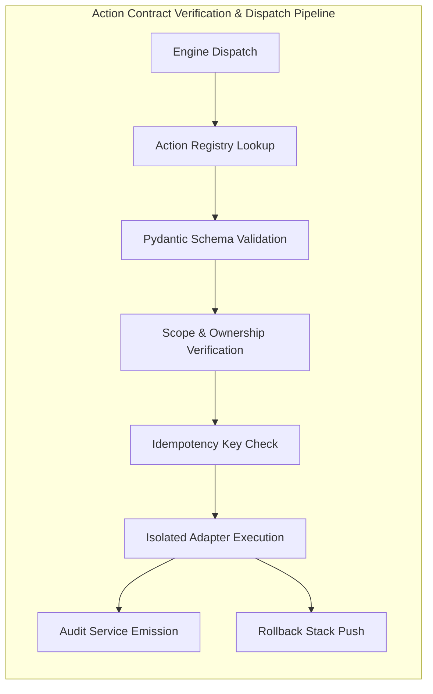

# ContextIQ Phase 7: Governed Action Contracts Specification
## Comprehensive Action Interface Standards, Schemas, Side Effects & Reversibility

---

## 1. Executive Summary & Action Contract Standards

In ContextIQ, autonomous workflows never execute arbitrary commands, loose SQL queries, or unstructured scripts. Every discrete operation that modifies internal state or calls external third-party APIs must be registered as an immutable, strictly typed **Action Contract**.

### The 10 Invariant Dimensions of an Action Contract
Every executable action in ContextIQ must formally specify:
1. **Action Identifier**: Globally unique, namespaced string (e.g. `domain:entity:operation`).
2. **Description & Human Intent**: Clear, unambiguous natural language explanation of what the action does and why.
3. **Required Permissions & Scopes**: Exact internal platform roles and external OAuth scopes needed (e.g., `https://www.googleapis.com/auth/calendar.events`).
4. **Input Schema**: Strict Pydantic V2 / JSON Schema Draft-07 specification defining all required, optional, and typed fields.
5. **Validation Rules**: Compile-time and runtime guard checks (e.g. range bounds, date sanity, tenant ownership).
6. **Expected Result**: Output JSON schema detailing returned identifiers, state diffs, and confirmation receipts.
7. **System & External Side Effects**: Exhaustive documentation of all entities created, mutated, or deleted internally and externally.
8. **Idempotency Strategy**: Hashing formula and external provider deduplication headers.
9. **Reversibility & Compensation Contract**: Whether the action is reversible, the identifier of its inverse compensating action, and the compensation payload structure.
10. **Failure Handling & Retry Strategy**: Retryability classification, maximum attempts, backoff profile, and blast radius containment.



---

## 2. Action Catalog by Workflow Category

The following catalog establishes the production contracts across all seven ContextIQ automation types.

---

### 2.1 Category 1: Task-Management Actions

#### Action 1.1: `task:decompose_into_subtasks`
- **Description**: Decomposes a complex parent task into smaller, sequenced subtasks with discrete progress checkpoints.
- **Required Permissions**: `tasks:write`, tenant ownership of `parent_task_id`.
- **Input Schema**:
  ```json
  {
    "type": "object",
    "required": ["parent_task_id", "subtask_titles"],
    "properties": {
      "parent_task_id": {"type": "string", "format": "uuid"},
      "subtask_titles": {
        "type": "array",
        "items": {"type": "string", "minLength": 3, "maxLength": 128},
        "minItems": 2,
        "maxItems": 6
      },
      "estimated_minutes_per_subtask": {"type": "integer", "minimum": 5, "maximum": 120, "default": 25},
      "elevate_first_subtask_priority": {"type": "boolean", "default": true}
    }
  }
  ```
- **Validation Rules**:
  - `parent_task_id` must resolve to an active, non-completed task owned by the calling `user_id`.
  - Parent task must not already have active subtasks.
- **Expected Result**:
  ```json
  {
    "parent_task_id": "uuid",
    "created_subtask_ids": ["uuid-1", "uuid-2", "uuid-3"],
    "count": 3
  }
  ```
- **Side Effects**:
  - Inserts $N$ rows into `tasks` table with `parent_id = parent_task_id`.
  - Emits `TASK_CREATED` events into `task_events`.
- **Idempotency Strategy**: Key = `SHA256(user_id:parent_task_id:subtask_titles_joined)`.
- **Reversibility**: **Reversible**.
  - *Compensating Action*: `task:batch_delete_subtasks`.
  - *Revert Payload*: `{"subtask_ids": ["uuid-1", "uuid-2", "uuid-3"], "parent_task_id": "uuid"}`.
- **Failure Handling**: Atomic transaction; if subtask insertion fails, entire transaction rolls back. Non-retryable if validation fails.

#### Action 1.2: `task:update_priority`
- **Description**: Updates the priority of an existing task to optimize focus sequence.
- **Required Permissions**: `tasks:write`, tenant ownership of `task_id`.
- **Input Schema**:
  ```json
  {
    "type": "object",
    "required": ["task_id", "new_priority"],
    "properties": {
      "task_id": {"type": "string", "format": "uuid"},
      "new_priority": {"type": "string", "enum": ["LOW", "MEDIUM", "HIGH", "CRITICAL"]},
      "reason": {"type": "string", "maxLength": 256}
    }
  }
  ```
- **Validation Rules**: `task_id` must exist and be active; `new_priority` must differ from current priority.
- **Expected Result**: `{"task_id": "uuid", "old_priority": "MEDIUM", "new_priority": "HIGH"}`.
- **Side Effects**: Updates `priority` in `tasks` table; records `TASK_UPDATED` event.
- **Idempotency Strategy**: Natural state idempotency (setting priority to same value is a no-op).
- **Reversibility**: **Reversible**.
  - *Compensating Action*: `task:update_priority`.
  - *Revert Payload*: `{"task_id": "uuid", "new_priority": "MEDIUM", "reason": "Rollback"}`.
- **Failure Handling**: Database retry on deadlock (up to 3 times with exponential backoff).

---

### 2.2 Category 2: Calendar Actions

#### Action 2.1: `calendar:insert_focus_block`
- **Description**: Creates a dedicated focus work block on the user's primary external calendar (Google Calendar / Microsoft Outlook).
- **Required Permissions**: `calendar:write`, OAuth scope `https://www.googleapis.com/auth/calendar.events` or `Calendars.ReadWrite`.
- **Input Schema**:
  ```json
  {
    "type": "object",
    "required": ["title", "start_time", "end_time"],
    "properties": {
      "title": {"type": "string", "minLength": 3, "maxLength": 100},
      "start_time": {"type": "string", "format": "date-time"},
      "end_time": {"type": "string", "format": "date-time"},
      "associated_task_id": {"type": "string", "format": "uuid", "nullable": true},
      "availability": {"type": "string", "enum": ["BUSY", "TENTATIVE"], "default": "BUSY"},
      "provider": {"type": "string", "enum": ["google_calendar", "microsoft_outlook"], "default": "google_calendar"}
    }
  }
  ```
- **Validation Rules**:
  - `start_time` must be in the future ($\ge \text{now} - 60\text{s}$).
  - `end_time` must be strictly after `start_time` with duration between 15 and 240 minutes.
  - Active OAuth token with write access must exist for the specified provider.
- **Expected Result**:
  ```json
  {
    "external_event_id": "ext_cal_981241",
    "html_link": "https://calendar.google.com/event?eid=...",
    "scheduled_start": "2026-11-26T09:30:00Z",
    "scheduled_end": "2026-11-26T11:00:00Z"
  }
  ```
- **Side Effects**:
  - Creates remote calendar event on Google Calendar or MS Outlook.
  - Inserts local record into `external_calendar_events` table.
- **Idempotency Strategy**: Passes client request token `client-request-id: ctx_foc_<hash>` in HTTP headers.
- **Reversibility**: **Reversible**.
  - *Compensating Action*: `calendar:delete_event`.
  - *Revert Payload*: `{"provider": "google_calendar", "external_event_id": "ext_cal_981241"}`.
- **Failure Handling**:
  - HTTP 429/503: Exponential backoff with jitter (3 retries).
  - HTTP 401: Refresh OAuth token; if failed, abort step and flag re-auth.

#### Action 2.2: `calendar:reschedule_event`
- **Description**: Moves an existing calendar focus block to a circadian-optimized time slot.
- **Required Permissions**: `calendar:write`, OAuth write scopes.
- **Input Schema**:
  ```json
  {
    "type": "object",
    "required": ["external_event_id", "new_start_time", "new_end_time", "provider"],
    "properties": {
      "external_event_id": {"type": "string"},
      "provider": {"type": "string", "enum": ["google_calendar", "microsoft_outlook"]},
      "new_start_time": {"type": "string", "format": "date-time"},
      "new_end_time": {"type": "string", "format": "date-time"}
    }
  }
  ```
- **Validation Rules**: `new_start_time` must be in the future; target event must be owned by the user.
- **Expected Result**: `{"external_event_id": "ext_cal_981241", "updated_start": "...", "updated_end": "..."}`.
- **Side Effects**: Mutates external calendar event and updates local sync cache.
- **Idempotency Strategy**: Conditional update matching `etag` or `If-Match` header.
- **Reversibility**: **Reversible**.
  - *Compensating Action*: `calendar:reschedule_event`.
  - *Revert Payload*: `{"external_event_id": "...", "new_start_time": "<original_start>", "new_end_time": "<original_end>", "provider": "..."}`.
- **Failure Handling**: If etag mismatch occurs (event was modified elsewhere), abort and notify user of conflict.

---

### 2.3 Category 3: Reminder & Nudge Actions

#### Action 3.1: `reminder:stage_context_warming`
- **Description**: Pre-stages application context and schedules a gentle reminder 15 minutes prior to a deep work session.
- **Required Permissions**: `notifications:write`.
- **Input Schema**:
  ```json
  {
    "type": "object",
    "required": ["task_id", "lead_time_minutes", "channel"],
    "properties": {
      "task_id": {"type": "string", "format": "uuid"},
      "lead_time_minutes": {"type": "integer", "minimum": 5, "maximum": 60, "default": 15},
      "channel": {"type": "string", "enum": ["IN_APP_TOAST", "DESKTOP_POPUP", "MOBILE_PUSH"], "default": "IN_APP_TOAST"},
      "include_file_links": {"type": "boolean", "default": true}
    }
  }
  ```
- **Validation Rules**: `task_id` must be active; target delivery time must be before task start time.
- **Expected Result**: `{"reminder_id": "rem_19284", "scheduled_delivery_at": "2026-11-26T09:15:00Z"}`.
- **Side Effects**: Inserts scheduled notification into `user_notifications` table.
- **Idempotency Strategy**: Key = `SHA256(user_id:task_id:scheduled_delivery_at)`.
- **Reversibility**: **Reversible**.
  - *Compensating Action*: `reminder:cancel_scheduled_notification`.
  - *Revert Payload*: `{"reminder_id": "rem_19284"}`.
- **Failure Handling**: Non-critical step. If notification cannot be scheduled, workflow marks step partial and continues.

#### Action 3.2: `reminder:snooze_non_urgent`
- **Description**: Throttles non-urgent desktop and push alerts during intense cognitive work periods.
- **Required Permissions**: `notifications:write`.
- **Input Schema**:
  ```json
  {
    "type": "object",
    "required": ["throttle_duration_minutes", "tier_threshold"],
    "properties": {
      "throttle_duration_minutes": {"type": "integer", "minimum": 15, "maximum": 240, "default": 60},
      "tier_threshold": {"type": "string", "enum": ["URGENT_ONLY", "MUTED_ALL"], "default": "URGENT_ONLY"}
    }
  }
  ```
- **Validation Rules**: `throttle_duration_minutes` must be positive and $\le 240$.
- **Expected Result**: `{"throttled_until": "2026-11-26T11:30:00Z", "tier": "URGENT_ONLY"}`.
- **Side Effects**: Sets temporary override in `DeliveryPolicy` and updates `UserBehavioralProfile.quiet_hours`.
- **Idempotency Strategy**: Natural state override.
- **Reversibility**: **Reversible**.
  - *Compensating Action*: `reminder:restore_notification_delivery`.
  - *Revert Payload*: `{"user_id": "uuid"}`.
- **Failure Handling**: Internal database update with guaranteed rollback.

---

### 2.4 Category 4: Focus-Session Actions

#### Action 4.1: `focus:create_session_block`
- **Description**: Allocates an uninterruptible cognitive focus session with application distraction shielding.
- **Required Permissions**: `focus:write`, `desktop_agent:command`.
- **Input Schema**:
  ```json
  {
    "type": "object",
    "required": ["session_duration_minutes", "protect_against_switching"],
    "properties": {
      "session_duration_minutes": {"type": "integer", "minimum": 20, "maximum": 120, "default": 50},
      "protect_against_switching": {"type": "boolean", "default": true},
      "associated_task_id": {"type": "string", "format": "uuid", "nullable": true}
    }
  }
  ```
- **Validation Rules**: User must not currently be in an active focus session.
- **Expected Result**: `{"focus_session_id": "foc_sess_8219", "duration_minutes": 50, "shielding_enabled": true}`.
- **Side Effects**: Inserts into `context_sessions` with type `DEEP_WORK`; sends command to desktop agent.
- **Idempotency Strategy**: Fails if an active focus session is already open for the user.
- **Reversibility**: **Reversible**.
  - *Compensating Action*: `focus:end_session_early`.
  - *Revert Payload*: `{"focus_session_id": "foc_sess_8219"}`.
- **Failure Handling**: If desktop agent is offline, session is recorded in web backend with a warning.

#### Action 4.2: `focus:clamp_complementary_tools`
- **Description**: Activates workstation window management, pinning primary IDE/work tools and hiding distraction apps.
- **Required Permissions**: `desktop_agent:command`.
- **Input Schema**:
  ```json
  {
    "type": "object",
    "required": ["allowed_application_names"],
    "properties": {
      "allowed_application_names": {
        "type": "array",
        "items": {"type": "string"},
        "minItems": 1
      },
      "auto_minimize_distractions": {"type": "boolean", "default": true}
    }
  }
  ```
- **Validation Rules**: `allowed_application_names` must contain at least one valid executable identifier.
- **Expected Result**: `{"clamped_apps": ["code.exe", "powershell.exe"], "minimized_count": 3}`.
- **Side Effects**: Dispatches IPC command to local Windows desktop agent.
- **Idempotency Strategy**: Key = `SHA256(user_id:allowed_apps_sorted)`.
- **Reversibility**: **Reversible**.
  - *Compensating Action*: `focus:unclamp_tools`.
  - *Revert Payload*: `{"user_id": "uuid"}`.
- **Failure Handling**: Best-effort; desktop agent failures do not fail the parent workflow.

---

### 2.5 Category 5: Recovery-Buffer Actions

#### Action 5.1: `recovery:insert_post_interruption_buffer`
- **Description**: Automatically inserts a cognitive cooldown buffer directly following a disruptive interruption.
- **Required Permissions**: `calendar:write`, `tasks:write`.
- **Input Schema**:
  ```json
  {
    "type": "object",
    "required": ["buffer_duration_minutes", "interruption_id"],
    "properties": {
      "buffer_duration_minutes": {"type": "integer", "minimum": 5, "maximum": 30, "default": 10},
      "interruption_id": {"type": "string", "format": "uuid"},
      "task_id": {"type": "string", "format": "uuid", "nullable": true}
    }
  }
  ```
- **Validation Rules**: `interruption_id` must resolve to a valid detected disruption in `detected_interruptions`.
- **Expected Result**: `{"buffer_start": "...", "buffer_end": "...", "resumption_lag_target_seconds": 600}`.
- **Side Effects**: Inserts buffer event on external calendar and delays subsequent task reminder.
- **Idempotency Strategy**: Key = `SHA256(user_id:interruption_id:recovery_buffer)`.
- **Reversibility**: **Reversible**.
  - *Compensating Action*: `calendar:delete_event`.
  - *Revert Payload*: `{"buffer_event_id": "ext_cal_..."}`.
- **Failure Handling**: If calendar insert fails, in-app local cooldown timer is activated as fallback.

#### Action 5.2: `recovery:meeting_decompression_slot`
- **Description**: Inserts a 10-minute non-negotiable breathing slot between consecutive high-load calendar meetings.
- **Required Permissions**: `calendar:write`.
- **Input Schema**:
  ```json
  {
    "type": "object",
    "required": ["first_meeting_end", "second_meeting_start", "provider"],
    "properties": {
      "first_meeting_end": {"type": "string", "format": "date-time"},
      "second_meeting_start": {"type": "string", "format": "date-time"},
      "provider": {"type": "string", "enum": ["google_calendar", "microsoft_outlook"]}
    }
  }
  ```
- **Validation Rules**: Difference between `second_meeting_start` and `first_meeting_end` must be $< 15$ minutes.
- **Expected Result**: `{"slot_event_id": "ext_cal_decomp_129", "duration_minutes": 10}`.
- **Side Effects**: Creates a calendar hold titled *"ContextIQ Cognitive Decompression"*.
- **Idempotency Strategy**: Natural calendar slot uniqueness.
- **Reversibility**: **Reversible**.
  - *Compensating Action*: `calendar:delete_event`.
  - *Revert Payload*: `{"slot_event_id": "ext_cal_decomp_129"}`.
- **Failure Handling**: Calendar API backoff retry; abort if calendar schedule changes during insertion.

---

### 2.6 Category 6: Behavioral Intervention Actions

#### Action 6.1: `intervention:trigger_micro_break`
- **Description**: Deploys a targeted micro-break nudge when cognitive fatigue exceeds safe recovery thresholds.
- **Required Permissions**: `interventions:execute`.
- **Input Schema**:
  ```json
  {
    "type": "object",
    "required": ["break_type", "duration_seconds"],
    "properties": {
      "break_type": {"type": "string", "enum": ["EYE_REST", "POSTURE_STRETCH", "HYDRATION_RESET"], "default": "EYE_REST"},
      "duration_seconds": {"type": "integer", "minimum": 30, "maximum": 300, "default": 60},
      "bandit_arm_id": {"type": "string", "nullable": true}
    }
  }
  ```
- **Validation Rules**: Must not have delivered another micro-break nudge within the past 45 minutes.
- **Expected Result**: `{"intervention_id": "intv_8912", "prompt_displayed": true, "duration_seconds": 60}`.
- **Side Effects**: Inserts into `user_interventions` and logs bandit decision in `bandit_decision_logs`.
- **Idempotency Strategy**: Key = `SHA256(user_id:intervention:date_hour)`.
- **Reversibility**: **Irreversible (Ephemeral)**: Nudge displayed to human attention cannot be un-displayed. Marked `is_reversible: false`.
- **Failure Handling**: Fail silent; user experience is unaffected if toast fails to display.

#### Action 6.2: `intervention:anti_thrash_fullscreen_prompt`
- **Description**: Displays a calming focus re-centering modal when rapid application switching thrash is detected.
- **Required Permissions**: `interventions:execute`, `desktop_agent:command`.
- **Input Schema**:
  ```json
  {
    "type": "object",
    "required": ["switches_per_minute", "active_task_id"],
    "properties": {
      "switches_per_minute": {"type": "number", "minimum": 6.0},
      "active_task_id": {"type": "string", "format": "uuid", "nullable": true}
    }
  }
  ```
- **Validation Rules**: `switches_per_minute` must be $\ge 6.0$.
- **Expected Result**: `{"prompt_acknowledged": true, "selected_resumption_action": "CONTINUE_TASK"}`.
- **Side Effects**: Displays focused pause overlay on Windows desktop.
- **Idempotency Strategy**: Debounced to at most once per 30 minutes.
- **Reversibility**: **Irreversible (Ephemeral)**.
- **Failure Handling**: Falls back to gentle in-app notification if desktop agent overlay fails.

---

### 2.7 Category 7: Cross-Device Actions

#### Action 7.1: `cross_device:sync_dnd_focus_mode`
- **Description**: Propagates active focus mode across all registered user companion devices (Desktop and Mobile).
- **Required Permissions**: `devices:command`.
- **Input Schema**:
  ```json
  {
    "type": "object",
    "required": ["enabled", "duration_minutes"],
    "properties": {
      "enabled": {"type": "boolean"},
      "duration_minutes": {"type": "integer", "minimum": 15, "maximum": 240, "default": 60},
      "target_device_ids": {
        "type": "array",
        "items": {"type": "string", "format": "uuid"},
        "nullable": true
      }
    }
  }
  ```
- **Validation Rules**: User must have at least one active companion device registered in `user_devices`.
- **Expected Result**: `{"synced_devices_count": 2, "dnd_state": "ACTIVE", "expires_at": "..."}`.
- **Side Effects**: Sends push sync commands via web sockets or push notification gateways.
- **Idempotency Strategy**: Natural state idempotency.
- **Reversibility**: **Reversible**.
  - *Compensating Action*: `cross_device:sync_dnd_focus_mode`.
  - *Revert Payload*: `{"enabled": false, "duration_minutes": 0}`.
- **Failure Handling**: Best effort per device; failures logged in `user_notifications`.

#### Action 7.2: `cross_device:transit_lockscreen_handoff`
- **Description**: Transfers ongoing task context and next steps to the user's mobile lock-screen widget when departure is detected.
- **Required Permissions**: `devices:command`, `location:read`.
- **Input Schema**:
  ```json
  {
    "type": "object",
    "required": ["active_task_id", "departure_location_id"],
    "properties": {
      "active_task_id": {"type": "string", "format": "uuid"},
      "departure_location_id": {"type": "string", "format": "uuid"}
    }
  }
  ```
- **Validation Rules**: `active_task_id` must be in progress; departure location must match registered home/office geofence.
- **Expected Result**: `{"handoff_token": "hnd_98124", "mobile_widget_updated": true}`.
- **Side Effects**: Pushes context payload to mobile companion storage.
- **Idempotency Strategy**: Key = `SHA256(user_id:active_task_id:departure_location_id)`.
- **Reversibility**: **Reversible**.
  - *Compensating Action*: `cross_device:clear_mobile_handoff`.
  - *Revert Payload*: `{"handoff_token": "hnd_98124"}`.
- **Failure Handling**: If mobile gateway fails, handoff token is preserved in database for on-demand fetch.

---

## 3. Summary Action Contract Specification Matrix

| Action Identifier | Category | Risk Tier | Required Internal Scope | External OAuth Scope | Reversible? | Idempotency Key Basis |
|:---|:---|:---:|:---|:---|:---:|:---|
| `task:decompose_into_subtasks` | Task | Tier 1 | `tasks:write` | None | Yes | `user:parent_task:titles` |
| `task:update_priority` | Task | Tier 1 | `tasks:write` | None | Yes | Natural state |
| `calendar:insert_focus_block` | Calendar | Tier 2 | `calendar:write` | `calendar.events` | Yes | Request token header |
| `calendar:reschedule_event` | Calendar | Tier 2 | `calendar:write` | `calendar.events` | Yes | Event etag match |
| `reminder:stage_context_warming`| Reminder | Tier 1 | `notifications:write` | None | Yes | `user:task:delivery_at` |
| `reminder:snooze_non_urgent` | Reminder | Tier 1 | `notifications:write` | None | Yes | Natural state |
| `focus:create_session_block` | Focus | Tier 1 | `focus:write` | None | Yes | Active session lock |
| `focus:clamp_complementary_tools`| Focus | Tier 1 | `desktop_agent:command`| None | Yes | `user:allowed_apps` |
| `recovery:insert_post_interruption_buffer`| Recovery | Tier 2 | `calendar:write` | `calendar.events` | Yes | `user:interruption:buffer` |
| `recovery:meeting_decompression_slot` | Recovery | Tier 2 | `calendar:write` | `calendar.events` | Yes | Natural slot uniqueness |
| `intervention:trigger_micro_break`| Behavioral | Tier 0 | `interventions:execute`| None | No | `user:hour:break` |
| `intervention:anti_thrash_fullscreen_prompt`| Behavioral | Tier 1 | `interventions:execute`| None | No | Debounce timestamp |
| `cross_device:sync_dnd_focus_mode`| Cross-Device | Tier 1 | `devices:command` | None | Yes | Natural state |
| `cross_device:transit_lockscreen_handoff`| Cross-Device| Tier 1 | `devices:command` | None | Yes | `user:task:location` |
