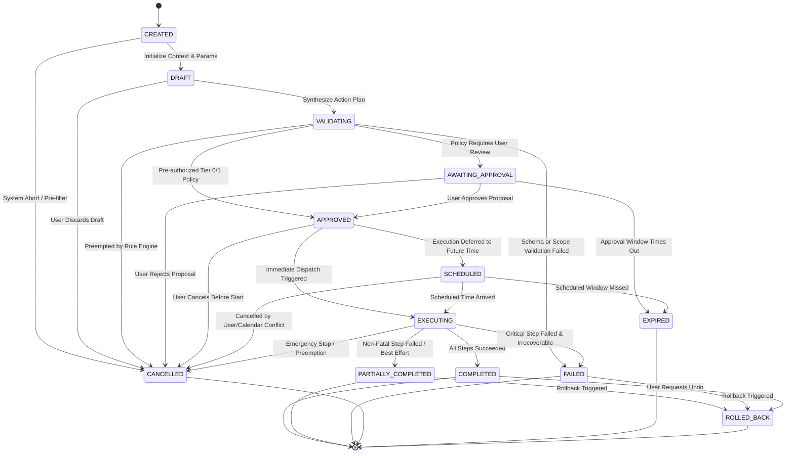
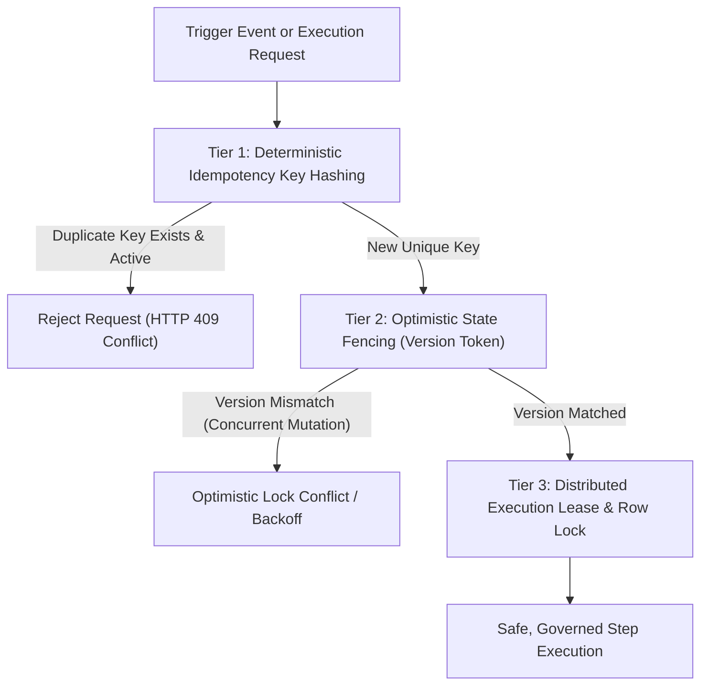
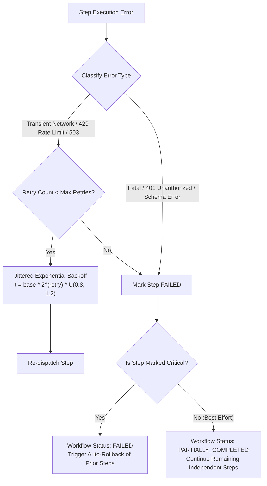

# ContextIQ Phase 7: Governed Automation Lifecycle Specification
## Deterministic 13-State Machine, State Invariants & Concurrency Fencing

---

## 1. Executive Summary & Lifecycle Philosophy

In autonomous behavioral optimization and micro-delay intervention systems, workflows execute real-world operations across task databases, external calendar systems (Google Calendar, Microsoft Outlook), notification daemons, and operating system focus modes. If an automated workflow executes unpredictably, gets triggered multiple times, or fails midway without clean recovery, user trust is destroyed and cognitive friction increases rather than decreases.

To guarantee reliability, safety, and auditability, ContextIQ governs all autonomous workflows using a **strictly formalized, deterministic 13-State Finite State Machine (FSM)**.

### Core Lifecycle Principles:
1. **Explicit Forward Progression**: Workflows never transition implicitly or skip validation/safety gates.
2. **Deterministic State Fencing**: State changes are atomic and guarded by optimistic concurrency version tokens (`version`) and unique idempotency keys.
3. **No Unapproved Consequential Action**: Any action altering external state or schedule calendars must pass through `AWAITING_APPROVAL` unless explicitly pre-authorized by user policy.
4. **Guaranteed Terminal Finality**: Workflows terminate exclusively in well-defined terminal states (`COMPLETED`, `CANCELLED`, `EXPIRED`, `FAILED`, `ROLLED_BACK`) with full audit provenance.
5. **Reversibility Guarantee**: Workflows that modify state must maintain inverse compensating operations allowing complete transition to `ROLLED_BACK`.

---

## 2. The 13 Formal Lifecycle States



### Detailed State Definitions

| State | Classification | Description | Invariants & Allowed Operations |
|:---|:---|:---|:---|
| **CREATED** | Ephemeral | Initial allocation of workflow record in response to a matched trigger or manual scenario. | Must have valid `user_id`, `idempotency_key`, and `rule_id` (or scenario reference). No actions planned yet. |
| **DRAFT** | Mutable | Workflow parameters, target task IDs, and context constraints are populated and configured. | Parameters can be edited. Actions not yet synthesized or validated. |
| **VALIDATING** | Processing | Workflow Planner checks action contracts, verifies user permissions, validates schemas, and checks least-privilege scopes. | Read-only with respect to external state. Evaluates action risk tier and generates action previews. |
| **AWAITING_APPROVAL** | Suspended | Workflow is presented to the user with a detailed action preview, expected benefit, and visual diff. Awaiting explicit user consent. | Immutable action plan. Awaiting user response via Web, Mobile, or API. Subject to approval timeout clock. |
| **APPROVED** | Ready | Workflow has received explicit user approval (or met verified pre-authorized autonomous policy). Ready for queueing. | Immutable action plan and verified `approved_at` timestamp. Cannot re-enter approval or draft states. |
| **SCHEDULED** | Waiting | Workflow execution is deferred to a future timestamp (e.g. scheduled focus session or circadian peak window). | Monitored by `WorkflowScheduler`. Can be cancelled before dispatch if calendar context changes. |
| **EXECUTING** | Active | Actions are being dispatched sequentially or in parallel according to the workflow DAG. Side effects are taking place. | Lock acquired. Compensating actions pushed to rollback stack as each step succeeds. Subject to watchdog heartbeat. |
| **COMPLETED** | Terminal (Success) | All actions in the workflow DAG executed successfully and confirmed by target service adapters. | Side effects fully realized. Rollback stack preserved to allow subsequent user-initiated undo. |
| **PARTIALLY_COMPLETED** | Terminal (Partial) | Some non-critical steps succeeded, but one or more optional/best-effort steps failed without failing the entire workflow. | System evaluates whether to leave partial state or auto-rollback. Rollback stack available. |
| **FAILED** | Terminal (Failure) | A critical action failed and exhausted all retry budgets, or an unhandled exception occurred during execution. | Execution halted immediately. System triggers automatic compensation or alerts user for manual resolution. |
| **CANCELLED** | Terminal (Aborted) | Workflow was aborted by the user, rejected during approval, or preempted by emergency stop prior to completion. | No further steps may execute. If cancelled during execution, already completed steps are rolled back. |
| **EXPIRED** | Terminal (Timeout) | Workflow was not approved within the designated TTL window (e.g. 24 hours), or the scheduled execution slot has passed. | Workflow becomes void and cannot be executed. Zero side effects were executed. |
| **ROLLED_BACK** | Terminal (Reverted) | All executed side effects were successfully reversed via inverse compensating actions; initial system state is restored. | Rollback stack fully unwound and confirmed. Terminal state with comprehensive reconciliation log. |

---

## 3. Complete State Transition Matrix

The following matrix formally specifies every permissible transition. Any transition attempt not explicitly marked with **ALLOW** is strictly rejected with an `InvalidStateTransitionError` (HTTP 409 Conflict).

| Current State | Target State | Permissible? | Guard Condition / Triggering Event |
|:---|:---|:---:|:---|
| **CREATED** | `DRAFT` | **ALLOW** | Trigger payload parsed; contextual parameters attached. |
| **CREATED** | `CANCELLED` | **ALLOW** | Pre-filter rule drops workflow; rule cooldown violated. |
| **CREATED** | *Any other* | **DENY** | Direct jump bypasses parameter initialization. |
| **DRAFT** | `VALIDATING` | **ALLOW** | Action synthesis complete; schema validation invoked. |
| **DRAFT** | `CANCELLED` | **ALLOW** | Discarded by user or superseded by newer event. |
| **DRAFT** | *Any other* | **DENY** | Cannot approve or execute unvalidated draft. |
| **VALIDATING** | `AWAITING_APPROVAL` | **ALLOW** | Validation passed; action risk Tier $\ge 2$ requires approval. |
| **VALIDATING** | `APPROVED` | **ALLOW** | Validation passed; all actions are Tier 0/1 pre-authorized. |
| **VALIDATING** | `FAILED` | **ALLOW** | Schema invalid, scope missing, or contract broken. |
| **VALIDATING** | `CANCELLED` | **ALLOW** | Cancelled during validation by rule suppressor. |
| **VALIDATING** | *Any other* | **DENY** | Cannot jump directly to execution or scheduling. |
| **AWAITING_APPROVAL** | `APPROVED` | **ALLOW** | Explicit user approval received (`approved=true`). |
| **AWAITING_APPROVAL** | `CANCELLED` | **ALLOW** | User rejected proposal (`approved=false`). |
| **AWAITING_APPROVAL** | `EXPIRED` | **ALLOW** | Current time exceeds `approval_expires_at`. |
| **AWAITING_APPROVAL** | *Any other* | **DENY** | Cannot execute without user approval. |
| **APPROVED** | `SCHEDULED` | **ALLOW** | Workflow target time is $> \text{now} + 60\text{s}$. |
| **APPROVED** | `EXECUTING` | **ALLOW** | Workflow target time is immediate ($\le \text{now} + 60\text{s}$). |
| **APPROVED** | `CANCELLED` | **ALLOW** | User revokes approval prior to execution dispatch. |
| **APPROVED** | *Any other* | **DENY** | Cannot re-enter draft or validation. |
| **SCHEDULED** | `EXECUTING` | **ALLOW** | Scheduler poll confirms execution window open. |
| **SCHEDULED** | `CANCELLED` | **ALLOW** | User cancels or target task deleted before window. |
| **SCHEDULED** | `EXPIRED` | **ALLOW** | Execution window passed (e.g. system downtime during slot). |
| **SCHEDULED** | *Any other* | **DENY** | Must execute or cancel/expire. |
| **EXECUTING** | `COMPLETED` | **ALLOW** | All action steps executed successfully (100% success). |
| **EXECUTING** | `PARTIALLY_COMPLETED` | **ALLOW** | Critical steps passed, optional steps failed. |
| **EXECUTING** | `FAILED` | **ALLOW** | Critical step failed; retries exhausted. |
| **EXECUTING** | `CANCELLED` | **ALLOW** | Emergency stop or preemption signal received. |
| **EXECUTING** | *Any other* | **DENY** | Cannot jump back to approved or scheduled. |
| **PARTIALLY_COMPLETED**| `ROLLED_BACK` | **ALLOW** | Rollback triggered manually or by failure policy. |
| **FAILED** | `ROLLED_BACK` | **ALLOW** | Automatic compensation executed for partial side effects. |
| **COMPLETED** | `ROLLED_BACK` | **ALLOW** | User clicks "Undo Workflow" within revert window. |
| **ROLLED_BACK** | *Any other* | **DENY** | Final terminal state. |
| **CANCELLED** | *Any other* | **DENY** | Final terminal state. |
| **EXPIRED** | *Any other* | **DENY** | Final terminal state. |

---

## 4. Guard Conditions, Pre-Conditions & Post-Conditions

To guarantee deterministic behavior, every state transition enforces formal pre-conditions and post-conditions.

### 4.1 Transition: `VALIDATING` $\rightarrow$ `AWAITING_APPROVAL` vs `APPROVED`
- **Pre-Conditions**:
  1. Action list is non-empty and forms a valid Directed Acyclic Graph (DAG).
  2. Every action identifier exists in the `ActionRegistry`.
  3. Every action payload conforms 100% to its JSON Schema / Pydantic model.
  4. Required OAuth scopes for all external actions are verified against current active tokens in `TokenManager`.
- **Guard Function**:
  $$\text{TargetState} = \begin{cases} \text{AWAITING\_APPROVAL} & \text{if } \max_{a \in \text{actions}} \text{RiskTier}(a) \ge 2 \lor \text{UserPolicyRequiresApproval} \\ \text{APPROVED} & \text{otherwise (Tier 0/1 pre-authorized)} \end{cases}$$
- **Post-Conditions**:
  - `action_previews` synthesized and persisted with before/after diffs.
  - If `AWAITING_APPROVAL`, `approval_expires_at` set to $\text{now} + 24\text{ hours}$.

### 4.2 Transition: `APPROVED` / `SCHEDULED` $\rightarrow$ `EXECUTING`
- **Pre-Conditions**:
  1. Concurrency token check: `SELECT ... FOR UPDATE` or optimistic version match.
  2. Idempotency lock acquired for `idempotency_key`.
  3. Emergency stop flag is not set for user or platform.
  4. Target task or calendar references still exist and are valid.
- **Post-Conditions**:
  - `started_at` timestamp recorded.
  - Execution heartbeat watchdog initialized.
  - Audit log entry emitted with state `EXECUTING`.

### 4.3 Transition: `EXECUTING` $\rightarrow$ `COMPLETED`
- **Pre-Conditions**:
  1. Every required action in the workflow DAG executed with status `SUCCESS`.
  2. All external provider write operations confirmed with remote receipt IDs (e.g. Google Calendar event ID).
  3. Compensating action payloads pushed to `workflow_rollback_stacks` in reverse order.
- **Post-Conditions**:
  - `completed_at` timestamp recorded.
  - Idempotency lock finalized with success hash.
  - User notification sent summarizing completed optimizations.

### 4.4 Transition: `COMPLETED` / `FAILED` $\rightarrow$ `ROLLED_BACK`
- **Pre-Conditions**:
  1. Workflow has `is_reversible = true`.
  2. Current time does not exceed `completed_at + max_revert_window` (default: 48 hours).
  3. No dependent external modifications conflict with the rollback payload.
- **Post-Conditions**:
  - All compensating actions executed in strict LIFO (Last-In, First-Out) order.
  - Original database and calendar entities restored to pre-workflow states.
  - `reverted_at` timestamp recorded with complete reconciliation diff.

---

## 5. Concurrency Control & Duplicate Execution Prevention

Autonomous workflows risk serious failure modes if concurrent events trigger duplicate workflows or if network retries cause redundant external actions. ContextIQ employs a three-tier concurrency and idempotency defense:



### 5.1 Tier 1: Deterministic Idempotency Key Formulation
Every workflow instance receives a globally unique, deterministic idempotency key computed as:
$$\text{idempotency\_key} = \text{SHA256}\Big(\text{user\_id} \parallel \text{rule\_id} \parallel \text{trigger\_event\_id} \parallel \text{action\_signature} \parallel \text{target\_time\_slot}\Big)$$
- A database unique constraint (`UNIQUE(idempotency_key)`) guarantees that even under network retries or parallel event emissions, only one workflow instance can ever be inserted into PostgreSQL.

### 5.2 Tier 2: Optimistic Concurrency Fencing (`version`)
Every update to a `workflow_instance` table record must match and increment its integer `version` column:
```sql
UPDATE workflow_instances
SET status = :new_status,
    version = version + 1,
    updated_at = :now
WHERE id = :workflow_id
  AND status = :expected_current_status
  AND version = :current_version;
```
If the row count returned is `0`, another worker process or user cancellation has modified the workflow in the interim. The transition is immediately rejected without side effects.

### 5.3 Tier 3: Step-Level Idempotency Tokens
When the Workflow Execution Engine dispatches a step to an external provider (such as Google Calendar or Outlook Graph API), a client-side request token is passed:
- **Google Calendar**: `privateCopy=false`, request header `X-Client-ID: wfs_<step_id>`.
- **Microsoft Graph**: Request header `client-request-id: <step_id>`.
This guarantees that if an HTTP request times out and the engine retries, the external calendar provider deduplicates the creation rather than creating duplicate events.

---

## 6. Failure Handling, Retries & Partial Completion

When an error occurs during step execution, the engine follows a structured failure hierarchy based on the action contract and error taxonomy:



### 6.1 Error Classification
1. **Transient Errors**: HTTP 429 (Rate Limit), HTTP 502/503/504 (Gateway/Service Unavailable), Database deadlock.
   - Handled via jittered exponential backoff (initial delay: 1.5s, max delay: 60s, max retries: 3).
2. **Permanent Contract Errors**: HTTP 400 (Bad Request), HTTP 422 (Schema Validation Error), HTTP 404 (Target Task Deleted).
   - Non-retryable. Immediate step failure.
3. **Authentication / Scope Errors**: HTTP 401/403 (Token Expired or Revoked).
   - Triggers token refresh attempt. If refresh fails, marks step `FAILED` and flags user integration for re-authentication.

### 6.2 Partial Completion Handling
Certain workflows contain a mix of critical core actions and optional secondary actions:
- *Example*: Rescheduling a task (Critical) + Sending a mobile push notification (Optional).
- If the mobile notification service is unreachable after 3 retries, the task reschedule is preserved, and the workflow finishes in `PARTIALLY_COMPLETED`.
- The user is notified: *"Task was successfully rescheduled, but your mobile notification could not be delivered."*

---

## 7. Expiration, Cancellation & Rollback Lifecycles

### 7.1 Approval Expiration
- When a workflow enters `AWAITING_APPROVAL`, a time-to-live clock starts (default: 24 hours, configurable per rule).
- If the user does not approve or reject within this window, the `WorkflowScheduler` transitions the record to `EXPIRED`.
- **Reasoning**: A schedule optimization proposed yesterday may conflict with newly added calendar events today; executing stale proposals is hazardous.

### 7.2 Cooperative Cancellation & Emergency Stop
- A user or system administrator can issue a cancellation command at any point.
- If the workflow is `AWAITING_APPROVAL` or `SCHEDULED`, it transitions immediately to `CANCELLED`.
- If the workflow is actively `EXECUTING`, an atomic preemption flag (`is_cancelled = true`) is set. The execution engine checks this flag before dispatching each step. In-flight steps complete their current atomic operation, subsequent steps are skipped, and all prior completed steps in that run are unwound via the `RollbackManager`.

### 7.3 Transactional Rollback Lifecycle
For reversible workflows, every successful step records an inverse operation into `workflow_rollback_stacks`:
1. **LIFO Execution**: Compensating actions are executed in strict reverse order of execution (Step $N \rightarrow \text{Step } 1$).
2. **Atomic Inversion**:
   - `calendar:event:create` $\rightarrow$ Compensated by `calendar:event:delete(event_id)`.
   - `task:item:update_priority(new_priority="HIGH")` $\rightarrow$ Compensated by `task:item:update_priority(priority=original_priority)`.
   - `notification:dnd:enable(duration=60m)` $\rightarrow$ Compensated by `notification:dnd:disable()`.
3. **Reconciliation Audit**: Upon successful execution of all compensating steps, the workflow transitions to `ROLLED_BACK` and an audit event `WORKFLOW_REVERTED` is recorded.
