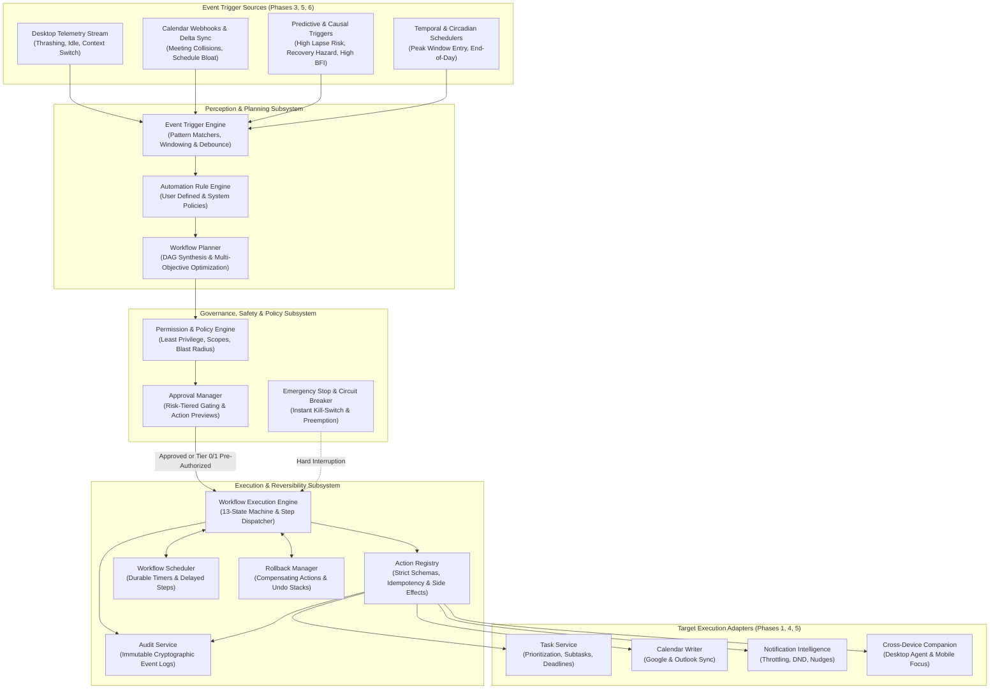
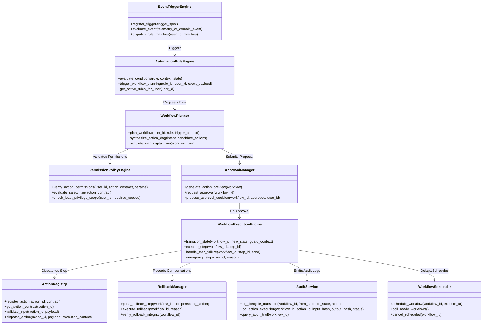
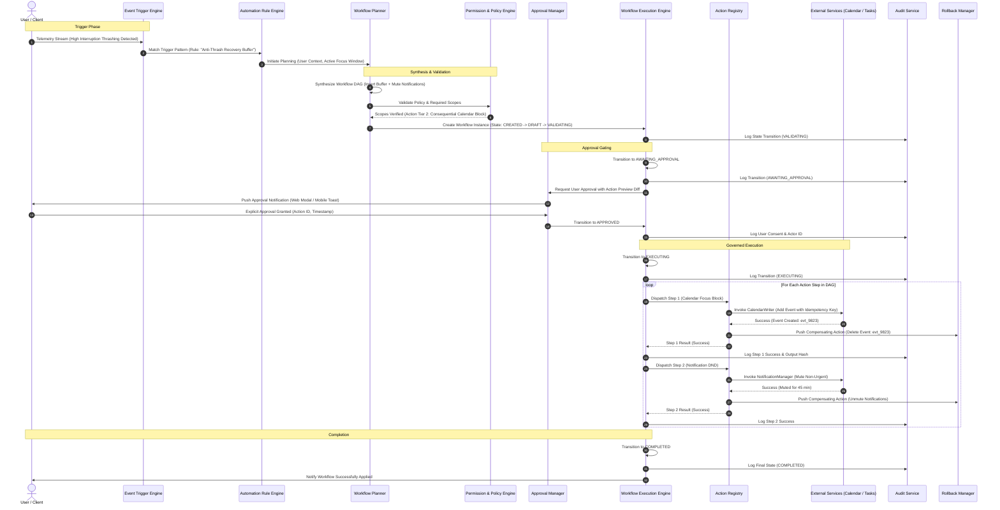
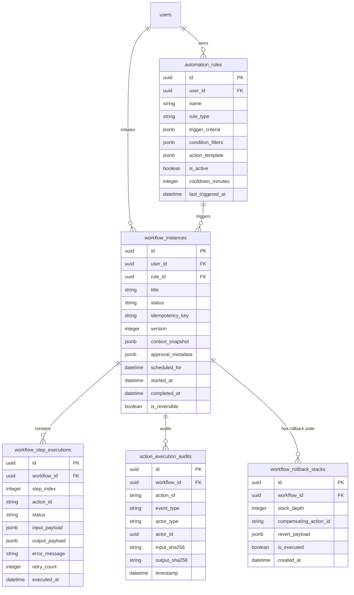

# ContextIQ Phase 7: Governed Autonomous Workflows & Proactive Behavioral Optimization
## Architecture Specification & System Audit (Phase 7.1)

---

## 1. Executive Summary & Architectural Vision

ContextIQ evolved through Phases 1 through 6 into a sophisticated behavioral intelligence, cognitive recovery, and predictive decision-support platform:
- **Phase 1**: Relational task lifecycle, manual interruption logging, and baseline core API.
- **Phase 2**: Machine learning prospective lapse prediction, population Cox survival baselines, Platt/Isotonic probability calibration, and SHAP explainability.
- **Phase 3**: Passive Windows desktop behavioral telemetry, automated interruption classification, work session reconstruction, and cognitive recovery analytics (Behavioral Friction Index, resumption lag).
- **Phase 4**: Personal Behavioral Profiles (Digital Twin), circadian focus-window discovery, multi-objective task prioritization, 14 personalized interventions, and contextual bandit adaptation (LinUCB / Thompson Sampling).
- **Phase 5**: Two-way external calendar integration (Google Calendar & Microsoft Outlook via Graph API), cross-device session stitching, and privacy-preserving location context boundaries.
- **Phase 6**: Continuous-time state-space dynamics, prospective cognitive recovery survival models, causal structural DAG identification, off-policy counterfactual evaluation (DR-OPE / SnIPW), Pareto-optimal multi-objective scheduling, conformal uncertainty quantification, and in-silico behavioral digital twin simulation.

### The Phase 7 Mandate: Governed Autonomous Workflows
Across Phases 1 through 6, ContextIQ operated predominantly as an **analytical, predictive, and consultative** platform: it detected behavioral friction, forecast lapse hazards, evaluated counterfactual interventions, and proposed schedule adjustments. However, turning these insights into reality still required manual, fragmented actions by the user.

**Phase 7 transforms ContextIQ from a reactive advisory system into an active, governed autonomous intelligence platform.**
ContextIQ proactively:
1. **Detects triggers in real-time** (e.g., severe context thrashing, cognitive fatigue, impending lapse hazards, external calendar collisions, or post-interruption friction).
2. **Plans multi-step workflows** (e.g., rescheduling deep-work blocks, decomposing complex tasks, configuring context-aware notification throttling, inserting cognitive recovery buffers, and orchestrating cross-device focus modes).
3. **Applies deterministic safety & policy controls** (enforcing least-privilege scoping, OAuth capabilities, action consequence classification, and explicit user approval gating).
4. **Executes approved workflows idempotently** across internal state and external providers.
5. **Maintains complete auditability and transactional reversibility**, guaranteeing that any multi-step action can be inspected, monitored, paused, cancelled, or rolled back without state corruption.

---

## 2. Comprehensive Audit of Existing Systems (Phases 1–6)

To prevent duplication and leverage existing production code, every subsystem across Phases 1 through 6 was audited for reusability, integration interfaces, and architectural boundaries.

| Subsystem | Existing Phase & Implementation | Capabilities Reusable for Autonomous Workflows | Gaps Addressed by Phase 7 |
|:---|:---|:---|:---|
| **FastAPI Backend & API Router** | Phase 1–6 (`backend/app/api/v1/`, `backend/app/main.py`) | Centralized dependency injection (`get_db`, `get_current_user`), error handling (`core/errors.py`), and unified route aggregation. | Missing dedicated automation API surface (`/api/v1/automations/`, `/api/v1/workflows/`, `/api/v1/actions/`). |
| **PostgreSQL Persistence & ORM** | Phase 1–6 (`backend/app/models/`, `backend/app/db/`) | UUID primary keys, JSONB storage, Alembic migrations, tenant foreign keys, `TimestampMixin`. Model `ProposedWorkflow` in `simulation_models.py`. | Needs dedicated tables for `AutomationRule`, `EventTrigger`, `WorkflowInstance`, `WorkflowStepExecution`, `ActionExecutionAudit`, and `WorkflowRollbackStack`. |
| **Data Engine & Session Reconstruction** | Phase 1, 3 (`data-engine/app/`, `backend/app/services/session_reconstruction_engine.py`) | Idempotent event ingestion, windowed session stitching, idle duration filtering, glance detection. | Real-time event subscription bus to emit trigger events immediately upon pattern detection. |
| **Forgetting ML & Risk Scoring** | Phase 2, 6 (`forgetting-ml/app/`, `backend/app/services/dynamic_survival_service.py`) | Calibrated lapse probability ($P_{\text{lapse}}$), dynamic hazard functions ($h(t)$), SHAP risk factor vectors. | Autonomous triggers that evaluate lapse thresholds without user-initiated queries. |
| **Context Engine & Interruption Telemetry** | Phase 3 (`context-engine/app/`, `backend/app/services/interruption_detector.py`) | Detection of `RAPID_SWITCHING_THRASH`, `EXTERNAL_COMMUNICATION`, and `IDLE_ABANDONMENT`. Resumption lag computation. | Proactive dispatch of recovery buffer workflows and distraction-shielding actions. |
| **Intelligence & LLM Explanation** | Phase 1, 4 (`intelligence/app/insight_engine.py`, `backend/app/interventions/`) | Structured reasoning, natural language summarization of recommendations, ranking models. | AI outputs must be strictly confined to proposed workflow plans; cannot execute actions directly or bypass policy checks. |
| **Recommendation Engine & Bandits** | Phase 4 (`backend/app/bandit/`, `backend/app/effectiveness/`) | Contextual bandit exploration (LinUCB / Thompson Sampling), 14 discrete intervention arms, doubly robust ATE. | Bandits select high-level workflow templates and policy parameterizations rather than isolated nudges. |
| **Behavioral Digital Twin & Simulation** | Phase 6 (`backend/app/services/digital_twin_engine.py`, `simulation_service.py`) | In-silico state-space simulation of user cognitive fatigue, counterfactual scenario evaluation (`SavedScenario`). | Automated candidate workflow generation evaluated against digital twin before submission for approval. |
| **Counterfactual Analysis (DR-OPE)** | Phase 6 (`backend/app/services/counterfactual_service.py`, `causal_dag.py`) | Off-policy evaluation, causal structural identification, sensitivity bounds to prevent harmful policy shifts. | Safety bounds used to score workflow risk and estimate expected treatment effect prior to execution. |
| **Multi-Objective Optimizer (Pareto)** | Phase 6 (`backend/app/services/multi_objective_optimizer.py`, `multi_objective_service.py`) | NSGA-II solver balancing completion likelihood, cognitive friction, and circadian alignment. | Workflow Planner uses optimizer to generate non-dominated task schedules and buffer placements. |
| **Calendar Integrations & Writer** | Phase 5 (`integrations/app/`, `backend/app/scheduling/calendar_writer.py`) | `BaseCalendarProvider`, Google Calendar & MS Graph OAuth, delta token sync, conflict resolution, rate limiting. | Autonomous multi-action calendar modifications with transactional rollbacks and conflict locks. |
| **Mobile Companion & Agent** | Phase 3, 5 (`mobile/`, `desktop-agent/`) | Cross-device telemetry ingestion, active device tracking, geofenced routine detection (`LocationCheckin`). | Bidirectional push actions: remote DND activation, lock-screen notifications, cross-device focus sync. |
| **Cross-Device Synchronization** | Phase 5 (`backend/app/services/device_service.py`, `timeline_service.py`) | Device heartbeat tracking, unified chronological timeline, device pairing. | Cross-device workflow handoffs (e.g. desktop distraction shielding triggered by mobile calendar entry). |
| **Notification Infrastructure** | Phase 4 (`backend/app/notifications/`, `delivery_policy.py`, `fatigue_tracker.py`) | Cognitive fatigue tracking, quiet hours enforcement, multi-tier notification routing (URGENT, NUDGE, SUMMARY). | Programmatic notification actions (throttle alerts, schedule staged reminders, snooze non-urgent channels). |
| **OAuth Security & Token Vault** | Phase 5 (`integrations/app/core/token_manager.py`, `encryption.py`) | AES-256-GCM encrypted tokens, PKCE authorization, granular scope validation (`write_scopes`). | Fine-grained scope verification inside Permission and Policy Engine prior to action execution. |
| **Model Registry & Governance** | Phase 2 (`forgetting-ml/app/`, `model_catalog.json`) | SHA-256 model artifact integrity, atomic deployment history, promotion/rollback FSM. | Used to version workflow policy models and ensure deterministic planner outputs. |
| **Background Workers & Schedulers** | Phase 1, 5 (`backend/app/services/orchestrator.py`, `integrations/app/synchronization/sync_scheduler.py`) | FastAPI `BackgroundTasks`, jittered exponential backoff scheduler. | Robust persistent Workflow Scheduler for delayed actions, recurring automations, and timeout monitors. |

---

## 3. Autonomous Automation Types

ContextIQ governs seven specialized categories of autonomous workflows. Each category targets a specific dimension of human cognitive endurance, behavioral friction, and task execution.

### 3.1 Task-Management Workflows
- **Objective**: Dynamically restructure task queues to match cognitive throughput, reduce activation friction, and prevent procrastination-induced deadline collapses.
- **Representative Workflows**:
  - *Proactive Task Decomposition*: Detects tasks with high estimated effort or repeated abandonment; automatically partitions them into 3 staged subtasks with individual checkpoints and elevates the first subtask's priority.
  - *Fatigue-Aware Priority Escalation*: Automatically elevates high-value, pending tasks into active morning focus slots while demoting low-leverage administrative tasks to post-lunch recovery windows.
  - *Deadline Cascade Realignment*: When a high-priority task overruns its estimated duration, downstream dependent task deadlines are automatically recalculated and proposed for adjustment.

### 3.2 Calendar Workflows
- **Objective**: Guard the user's schedule against context fragmenting meetings, preserve contiguous deep-work blocks, and resolve scheduling collisions.
- **Representative Workflows**:
  - *Deep Work Focus Protection*: Automatically slots 90-minute focus sessions into circadian peak windows discovered by the Focus Window Engine, marking calendar availability as "Busy / Tentative".
  - *Meeting Decompression Slot Insertion*: Detects back-to-back high-cognitive-load external meetings and inserts 10-minute non-negotiable breathing slots directly between them.
  - *Proactive Conflict Resolution*: Identifies conflicting calendar commitments between external calendars (e.g. Google Calendar vs Outlook) and suggests optimal moves with one-click approval.

### 3.3 Reminder & Nudge Workflows
- **Objective**: Deliver timely cognitive cues without triggering attention fragmentation or notification fatigue.
- **Representative Workflows**:
  - *Context-Staged Pre-Task Warming*: Stages essential documentation and files 10 minutes prior to a deep work session and delivers a gentle context preview nudge.
  - *Fatigue-Aware Alert Suppression*: When user cognitive fatigue score exceeds $0.75$, suppresses non-critical desktop notifications and defers them to a batched end-of-day summary.
  - *Idle Resumption Nudge*: Detects an idle period exceeding 5 minutes following an interruption and delivers a gentle desktop toast containing the exact application and file state needed to resume.

### 3.4 Focus-Session Workflows
- **Objective**: Establish an impenetrable distraction-free perimeter across applications and devices during deep cognitive work.
- **Representative Workflows**:
  - *Deep Work Perimeter Lockdown*: At the start of a scheduled focus window, automatically activates Windows Focus Assist / Do Not Disturb, mutes notification channels, and minimizes background communication tools.
  - *Complementary Tool Clamping*: Automatically launches the required development environment (e.g., IDE + Terminal) while intercepting and logging attempts to switch to distraction domains.
  - *Session Progress Checkpointing*: Silently records milestones every 25 minutes, providing a structured session summary upon completion.

### 3.5 Recovery-Buffer Workflows
- **Objective**: Prevent cognitive burnout and context thrashing by enforcing biological and mental reset intervals after disruptive events.
- **Representative Workflows**:
  - *Post-Disruption Resumption Cooldown*: Following an unscheduled, disruptive interruption (e.g., unexpected voice call), inserts an immediate 8-minute recovery buffer to allow working memory reconstitution.
  - *Post-Sprint Cognitive Reset*: Following a 90-minute sustained deep-work block, schedules an obligatory 15-minute physical/mental disconnection buffer.
  - *Late-Day Energy Stabilization*: Detects rising Behavioral Friction Index ($BFI > 0.65$) during afternoon hours and converts scheduled deep-work slots into low-friction administrative catch-ups.

### 3.6 Behavioral Intervention Workflows
- **Objective**: Deploy personalized, contextually calibrated interventions derived from the contextual bandit engine.
- **Representative Workflows**:
  - *Anti-Thrash Micro-Intervention*: Detects rapid application thrashing ($> 8$ switches per minute across unrelated context domains) and triggers a fullscreen calming pause and focus re-centering prompt.
  - *Circadian Alignment Nudge*: Prompts the user to tackle their most cognitively demanding task during their empirically proven peak focus window ($Q \ge 60$).
  - *Adaptive Reward Calibration*: Logs user responsiveness to behavioral interventions, updating bandit arms (LinUCB) to favor the highest-yield intervention modalities for that specific user.

### 3.7 Cross-Device Workflows
- **Objective**: Synchronize context and state across desktop, mobile, and ambient interfaces without manual handoff.
- **Representative Workflows**:
  - *Desktop-to-Mobile Transit Handoff*: Detects mobile departure from home/office geofence while a task is in progress; transfers context summary and pending reminders to mobile lock-screen widgets.
  - *Multi-Device Unified DND*: Activating a focus session on desktop immediately broadcasts an event over the sync bus to place paired mobile devices into silent mode.
  - *Geofenced Workday Start*: Detects mobile arrival at workplace location and triggers automatic desktop morning briefing compilation and calendar synchronization.

---

## 4. Reusable Component Architecture

The Phase 7 autonomous architecture is organized into ten modular, decoupled components. Every component follows strict single-responsibility principles and integrates directly with existing services.

### 4.1 Event Trigger Engine
- **Responsibility**: Ingests high-frequency event streams (desktop telemetry, calendar delta syncs, predictive risk updates, circadian clock ticks) and performs pattern matching, sliding-window aggregation, and debouncing.
- **Reused Assets**: Integrates with `SessionReconstructionEngine`, `InterruptionDetector`, and `CalendarSyncTracker`.
- **Key Features**: Debounce windows (preventing repeated firings within $N$ minutes), threshold evaluators, and composite trigger logic (`AND` / `OR` event correlation).

### 4.2 Automation Rule Engine
- **Responsibility**: Manages user-configured and system-default automation rules. Matches incoming trigger events against user preferences, active work modes, and blacklisted time windows.
- **Reused Assets**: Enforces profile preferences from `UserBehavioralProfile` and circadian rules from `FocusWindowEngine`.
- **Key Features**: Dynamic condition evaluation, priority ranking among conflicting rules, and rate-limiting per rule (e.g. max 2 firings per user per day).

### 4.3 Workflow Planner
- **Responsibility**: Translates an automation rule match into a concrete, executable Directed Acyclic Graph (DAG) of discrete actions.
- **Reused Assets**: Leverages `DigitalTwinEngine` for forward simulation and `MultiObjectiveOptimizer` for optimal schedule placement.
- **Key Features**: Action dependency resolution, parameter interpolation from runtime context, and generation of dry-run action previews.

### 4.4 Workflow Execution Engine
- **Responsibility**: Drives workflow instances through the 13 formal lifecycle states. Enforces state transition invariants, handles step retries, and coordinates synchronous vs asynchronous step executions.
- **Reused Assets**: Extends `WorkflowOrchestrator` (`backend/app/services/workflow_orchestrator.py`) into a fully governed state machine.
- **Key Features**: Atomic optimistic concurrency checks (`version` token), execution timeout timers, step dependency dispatch, and cooperative preemption.

### 4.5 Permission and Policy Engine
- **Responsibility**: Deterministic security and authorization gatekeeper. Guarantees that no action is dispatched without verified user ownership, valid OAuth tokens with least-privilege scopes, and compliance with organizational safety policies.
- **Reused Assets**: Integrates with `TokenManager` (AES-256-GCM token verification) and `AgentPrivacyGuard`.
- **Key Features**: Mandatory policy pipeline that runs on every action execution; impossible for AI/LLM layers to bypass or short-circuit.

### 4.6 Approval Manager
- **Responsibility**: Manages the approval lifecycle for consequential workflows. Renders comprehensive, human-readable action previews, delivers actionable notifications across Web and Mobile, and records explicit consent.
- **Reused Assets**: Uses `DeliveryPolicy` and `NotificationManager` for notification routing.
- **Key Features**: Multi-channel approval delivery (Web modal, Mobile push action button), approval timeout expiration, and user rejection feedback capture.

### 4.7 Action Registry
- **Responsibility**: Centralized catalog of all executable capabilities in ContextIQ. Enforces strict Pydantic/JSON-schema input validation, explicit side-effect documentation, and idempotency key requirements.
- **Reused Assets**: Wraps existing services (`TaskService`, `CalendarWriter`, `NotificationManager`, `DeviceService`).
- **Key Features**: Pluggable action handlers, runtime validation, dry-run simulation mode, and standard error classification.

### 4.8 Audit Service
- **Responsibility**: Immutable, append-only chronological record of all automation events, state transitions, permission evaluations, and action executions.
- **Reused Assets**: Extends relational persistence with tamper-evident cryptographic checksums.
- **Key Features**: Structured JSON payloads, caller identity tracking (System, User, Emergency Stop), input/output payload hashing, and fast audit query APIs.

### 4.9 Rollback Manager
- **Responsibility**: Ensures zero irreversible side effects for reversible workflows. Tracks an inverse stack of compensating actions for every executed step and coordinates transactional undos.
- **Reused Assets**: Extends rollback mechanisms prototyped in Phase 6.9 (`workflow_orchestrator.py`).
- **Key Features**: Backward-traversing execution of compensating actions, partial failure rollback handling, and reconciliation reports.

### 4.10 Workflow Scheduler
- **Responsibility**: Manages delayed, scheduled, and recurring workflow executions. Guarantees durable timer firing across backend restarts.
- **Reused Assets**: Leverages persistence layer and `SyncScheduler` backoff algorithms.
- **Key Features**: Persistent schedule queue, lease-based worker polling, miss-fire recovery, and scheduled workflow cancellation.

---

## 5. End-to-End Autonomous Workflow Execution Sequence

The following sequence illustrates a complete governed autonomous cycle: from real-time trigger detection to user approval, execution, and audit logging.

---

## 6. Persistence & Relational Schema Extensions

Phase 7 introduces six structured relational entities to persist rules, workflow instances, step executions, and audit records with strict multi-tenancy.

---

## 7. Architectural Guarantees & Verification Matrix

1. **Non-Bypassable Authorization**: All executable actions route through the Permission & Policy Engine. No AI, LLM, or heuristic planner has write privileges to database tables or external calendar APIs.
2. **Deterministic Idempotency**: Workflows and action steps generate cryptographic idempotency tokens derived from `(user_id, rule_id, trigger_event_id, target_slot)`. Duplicate submissions are recognized and rejected before dispatch.
3. **Atomic Concurrency Control**: State transitions utilize optimistic concurrency token checks (`UPDATE ... WHERE version = :expected_version`), completely eliminating race conditions and split-brain executions.
4. **Zero Unaudited Side Effects**: Every external call, state modification, user approval, and rollback attempt writes an immutable entry into `action_execution_audits`.
5. **Full Reversibility**: Reversible workflows maintain a strict LIFO compensating action stack (`workflow_rollback_stacks`), guaranteeing that rolled-back workflows cleanly restore initial user state.
