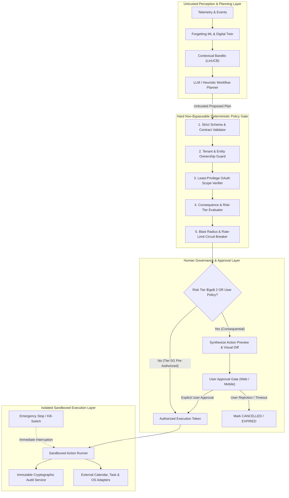
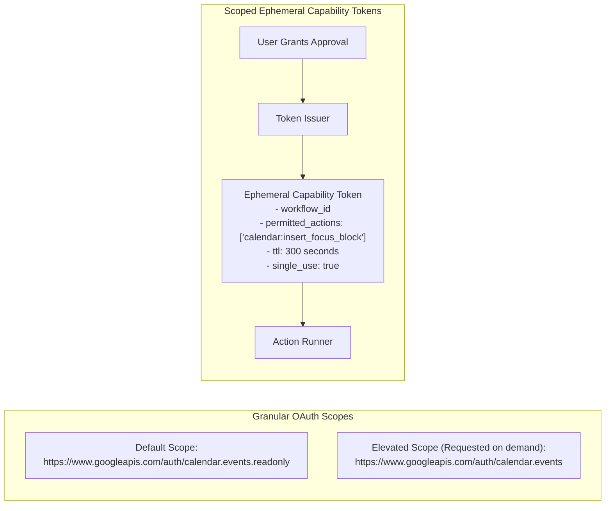
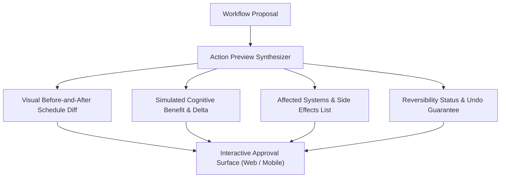
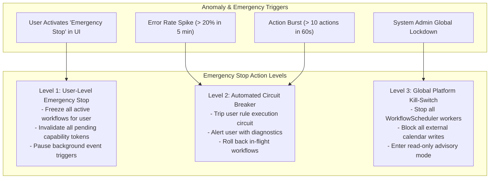

# ContextIQ Phase 7: Governed Autonomous Safety & Policy Model
## Multi-Tier Risk Governance, Non-Bypassable Policy Gates, Action Previews & Emergency Stop

---

## 1. Executive Summary & Safety Philosophy

As ContextIQ evolves from predictive decision-support into an autonomous behavioral optimization system, safety and governance become existential requirements. When an autonomous system is granted access to calendar commitments, workplace notification channels, task backlogs, and desktop operating system controls, the cost of an erroneous or unconstrained action is severe: missed meetings, broken workflows, cognitive disorientation, and loss of user trust.

To provide absolute safety guarantees, ContextIQ implements a foundational principle:
> **"Propose Autonomously, Authorize Explicitly, Execute Deterministically by Policy."**

Under this architecture:
- Machine learning models, contextual bandits, and LLMs operate strictly as **untrusted planners and proposal generators**.
- No AI or algorithmic component possesses write privileges to the database, external calendar APIs, or operating system hooks.
- Every executable action must traverse an immutable, deterministic, hard-coded **Permission and Policy Engine** that cannot be bypassed, spoofed, or prompted away.



---

## 2. The 4-Tier Risk & Consequence Classification Framework

Every executable action in ContextIQ is categorized into one of four immutable Risk Tiers. The tier dictates the minimum authorization requirement, approval threshold, and reversibility mandate.

| Risk Tier | Classification | Blast Radius & System Impact | Approval Requirement | Execution Policy | Reversibility Mandate |
|:---:|:---|:---|:---|:---|:---:|
| **Tier 0** | **Read-Only / Passive Analytical** | Zero side effects. Generates inferences, extracts features, calculates BFI, runs simulations. | Fully autonomous. No user prompt. | Executed silently in background. | N/A (No side effects) |
| **Tier 1** | **Internal Low-Impact Reversible** | Modifies internal ContextIQ entities (e.g. creating subtasks, updating task priority, setting in-app reminders). | Configurable by user policy. Default: Autonomous if pre-authorized. | Executed with immediate notification toast and undo option. | **Strictly Mandatory** (Compensating action required) |
| **Tier 2** | **Consequential External Actions** | Calls external systems (Google Calendar, Outlook Graph API) or OS controls (DND, tool locking). | **Mandatory Explicit User Approval** with rich action preview. | Cannot execute without user approval click. | **Strictly Mandatory** (Calendar event deletion/move compensation) |
| **Tier 3** | **High-Impact / Destructive / Irreversible** | Bulk task deletions, external calendar deletions of third-party meetings, account disconnects. | **Explicit Dual-Confirmation** (Modal + re-authentication). | Autonomous proposal strictly prohibited. | Irreversible or high-cost compensation. |

### 2.1 Consequence Decision Table

$$\text{Required Approval} = \begin{cases} 
\text{None (Autonomous Background)} & \text{if } \text{Tier} = 0 \\
\text{None (if User Policy Pre-Authorized)} \lor \text{Single-Tap Approval} & \text{if } \text{Tier} = 1 \\
\text{Mandatory Explicit User Approval with Action Preview} & \text{if } \text{Tier} = 2 \\
\text{Dual Confirmation + Password / Biometric Authentication} & \text{if } \text{Tier} = 3 
\end{cases}$$

---

## 3. Explicit Authorization & Least-Privilege Scoping

ContextIQ enforces the principle of least privilege across internal roles and external third-party integrations:



### 3.1 Separation of Read and Write Scopes
- When a user connects their Google Calendar or Microsoft Outlook account during onboarding, ContextIQ requests **read-only scopes exclusively** (`calendar.events.readonly` / `Calendars.Read`).
- Write scopes (`calendar.events` / `Calendars.ReadWrite`) are requested **only when the user explicitly enables two-way calendar synchronization or approves a calendar automation rule**.
- If a workflow containing a calendar write action is planned for a user who has only granted read-only scopes, the Permission & Policy Engine detects the scope deficit during `VALIDATING` and pauses with an `OAUTH_SCOPE_REQUIRED` resolution prompt.

### 3.2 Ephemeral Capability Tokens
When a user clicks "Approve Workflow" on an `AWAITING_APPROVAL` proposal:
1. The backend issues a short-lived, cryptographically signed **Capability Token** (HMAC-SHA256).
2. The token explicitly enumerates:
   - `workflow_id`
   - `user_id`
   - Permitted `action_ids`
   - Allowed parameter hashes
   - Time-to-live: exactly **300 seconds (5 minutes)**
   - `single_use = true`
3. The Workflow Execution Engine must supply this token to the sandboxed action adapters. Unsigned or expired calls are immediately dropped.

---

## 4. The Non-Bypassable Policy Gate

A critical failure mode in modern AI agent architectures is **LLM jailbreaking, prompt injection, or hallucinations bypassing security checks**. ContextIQ's architecture eliminates this vulnerability through structural separation:

```
[ AI / LLM / Contextual Bandits ]
             │
             │ (Generates purely declarative JSON proposals)
             ▼
══════════════════════════════════════════════════════════════
 HARD NON-BYPASSABLE POLICY BOUNDARY (Compiled Python / Rust)
══════════════════════════════════════════════════════════════
             │
             ├─ 1. Pydantic V2 Strict Schema Validation
             ├─ 2. Multi-tenant Tenant Isolation Enforcement
             ├─ 3. Required OAuth Scope Validation
             ├─ 4. Rate-Limiting & Blast Radius Check
             ├─ 5. Risk-Tier Classification
             │
             ▼
[ Deterministic Approval Gate & Sandboxed Execution ]
```

### 5 Non-Bypassable Enforcement Invariants:
1. **Zero Raw Execution Primitives**: The system has no `eval()`, shell execution, raw SQL query executor, or generic HTTP client accessible to planners. Every action maps to a strictly compiled function in `ActionRegistry`.
2. **Deterministic Validation**: Even if an LLM outputs an action claiming `"tier": 0`, the Permission and Policy Engine overrides the payload using the authoritative tier declared in the code registry.
3. **Tenant Ownership Verification**: Every referenced ID (`task_id`, `calendar_id`, `device_id`) is validated against `current_user.id`. Cross-tenant mutations trigger an immediate security alert and kill the workflow.
4. **Rate-Limiting Fences**: No user may execute more than 10 automated workflow steps per hour, preventing runaway automation loops.
5. **No AI Override**: There is no natural-language instruction, prompt, or parameter that can instruct the execution engine to skip approval for a Tier 2 action.

---

## 5. Action Previews & Visual Diffs

Before a user is asked to approve an automation, ContextIQ renders an exhaustive, visual **Action Preview**. The preview leaves zero ambiguity regarding what will happen.



### Component Structure of an Action Preview:
1. **Human-Readable Intent**: *"Reschedule 'Q4 Strategy Review' to 09:30 AM tomorrow and insert a 10-minute recovery buffer."*
2. **Visual Before-and-After Diff**:
   - **Before**: 02:00 PM – 03:30 PM (Post-lunch low energy dip, lapse risk: $68\%$).
   - **After**: 09:30 AM – 11:00 AM (Circadian peak focus window, predicted lapse risk: $14\%$).
3. **Predicted Cognitive Impact**:
   - Estimated Behavioral Friction Index change: $\Delta \text{BFI} = -0.22$.
   - Recovery time saved: $18\text{ minutes}$.
4. **Affected Systems List**:
   - Google Calendar (`user@company.com`): Modifies 1 event.
   - ContextIQ Backlog: Elevates task priority to `HIGH`.
   - Desktop Notification: Pre-stages 15-minute warming alert.
5. **Reversibility Badge**:
   - Visual indicator: `[REVERSIBLE: Full 1-Click Undo Supported for 48 Hours]`.
6. **Time-to-Live Expiration Clock**:
   - *"Proposal expires in 23 hours 45 minutes."*

---

## 6. Immutable Cryptographic Audit History

Every automated decision, state change, and external side effect is permanently recorded by the `AuditService`.

### 6.1 Audit Record Data Schema
```json
{
  "audit_event_id": "aud_01HGB8293KA...",
  "workflow_id": "wf_78a129d...",
  "user_id": "usr_912384...",
  "timestamp": "2026-11-25T17:20:00.128Z",
  "event_type": "ACTION_EXECUTED",
  "actor": {
    "type": "USER",
    "actor_id": "usr_912384...",
    "ip_address": "192.168.1.10",
    "user_agent": "ContextIQ-Web/1.0"
  },
  "action_details": {
    "action_id": "calendar:insert_focus_block",
    "step_index": 1,
    "risk_tier": "Tier 2",
    "idempotency_key": "c4d812fa...",
    "input_payload_hash": "SHA256(input_json)",
    "output_payload_hash": "SHA256(output_json)",
    "execution_duration_ms": 342.5,
    "status": "SUCCESS"
  },
  "prev_audit_hash": "e3b0c44298fc1c149afbf4c8996fb92427ae41e4649b934ca495991b7852b855",
  "record_signature": "HMAC-SHA256(prev_hash + record_content, server_secret)"
}
```

### 6.2 Audit Invariants
1. **Append-Only Persistence**: The `action_execution_audits` table has `INSERT` grants only. Updates and deletions are blocked by PostgreSQL row-level triggers.
2. **Cryptographic Hash Chain**: Each audit record includes the SHA-256 hash of the immediately preceding record for that user, forming a verifiable tamper-evident ledger.
3. **Privacy-Preserving Payload Hashing**: Input and output payloads containing sensitive meeting titles or notes are stored as SHA-256 hashes in the audit index, with encrypted payloads kept in user-isolated vaults.

---

## 7. Cancellation Support & Cooperative Preemption

ContextIQ provides responsive cancellation guarantees:
1. **Pre-Execution Cancellation**: While in `AWAITING_APPROVAL` or `SCHEDULED`, clicking "Cancel" instantaneously moves the workflow to `CANCELLED` and purges any scheduled queue timers.
2. **Cooperative In-Flight Preemption**:
   - The Workflow Execution Engine checks an atomic cancellation token before every step execution:
     ```python
     if self.is_preempted(workflow_id):
         logger.info(f"Workflow {workflow_id} preempted. Halting execution.")
         self.transition_state(workflow_id, WorkflowStatus.CANCELLED)
         self.rollback_manager.execute_rollback(workflow_id, reason="User Preemption")
         return
     ```
   - If cancelled while Step 2 of 4 is running, Step 2 completes cleanly, Steps 3 and 4 are discarded, and Step 1 is rolled back.

---

## 8. Emergency Stop ("Kill Switch") & Circuit Breakers

ContextIQ implements a layered safety net to prevent cascading failures or runaway automated loops:



### 8.1 User-Level Emergency Stop
- Located prominently on both Web and Mobile dashboard headers: `[ EMERGENCY STOP ALL AUTOMATIONS ]`.
- Clicking this button immediately:
  1. Sets `users.automations_frozen = true`.
  2. Cancels all `AWAITING_APPROVAL`, `SCHEDULED`, and `EXECUTING` workflows for that user.
  3. Prompts the user with a single-click *"Rollback all automations executed in the last 2 hours"* action.

### 8.2 Autonomous Circuit Breakers
The background scheduler tracks moving-window error metrics:
- **Consecutive Failure Breaker**: If 3 consecutive workflows fail for a given user or rule, the rule is automatically disabled (`is_active = false`), and a notification is sent to the user.
- **Velocity Rate-Limiter**: Maximum 5 external modifications per user per 15-minute rolling window. Further executions are held in `SCHEDULED` with a rate-limit backpressure notice.
